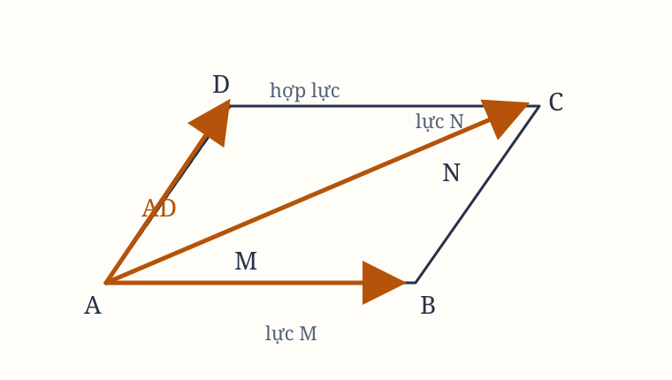

## Hệ quả I. Hợp lực của hai lực

Một vật thể chịu tác dụng của hai lực sẽ mô tả đường chéo của một hình bình hành trong khoảng thời gian mà nó sẽ mô tả hai cạnh của hình bình hành ấy nếu hai lực ấy tác dụng riêng biệt.

Giả sử một vật thể, trong một khoảng thời gian đã cho, nếu chịu lực $M$ tác dụng riêng biệt tại điểm $A$, sẽ được mang chuyển động đều từ $A$ đến $B$. Nếu chịu lực $N$ tác dụng riêng biệt tại cùng điểm ấy, nó sẽ được mang từ $A$ đến $C$.

Hoàn thành hình bình hành $ABCD$. Khi cả hai lực cùng tác dụng, vật thể sẽ được mang đến điểm $D$ theo đường chéo $AD$ trong cùng khoảng thời gian ấy.

Lực $N$ tác dụng theo phương của đường thẳng $AC$, song song với $BD$. Vì vậy, theo Định luật II, lực này không làm thay đổi vận tốc do lực $M$ sinh ra; lực $M$ mang vật thể đến gần đường thẳng $BD$.

Do đó, vật thể sẽ đến đường thẳng $BD$ sau cùng một khoảng thời gian, cho dù lực $N$ có được tác dụng hay không. Vì vậy, vào cuối khoảng thời gian đó, vật thể sẽ nằm ở một điểm nào đó trên đường thẳng $BD$.

Lập luận tương tự cho ta biết vào cuối cùng khoảng thời gian ấy, vật thể sẽ nằm ở một điểm nào đó trên đường thẳng $CD$. Vì thế, nó phải nằm tại điểm $D$, nơi hai đường thẳng ấy cắt nhau. Nhưng theo Định luật I, vật thể chuyển động theo đường thẳng từ $A$ đến $D$.

*Hình 1. Hai lực $M$ và $N$ cùng tác dụng tại $A$; đường chéo $AD$ là hợp lực. Sơ đồ được dựng lại từ hình minh họa trong bản gốc.*

> **[Chú giải]**
>
> **Hệ quả I là quy tắc hình bình hành của lực**
>
> $\vec{F}_{net} = \vec{M} + \vec{N}$, tức hợp lực là đường chéo của hình bình hành dựng trên hai lực. Đây là phép cộng vector - nhưng với hai lực thay cho hai đại lượng.
>
> Độ lớn của hợp lực suy ra bằng định lý cosin: $F = \sqrt{M^2 + N^2 + 2MN\cos\theta}$. Kiểm tra ba trường hợp: hai lực $10\ \mathrm{N}$ vuông góc nhau cho $F = 10\sqrt{2} \approx 14{,}1\ \mathrm{N}$; hai lực $10\ \mathrm{N}$ ngược hướng nhau cho $F = 0$; hai lực $10\ \mathrm{N}$ hợp ở $60^\circ$ cho $F = \sqrt{300} \approx 17{,}3\ \mathrm{N}$.
>
> **Cách chứng minh đáng kể ở phương pháp hơn là ở nội dung**
>
> Newton không tính toán gì cả. Ông lập luận rằng vật thể phải rơi vào **đường thẳng** $BD$ (vì lực $N$ song song với $BD$ nên không đổi vận tốc mà lực $M$ sinh ra), đồng thời lập luận nó phải rơi vào **đường thẳng** $CD$. Nó không thể nằm trên cả hai đường thẳng ấy mà không ở giao điểm, tức là $D$. Rồi theo Định luật I, nó chạy thẳng từ $A$ tới $D$. Toàn bộ quy tắc cộng lực được dựng bằng hình học thuần tuý, không có toạ độ, không có đại số. Đó là ngôn ngữ chuẩn mực của thế kỷ XVII, và người đọc hôm nay sẽ không tìm thấy một ký hiệu vector nào trong cả chương.
>
> Việc Hệ quả I làm là biến lực thành **đại lượng có hướng** cộng được bằng hình học. Trước Newton, lực trong cơ học cổ điển được hiểu là thứ chỉ tồn tại dọc theo một đường tác dụng, và hai lực ở hai đường khác nhau được phân giải bằng phép cộng số theo một trục tuỳ ý. Newton đưa lực vào không gian ba chiều; ký hiệu để gọi tên việc đó chỉ dựng được hơn một thế kỷ sau, và ông đã làm nó bằng hình học.
>
> Câu "lực $N$ không làm thay đổi vận tốc do lực $M$ sinh ra" tiết lộ tính chất **tuyến tính** đã nói ở Định luật II. Nếu một lực song song với kết quả của lực kia, nó chỉ làm thay đổi vận tốc theo hướng song song, tức gia tốc của nó không có thành phần vuông góc với vận tốc cũ. Chính vì vậy bài toán nhiều lực giải được bằng cách giải từng lực một rồi cộng kết quả, thay vì phải xét toàn bộ chuyển động một lúc.
