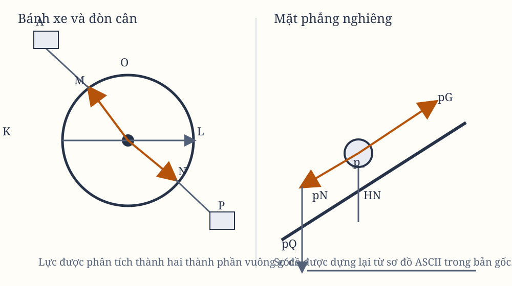

# Hệ quả II. Hợp và phân tích lực

## Hệ quả II

Từ đó, ta có thể giải thích cách hợp một lực thẳng bất kỳ $AD$ từ hai lực xiên bất kỳ $AC$ và $CD$; và ngược lại, có thể phân tích một lực thẳng bất kỳ $AD$ thành hai lực xiên $AC$ và $CD$. Phép hợp và phân tích ấy đã được cơ học xác nhận rõ ràng.

Xét một bánh xe có tâm $O$. Gọi $OM$ và $ON$ là hai bán kính không bằng nhau. Các dây $MA$ và $NP$ giữ lại các trọng lượng $A$ và $P$. Qua tâm $O$, kẻ đường thẳng $KOL$, cắt các dây ở $K$ và $L$ theo phương vuông góc.

Từ tâm $O$, lấy $OL$ là bán kính lớn hơn trong hai khoảng cách $OK$ và $OL$, vẽ một đường tròn cắt dây $MA$ tại $D$. Kẻ $OD$, rồi kẻ $AC$ song song với $OD$ và $DC$ vuông góc với $AC$.

Việc các điểm $K$, $L$, $D$ trên dây có cố định vào mặt phẳng của bánh xe hay không không làm thay đổi kết quả. Các trọng lượng sẽ có cùng tác dụng khi được treo từ $K$ và $L$, hay từ $D$ và $L$.

Hãy biểu diễn toàn bộ lực của trọng lượng $A$ bằng đường $AD$, rồi phân tích nó thành hai lực $AC$ và $CD$. Lực $AC$, kéo bán kính $OD$ trực tiếp ra khỏi tâm, không có tác dụng làm bánh xe chuyển động. Lực còn lại $DC$, kéo bán kính $DO$ theo phương vuông góc, có cùng tác dụng như khi nó kéo vuông góc bán kính $OL$ dài bằng $OD$.

Vì vậy, lực $DC$ có cùng tác dụng như trọng lượng $P$, nếu trọng lượng $P$ so với trọng lượng $A$ cũng tỉ lệ với lực $DC$ so với lực $DA$. Do các tam giác $ADC$ và $DOK$ đồng dạng, tỉ số ấy cũng bằng tỉ số của $OK$ với $OD$ hoặc $OL$.

Do đó, các trọng lượng $A$ và $P$, tỉ lệ nghịch với các bán kính $OK$ và $OL$ nằm trên cùng một đường thẳng, sẽ có tác dụng tương đương và giữ cân bằng. Đây chính là tính chất đã biết của bàn cân, đòn cân và bánh xe. Nếu một trong hai trọng lượng lớn hơn theo đúng tỉ số ấy, lực làm bánh xe chuyển động cũng lớn hơn tương ứng.

Giờ xét trọng lượng $p$, bằng trọng lượng $P$, được treo một phần bằng dây $NJO$ và được đỡ một phần bởi mặt phẳng nghiêng $pG$. Kẻ $pH$ vuông góc với đường chân trời và $NH$ vuông góc với mặt phẳng $pG$. Nếu lực của trọng lượng $p$, có xu hướng kéo xuống, được biểu diễn bằng đường $pH$, ta có thể phân tích nó thành hai lực $pN$ và $HN$.

Nếu có một mặt phẳng $pQ$ vuông góc với dây $pN$ và cắt mặt phẳng $pG$ theo một đường song song với đường chân trời, thì khi trọng lượng $p$ chỉ được đỡ bởi hai mặt phẳng $pQ$ và $pG$, nó sẽ ép vuông góc lên hai mặt phẳng ấy bằng các lực $pN$ và $HN$. Nó ép mặt phẳng $pQ$ bằng lực $pN$, và ép mặt phẳng $pG$ bằng lực $HN$.

Nếu mặt phẳng $pQ$ bị lấy đi để trọng lượng $p$ có thể làm căng dây, thì dây, nay đang giữ trọng lượng, sẽ thay thế vị trí của mặt phẳng đã bị lấy đi. Dây chịu cùng lực $pN$ đã từng ép lên mặt phẳng ấy. Vì vậy, lực căng của dây xiên $pN$ sẽ tỉ lệ với lực căng của dây vuông góc $PN$ theo tỉ số $pN$ với $pH$.

Do đó, nếu trọng lượng $p$ tỉ lệ với trọng lượng $A$ theo một tỉ số được tạo thành từ tỉ số nghịch của những khoảng cách nhỏ nhất từ dây $PN$ và $AM$ đến tâm bánh xe, nhân với tỉ số trực tiếp của $pH$ với $pN$, thì các trọng lượng sẽ có cùng tác dụng khi làm bánh xe chuyển động, và do đó chúng sẽ đỡ lẫn nhau. Điều này có thể kiểm tra bằng thí nghiệm.

Trọng lượng $p$, khi ép lên hai mặt phẳng xiên ấy, có thể được xem như một nêm nằm giữa hai mặt bên trong của một vật thể bị nó tách ra. Vì vậy, có thể xác định lực của nêm và của chiếc búa; bởi lực mà trọng lượng $p$ ép lên mặt phẳng $pQ$ tỉ lệ với lực mà chính nó, dù do trọng lực riêng hay do cú đánh của búa, bị thúc theo phương $pH$ về phía cả hai mặt phẳng, theo tỉ số $pN$ với $pH$; và tỉ lệ với lực mà nó ép lên mặt phẳng $pG$, theo tỉ số $pN$ với $NH$.

Từ đó, lực của một chiếc ren cũng có thể được suy ra từ một phép phân tích lực tương tự. Chiếc ren không gì khác ngoài một nêm được thúc bằng lực của một đòn cân. Vì vậy, công dụng của Hệ quả này rất rộng, và sự mở rộng ấy càng làm chân lý của nó được xác nhận.

Toàn bộ học thuyết cơ học, được các tác giả khác nhau chứng minh theo nhiều cách, phụ thuộc vào những điều vừa nói. Từ đó có thể dễ dàng suy ra lực của các máy cơ, được tạo thành từ bánh xe, ròng rọc, đòn cân, dây và trọng lượng, trong đó các lực truyền theo phương trực tiếp hoặc xiên; cũng như lực của các gân dây khiến xương của động vật chuyển động.

*Hình 2. Các sơ đồ được dựng lại từ phần chữ và sơ đồ ASCII trong bản gốc; cần đối chiếu trực tiếp với scan trước khi coi là hoàn tất.*
