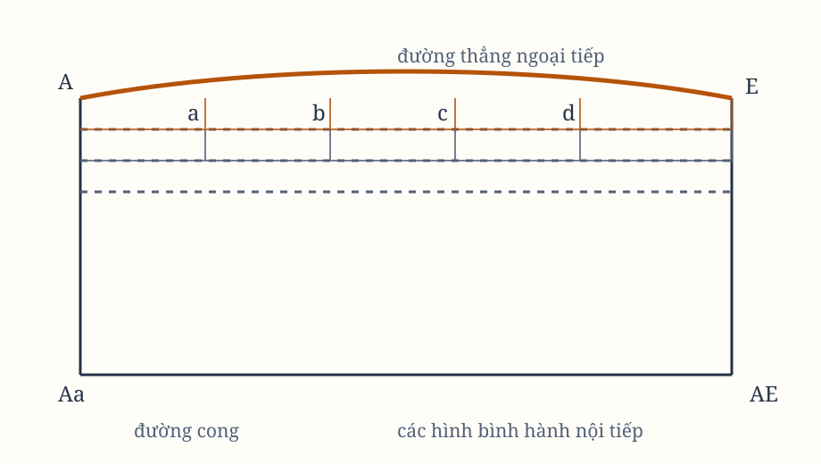

## Phần I

Về phương pháp dùng các tỷ số đầu và cuối của các đại lượng, nhờ đó ta chứng minh các mệnh đề tiếp theo.

## Lemma I

Các đại lượng, cũng như các tỷ số của các đại lượng, nếu trong một khoảng thời gian hữu hạn liên tục tiến đến sự bằng nhau, và trước khi khoảng thời gian ấy kết thúc tiến gần đến nhau hơn bất kỳ một sai khác đã cho nào, thì cuối cùng sẽ trở nên bằng nhau.

Nếu phủ nhận điều ấy, hãy giả sử chúng cuối cùng không bằng nhau, và gọi $D$ là sai khác cuối cùng của chúng. Khi ấy, chúng không thể tiến gần đến sự bằng nhau hơn sai khác đã cho $D$ ấy; điều này trái với giả thiết.

> **[Chú giải]**
>
> **Lemma I là định nghĩa giới hạn theo kiểu epsilon-delta**
>
> Cấu trúc "với mọi sai khác đã cho $\varepsilon > 0$, tồn tại một thời điểm $N$ mà từ đó trở đi thì sai khác nhỏ hơn $\varepsilon$" chính là cách phân tích giới hạn vẫn được dùng nguyên vẹn sau ba trăm năm. Nhánh phản chứng của Newton - giả sử sai khác cuối cùng bằng $D \ne 0$, rồi mâu thuẫn với giả thiết - là cách chứng minh tiêu chuẩn: nếu hai dãy hội tụ về cùng một giá trị thì sai khác của chúng phải hội tụ về 0.
>
> Điều Lemma I khẳng định là $\forall \varepsilon > 0, \exists N \in \mathbb{N}$ sao cho $\forall n \ge N: |a_n - b_n| < \varepsilon$. Tương đương với $\lim_{n \to \infty} a_n = \lim_{n \to \infty} b_n \Rightarrow \lim_{n \to \infty} (a_n - b_n) = 0$. Chú ý cách Newton nói "trong một khoảng thời gian hữu hạn" chứ không nói tại một điểm - đó là ý cốt lõi, vì giới hạn là một tuyên bố về đuôi của dãy chứ không phải về một khoảnh khắc.
>
> **Vì sao ông gọi đây là “tỷ số giới hạn”**
>
> Ông cần nền tảng để rồi mới chứng minh được định luật I và II mà không bị mắc kẹt. Ông hiểu rõ các nghịch lý của Zeno về vận động, và các đối thủ của ông sẽ tấn công ông ngay lập tức nếu ông dùng "vô hạn nhỏ" như một vật thể. Bằng cách chỉ nói về **tỷ số đầu và cuối** của các đại lượng đang biến đổi, ông tránh hẳn câu hỏi về cái vô hạn nhỏ có tồn tại hay không.
>
> Bản chất của Lemma I không thay đổi, nhưng ngôn ngữ trình bày thì đã thay đổi hoàn toàn. Toán học hiện đại dùng ngôn ngữ hệ quân vì nó tránh được mọi trực giác sai lệch: nó không nói gì về "điểm cuối cùng", chỉ nói từ ngưỡng nào trở đi thì đúng. Trực giác của Newton - còn tồn tại sai khác nào không - vẫn có giá trị khi phân tích, và người học vẫn dùng nó để trực giác hoá. Điều ngày nay không còn chấp nhận là coi các đại lượng vô hạn nhỏ như thể chúng có thật.

## Lemma II

Giả sử trong một hình bất kỳ $AacE$, được giới hạn bởi hai đường thẳng $Aa$, $AE$ và đường cong $acE$, có bất kỳ số lượng hình bình hành nào được nội tiếp $Ab$, $Be$, $Cd$, $dc$, với các đáy bằng nhau $AB$, $BC$, $CD$, $dc$, và các cạnh $Bb$, $Cc$, $Dd$, $dc$ song song với một cạnh $Aa$ của hình.

Hoàn thành các hình bình hành $aKbl$, $bLcm$, $cMdn$, $dc$. Nếu giả sử bề rộng của những hình bình hành ấy giảm dần, còn số lượng của chúng tăng lên vô hạn, thì các tỷ số cuối cùng giữa hình nội tiếp $AKbLcMdD$, hình ngoại tiếp $AalbmcndoE$ và hình cong $AabcdE$ sẽ là các tỷ số bằng nhau.

Sự khác nhau giữa hình nội tiếp và hình ngoại tiếp là tổng của các hình bình hành $K7$, $Lw$, $M//$, $Do$. Do các đáy của chúng bằng nhau, tổng ấy bằng hình chữ nhật có một đáy $K6$ và tổng các chiều cao $Aa$, tức là hình chữ nhật $ABla$.

Nhưng hình chữ nhật này, vì bề rộng $AB$ của nó được giảm vô hạn, sẽ nhỏ hơn bất kỳ một không gian đã cho nào. Vì vậy, theo Lemma I, các hình nội tiếp và ngoại tiếp cuối cùng sẽ bằng nhau; và hình cong trung gian cũng sẽ cuối cùng bằng với mỗi hình trong hai hình ấy.

> **[Chú giải]**
>
> **Lemma II là định lý kẹp trong hình học**
>
> Các hình đa giác nội tiếp và ngoại tiếp kẹp lấy hình cong, khoảng cách giữa hai lớp kẹp tiêu biến về không, nên cả ba cùng có một giới hạn chung. Diện tích dưới một đường cong là giới hạn của tổng các hình chữ nhật, và việc kẹp giữa hai tổng đó bảo đảm cả hai cùng hội tụ về cùng một giá trị.
>
> Gọi $I_n$ và $O_n$ lần lượt là tổng diện tích các hình nội tiếp và ngoại tiếp thứ $n$. Phần chênh lệch là một hình chữ nhật có một cạnh bằng tổng các đáy bằng nhau $AB$ và một cạnh bằng chiều cao tổng cộng của dải, nên $O_n - I_n = AB \cdot h$. Vì $AB \to 0$ còn $h$ hữu hạn, ta có $O_n - I_n \to 0$, và theo Lemma I suy ra cả $I_n$ lẫn $O_n$ cùng hội tụ về một giá trị. Đây là hình thức hình học của bất đẳng thức $I_n \le \int f \le O_n$ rồi áp định lý kẹp.
>
> **Vì sao ông tỉ mỉ so sánh phần giữa hai lớp**
>
> Newton không hề dùng ký hiệu tích phân; ông dùng các tỷ số đầu và cuối. Việc ông so sánh diện tích phần giữa hai lớp - thay vì chỉ nói "phần dư nhỏ đi" - là để chứng minh **phần dư** nhỏ lại tuyến tính theo bề rộng đáy, và nhờ đó phần dư bị kiểm soát chặt. Ý ấy sau này được gọi là ước lượng sai số, và nó là phần cứng nhất về mặt toán học trong toàn bộ cơ học của ông.
>
> Hình học này vẫn sống trong hai nơi. Một là trong giải tích: tổng Riemann mà ngày nay dùng để định nghĩa tích phân chính là các hình chữ nhật nội tiếp và ngoại tiếp mà Newton vẽ ở đây, và bước ước lượng phần dư ông đòi hỏi chính là điều kiện để tổng Riemann hội tụ. Hai là trong lý thuyết độ đo và xác suất, nơi cách kẹp giữa một tổng dưới và một tổng trên là cách chuẩn để định nghĩa một đại lượng mà chưa có công thức tích phân. Nếu bỏ bước ước lượng phần dư này đi, thì phép tích thế kỷ XVII chưa đủ sức chứng minh định luật Kepler.

*Hình 3. Sơ đồ được dựng lại từ hình minh họa trong bản gốc; cần đối chiếu ký hiệu với scan.*
