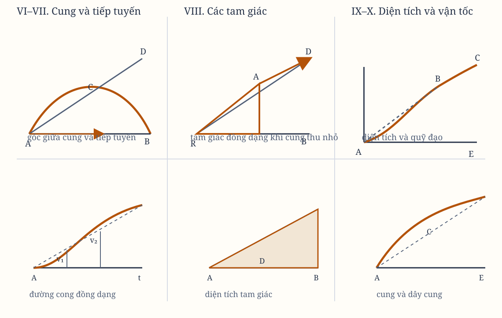

# Sách I, Phần I. Lemma VI–X

*Hình 4. Sơ đồ tổng hợp được dựng lại từ các hình trong bản gốc; cần đối chiếu từng ký hiệu với scan.*

## Lemma VI

Nếu một cung $ACB$, được cho ở vị trí xác định, được giới hạn bởi dây cung $AB$, và tại một điểm bất kỳ $A$ ở giữa độ cong liên tục của nó, có một đường thẳng $AD$ tiếp xúc, kéo dài theo cả hai phía, thì nếu các điểm $A$ và $B$ tiến lại gần nhau và gặp nhau, tôi nói góc $RAD$, nằm giữa dây cung và tiếp tuyến, sẽ giảm dần vô hạn, và cuối cùng sẽ biến mất.

Nếu góc ấy không biến mất, cung $ACB$ sẽ tạo với tiếp tuyến $AD$ một góc bằng một góc thẳng. Vì vậy, độ cong tại điểm $A$ sẽ không liên tục, trái với giả thiết.

## Lemma VII

Với những điều kiện ấy, tôi nói tỷ số giới hạn của cung, dây cung và tiếp tuyến, xét mỗi cái với mỗi cái khác, là tỷ số bằng nhau.

Trong khi điểm $B$ tiến về điểm $A$, hãy luôn xét $AB$ và $AD$ như các đường thẳng kéo dài đến những điểm ở xa $b$ và $d$, rồi kẻ $bd$ song song với đường cắt $BD$. Hãy luôn để cung $Acb$ đồng dạng với cung $ACB$.

Khi các điểm $A$ và $B$ trùng nhau, góc $dAb$ sẽ biến mất theo Lemma trước. Vì vậy, các đường thẳng $Ab$, $Ad$, vốn luôn hữu hạn, và cung trung gian $Acb$, sẽ trùng nhau và trở nên bằng nhau.

Do đó, các đường thẳng $AB$, $AD$ và cung trung gian $ACB$, vốn luôn tỉ lệ với những đối tượng trước đó, sẽ tiêu biến và cuối cùng nhận tỷ số bằng nhau.

## Hệ quả 1

Nếu qua $B$ ta kẻ $BP$ song song với tiếp tuyến, và đường thẳng này luôn cắt một đường thẳng bất kỳ $AF$ đi qua $A$ tại $F$, thì đường $BP$ cuối cùng sẽ ở tỷ số bằng nhau với cung tiêu biến $ACB$. Điều này là vì, sau khi hoàn thành hình bình hành $APBD$, nó luôn ở tỷ số bằng nhau với $AD$.

## Hệ quả 2

Nếu qua $B$ và $A$ ta kẻ thêm những đường thẳng $BE$, $BD$, $AF$, $AG$, cắt tiếp tuyến $AD$ và đường thẳng $BP$ song song với nó, thì tỷ số giới hạn của tất cả các đoạn $AD$, $AE$, $BF$, $BG$, cùng dây cung và cung $AB$, xét mỗi cái với mỗi cái khác, sẽ là tỷ số bằng nhau.

## Hệ quả 3

Vì vậy, trong mọi lập luận của chúng ta về các tỷ số giới hạn, ta có thể tùy ý dùng bất kỳ đường nào trong số đó thay cho bất kỳ đường nào khác.

> **[Ghi chú hiện đại]**
>
> **Khái niệm tương ứng.** Lemma VI và VII là định nghĩa đạo hàm bằng **hình học** thay vì bằng đại số. Lemma VI nói góc giữa dây cung và tiếp tuyến biến mất khi hai điểm trùng nhau; Lemma VII nói cung, dây cung và tiếp tuyến có tỷ số giới hạn bằng nhau. Hệ quả 3 — tùy ý thay thế bất kỳ đường nào trong số đó — chính là tuyên bố rằng đây là ba cách tính cùng một vật. Người đọc hôm nay đọc lại thấy ngay: đạo hàm là giới hạn của tỷ số sai số, đồng thời là hệ số của đoạn thẳng nằm sát đường cong.
>
> **Công thức.** Với $y = f(x)$, định nghĩa bằng dây cung cho $f'(x) = \lim_{h \to 0} \dfrac{f(x+h) - f(x)}{h}$; định nghĩa bằng tiếp tuyến cho cùng giá trị đó. Lemma VII còn định lượng quan hệ giữa cung và dây cung: nếu $s$ là độ dài cung và $c$ là dây cung trên cùng một đoạn thì $\lim c/s = 1$, tức hai đại lượng trùng nhau ở giới hạn và sai số là bậc cao hơn $c$. Hệ quả 2 cho phép thay mọi đoạn thẳng bằng mọi đoạn thẳng khác mà tỷ số giới hạn không đổi.
>
> **Vì sao Newton viết như vậy.** Vì ông cần một quy tắc thực hành để biết khi nào được phép thay một đường cong bằng thẳng trong khi tính. Trong hình học cổ điển, đường thẳng và đường cong là hai loại vật thể khác hẳn nhau, không thể lẫn. Newton ở đây xếp chúng vào cùng một họ rồi nói: khi hai điểm trùng nhau, chúng không còn khác nhau. Đó là một bước nhảy về phía phép tính, dù ông không hề dùng ngôn ngữ giới hạn mà ta dùng hôm nay.
>
> **Hiện nay thì sao.** Ý này sống trong hình học vi phân: đường cong và đường thẳng giống nhau ở mức cục bộ, và bậc tiếp xúc là thứ định nghĩa độ cong. Nó cũng là điều giả định im lặng phía sau mọi phép xấp xỉ tuyến tính trong vật lí: gần một điểm, mọi trường đều thay bằng gradient của nó. Khi ta nói vật rơi gần mặt đất có gia tốc không đổi, ta đang dùng chính Lemma VI — sai số so với tiếp tuyến biến mất nhanh hơn bậc một.

## Lemma VIII

Nếu các đường thẳng $AR$, $BR$, cùng cung $ACB$, dây cung $AB$ và tiếp tuyến $AD$, tạo thành ba tam giác $RAB$, $RACB$, $RAD$, và các điểm $A$ và $B$ tiến lại gần nhau rồi gặp nhau, thì tôi nói dạng giới hạn của những tam giác tiêu biến ấy là dạng đồng dạng, và tỷ số giới hạn của chúng là tỷ số bằng nhau.

Trong khi điểm $B$ tiến về $A$, hãy luôn xét $AB$, $AD$, $AR$ như các đường thẳng kéo dài đến những điểm ở xa $b$, $d$, $r$, rồi kẻ $rbd$ song song với $RD$, và luôn để cung $Acb$ đồng dạng với cung $ACB$.

Khi các điểm $A$ và $B$ trùng nhau, góc $bAd$ sẽ biến mất. Vì vậy, ba tam giác $rAb$, $rAcb$, $rAd$, vốn luôn hữu hạn, sẽ trùng nhau, và do đó vừa đồng dạng vừa bằng nhau. Vì vậy, các tam giác $RAB$, $RACB$, $RAD$, vốn luôn đồng dạng và tỉ lệ với chúng, cuối cùng sẽ vừa đồng dạng vừa bằng nhau.

## Hệ quả

Vì vậy, trong mọi lập luận về các tỷ số giới hạn, ta có thể tùy ý dùng bất kỳ tam giác nào trong số đó thay cho bất kỳ tam giác nào khác.

## Lemma IX

Nếu một đường thẳng $AE$ và một đường cong $ABC$, cả hai đều được cho ở vị trí xác định, cắt nhau theo một góc xác định $A$; và trên đường thẳng ấy, theo những góc xác định khác, các đoạn $BD$, $CE$ lần lượt được dựng, gặp đường cong tại $B$, $C$; và các điểm $B$ và $C$ cùng tiến về điểm $A$ rồi gặp nhau, thì tôi nói diện tích của các tam giác $ABD$, $ACE$ cuối cùng sẽ có tỷ lệ bậc hai của các cạnh.

Trong khi $B$, $C$ tiến về $A$, hãy luôn giả sử $AD$ được kéo dài đến những điểm ở xa $d$ và $e$, sao cho $Ad$, $Ae$ tỉ lệ với $AD$, $AE$; và kẻ các đoạn $db$, $ec$ song song với các đoạn $DB$, $EC`, cắt các đường $AB$ và $AC$ kéo dài tại $b$ và $c$.

Hãy luôn để các đường cong $Abe$ và $ABC$ đồng dạng, và kẻ đường thẳng $Ag$ tiếp xúc với cả hai đường cong tại $A$, cắt các đoạn $DB$, $EC$, $db$, $ec$ tại $F$, $G$, $f$, $g$. Khi giữ độ dài $Ae$ không đổi và cho $B$, $C$ gặp nhau tại $A$, góc $cAg$ biến mất; các diện tích cong $ABf$, $Ace$ sẽ trùng với các diện tích thẳng $Abf$, $Age`, và do đó, theo Lemma V, chúng sẽ có tỷ lệ bậc hai của các cạnh $Ad$, $Ae$.

Nhưng diện tích $ABD$, $ACE$ luôn tỉ lệ với những diện tích này; và do đó các cạnh $AD$, $AE$ cũng tỉ lệ với những cạnh ấy. Vì vậy, diện tích $ABD$, $ACE$ cuối cùng có tỷ lệ bậc hai của các cạnh $AD$, $AE$.

## Lemma X

Những không gian mà một vật thể mô tả dưới tác dụng của bất kỳ lực hữu hạn nào thúc nó, dù lực ấy có được xác định và bất biến hay liên tục tăng lên hoặc liên tục giảm xuống, thì ngay từ đầu chuyển động, tỉ lệ với nhau theo tỷ số bậc hai của các thời gian.

Hãy biểu diễn các thời gian bằng những đường $AD$, $AE$, và các vận tốc được sinh ra trong những thời gian ấy bằng các đoạn $DB$, $EC$.

Những không gian được mô tả với các vận tốc này sẽ tỉ lệ với các diện tích $ABD$, $ACE$ được các đoạn ấy mô tả. Vì vậy, ngay từ đầu chuyển động, theo Lemma IX, chúng tỉ lệ theo tỷ số bậc hai của các thời gian $AD$, $AE$.

## Hệ quả 1

Vì vậy, ta có thể dễ dàng suy ra rằng sai số của những vật thể mô tả các phần tương đồng của những hình tương đồng trong những thời gian tỉ lệ, gần như tỉ lệ với các bình phương của những thời gian sinh ra chúng, nếu những sai số ấy được sinh ra bởi những lực bằng nhau được tác dụng tương tự lên các vật thể, và được đo bằng các khoảng cách của vật thể từ những vị trí của các hình tương đồng mà, nếu không có tác dụng của lực, chúng đã đến trong những thời gian tỉ lệ ấy.

## Hệ quả 2

Nhưng những sai số được sinh ra bởi các lực tỉ lệ, được tác dụng tương tự lên các vật thể tại những phần tương đồng của các hình tương đồng, lại tỉ lệ với tích của các lực và bình phương của các thời gian.

## Hệ quả 3

Điều này cũng phải được hiểu như vậy với mọi không gian mà các vật thể mô tả khi được thúc bằng những lực khác nhau. Tất cả những không gian ấy, ngay từ đầu chuyển động, tỉ lệ với tích của các lực và bình phương của các thời gian.

## Hệ quả 4

Vì vậy, các lực tỉ lệ trực tiếp với những không gian được mô tả ngay từ đầu chuyển động, và nghịch với bình phương của các thời gian.

## Hệ quả 5

Và bình phương của các thời gian tỉ lệ trực tiếp với những không gian được mô tả, và nghịch với các lực.

## Học luận

Khi so sánh những đại lượng bất định khác loại với nhau, nếu ta nói một đại lượng này tỉ lệ trực tiếp hoặc nghịch với một đại lượng khác, thì ý nghĩa là đại lượng thứ nhất tăng hoặc giảm theo cùng tỷ số với đại lượng thứ hai, hoặc với nghịch đảo của nó.

Nếu ta nói một đại lượng này tỉ lệ trực tiếp hoặc nghịch với hai hay nhiều đại lượng khác, thì ý nghĩa là đại lượng thứ nhất tăng hoặc giảm theo tỷ số tạo thành từ các tỷ số mà những đại lượng còn lại, hoặc nghịch đảo của chúng, tăng hoặc giảm.

Ví dụ, nếu ta nói $A$ tỉ lệ trực tiếp với $B$, trực tiếp với $C$, và nghịch với $D$, thì ý nghĩa là $A$ tăng hoặc giảm theo cùng tỷ số với $B \times C \times \frac{1}{D}$. Nói cách khác, $A$ và $\frac{1}{D}$ có tỷ số đã cho với nhau.

> **[Ghi chú hiện đại]**
>
> **Khái niệm tương ứng.** Lemma X là mệnh đề đầu tiên của *kinh học* hiện đại: quãng đường đi được tỷ lệ với bình phương thời gian. Học luận ngay sau đó định nghĩa chính xác thứ nghĩa của "tỉ lệ trực tiếp" và "nghịch với". Người đọc hôm nay thấy đây chính là nơi bắt đầu của **phân tích thứ nguyên**: một đại lượng không tự nói lên mình, nó chỉ có nghĩa thông qua quan hệ tỉ lệ với những đại lượng khác.
>
> **Công thức.** Lemma X cho $s \propto t^2$, và Hệ quả 4 suy ra từ đó gia tốc không đổi, vì $a \propto s/t^2$ là hằng số. Dạng chuẩn là $s = \tfrac{1}{2} a t^2$ và $v = at$, nên cả ba đại lượng $s, v, a$ thuộc cùng một họ tỉ lệ. Học luận phát biểu quy tắc tổng quát: nếu $A$ tỉ lệ trực tiếp với $B$ và $C$, nghịch với $D$, thì $A \propto B \times C / D$.
>
> **Vì sao Newton viết như vậy.** Vì ông cần chứng minh lực hút phải nghịch với bình phương khoảng cách, mà chưa có khái niệm trường hấp dẫn. Chiến lược của ông là so sánh hai vật thể ở hai khoảng cách khác nhau: nếu lực tỉ lệ với không gian mà vật thể đi được trong một thời gian cố định, thì nó nghịch với bình phương thời gian đó; mà không gian lại tỉ lệ với bình phương thời gian; suy ra lực nghịch với bình phương khoảng cách. Toàn bộ Hệ quả 4 và 5 là bộ khung của bước suy luận đó.
>
> **Hiện nay thì sao.** Đây chính là mạch lập luận Galileo đã dùng để chứng minh vận tốc tăng theo thời gian, và Newton chỉ đường từ đó cho lực. Ngày nay nó là hệ quả trực tiếp của định luật II, gần như tầm thường — nhưng nó lịch sử về mặt lý trí, vì cho thấy quy luật lũy thừa bậc hai không rơi từ trời xuống mà được dựng lên từng bước. Nó cũng là phép thử tiêu chuẩn cho mọi mô hình: nếu dữ liệu ở một thời gian tỉ lệ với bình phương một thời gian khác, thì bạn đang ở trong vùng tỉ lệ bậc hai, và hằng số tỉ lệ chính là gia tốc.
