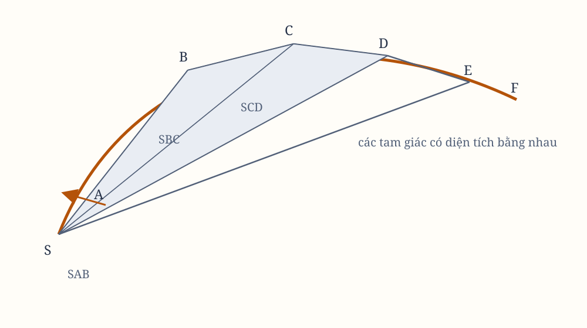

# Sách I, Phần II. Định lý về diện tích

## Phần II

Về việc phát minh các lực hướng tâm.

## Proposition I. Định lý I

Các diện tích mà những vật thể đang quay mô tả bằng những bán kính kẻ tới một tâm lực bất động đều nằm trong cùng những mặt phẳng bất động, và tỷ lệ với những thời gian mà chúng được mô tả.

Hãy giả sử thời gian được chia thành những phần bằng nhau, và trong phần thời gian đầu tiên, vật thể nhờ lực nội tại mô tả đường thẳng $AB$.

Trong phần thời gian thứ hai, nếu không bị cản trở, vật thể sẽ theo Định luật I đi thẳng đến $c$, cùng với $Bc$ bằng $AB$. Vì vậy, khi kẻ các bán kính $AS$, $BS$, $cS$ tới tâm, các diện tích bằng nhau $ASB$, $BSc$ sẽ được mô tả.

Nhưng khi vật thể đến $B$, giả sử một lực hướng tâm tác dụng ngay lập tức với một cú đẩy lớn, làm lệch vật thể khỏi đường thẳng $Bc$ và buộc nó tiếp tục chuyển động theo đường thẳng $BC$. Kẻ $cC$ song song với $BS$ và cắt $BC$ tại $C$. Vào cuối phần thời gian thứ hai, theo Hệ quả I của các Định luật, vật thể sẽ ở tại $C$, trong cùng mặt phẳng với tam giác $ASB$.

Nối $SC$. Vì $SB$ và $Cc$ song song, tam giác $SBC$ sẽ bằng tam giác $SBc$, và do đó cũng bằng tam giác $SAB$.

Lập luận tương tự, nếu lực hướng tâm lần lượt tác dụng tại $C$, $D$, $E$, v.v., và làm vật thể trong mỗi phần nhỏ của thời gian mô tả các đường thẳng $CD$, $DE$, $EF$, v.v., thì tất cả những đường ấy sẽ nằm trong cùng một mặt phẳng. Tam giác $SCD$ sẽ bằng $SBC$, $SDE$ bằng $SCD$, và $SEF$ bằng $SDE$.

Vì vậy, trong những thời gian bằng nhau, các diện tích bằng nhau được mô tả trong cùng một mặt phẳng bất động. Và do việc cộng, mọi tổng $SADS$, $SAFS$ của những diện tích ấy cũng tỉ lệ với những thời gian mà chúng được mô tả.

Bây giờ hãy tăng số lượng những tam giác ấy, đồng thời làm bề rộng của chúng giảm dần vô hạn. Theo Hệ quả 4 của Lemma III, chu vi giới hạn $ADF$ của chúng sẽ là một đường cong. Vì vậy, lực hướng tâm, nhờ đó vật thể luôn được kéo trở lại từ tiếp tuyến của đường cong này, sẽ tác dụng liên tục. Mọi diện tích được mô tả, như $SADS$, $SAFS$, luôn tỷ lệ với thời gian mô tả chúng, và do đó trong trường hợp này cũng tỷ lệ với những thời gian ấy.

*Hình 5. Sơ đồ được dựng lại từ hình minh họa trong bản gốc; cần đối chiếu các đường bán kính và tiếp tuyến với scan.*

## Hệ quả 1

Vận tốc của một vật thể bị hút về một tâm bất động, trong những không gian không có sức cản, tỷ lệ nghịch với đoạn vuông góc hạ từ tâm ấy xuống đường thẳng tiếp xúc với quỹ đạo.

Bởi vì các vận tốc tại những nơi $A$, $B$, $C$, $D$, $E$ tỷ lệ với các đáy $AB$, $BC$, $CD$, $DE$, $EF$ của những tam giác bằng nhau. Và những đáy ấy lại tỷ lệ nghịch với các đoạn vuông góc hạ xuống chúng.

## Hệ quả 2

Nếu các dây cung $AB$, $BC$ của hai cung, được cùng một vật thể mô tả liên tiếp trong những thời gian bằng nhau, trong không gian không có sức cản, được hoàn thành thành hình bình hành $ABCV$, và đường chéo $BV$ của hình bình hành ấy, ở vị trí giới hạn mà nó nhận được khi những cung ấy giảm dần vô hạn, được kéo dài theo cả hai phía, thì nó sẽ đi qua tâm lực.

## Hệ quả 3

Nếu các dây cung $AB$, $BC$ và $DE$, $EF$ của những cung được mô tả trong những thời gian bằng nhau, trong không gian không có sức cản, được hoàn thành thành những hình bình hành $ABCV$, $DEFZ$, thì các lực tại $B$ và $E$ tỷ lệ với nhau theo tỷ số giới hạn của các đường chéo $BV$, $EZ$ khi những cung ấy giảm dần vô hạn.

Bởi vì các chuyển động $BC$ và $EF$ của vật thể, theo Hệ quả 1 của các Định luật, được tạo thành từ các chuyển động $Bc$, $BV$ và $Ef$, $EZ$. Nhưng $BV$ và $EZ$, bằng $Cc$ và $Ff$ trong chứng minh Proposition này, được sinh ra từ những cú đẩy của lực hướng tâm tại $B$ và $E$. Vì vậy, chúng tỷ lệ với những cú đẩy ấy.

## Hệ quả 4

Các lực khiến vật thể, trong không gian không có sức cản, bị kéo trở lại từ chuyển động thẳng và chuyển thành các quỹ đạo cong, tỷ lệ với nhau theo các phiên của những cung được mô tả trong những thời gian bằng nhau. Những phiên ấy hướng về tâm lực và chia đôi các dây cung khi những cung ấy giảm dần vô hạn.

Bởi vì những phiên ấy là một nửa các đường chéo nêu trong Hệ quả 3.

## Hệ quả 5

Vì vậy, các lực ấy tỷ lệ với lực hấp dẫn như những phiên ấy tỷ lệ với các phiên vuông góc với đường chân trời của những cung parabol mà các vật thể bị bắn mô tả trong cùng thời gian.

## Hệ quả 6

Và những điều ấy vẫn đúng hoàn toàn, theo Hệ quả 5 của các Định luật, khi những mặt phẳng mà vật thể chuyển động, cùng các tâm lực nằm trong những mặt phẳng ấy, không đứng yên mà chuyển động đều về phía trước theo những đường thẳng.
