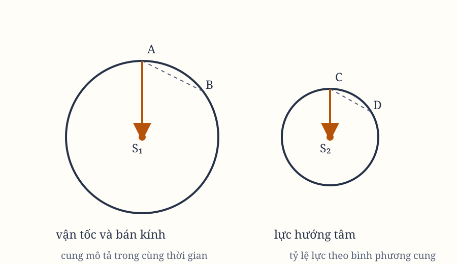

# Sách I, Phần II. Proposition IV

*Hình 6. Sơ đồ được dựng lại từ các hình trong bản gốc; cần đối chiếu với scan.*

## Proposition IV. Định lý IV

Các lực hướng tâm của những vật thể, với những chuyển động đều mô tả những đường tròn khác nhau, hướng về tâm của những đường tròn ấy; và chúng tỷ lệ với nhau theo bình phương của các cung được mô tả trong những thời gian bằng nhau, chia cho các bán kính của các đường tròn.

Các lực ấy hướng về tâm của các đường tròn, theo Proposition II và Hệ quả 2 của Proposition I. Chúng tỷ lệ với nhau theo các phiên của những cung nhỏ nhất được mô tả trong những thời gian bằng nhau, theo Hệ quả 4 của Proposition I.

Điều đó có nghĩa là chúng tỷ lệ theo bình phương của những cung ấy chia cho các đường kính của các đường tròn, theo Lemma VII. Vì những cung ấy tỷ lệ với các cung được mô tả trong bất kỳ khoảng thời gian bằng nhau nào, và các đường kính tỷ lệ với các bán kính, các lực sẽ tỷ lệ theo bình phương của bất kỳ cung nào được mô tả trong cùng một khoảng thời gian, chia cho các bán kính của các đường tròn.

## Hệ quả 1

Vì những cung ấy tỷ lệ với các vận tốc của các vật thể, các lực hướng tâm sẽ ở trong một tỷ số tạo thành từ tỷ số bậc hai của các vận tốc theo chiều trực tiếp và tỷ số đơn của các bán kính theo chiều nghịch.

## Hệ quả 2

Vì các thời gian tuần hoàn ở trong một tỷ số tạo thành từ tỷ số của các bán kính theo chiều trực tiếp và tỷ số của các vận tốc theo chiều nghịch, các lực hướng tâm sẽ ở trong một tỷ số tạo thành từ tỷ số của các bán kính theo chiều trực tiếp và tỷ số bậc hai của các thời gian tuần hoàn theo chiều nghịch.

## Hệ quả 3

Nếu các thời gian tuần hoàn bằng nhau, và vì vậy các vận tốc tỷ lệ với các bán kính, thì các lực hướng tâm cũng tỷ lệ với các bán kính; và ngược lại.

## Hệ quả 4

Nếu cả các thời gian tuần hoàn lẫn các vận tốc đều ở trong tỷ số căn bậc hai của các bán kính, thì các lực hướng tâm sẽ bằng nhau; và ngược lại.

## Hệ quả 5

Nếu các thời gian tuần hoàn tỷ lệ với các bán kính, và vì vậy các vận tốc bằng nhau, thì các lực hướng tâm sẽ tỷ lệ nghịch với các bán kính; và ngược lại.

## Hệ quả 6

Nếu các thời gian tuần hoàn ở trong tỷ số một phần rưỡi của các bán kính, và vì vậy các vận tốc tỷ lệ nghịch trong tỷ số căn bậc hai của các bán kính, thì các lực hướng tâm sẽ ở trong tỷ số bậc hai của các bán kính theo chiều nghịch; và ngược lại.

## Hệ quả 7

Nhìn chung, nếu thời gian tuần hoàn tỷ lệ với lũy thừa $R^n$ của bán kính $R$, và vì vậy vận tốc tỷ lệ nghịch với lũy thừa $R^n$ của bán kính, thì lực hướng tâm sẽ tỷ lệ nghịch với lũy thừa $R^{2n-1}$ của bán kính; và ngược lại.

> **[Ghi chú hiện đại]**
>
> **Khái niệm tương ứng.** Proposition IV là định lý lực hướng tâm $F = \dfrac{mv^2}{R}$ viết bằng ngôn ngữ tỷ lệ, còn Hệ quả 7 là **định luật lũy thừa tổng quát** mà toàn bộ Phần III dựa vào. Nó nói: nếu chu kỳ tuần hoàn tỷ lệ với $R^n$, thì lực tỷ lệ với $R^{1-2n}$. Cắm định luật Kepler thứ ba vào đó là ra luật nghịch đảo bậc hai.
>
> **Công thức.** Từ Hệ quả 1, $F \propto v^2/R$. Với $T = 2\pi R/v$ ta có $v \propto R^{1-n}$, nên $F \propto R^{2(1-n)-1} = R^{1-2n}$ — đúng như Hệ quả 7. Với định luật Kepler thứ ba $T \propto R^{3/2}$, tức $n = 3/2$, ta được ngay $F \propto R^{-2}$. Viết theo cách khác, từ $T^2 \propto R^3$ suy ra $F \propto \dfrac{v^2}{R} = \dfrac{4\pi^2 R^2}{T^2 R} \propto \dfrac{1}{R^2}$.
>
> **Vì sao Newton viết như vậy.** Vì ông cần một công thức tổng quát trước khi biết lực là gì. Hệ quả 7 vừa bao hàm trường hút, vừa bao hàm lực đàn hồi xuyên tâm khi $T \propto R$ cho $F \propto R$, vừa bao hàm lực tỷ lệ với bản thân bán kính. Chỉ cần đo chu kỳ theo quy luật lũy thừa nào, ta đọc ra lực. Đó là một máy suy luận thực nghiệm chứ không phải một giả thuyết, và nó là cách Newton biến ba quy luật của Kepler thành một định luật lực duy nhất.
>
> **Hiện nay thì sao.** Hệ quả 7 sống sót nguyên vẹn dưới tên gọi chung là **quan hệ lực – quy mô**. Cùng cách suy ấy, lực điện từ trong trường tĩnh điện tỷ lệ $1/R^2$, lực hấp dẫn tỷ lệ $1/R^2$, và lực giữa hai dây dẫn thẳng tỷ lệ $1/R$. Hệ quả 7 cũng tiên đoán thứ mà Newton không cần nói ra: quỹ đạo tròn chỉ là một trường hợp đặc biệt khi hằng số quỹ đạo vừa khớp bán kính, và mọi quỹ đạo lệch khác đều không tròn.

## Hệ quả 8

Mọi điều ấy cũng đúng đối với thời gian, vận tốc và lực của các vật thể mô tả những phần tương đồng của những hình tương đồng bất kỳ, khi các tâm của hình nằm ở những vị trí tương đồng trong những hình ấy.

Việc áp dụng chỉ cần thay sự mô tả diện tích đều bằng chuyển động đều, và dùng khoảng cách của vật thể từ các tâm thay cho các bán kính.

## Hệ quả 9

Từ cùng chứng minh ấy, cũng suy ra rằng cung mà một vật thể quay đều trong một đường tròn nhờ một lực hướng tâm đã cho, mô tả trong một khoảng thời gian bất kỳ, là trung bình nhân giữa đường kính của đường tròn và không gian mà cùng vật thể ấy, rơi xuống dưới cùng lực đã cho, sẽ rơi trong cùng khoảng thời gian ấy.

## Học luận

Trường hợp của Hệ quả 6 xuất hiện trong các thiên thể, như Sir Christopher Wren, Dr. Hooke và Dr. Halley đã lần lượt quan sát thấy. Vì vậy, trong phần tiếp theo, tôi sẽ nói rộng hơn về những điều liên quan đến lực hướng tâm giảm theo bậc hai của khoảng cách.

> **[Ghi chú hiện đại]**
>
> **Khái niệm tương ứng.** Hệ quả 9 là quan hệ **trung bình nhân** giữa cung tròn, đường kính và quãng đường rơi tự do, và nó là câu ngắn gọn nhất cho ý tưởng mà Galileo mơ hồ và Newton viết thành công thức: **chuyển động tròn là giới hạn của chuyển động ném liên tiếp**.
>
> **Công thức.** Cung đi qua trong thời gian $T$ là $s = vT$, còn quãng đường rơi tự do trong cùng thời gian dưới cùng lực là $d = \tfrac{1}{2}\dfrac{F}{m}T^2$. Với $F = \dfrac{mv^2}{R}$ ta có $d = \dfrac{v^2 T^2}{2R}$, suy ra $s^2 = 2Rd$, tức $s = \sqrt{2Rd}$ — đúng là trung bình nhân của $2R$ và $d$.
>
> **Vì sao Newton viết như vậy.** Vì ông cần biến bài toán "vật thể đang quay" thành bài toán "vật thể đang rơi" để dùng chung một bộ quy tắc. Mỗi phần nhỏ của đường tròn đều là một vật thể ném ngang, và trong khoảng thời gian rất ngắn nó rơi đúng quãng đường mà lực hướng tâm sai lệch so với tiếp tuyến. Công thức này là bản định lượng của một câu quen thuộc: ném đá càng mạnh càng xa, và nếu mạnh vô hạn thì đá đi thành đường thẳng — hãy ném đủ mạnh và giữ trọng lực, nó sẽ thành đường tròn.
>
> **Hiện nay thì sao.** Học luận cuối chương ghi lại một mắt xích lịch sử đáng nhớ: Wren, Hooke và Halley đều quan sát thấy Hệ quả 6, và chính Halley đã gợi ý với Newton rằng lực hút phải giảm theo bậc hai. Học luận này ghi nhận sự quan sát của cả ba, còn phần chứng minh thì Newton viết dưới tên mình. Người đọc hôm nay hiểu Hệ quả 9 như một phép kiểm tra nhanh rất thực dụng: nếu một vật thể quay tròn, hãy so độ cong thực tế của nó với độ cong của đường rơi tự do, và hai cái phải khớp nhau.
