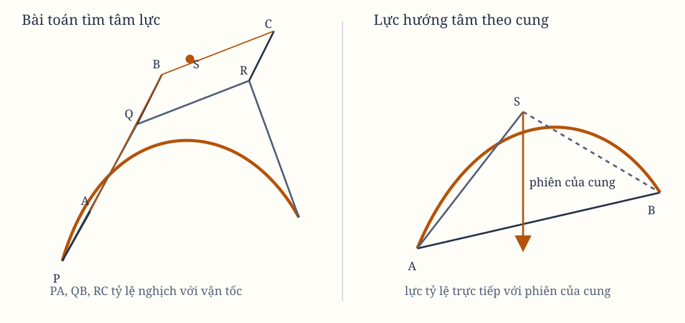

# Sách I, Phần II. Proposition V–VI

*Hình 7. Sơ đồ được dựng lại từ các hình trong bản gốc; cần đối chiếu ký hiệu với scan.*

## Proposition V. Bài toán I

Cho biết tại những nơi bất kỳ, vận tốc mà một vật thể mô tả một hình đã cho, nhờ các lực hướng về một tâm chung. Hãy tìm tâm ấy.

Cho ba đường thẳng $PT$, $TQV$, $VR$ tiếp xúc với hình được mô tả tại những điểm $P$, $Q$, $R$, và cắt nhau tại $T$ và $V$.

Trên các tiếp tuyến ấy, dựng các đoạn vuông góc $PA$, $QB$, $RC$ tỷ lệ nghịch với các vận tốc của vật thể tại những điểm $P$, $Q$, $R$ mà các đoạn vuông góc được dựng từ đó. Nghĩa là, $PA$ tỷ lệ với $QB$ như vận tốc tại $Q$ tỷ lệ với vận tốc tại $P$, và $QB$ tỷ lệ với $RC$ như vận tốc tại $R$ tỷ lệ với vận tốc tại $Q$.

Qua các đầu $A$, $B$, $C$ của các đoạn vuông góc, kẻ $AD$, $DBE$, $EC$ vuông góc với nhau, cắt nhau tại $D$ và $E$. Các đường thẳng $TD$ và $VE$, kéo dài, sẽ gặp nhau tại $S$, tâm cần tìm.

Để các đoạn vuông góc từ tâm $S$ hạ xuống các tiếp tuyến $PT$, $QT$ tỷ lệ nghịch với các vận tốc tại $P$ và $Q$, theo Hệ quả 1 của Proposition I, và do đó, theo cách dựng, chúng tỷ lệ trực tiếp với các đoạn vuông góc $AP$, $BQ$; nghĩa là, chúng tỷ lệ với các đoạn vuông góc hạ từ điểm $D$ xuống các tiếp tuyến.

Từ đó dễ dàng suy ra rằng các điểm $S$, $D$, $T$ nằm trên cùng một đường thẳng. Lập luận tương tự cho biết các điểm $S$, $E$, $V$ cũng nằm trên cùng một đường thẳng. Vì vậy, tâm $S$ là giao điểm của các đường thẳng $TD$ và $YE$.

## Proposition VI. Định lý V

Trong một không gian không có sức cản, nếu một vật thể quay trong bất kỳ quỹ đạo nào quanh một tâm bất động, và trong thời gian ngắn nhất mô tả một cung vừa bắt đầu, đồng thời phiên của cung ấy được giả sử vẽ sao cho chia đôi dây cung và kéo dài đi qua tâm lực, thì lực hướng tâm ở giữa cung sẽ tỷ lệ trực tiếp với phiên của cung và nghịch với bình phương thời gian.

Bởi vì phiên của cung trong một thời gian đã cho tỷ lệ với lực, theo Hệ quả 4 của Proposition I. Khi thời gian tăng theo một tỷ số bất kỳ, cung cũng tăng theo cùng tỷ số ấy, nên phiên của cung tăng theo bình phương của tỷ số đó, theo Hệ quả 2 và 3 của Lemma X. Vì vậy, nó tỷ lệ với lực và bình phương của thời gian.

Trừ tỷ số bậc hai của thời gian ở cả hai vế, ta thấy lực sẽ tỷ lệ trực tiếp với phiên của cung và nghịch với bình phương của thời gian.

## Hệ quả 1

Nếu vật thể $P$, đang quay quanh tâm $S$, mô tả một đường cong $APQ$, và một đường thẳng $ZPR$ tiếp xúc với đường cong ấy tại điểm $P$; từ một điểm bất kỳ khác $Q$ trên đường cong, kẻ $QR$ song song với khoảng cách $SP$ và cắt tiếp tuyến tại $R$; và kẻ $QT$ vuông góc với khoảng cách $SP$, thì lực hướng tâm sẽ tỷ lệ nghịch với khối lượng $\frac{SP^2 \times QT^2}{QR}$, nếu khối lượng ấy được lấy ở độ lớn mà nó cuối cùng nhận được khi $P$ và $Q$ trùng nhau.

Bởi vì $QR$ bằng phiên của hai lần cung $QP$, có $P$ làm trung điểm. Hai lần tam giác $SQP$, tức là $SP \times QT$, tỷ lệ với thời gian mà cung đôi ấy được mô tả; vì vậy có thể dùng làm số mũ của thời gian.

## Hệ quả 2

Lập luận tương tự cho thấy lực hướng tâm tỷ lệ nghịch với khối lượng $\frac{SY^2 \times QP^2}{QR^2}$, nếu $SY$ là đoạn vuông góc từ tâm lực hạ xuống $PR$, tiếp tuyến của quỹ đạo.

Bởi vì các hình chữ nhật $SY \times QP$ và $SP \times QT$ bằng nhau.

## Hệ quả 3

Nếu quỹ đạo là một đường tròn, hoặc tiếp xúc hoặc cắt một đường tròn đồng tâm, tức là tạo với đường tròn một góc tiếp xúc hoặc góc cắt nhỏ nhất, có cùng độ cong và cùng bán kính độ cong tại điểm $P$; và nếu $PV$ là một dây cung của đường tròn này, kẻ từ vật thể qua tâm lực, thì lực hướng tâm sẽ tỷ lệ nghịch với khối lượng $SY^2 \times PV$.

## Hệ quả 4

Với cùng điều kiện ấy, lực hướng tâm tỷ lệ trực tiếp với bình phương vận tốc và nghịch với dây cung ấy.

Bởi vì vận tốc tỷ lệ nghịch với đoạn vuông góc $SY$, theo Hệ quả 1 của Proposition I.

## Hệ quả 5

Vì vậy, nếu một hình cong $APQ$ bất kỳ được cho, và bên trong có một điểm $S$ cũng được cho, là nơi một lực hướng tâm luôn hướng về, thì có thể tìm ra quy luật của lực hướng tâm, nhờ đó vật thể $P$ sẽ liên tục bị kéo trở lại từ chuyển động thẳng, bị giữ trên chu vi của hình ấy, và sẽ mô tả hình ấy bằng một chuyển động quay vĩnh cửu.

Nói cách khác, ta cần tìm, bằng tính toán, khối lượng $SP^2 \times QT^2$ hoặc $SY^2 \times PV$ tỷ lệ nghịch với lực này. Những Bài toán sau sẽ cung cấp ví dụ cho điều đó.
