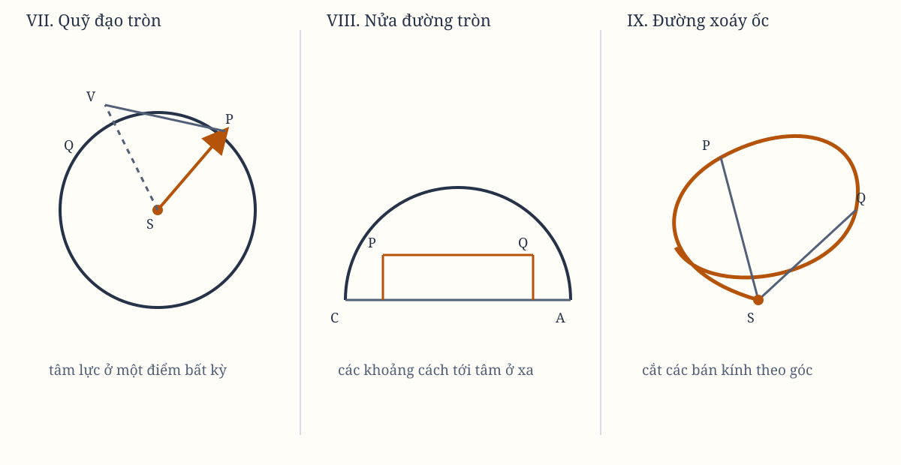

# Sách I, Phần II. Proposition VII

*Hình 8. Sơ đồ được dựng lại từ các hình trong bản gốc; cần đối chiếu ký hiệu với scan.*

## Proposition VII. Bài toán II

Nếu một vật thể quay trên chu vi của một đường tròn, hãy tìm quy luật của lực hướng tâm hướng về một điểm bất kỳ đã cho.

Gọi $VQPA$ là chu vi của đường tròn, $S$ là điểm đã cho mà lực hướng về như một tâm, $P$ là vật thể đang chuyển động trên chu vi, $Q$ là nơi tiếp theo mà nó sẽ đến, và $PRZ$ là tiếp tuyến của đường tròn tại nơi trước đó.

Qua $S$, kẻ dây cung $PV$ và đường kính $VA$ của đường tròn. Nối $AP$, và kẻ $QT$ vuông góc với $SP$, kéo dài để cắt tiếp tuyến $PR$ tại $Z$. Cuối cùng, qua $Q$, kẻ $LR$ song song với $SP$, cắt đường tròn tại $L$ và tiếp tuyến $PZ$ tại $R$.

Vì các tam giác $ZQR$, $ZTP$, $VPA$ đồng dạng, ta có
$$
RP^2 = QRL
$$
tỷ lệ với
$$
QT^2
$$
theo tỷ số của $AV^2$ với $PV^2$. Vì vậy, $\frac{QRL \times PV^2}{SP^2}$ bằng $QT^2$.

Nhân hai đẳng thức ấy với $\frac{SP^2}{PV^2}$, và khi các điểm $P$ và $Q$ trùng nhau, ta dùng $PV$ cho $RL$. Khi ấy, ta có
$$
\frac{SP^2 \times PV^3}{AV^2} = SP^2 \times QT^2.
$$

Vì vậy, theo Hệ quả 1 và 5 của Proposition VI, lực hướng tâm tỷ lệ nghịch với $\frac{SP^2 \times PV^3}{AV^2}$. Vì $AV^2$ là hằng số đã cho, lực hướng tâm tỷ lệ nghịch với tích của bình phương khoảng cách hoặc độ cao $SP$ và lập thể của dây cung $PV$.

Có thể chứng minh điều tương tự theo cách khác. Trên tiếp tuyến $PR$ kéo dài, hạ đoạn vuông góc $SY$. Vì các tam giác $SYP$, $VPA$ đồng dạng, ta có
$$
\frac{AV}{PV} = \frac{SP}{SY},
$$
và do đó
$$
\frac{SP \times PV}{AV} = SY,
\qquad
\frac{SP^2 \times PV^3}{AV^2} = SY^2 \times PV.
$$

Vì vậy, theo Hệ quả 3 và 5 của Proposition VI, lực hướng tâm tỷ lệ nghịch với $\frac{SP^2 \times PV^3}{AV^2}$; vì $AV$ là hằng số, nó tỷ lệ nghịch với $SP^2 \times PV^3$.

> **[Ghi chú hiện đại]**
>
> **Khái niệm tương ứng.** Bài toán II là một **phép đảo** của các Proposition đi trước: các định lý đi từ quy luật lực ra quỹ đạo, còn bài toán đi từ quỹ đạo ngược lại để tìm quy luật lực. Toàn bộ cấu trúc của *Principia* dựng trên sự đối xứng ấy, và người đọc hôm nay nhận ra đó chính là cách vật lí trường vẫn vận hành: có phương trình chuyển động thì có quỹ đạo, và có quỹ đạo thì dựng lại được trường lực.
>
> **Công thức.** Kết quả của Bài toán II là $F \propto \dfrac{1}{SP^2 \cdot PV^3}$, trong đó $AV$ là đường kính nên là hằng số. Ở Hệ quả 1, khi tâm lực $S$ nằm ngay trên chu vi đường tròn thì dây cung $PV$ trở thành chính $SP$, nên $F \propto \dfrac{1}{SP^5}$.
>
> **Vì sao Newton viết như vậy.** Vì ông cần một bài học về **cách đặt câu hỏi**, không chỉ về kết quả. Bằng việc cho tâm lực ở một vị trí bất kỳ, ông buộc người đọc thấy rằng thay đổi *vị trí của nguồn lực* đôi khi làm đổi cả *số mũ* của quy luật. Lực hút về một tâm ở xa và lực hút về một tâm nằm trên chính quỹ đạo không phải hai trường hợp nhỏ của cùng một thứ — chúng là hai trường khác hẳn nhau.
>
> **Hiện nay thì sao.** Lực $1/r^5$ ứng với thế năng tỷ lệ $1/r^4$, dốc hơn hẳn lực hút vô cùng xa và lực Coulomb. Bằng chứng toán học mà Hệ quả 1 cung cấp vẫn là bằng chứng hữu dụng: **cấp của lực phụ thuộc vào hình học của tình huống, không chỉ vào khoảng cách**. Người đọc hôm nay dùng đúng cách đó mỗi khi phải kiểm tra một số mũ lực mới, thay vì tin vào trực giác rằng khoảng cách tăng gấp đôi thì lực giảm gấp đôi.

## Hệ quả 1

Nếu điểm $S$ đã cho, là nơi lực hướng tâm luôn hướng về, nằm trên chu vi của đường tròn, như tại $V$, thì lực hướng tâm sẽ tỷ lệ nghịch với lũy thừa bậc năm của độ cao $SP$.

## Hệ quả 2

Lực mà vật thể $P$ quay quanh tâm lực $S$ trong đường tròn $APTV$, tỷ lệ với lực mà cùng vật thể $P$ có thể quay trong cùng đường tròn ấy và cùng thời gian tuần hoàn quanh một tâm lực bất kỳ khác $R$, như $RP^2 \times SP$ tỷ lệ với lập thể của đoạn thẳng $SG$.

Ở đây $SG$ được kẻ từ tâm lực thứ nhất $S$ song song với khoảng cách $PR$ của vật thể từ tâm lực thứ hai $R$, và cắt tiếp tuyến $PG$ của quỹ đạo tại $G$.

Theo cách dựng của Proposition này, lực trước tỷ lệ với lực sau như $RP^2 \times PT^3$ tỷ lệ với $SP^2 \times PV^3$. Điều này cũng được giải thích bằng các tam giác đồng dạng $PSG$, $TPV$.

## Hệ quả 3

Lực mà vật thể $P$ quay quanh tâm lực $S$ trong bất kỳ quỹ đạo nào, tỷ lệ với lực mà cùng vật thể ấy có thể quay trong cùng quỹ đạo và cùng thời gian tuần hoàn quanh một tâm lực bất kỳ khác $R$, như khối lượng $SP \times RP^2$, chứa khoảng cách của vật thể từ tâm lực thứ nhất $S$ và bình phương khoảng cách của nó từ tâm lực thứ hai $R$, tỷ lệ với lập thể của đoạn thẳng $SG$.

Lực trong quỹ đạo bất kỳ tại điểm $P$ cũng giống lực trong một đường tròn có cùng độ cong.

> **[Ghi chú hiện đại]**
>
> **Khái niệm tương ứng.** Câu cuối cùng của chương là nguyên lý **đường tròn osculating**: lực tại một điểm bất kỳ của một quỹ đạo bất kỳ chỉ phụ thuộc độ cong cục bộ, không phụ thuộc vào hình dạng tổng thể của đường. Đây là một trong những phát biểu đẹp nhất của *Principia*, vì nó biến bài toán hình học phức tạp thành bài toán trên một đường tròn.
>
> **Công thức.** Với đường tròn osculating bán kính $r$ tại $P$, Proposition VI cho $F = mv^2\kappa = \dfrac{mv^2}{r}$. Dây cung $PV$ xuất hiện trong kết quả Bài toán II chính là đại lượng mô tả độ cong tại $P$: nó chỉ phụ thuộc bán kính đường tròn osculating, nên thay quỹ đạo bằng đường tròn không đổi lực.
>
> **Vì sao Newton viết như vậy.** Vì ông cần một nguyên tắc giảm thiểu để làm việc được. Nếu quỹ đạo không tròn, việc tính lực sẽ đòi hỏi xét toàn bộ hình dạng đường. Nguyên tắc osculating cho phép ông thay mọi quỹ đạo bằng một đường tròn duy nhất, đúng tại chỗ đang xét, và mọi bài toán quỹ đạo về sau — từ quỹ đạo elip tới quỹ đạo hyperbol — đều xây trên nền này.
>
> **Hiện nay thì sao.** Nguyên tắc này là hình học của **tính cục bộ của trường**, và nó là lý do các phương trình vi phân mô tả được vật lí: ở mỗi điểm, trạng thái chuyển động cùng với trường tại điểm ấy đã đủ để xác định chuyển động tiếp theo, không cần biết quỹ đạo trước. Người đọc hôm nay còn thấy nó nơi khác nữa: trong hình học phẳng cong, trong mặt phẳng với hình học Riemann, và trong cơ học Lagrange, nơi toạ độ cong chính là cách viết lại toàn bộ vấn đề trong từ ngữ ấy.
