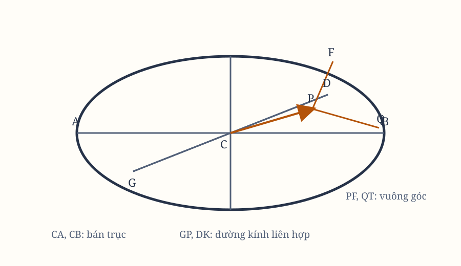

*Hình 10. Sơ đồ được dựng lại từ hình minh họa trong bản gốc; cần đối chiếu ký hiệu với scan.*

## Proposition X. Bài toán V

Nếu một vật thể quay trong một elip, hãy tìm quy luật của lực hướng tâm hướng về tâm của elip.

Giả sử $CA$, $CB$ là hai bán trục của elip; $GP$, $DK$ là các đường kính liên hợp; $PF$, $QT$ là các đoạn vuông góc với những đường kính ấy; $Qv$ là ordinate theo đường kính $GP$; và hoàn thành hình bình hành $QvPR$.

Theo các tính chất của các hình cắt, hình chữ nhật $PvG$ tỷ lệ với $Qv^2$ như $PC^2$ tỷ lệ với $CD^2$. Vì các tam giác $QvT$, $PCF$ đồng dạng, ta có
$$
\frac{Qv^2}{QT^2} = \frac{PC^2}{PF^2}.
$$

Nhân các tỷ số ấy, tỷ số của $PvG$ với $QT^2$ được tạo thành từ tỷ số của $PC^2$ với $CD^2$ và tỷ số của $PC^2$ với $PF^2$.

Đặt $QR$ thay cho $Pr$, và theo Lemma XII, đặt $BC \times CA$ thay cho $CD \times PF$. Khi $P$ và $Q$ trùng nhau, đặt $2PC$ thay cho $rG$. Nhân các cực và trung bình, ta có
$$
\frac{QT^2 \times PC^2}{QR^2}
=
\frac{2BC^2 \times CA^2}{PC^2}.
$$

Vì vậy, theo Hệ quả 5 của Proposition VI, lực hướng tâm tỷ lệ nghịch với
$$
\frac{2BC^2 \times CA^2}{PC^2}.
$$

Vì $2BC^2 \times CA^2$ là hằng số đã cho, lực hướng tâm tỷ lệ nghịch với $PC^2$; tức là, trực tiếp tỷ lệ với khoảng cách $PC$.

## Hệ quả 1

Vì vậy, lực tỷ lệ với khoảng cách của vật thể từ tâm của elip; và ngược lại, nếu lực tỷ lệ với khoảng cách, vật thể sẽ chuyển động trong một elip có tâm trùng với tâm lực, hoặc có thể trong một đường tròn mà elip ấy có thể thoái lui.

> **[Chú giải]**
>
> **Lực tỷ lệ thuận với khoảng cách đến tâm: dao động tử điều hòa**
>
> Newton đã tìm ra rằng lực tuyến tính theo độ lệch thì quỹ đạo là một elip, và con đường đó là mặt cắt conic đầu tiên xuất hiện trong vật lí.
>
> $F \propto PC$ với $PC$ là khoảng cách tới tâm, tức $\vec{F} = -k\vec{r}$ và $k$ không đổi. Từ đó $\ddot{\vec{r}} = -\omega^2 \vec{r}$ với $\omega^2 = k/m$, và nghiệm tổng quát là $\vec{r}(t) = \vec{A}\cos(\omega t) + \vec{B}\sin(\omega t)$ với $\vec{A} \perp \vec{B}$ và $|\vec{A}| = |\vec{B}|$. Chính điều kiện hai độ dài bằng nhau ấy sinh ra elip, và chu kỳ là $T = 2\pi/\omega$ không phụ thuộc biên độ - đúng như Hệ quả 2 nói về thời gian tuần hoàn bằng nhau của mọi elip cùng tâm.
>
> **Một trường hợp đối xứng để kiểm tra cả Phần II**
>
> Nếu lực hướng về tâm của hình thì quy luật lực phải đơn giản nhất có thể, và $F \propto r$ là ứng viên đơn giản nhất. Ông cũng cần nó để chuẩn bị: ở Phần III ông sẽ chứng minh lực hút *thực sự* tạo ra elip, và ông làm việc ấy với đường tròn làm trường hợp tham chiếu.
>
> Dao động tử điều hòa là ví dụ đầu tiên người ta học trong cơ học, và nó vẫn là nơi mọi lý thuyết cơ bản phải vượt qua. Bản chất sâu hơn nằm ở không gian trạng thái: quỹ đạo của nó trong mặt phẳng $(x, \dot{x})$ là một elip. Newton đã vẽ ra bức tranh đầu tiên của cái mà ngày nay gọi là **elip trạng thái**.

## Hệ quả 2

Và những thời gian tuần hoàn của các chuyển động quanh cùng một tâm trong mọi elip sẽ bằng nhau.

Bởi vì các thời gian ấy trong những elip tương đồng sẽ bằng nhau, theo Hệ quả 3 và 8 của Proposition IV. Nhưng trong các elip có cùng trục lớn, chúng tỷ lệ với toàn bộ diện tích của các elip theo chiều trực tiếp, và với các phần diện tích được mô tả trong cùng thời gian theo chiều nghịch.

Điều đó có nghĩa là, chúng tỷ lệ trực tiếp với các trục nhỏ, và nghịch với các vận tốc của vật thể tại những đỉnh chính; tức là, trực tiếp với các trục nhỏ ấy, và nghịch với các ordinate tại cùng một điểm của các trục chung. Vì các tỷ số trực tiếp và nghịch bằng nhau, chúng bằng nhau.

## Học luận

Nếu elip, do tâm của nó được đưa ra vô cùng xa, thoái lui thành một parabol, vật thể sẽ chuyển động trong parabol ấy; và lực, nay hướng về một tâm ở vô cùng xa, sẽ trở thành đều. Đây chính là định lý của Galileo.

Nếu mặt cắt parabol của nón bị thay đổi thành hypebol, vật thể sẽ chuyển động trên chu vi của hypebol ấy, và lực hướng tâm của nó biến thành lực ly tâm.

Tương tự, trong hình tròn hoặc elip, nếu các lực hướng về tâm của hình được đặt trên trục hoành, thì các lực ấy, khi các ordinate tăng hoặc giảm theo một tỷ số đã cho, hoặc thậm chí khi góc nghiêng của các ordinate với trục hoành thay đổi, luôn tăng hoặc giảm theo tỷ số các khoảng cách từ tâm, với điều kiện các thời gian tuần hoàn vẫn bằng nhau.

Điều tương tự cũng đúng trong mọi hình: nếu các ordinate tăng hoặc giảm theo một tỷ số đã cho, hoặc nếu độ nghiêng của chúng thay đổi bất kỳ cách nào, trong khi thời gian tuần hoàn vẫn giữ nguyên, thì các lực hướng về bất kỳ tâm nào đặt trên trục hoành sẽ tăng hoặc giảm theo tỷ số các khoảng cách từ tâm.

> **[Chú giải]**
>
> **Khi tâm elip lùi ra vô cùng, ta thu được định luật của Galileo**
>
> Elip thoái lui thành parabol, lực tỷ lệ với khoảng cách trở thành lực **đều**, và bài toán quỹ đạo trở thành đúng định lý ném ngang của Galileo. Newton viết ra mắt xích ấy bằng ba câu, và đó là cách ông thừa nhận mình đang đứng trên vai một người khác.
>
> Với elip có các bán trục $CA = a$, $CB = b$, khi tâm lùi ra vô cùng dọc theo một trục thì elip chuyển thành parabol và $F \propto PC \to F = \text{hằng số}$. Ở giới hạn đó nghiệm là ném ngang: $x = v_0 t$, $y = \tfrac{1}{2} g t^2$, nên $y = \dfrac{g}{2v_0^2} x^2$ - đúng là parabol. Còn khi đổi dấu lực ở phía trong hình, quỹ đạo elip biến thành hypebol, và vì tâm lực nằm giữa hai nhánh nên lực trở thành **lực ly tâm**.
>
> **Một nguyên tắc biến đổi, không phải một danh sách kết quả**
>
> Nếu một quy luật đúng dưới những phép biến đổi hình học này thì nó phải đúng dưới mọi phép biến đổi cùng loại, và người đọc chỉ cần kiểm tra một trường hợp. Câu cuối cùng của Học luận phát biểu nguyên lý ấy ở dạng tổng quát: chỉ cần các ordinate tăng hay giảm theo cùng một tỷ số, và thời gian tuần hoàn giữ nguyên, thì lực cũng tăng hay giảm theo cùng tỷ số ấy.
>
> Nguyên lý của Học luận chính là **đối xứng thu nhoát**, và nó là phép thử chuẩn để kiểm tra một quy luật lực: lực thuần nhất cấp $F \propto r^n$ phải cho cùng dạng quỹ đạo khi ta co mọi khoảng cách theo một tỉ lệ. Cùng câu đó cũng giải thích vì sao lực ly tâm trong vật lí hiện đại chỉ là cái bóng toả phạm của một lực hướng tâm thật chứ không phải một lực riêng: đổi dấu lực ở bên trong hình chính là cách hình học nói ra điều đó.
