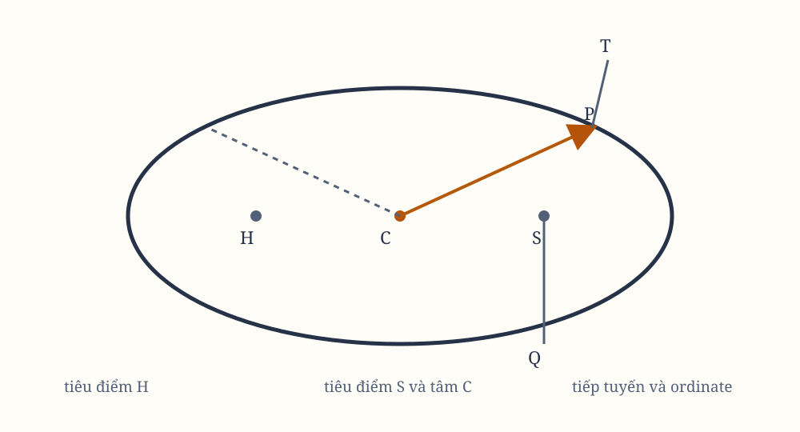

# Sách I, Phần III. Proposition XI

*Hình 11. Sơ đồ được dựng lại từ hình minh họa trong bản gốc; cần đối chiếu ký hiệu với scan.*

## Phần III

Về chuyển động của các vật thể trong những hình cắt conic lệch tâm.

## Proposition XI. Bài toán VI

Nếu một vật thể quay trong một elip, hãy tìm quy luật của lực hướng tâm hướng về tiêu điểm của elip.

Gọi $S$ là tiêu điểm của elip. Kẻ $SP$, cắt đường kính $DK$ của elip tại $E$, và cắt ordinate $Qv$ tại $x$; rồi hoàn thành hình bình hành $QvPR$.

Rõ ràng $EP$ bằng bán trục lớn $AC$. Để thấy điều này, kẻ $HI$ từ tiêu điểm còn lại $H$ của elip song song với $EC$. Vì $CS$, $CH$ bằng nhau, $ES$, $EI$ cũng bằng nhau. Vì vậy, $EP$ bằng một nửa tổng $PS$ và $PI$; tức là, nhờ $HI$, $PR$ song song và các góc $IPR$, $HPZ$ bằng nhau, $EP$ bằng một nửa tổng $PS$ và $PH$. Tổng ấy bằng toàn bộ trục $2AC$.

Kẻ $QT$ vuông góc với $SP$, và gọi $L$ là latus rectum chính của elip, tức là
$$
L = \frac{2BC^2}{AC}.
$$

Từ các tính chất của các hình cắt conic và các tam giác đồng dạng, ta có các tỷ số:
$$
\frac{L \times QR}{L \times Pv}
=
\frac{QR}{Pv}
=
\frac{Px}{Pv}
=
\frac{PE}{PC}
=
\frac{AC}{PC},
$$
$$
\frac{L \times Pv}{Gv \times Pv}
=
\frac{L}{Gv},
$$
và
$$
\frac{GvP}{Qv^2}
=
\frac{PC^2}{CD^2}.
$$

Khi $Q$ và $P$ trùng nhau, $Qv^2$ tỷ lệ bằng với $Qv^2$ theo Hệ quả 2 của Lemma VII. Ngoài ra,
$$
\frac{Qv^2}{QT^2}
=
\frac{EP^2}{PF^2}
=
\frac{CA^2}{PF^2}
=
\frac{CD^2}{CB^2}.
$$

Nhân tất cả các tỷ số ấy, ta có
$$
\frac{L \times QR}{QT^2}
\sim
AC \times L \times PC^2 \times CD^2.
$$

Mặt khác, khi $P$ và $Q$ trùng nhau, $2PC$ và $Gv$ bằng nhau. Vì vậy, các đại lượng $L \times QR$ và $QT^2$, tỷ lệ với những đại lượng này, cũng bằng nhau. Do đó,
$$
L \times SP^2
=
\frac{SP^2 \times QT^2}{QR}.
$$

Theo Hệ quả 1 và 5 của Proposition VI, lực hướng tâm tỷ lệ nghịch với $L \times SP^2$. Vì $L$ là hằng số, lực hướng tâm tỷ lệ nghịch với bình phương khoảng cách $SP$.

Có thể chứng minh cùng kết quả ấy theo cách khác. Lực hướng về tâm $C$ của elip, nhờ đó vật thể $P$ có thể quay trong elip, tỷ lệ với khoảng cách $CP$. Kẻ $CE$ song song với tiếp tuyến $PR$ của elip. Nếu $CE$ và $PS$ cắt nhau tại $E$, lực để vật thể $P$ quay quanh điểm bất kỳ khác $S$ sẽ tỷ lệ với $\frac{PE^3}{PT^3}$, theo Hệ quả 3 của Proposition VII.

Nếu $S$ là tiêu điểm của elip, $PE$ được cho là tỷ lệ nghịch với $SP^2$. Vì vậy, lực hướng tâm tỷ lệ nghịch với bình phương khoảng cách $SP$.

Vì tính quy trọng của bài toán này và việc sử dụng nó trong phần sau, tôi sẽ chứng minh các trường hợp còn lại bằng những lập luận riêng.
