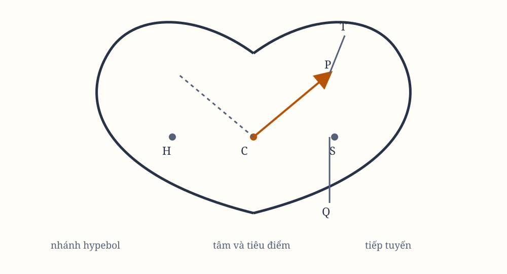

# Sách I, Phần III. Proposition XII

*Hình 12. Sơ đồ được dựng lại từ hình minh họa trong bản gốc; cần đối chiếu ký hiệu với scan.*

## Proposition XII. Bài toán VII

Giả sử một vật thể chuyển động trong một hypebol. Hãy tìm quy luật của lực hướng tâm hướng về tiêu điểm của hình ấy.

Gọi $CA$, $CB$ là hai bán trục của hypebol; $PG$, $KD$ là các đường kính liên hợp khác; $PF$ là đoạn vuông góc với đường kính $KD$; và $Qv$ là ordinate theo đường kính $GP$.

Kẻ $SP$, cắt đường kính $DK$ tại $E$, và cắt ordinate $Qv$ tại $x$, rồi hoàn thành hình bình hành $QRP.r$.

Rõ ràng $EP$ bằng bán trục ngang $AC$. Để thấy điều này, kẻ $HE$ từ tiêu điểm còn lại $H$ của hypebol song song với $EC$. Vì $CS$, $CH$ bằng nhau, $ES$, $EI$ cũng bằng nhau. Vì vậy, $EP$ bằng một nửa hiệu của $PS$ và $PI$; tức là, nhờ $IH$, $PR$ song song và các góc $IPR$, $HPZ$ bằng nhau, $EP$ bằng một nửa hiệu của $PS$ và $PH$. Hiệu ấy bằng toàn bộ trục $2AC$.

Kẻ $QT$ vuông góc với $SP$, và gọi $L$ là latus rectum chính của hypebol, tức là
$$
L = \frac{2BC^2}{AC}.
$$

Ta có
$$
\frac{L \times QR}{L \times Pv}
=
\frac{QR}{Pv}
=
\frac{Px}{Pv}
=
\frac{PE}{PC}
=
\frac{AC}{PC}.
$$

Ngoài ra,
$$
\frac{L \times Pv}{Gv \times Pv}
=
\frac{L}{Gv},
$$
và, theo các tính chất của các hình cắt conic,
$$
\frac{Gv^2}{Qv^2}
=
\frac{PC^2}{CD^2}.
$$

Khi $P$ và $Q$ trùng nhau, $Qv^2$ trở thành tỷ số bằng nhau theo Hệ quả 2 của Lemma VII. Và
$$
\frac{Qv^2}{QT^2}
=
\frac{EP^2}{PF^2}
=
\frac{CA^2}{PF^2}
=
\frac{CD^2}{CB^2}.
$$

Nhân các tỷ số ấy, ta có
$$
\frac{L \times QR}{QT^2}
\sim
AC \times L \times PC^2 \times CD^2.
$$

Khi $P$ và $Q$ trùng nhau, $2PC$ và $Gv$ bằng nhau. Vì vậy, các đại lượng $L \times QR$ và $QT^2$, tỷ lệ với chúng, cũng bằng nhau. Suy ra
$$
L \times SP^2
=
\frac{SP^2 \times QT^2}{QR}.
$$

Theo Hệ quả 1 và 5 của Proposition VI, lực hướng tâm tỷ lệ nghịch với $L \times SP^2$. Vì $L$ là hằng số, lực hướng tâm tỷ lệ nghịch với bình phương khoảng cách $SP$.

Có thể chứng minh cùng kết quả ấy theo cách khác. Lực hướng về tâm $C$ của hypebol tỷ lệ với khoảng cách $CP$. Nhưng từ đó, theo Hệ quả 3 của Proposition VII, lực hướng về tiêu điểm $S$ sẽ tỷ lệ với $\frac{PE^3}{PT^3}$; tức là, vì $PE$ tỷ lệ nghịch với $SP^2$, lực ấy tỷ lệ nghịch với bình phương khoảng cách $SP$.

Cũng có thể chứng minh theo cùng cách rằng nếu lực hướng tâm của vật thể biến thành lực ly tâm, vật thể sẽ chuyển động trong hypebol liên hợp.
