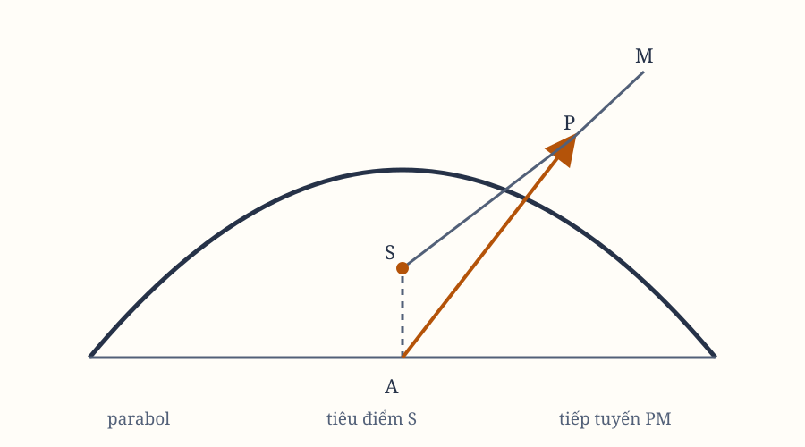

# Sách I, Phần III. Proposition XVI–XVII

*Hình 14. Sơ đồ dùng lại để đối chiếu tiếp tuyến, vuông góc và khoảng cách tới tiêu điểm.*

## Proposition XVI. Định lý VIII

Với cùng điều kiện ấy, kẻ các đường thẳng từ vật thể đến các tiếp tuyến của quỹ đạo, và hạ các đoạn vuông góc từ tiêu điểm chung xuống những tiếp tuyến ấy. Tôi nói rằng vận tốc của các vật thể ở trong một tỷ số tạo thành từ tỷ số nghịch của các đoạn vuông góc và tỷ số căn bậc hai trực tiếp của các latus rectum chính.

Từ tiêu điểm $S$, hạ $SY$ vuông góc với tiếp tuyến $PR$. Vận tốc của vật thể $P$ tỷ lệ nghịch với căn bậc hai của đại lượng
$$
\frac{SY^2}{SP \times QT}.
$$

Bởi vì vận tốc ấy tỷ lệ với cung vô cùng nhỏ $PQ$ được mô tả trong một khoảnh khắc đã cho; tức là, theo Lemma VII, nó tỷ lệ với tiếp tuyến $PR$. Vì $PR$ tỷ lệ với $QT$, và $SP$ tỷ lệ với $SY$, nên vận tốc tỷ lệ nghịch với $SY$ và trực tiếp với $SP \times QT$.

Nhưng $SP \times QT$ tỷ lệ với diện tích được mô tả trong thời gian đã cho, tức là, theo Proposition XIV, ở căn bậc hai của latus rectum.

## Hệ quả 1

Các latus rectum chính ở trong tỷ số tạo thành từ bình phương các đoạn vuông góc và bình phương các vận tốc.

## Hệ quả 2

Vận tốc của các vật thể tại khoảng cách lớn nhất và nhỏ nhất từ tiêu điểm chung, ở trong tỷ số tạo thành từ tỷ số nghịch của các khoảng cách và căn bậc hai trực tiếp của các latus rectum chính.

Bởi vì lúc ấy các đoạn vuông góc chính là các khoảng cách ấy.

## Hệ quả 3

Vì vậy, vận tốc trong một hình cắt conic, tại khoảng cách lớn nhất hoặc nhỏ nhất từ tiêu điểm, tỷ lệ với vận tốc trong một đường tròn tại cùng khoảng cách ấy từ tâm, theo căn bậc hai của latus rectum chính trên gấp đôi khoảng cách ấy.

## Hệ quả 4

Vận tốc của các vật thể quay trong các elip, tại khoảng cách trung bình từ tiêu điểm chung, bằng vận tốc của các vật thể quay trong các đường tròn tại cùng những khoảng cách ấy; tức là, theo Hệ quả 6 của Proposition IV, tỷ lệ nghịch với căn bậc hai của khoảng cách.

Bởi vì các đoạn vuông góc lúc ấy là các bán trục nhỏ, và chúng là trung bình nhân giữa các khoảng cách với các latus rectum.

## Hệ quả 5

Trong cùng một hình, hoặc thậm chí trong những hình khác nhau, nếu các latus rectum chính bằng nhau, vận tốc của vật thể tỷ lệ nghịch với đoạn vuông góc hạ từ tiêu điểm xuống tiếp tuyến.

## Hệ quả 6

Trong một parabol, vận tốc tỷ lệ nghịch với căn bậc hai của khoảng cách từ vật thể đến tiêu điểm của hình. Nó thay đổi nhiều hơn trong elip, và ít hơn trong hypebol, so với tỷ số này.

Bởi vì, theo Hệ quả 2 của Lemma XIV, đoạn vuông góc hạ từ tiêu điểm xuống tiếp tuyến của parabol ở trong tỷ số căn bậc hai của khoảng cách. Trong hypebol, đoạn vuông góc ít thay đổi hơn; trong elip, nhiều hơn.

## Hệ quả 7

Trong một parabol, vận tốc của vật thể tại bất kỳ khoảng cách nào từ tiêu điểm tỷ lệ với vận tốc của một vật thể quay trong một đường tròn tại cùng khoảng cách ấy từ tâm, theo căn bậc hai của tỷ số $2$ với $1$; trong elip, nó nhỏ hơn, và trong hypebol, lớn hơn so với tỷ số ấy.

Theo Hệ quả 2 của Proposition này, vận tốc tại đỉnh của parabol ở đúng tỷ số này, và theo Hệ quả 6 của Proposition này cùng Proposition IV, cùng tỷ lệ ấy giữ ở mọi khoảng cách.

Vì vậy, trong một parabol, vận tốc ở mọi nơi bằng vận tốc của một vật thể quay trong một đường tròn tại nửa khoảng cách; trong elip, nó nhỏ hơn, và trong hypebol, lớn hơn.

## Hệ quả 8

Vận tốc của một vật thể quay trong bất kỳ hình cắt conic nào tỷ lệ với vận tốc của một vật thể quay trong một đường tròn tại khoảng cách bằng một nửa latus rectum chính của hình cắt, như khoảng cách ấy tỷ lệ với đoạn vuông góc hạ từ tiêu điểm xuống tiếp tuyến của hình cắt.

## Hệ quả 9

Vì vậy, vận tốc của một vật thể quay trong một hình cắt conic sẽ tỷ lệ với vận tốc của một vật thể quay trong một đường tròn tại cùng khoảng cách, như một trung bình nhân giữa khoảng cách chung ấy và một nửa latus rectum chính của hình cắt, so với đoạn vuông góc hạ từ tiêu điểm chung xuống tiếp tuyến của hình cắt.

## Proposition XVII. Bài toán IX

Giả sử lực hướng tâm tỷ lệ nghịch với bình phương các khoảng cách từ các nơi đến tâm, và lượng tuyệt đối của lực ấy đã biết. Hãy xác định đường mà vật thể sẽ mô tả khi được thả từ một nơi đã cho với một vận tốc đã cho theo phương của một đường thẳng đã cho.

Gọi lực hướng tâm hướng tới $S$ là lực làm cho vật thể $P$ quay trong một quỹ đạo bất kỳ $pq$; và giả sử vận tốc của vật thể tại $p$ đã biết.

Từ nơi $P$, giả sử vật thể được thả với một vận tốc đã cho theo phương $PR$, nhưng bị lực hướng tâm lập tức làm lệch khỏi đường thẳng ấy vào hình cắt conic $PQ$. Vì vậy, đường thẳng $PR$ sẽ tiếp xúc tại $P$.

Tương tự, giả sử đường thẳng $pr$ tiếp xúc với quỹ đạo $pq$ tại $p$. Nếu từ $S$ hạ các đoạn vuông góc xuống những tiếp tuyến ấy, latus rectum chính của hình cắt conic sẽ tỷ lệ với latus rectum chính của quỹ đạo ấy theo tỷ số tạo thành từ bình phương các đoạn vuông góc và bình phương các vận tốc. Vì vậy, nó đã được cho.

Gọi latus rectum ấy là $L$. Tiêu điểm $S$ của hình cắt conic cũng đã được cho. Gọi $PH$ là đường thẳng chứa tiêu điểm còn lại $H$, sao cho góc $RPH$ là phần bù của góc $RPS$ với hai góc vuông.

Hạ $SK$ vuông góc với $PH$, rồi dựng bán trục liên hợp $BC$. Khi ấy, ta có
$$
SP^2 = 2KPH + PH^2,
$$
và các tỷ số cần thiết xác định $PH$.

Nếu vận tốc tại $P$ làm cho $L < 2SP + 2KP$, thì $PH$ nằm cùng phía của tiếp tuyến $PR$ với $SP$, và hình sẽ là một elip. Nếu $L = 2SP + 2KP$, độ dài $PH$ vô cùng lớn, và hình sẽ là parabol. Nếu vận tốc lớn hơn, $PH$ phải lấy ở phía bên kia tiếp tuyến, và hình sẽ là hypebol.

Vì nếu vật thể quay trong những hình cắt conic tìm được như vậy, Proposition XI, XII và XIII chứng minh rằng lực hướng tâm tỷ lệ nghịch với bình phương khoảng cách từ vật thể đến tâm lực $S$. Vì vậy, ta đã xác định đúng đường $PQ$ mà vật thể sẽ mô tả.

## Hệ quả 1

Vì vậy, trong mọi hình cắt conic, khi đỉnh chính $D$, latus rectum $L$ và tiêu điểm $S$ đã cho, tiêu điểm còn lại $H$ cũng được cho, bằng cách lấy $DH$ so với $DS$ bằng latus rectum so với hiệu giữa latus rectum và $4DS$.

## Hệ quả 2

Nếu vận tốc của vật thể tại đỉnh chính $D$ đã biết, quỹ đạo có thể được tìm dễ dàng. Trước hết, lấy latus rectum bằng hai lần khoảng cách $DS$, theo bình phương tỷ số vận tốc đã cho với vận tốc của một vật thể quay trong đường tròn tại khoảng cách $DS$. Sau đó, lấy $DH$ so với $DS$ bằng latus rectum so với hiệu giữa latus rectum và $4DS$.

## Hệ quả 3

Nếu vật thể chuyển động trong một hình cắt conic và bị một cú đẩy bất kỳ đưa ra khỏi quỹ đạo, ta có thể phát hiện quỹ đạo mà nó sẽ tiếp tục đi.

Bởi vì, nếu cộng chuyển động riêng của vật thể với chuyển động mà cú đẩy ấy tạo ra, ta sẽ có chuyển động mà vật thể dùng để rời khỏi nơi cú đẩy theo phương của một đường thẳng đã cho.

## Hệ quả 4

Nếu vật thể liên tục bị nhiễu bởi một lực bên ngoài, ta có thể gần như biết đường đi của nó bằng cách thu thập những thay đổi mà lực ấy tạo ra tại một số điểm, rồi ước lượng những thay đổi liên tục tại các nơi trung gian từ quy luật của chuỗi thay đổi ấy.

## Học luận

Nếu một vật thể $P$, nhờ lực hướng tâm hướng về một điểm $R$ đã cho, chuyển động trên chu vi của một hình cắt conh bất kỳ có tâm $C$, và cần tìm quy luật của lực hướng tâm, hãy kẻ $CG$ song song với bán kính $RP$ và cắt tiếp tuyến $PG$ của quỹ đạo tại $G$. Lực cần dùng sẽ tỷ lệ với $\frac{CG^3}{SP^2}$, theo Hệ quả 1 và Học luận của Proposition X, cùng Hệ quả 3 của Proposition VII.
