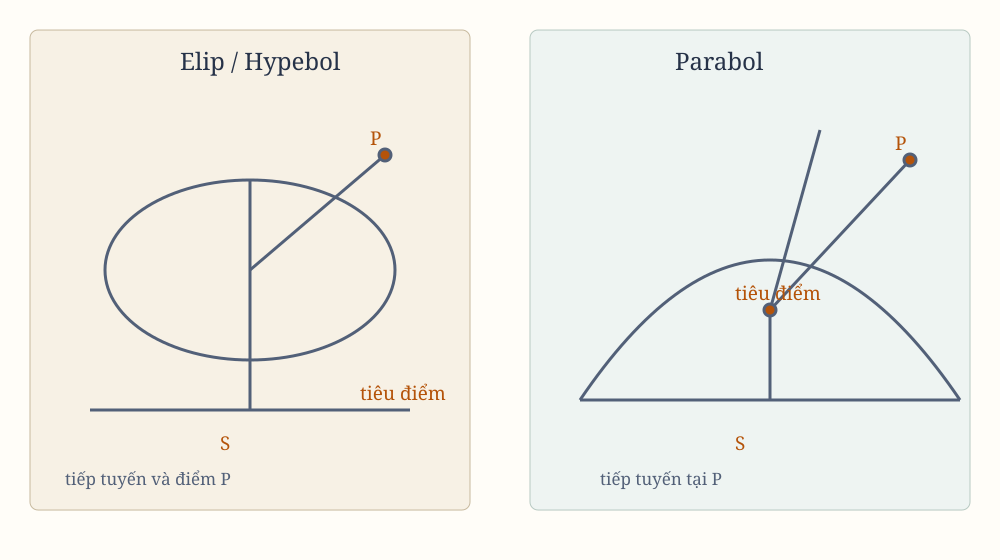

## Tìm các quỹ đạo elip, parabol và hypebol khi đã biết tiêu điểm

*Hình 15. Sơ đồ tổng hợp được dựng lại từ các hình bản gốc; cần đối chiếu từng ký hiệu với scan.*

## Lemma XV

Nếu từ hai tiêu điểm $S$, $H$ của một elip hoặc hypebol bất kỳ, ta kẻ hai đường thẳng $SV$, $HV$ tới một điểm thứ ba $V$, trong đó một đường $HV$ bằng trục chính của hình, tức là trục chứa hai tiêu điểm, thì đường thẳng còn lại $SV$ bị đoạn vuông góc $TR$ hạ xuống nó cắt đôi tại $T$. Đoạn vuông góc ấy sẽ chạm vào hình cắt conic tại một điểm nào đó; và ngược lại, nếu nó chạm vào hình cắt conic, $HV$ sẽ bằng trục chính của hình.

Cho đoạn vuông góc $TR$ cắt đường thẳng $HV$, kéo dài nếu cần, tại $R$, rồi nối $SR$. Vì $TS$, $TV$ bằng nhau, các đường thẳng $SR$, $VR$ và các góc $TRS$, $TRV$ cũng bằng nhau. Do đó, $R$ nằm trên hình cắt conic, và $TR$ chạm vào hình cắt conic ấy. Ngược lại, nếu $TR$ chạm vào hình cắt conic thì $HV$ bằng trục chính của hình.

> **[Chú giải]**
>
> **Tiếp tuyến của một conic là đường phân giác ngoài của góc hai tiêu điểm**
>
> Đây chính là **tính chất phản xạ** của conic - cái làm cho kính viễn và gương parabol trở thành dụng cụ quang học.
>
> Với tiêu điểm $S$, $H$ và điểm $P$ trên hình cắt conic, Lemma XV nói $ST$ là trung trực của $SV$, tức $TS = TV$, và từ đó $\angle TRS = \angle TRV$. Nói cách khác, góc giữa tiếp tuyến và bán kính tới tiêu điểm này bằng góc giữa tiếp tuyến và bán kính tới tiêu điểm kia. Với parabol, tiêu điểm nằm ở vô cùng nên góc phản xạ trở thành phản xạ song song.
>
> **Một cách dựng, không chỉ một tính chất**
>
> Cách dựng mà ông chỉ ra - lấy trung trực của một đoạn nối tiêu điểm với một điểm thứ ba - chính là cách thực hành mà người thợ dùng hàng thế kỷ: kẻ một sợi dây giữa hai điểm cố định, căng thẳng, bút chạm sợi dây sẽ vẽ nên đường conic. Người đọc hôm nay gọi đó là **đường dây kéo**, và nó vẫn là cách nhanh nhất để dựng elip bằng tay.
>
> Tính chất phản xạ giải thích vì sao kính viễn dùng parabol, vì sao đèn pha dùng gương parabol, và vì sao phòng đọng âm thanh dạng elip hoạt động: sóng âm từ một nguồn phản xạ đúng một lần rồi dồn về tiêu điểm. Nó cũng là lý do các conic xuất hiện trong thiết kế ống khuếch đại ánh sáng và trong nguyên lý truyền bức xạ vô tuyến.

## Proposition XVIII. Bài toán X

Từ một tiêu điểm và các trục chính đã cho, dựng các quỹ đạo elip và hypebol đi qua những điểm đã cho và chạm vào những đường thẳng đã cho theo vị trí.

Gọi $S$ là tiêu điểm chung của các hình, $AB$ là độ dài trục chính của một quỹ đạo bất kỳ, $P$ là một điểm mà quỹ đạo phải đi qua, và $TR$ là một đường thẳng mà quỹ đạo phải chạm vào.

Lấy $P$ làm tâm, với bán kính $AB - SP$ nếu quỹ đạo là elip, hoặc $AB + SP$ nếu quỹ đạo là hypebol, dựng đường tròn $HG$. Hạ $ST$ vuông góc với tiếp tuyến $TR$, kéo dài $ST$ đến $V$ sao cho $TV = ST$. Lấy $V$ làm tâm và bán kính $AB$, dựng đường tròn $FH$.

Nếu có hai điểm $P$, $p$, hoặc hai tiếp tuyến $TR$, $tr$, hoặc một điểm $P$ và một tiếp tuyến $TR$, ta dựng hai đường tròn theo cách ấy. Gọi $H$ là giao điểm chung của chúng. Từ hai tiêu điểm $S$, $H$ và trục đã cho, dựng quỹ đạo.

Vì $PH + SP$ trong elip, và $PH - SP$ trong hypebol, bằng trục chính, quỹ đạo dựng sẽ đi qua $P$; theo Lemma trước, nó sẽ chạm vào đường thẳng $TR$. Cùng lập luận ấy cho thấy nó sẽ đi qua hai điểm $P$, $p$, hoặc chạm vào hai đường thẳng $TR$, $tr$.

## Proposition XIX. Bài toán XI

Lấy một tiêu điểm đã cho, dựng quỹ đạo parabol đi qua những điểm đã cho và chạm vào những đường thẳng đã cho theo vị trí.

Gọi $S$ là tiêu điểm, $P$ là một điểm, và $TR$ là tiếp tuyến của quỹ đạo cần dựng. Lấy $P$ làm tâm, bán kính $PS$, dựng đường tròn $FG$. Từ tiêu điểm hạ $ST$ vuông góc với tiếp tuyến, kéo dài đến $V$ sao cho $TV = ST$.

Nếu có điểm thứ hai $p$, ta dựng đường tròn thứ hai $fg$ theo cùng cách. Nếu có tiếp tuyến thứ hai $tr$, ta cần tìm điểm thứ hai $v$.

Khi có hai điểm $P$, $p$, kẻ đường thẳng $IF$ tiếp xúc với hai đường tròn $FG$, $fg$. Khi có hai tiếp tuyến $TR$, $tr$, kẻ đường thẳng $IF$ đi qua hai điểm $V$, $v$. Khi có điểm $P$ và tiếp tuyến $TR$, kẻ đường thẳng $IF$ tiếp xúc với đường tròn $FG$ và đi qua $V$.

Hạ $SI$ vuông góc với $FI$ và chia đôi $SI$ tại $K$. Với trục $SK$ và đỉnh chính $K$, dựng parabol.

Vì $SK = IK$ và $SP = FP$, parabol này đi qua $P$. Vì $ST = TV$ và $\angle STR$ là góc vuông, theo Hệ quả 3 của Lemma XIV, nó chạm vào $TR$.

## Proposition XX. Bài toán XII

Lấy một tiêu điểm đã cho, dựng một quỹ đạo bất kỳ đã biết loại, đi qua những điểm đã cho và chạm vào những đường thẳng đã cho theo vị trí.

### Trường hợp 1

Dựng quỹ đạo $ABC$ đi qua hai điểm $B$, $C$.

Vì loại quỹ đạo đã biết, tỷ số giữa trục chính và khoảng cách hai tiêu điểm đã biết. Theo tỷ số ấy, lấy $KB$ so với $BS$, và $LC$ so với $CS$.

Lấy $B$, $C$ làm tâm, với các bán kính $BK$, $CL$, dựng hai đường tròn. Trên đường thẳng $KL$ tiếp xúc với hai đường tròn tại $K$, $L$, hạ $SG$ vuông góc. Đường thẳng này cắt các đường tròn tại $A$, $a$, sao cho
$$
GA:AS = Ga:aS = KB:BS.
$$
Với trục $Aa$ và các đỉnh $A$, $a$, dựng quỹ đạo.

Gọi $H$ là tiêu điểm còn lại của hình dựng. Vì $GA:AS = Ga:aS$, ta có
$$
Ga:GA = Aa:HS = AS:AS
$$
theo cách chia tỷ số, và do đó $SH$ có cùng tỷ số với trục chính và khoảng cách tiêu điểm của hình cần dựng. Vì vậy hình dựng cùng loại với hình đã cho.

Vì $KB:BS$ và $LC:CS$ cùng tỷ số, hình ấy đi qua $B$, $C$, như các tính chất của hình cắt conc cho thấy.

### Trường hợp 2

Dựng quỹ đạo chạm vào hai đường thẳng $TR$, $tr$.

Từ tiêu điểm hạ các đoạn vuông góc $ST$, $St$ xuống hai tiếp tuyến, kéo dài đến $V$, $v$ sao cho
$$
TV = TS,\qquad tv = tS.
$$
Chia đôi $Vv$ tại $O$, dựng đường vuông góc $OH$, cắt đường thẳng $VS$ kéo dài vô hạn tại $K$, $k$ sao cho
$$
VK:KS = Vk:Sk
$$
bằng tỷ số giữa trục chính của quỹ đạo cần dựng và khoảng cách tiêu điểm của nó.

Trên đường kính $Kk$ dựng đường tròn cắt $OH$ tại $H$. Với tiêu điểm $S$, $H$ và trục chính bằng $VH$, dựng quỹ đạo.

Chia đôi $Kk$ tại $X$, nối $HX$, $HS$, $HV$, $Hv$. Vì
$$
VK:KS = Vk:Sk,
$$
theo cách cộng và chia tỷ số, các tam giác $VXH$, $HXS$ đồng dạng. Do đó
$$
VH:SH = VX:XH = VK:KS.
$$
Vì thế, trục chính $VH$ của quỹ đạo dựng có cùng tỷ số với khoảng cách tiêu điểm $SH$ như trục chính của quỹ đạo cần dựng; do đó, nó cùng loại.

Vì $VH$, $vH$ bằng trục chính, còn $VS$, $vS$ bị các đường thẳng $TR$, $tr$ chia vuông góc, theo Lemma XV, hai đường thẳng ấy chạm vào quỹ đạo dựng.

### Trường hợp 3

Dựng quỹ đạo chạm vào đường thẳng $TR$ tại điểm $R$ đã cho.

Trên $TR$, hạ $ST$ vuông góc, kéo dài đến $V$ sao cho $TV = ST$. Nối $VR$, cắt $VS$ kéo dài vô hạn tại $K$, $k$ sao cho
$$
VK:SK = Vk:Sk
$$
bằng tỷ số giữa trục chính của elip cần dựng và khoảng cách tiêu điểm.

Trên đường kính $Kk$ dựng đường tròn, cắt $VR$ kéo dài tại $H$. Với tiêu điểm $S$, $H$ và trục chính bằng $VH$, dựng quỹ đạo.

Vì $VH:SH = VK:SK$, tỷ số ấy bằng tỷ số giữa trục chính của quỹ đạo cần dựng và khoảng cách tiêu điểm, như đã chứng minh ở Trường hợp 2. Vì thế, quỹ đạo dựng cùng loại với quỹ đạo cần dựng.

Đường thẳng $TR$, chia đôi góc $VRS$, chạm vào quỹ đạo tại $R$, theo các tính chất của hình cắt conic.

### Trường hợp 4

Dựng quỹ đạo $APB$ chạm vào đường thẳng $TR$, đi qua một điểm $P$ bất kỳ nằm ngoài tiếp tuyến, và đồng dạng với hình $apb$ đã dựng, có trục chính $ab$ và các tiêu điểm $s$, $h$.

Trên tiếp tuyến $TR$, hạ $ST$ vuông góc, kéo dài đến $V$ sao cho $TV = ST$.

Làm các góc $hsq$, $shq$ bằng các góc $VSP$, $SVP$. Lấy $q$ làm tâm, với bán kính tỷ lệ với $ab$ như $SP$ với $VS$, dựng đường tròn cắt hình $apb$ tại $p$. Nối $sp$, rồi dựng $SH$ sao cho
$$
SH:sh = SP:sp,
$$
và $\angle PSH = \angle psh$, $\angle VSH = \angle pyq$.

Với hai tiêu điểm $S$, $H$ và trục chính $AB$ bằng khoảng cách $VH$, dựng một hình cắt conic.

Nếu kẻ $sv$ sao cho $sv:sp = sh:sq$, $\angle vsp = \angle hsq$ và $\angle vsh = \angle psq$, các tam giác $svh$, $spq$ đồng dạng. Do đó
$$
vh:pq = sh:sq = VS:SP = ab:pq.
$$
Vì vậy $vh = ab$. Vì các tam giác $VSH$, $vsh$ đồng dạng,
$$
VH:SH = vh:sh.
$$
Trục của hình cắt conic dựng có cùng tỷ số với khoảng cách tiêu điểm như trục $ab$ với khoảng cách $sh$; do đó, hình dựng đồng dạng với hình $aph$.

Vì tam giác $PSH$ đồng dạng với tam giác $psh$, hình này đi qua $P$. Vì $VH$ bằng trục chính, còn $VS$ bị $TR$ chia vuông góc, hình ấy chạm vào $TR$.

> **[Chú giải]**
>
> **Một hình cắt conic có đúng năm điều kiện độc lập**
>
> Các Bài toán X, XI và XII tạo thành một bộ **dựng hình bằng thước kẻ và com pa** hoàn chỉnh, và khi nhìn lại ta thấy chúng được điều khiển bởi một con số duy nhất.
>
> Một conic tổng quát có phương trình $Ax^2 + Bxy + Cy^2 + Dx + Ey + F = 0$ với sáu hệ số, trừ đi một vì nhân cả hai vế với một hằng số không đổi hình, nên còn **năm** tham số. Mỗi điều kiện đi qua một điểm hay chạm một đường thẳng là một ràng buộc tuyến tính, tức mất đúng một tham số. Kiểm lại: Bài toán X cho trước tiêu điểm và độ dài trục chính, rồi một điểm và một tiếp tuyến - đủ năm. Ở Trường hợp 1 của Bài toán XII, có thêm điều kiện loại quỹ đạo đã biết, cộng tiêu điểm và hai điểm - cũng đủ năm.
>
> **Đủ ca cho mọi bài toán thực tế mà kỹ thuật thời ông gặp**
>
> Một hành tinh được quan sát ở vài vị trí và vài thời điểm, và ông phải dựng được conic khớp với tất cả. Ông không có máy tính, nên phải giải bằng thước kẻ và com pa - và ông liệt kê đủ từng tổ hợp: hai điểm, hai tiếp tuyến, một điểm và một tiếp tuyến, một tiếp tuyến tại một điểm đã biết, và cả trường hợp quỹ đạo đồng dạng với một hình cho trước.
>
> Người đọc hôm nay vẫn làm đúng việc đếm ấy, chỉ khác là dùng ma trận thay cho thước kẻ. Bài toán dựng quỹ đạo từ các điểm và tiếp tuyến vẫn là bài toán chuẩn trong thiên văn học, và dạng tối ưu của nó ngày nay mang tên **Lambert**. Việc chọn đúng số lượng điều kiện vẫn là kỹ năng cốt lõi: lấy dư một điều kiện thì bài toán không xác định, lấy thiếu thì vô số nghiệm.
