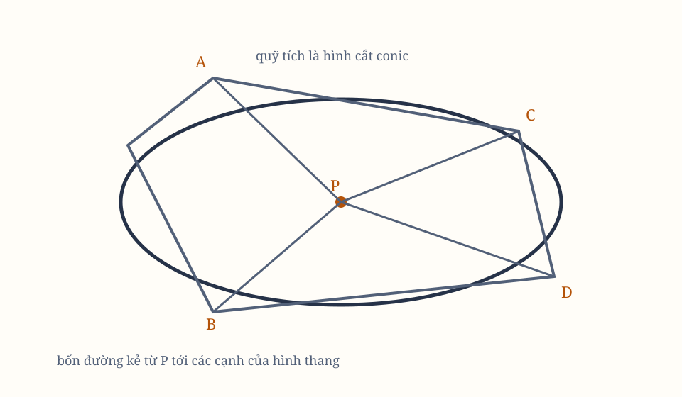

# Sách I, Phần V. Lemma XVII–XXI

## Cách tìm các quỹ đạo khi không biết tiêu điểm

*Hình 16. Sơ đồ tổng hợp được dựng lại từ các hình bản gốc; cần đối chiếu ký hiệu với scan.*

## Lemma XVII

Nếu từ một điểm $P$ bất kỳ của một hình cắt conh đã cho, ta kẻ bốn đường thẳng $PQ$, $PR$, $PS$, $PT$ tới bốn cạnh kéo dài $AB$, $CD$, $AC$, $DB$ của một hình thang $ABDC$ nội tiếp trong hình cắt conic ấy, mỗi đường tới mỗi cạnh theo những góc đã cho, thì diện tích hình chữ nhật $PQ \times PR$ của hai đường tới hai cạnh đối diện $AB$, $CD$ sẽ ở trong một tỷ số đã cho với diện tích $PS \times PT$ của hai đường tới hai cạnh đối diện còn lại $AC$, $BD$.

### Trường hợp 1

Trước hết, giả sử các đường kẻ tới một cặp cạnh đối diện song song với một trong hai cạnh kia, chẳng hạn $PQ$, $PR$ song song với cạnh $AC$, còn $PS$, $PT$ song song với cạnh $AB$. Giả sử thêm rằng hai cạnh đối diện $AC$, $BD$ song song với nhau.

Khi ấy, đường thẳng chia đôi hai cạnh song song ấy sẽ là một trong các đường kính của hình cắt conic, và cũng chia đôi $RQ$. Gọi $O$ là điểm chia đôi $RQ$. Khi ấy $PO$ là ordinate của đường kính ấy. Kéo dài $PO$ đến $K$ sao cho $OK = PO$. Vì vậy, $OK$ là ordinate ở phía bên kia của đường kính.

Vì các điểm $A$, $B$, $P$, $K$ nằm trong hình cắt conic, và $PK$ cắt $AB$ theo một góc đã cho, hình chữ nhật $PQK$ ở trong một tỷ số đã cho với hình chữ nhật $AQB$ (theo các Proposition XVII, XIX, XXI và XXII, Book III, *Conics* của Apollonius).

Vì $QK$ và $PR$ bằng nhau, chúng là hiệu của những đoạn bằng nhau $OK$, $OP$ và $OQ$, $OR$. Do đó, hình chữ nhật $PQK$ và $PQ \times PR$ bằng nhau. Vì thế,
$$
PQ \times PR : PS \times PT
$$
đã cho.

### Trường hợp 2

Giả sử hai cạnh đối diện $AC$, $BD$ của hình thang không song song. Kẻ $Be$ song song với $AC$, cắt đường thẳng $ST$ tại $t$ và hình cắt conic tại $d$. Nối $Cd$, cắt $PQ$ tại $r$, rồi kẻ $DM$ song song với $PQ$, cắt $Cd$ tại $M$ và $AB$ tại $N$.

Vì các tam giác $BTt$, $DBN$ đồng dạng, ta có
$$
Et:PQ = Tt:DN.
$$

Vì các tam giác $AQr$, $PSr$ đồng dạng, ta có
$$
Rr:PS = DM:AN.
$$

Do đó, khi nhân các vế trước với các vế trước, ta có
$$
PQ \times Rr : PS \times Tt
=
NDM : ANB.
$$

Theo Trường hợp 1, tỷ số này cũng bằng
$$
PQ \times Pr : PS \times Pt.
$$
Suy ra
$$
PQ \times PR : PS \times PT
$$
đã cho.

### Trường hợp 3

Giả sử bốn đường $PQ$, $PR$, $PS$, $PT$ không song song với các cạnh $AC$, $AB$, mà nghiêng tùy ý. Thay chúng bằng $Pq$, $Pr$ song song với $AC$, và $Ps$, $Pt$ song song với $AB$.

Vì các góc của các tam giác $PQq$, $PRr$, $PSs$, $PTt$ đã cho, các tỷ số
$$
PQ:Pq,\quad PR:Pr,\quad PS:Ps,\quad PT:Pt
$$
đều đã cho. Vì vậy, các tỷ số tạo thành
$$
PQ \times PR : Pq \times Pr
$$
và
$$
PS \times PT : Ps \times Pt
$$
đều đã cho.

Theo những điều đã chứng minh, tỷ số
$$
Pq \times Pr : Ps \times Pt
$$
đã cho. Do đó, tỷ số
$$
PQ \times PR : PS \times PT
$$
cũng đã cho.

## Lemma XVIII

Với các điều kiện ấy, nếu diện tích $PQ \times PR$ của các đường kẻ tới hai cạnh đối diện của hình thang ở trong tỷ số đã cho với diện tích $PS \times PT$ của các đường kẻ tới hai cạnh còn lại, thì điểm $P$, từ đó các đường ấy được kẻ, sẽ nằm trong một hình cắt conh mô tả quanh hình thang.

Hãy hình dung một hình cắt conh đi qua $A$, $B$, $C$, $D$ và một điểm $P$ bất kỳ trong vô số điểm, chẳng hạn $p$. Tôi nói rằng $P$ sẽ luôn nằm trong hình cắt conic ấy.

Nếu phủ định điều ấy, nối $AP$ và cho nó cắt hình cắt conic tại một điểm khác $P$, giả sử tại $b$. Khi đó, nếu từ $p$ và $b$ ta kẻ các đường $pq$, $pr$, $ps$, $pt$ và $bk$, $bn$, $bf$, $bd$ theo những góc đã cho tới các cạnh của hình thang, ta có
$$
bk \times bn : bf \times bd = pq \times pr : ps \times pt.
$$

Theo giả thiết,
$$
PQ \times PR : PS \times PT
$$
cũng bằng tỷ số ấy. Vì các hình thang $bkAf$, $PQAS$ đồng dạng, ta có
$$
bk:bf = PQ:PS.
$$

Do đó, bằng cách chia các số hạng tương ứng, ta có
$$
bn:bd = PR:PT.
$$

Vì thế các hình thang đồng góc $Dnbd$, $DRPT$ đồng dạng, và các đường chéo $Db$, $DP$ trùng nhau. Do đó $b$ nằm tại giao điểm của $AP$, $DP$, và trùng với $P$. Vì vậy, điểm $P$, dù được lấy ở đâu, cũng nằm trong hình cắt conic đã định.

## Hệ quả

Nếu từ một điểm $P$ chung, ta kẻ ba đường thẳng $PQ$, $PR$, $PS$ tới ba đường thẳng $AB$, $CD$, $AC$ đã cho theo vị trí, mỗi đường tới mỗi cạnh theo những góc tương ứng đã cho, và diện tích $PQ \times PR$ dưới hai đường bất kỳ ở trong tỷ số đã cho với bình phương $PS^2$, thì điểm $P$ sẽ nằm trong một hình cắt conh chạm các đường $AB$, $CD$ tại $A$, $C$; và ngược lại.

Vì vị trí của ba đường $AB$, $CD$, $AC$ không đổi, cho $BD$ tiến tới và trùng với $AC$. Đồng thời, cho $PT$ trùng với $PS$. Khi đó, $PS \times PT$ trở thành $PS^2$, còn $AB$, $CD$, trước đây cắt đường cong tại $A$, $B$ và $C$, $D$, chỉ còn chạm đường cong tại những điểm trùng nhau ấy.

## Học luận

Trong Lemma này, “hình cắt conic” phải được hiểu theo nghĩa rộng, gồm cả lát cắt thẳng qua đỉnh của nón và lát cắt tròn song song với đáy.

Nếu $p$ rơi vào một đường thẳng nối $A$, $D$ hoặc $C$, $B$, hình cắt conic biến thành hai đường thẳng: một đường chứa $p$, và một đường nối hai điểm còn lại trong bốn điểm.

Nếu hai góc đối diện của hình thang, lấy cộng lại, bằng hai góc vuông, và bốn đường $PQ$, $PR$, $PS$, $PT$ được kẻ vuông góc hoặc theo những góc bằng nhau, với
$$
PQ \times PR = PS \times PT,
$$
hình cắt conic sẽ trở thành đường tròn.

Điều tương tự cũng xảy ra nếu bốn đường được kẻ theo bất kỳ góc nào, và
$$
PQ \times PR : PS \times PT
$$
bằng tỷ số của diện tích dưới các góc của hai đường $PS$, $PT$ với diện tích dưới các góc của hai đường $PQ$, $PR$.

Trong mọi trường hợp khác, quỹ tích của $P$ là một trong ba hình thường gặp với tên hình cắt conic. Ta có thể thay hình thang $ABCD$ bằng một tứ giác có hai cạnh đối diện cắt nhau như hai đường chéo.

Ta cũng có thể giả thiết một hoặc hai trong bốn điểm $A$, $B$, $C$, $D$ nằm ở vô cùng. Khi ấy, các cạnh của hình hội tụ về những điểm ấy trở thành song song, và hình cắt conic đi qua những điểm còn lại, tiến vô hạn theo các đường song song ấy.

## Lemma XIX

Tìm một điểm $P$ sao cho nếu kẻ bốn đường thẳng $PQ$, $PR$, $PS$, $PT$ tới bốn đường thẳng $AB$, $CD$, $AC$, $BD$ đã cho theo vị trí, mỗi đường tới mỗi cạnh theo những góc đã cho, thì
$$
PQ \times PR : PS \times PT
$$
bằng một tỷ số đã cho.

Giả sử $AB$, $CD$, mà $PQ$, $PR$ kẻ tới, cắt hai đường thẳng đã cho theo vị trí tại $A$, $B$, $C$, $D$. Từ một điểm trong số đó, chẳng hạn $A$, kẻ một đường thẳng bất kỳ $AH$ để tìm $P$. Cho nó cắt các đường đối diện $BD$, $CD$ tại $H$, $I$.

Vì các góc của hình đã cho, tỷ số $PQ:PA$, $PA:PS$, và do đó $PQ:PS$, đều đã cho. Trừ tỷ số ấy khỏi tỷ số đã cho
$$
PQ \times PR : PS \times PT,
$$
ta được tỷ số $PR:PT$. Cộng các tỷ số đã cho $PI:PR$ và $PT:PH$, ta được tỷ số $PI:PH$, và do đó tìm được $P$.

## Hệ quả 1

Vì thế, ta cũng có thể kẻ tiếp tuyến tại bất kỳ điểm $D$ nào của quỹ tích. Dây $PD$, nơi $P$ và $D$ gặp nhau, trở thành tiếp tuyến. Khi đó, tỷ số giới hạn của các đoạn $IP$, $PH$ được xác định như trên.

Kẻ $CF$ song song với $AD$, cắt $BD$ tại $F$, rồi cắt $CF$ tại $E$ theo cùng tỷ số giới hạn. Khi ấy $DE$ là tiếp tuyến, vì $CF$ song song với đoạn vô cùng nhỏ $IH$, và chúng cắt nhau theo cùng cách tại $E$, $P$.

## Hệ quả 2

Vì thế, quỹ tích của mọi điểm $P$ cũng có thể được xác định.

Từ một điểm bất kỳ trong số $A$, $B$, $C$, $D$, chẳng hạn $A$, kẻ $AE$ tiếp xúc với quỹ tích. Từ một điểm khác $B$, kẻ $BF$ song song với tiếp tuyến, cắt quỹ tích tại $F$, rồi tìm $F$ bằng Lemma này.

Chia đôi $BF$ tại $G$. Đường $AG$ kéo dài sẽ là vị trí của đường kính mà $BG$, $FG$ là các ordinate. Cho $AG$ cắt quỹ tích tại $H$. Khi ấy $AH$ là đường kính hoặc latus transversum, và latus rectum tỷ lệ với
$$
\frac{BG^2}{AG \times GH}.
$$

Nếu $AG$ không bao giờ cắt quỹ tích, $AH$ vô hạn, quỹ tích là parabol, và latus rectum ứng với đường kính $AG$ bằng
$$
\frac{BG^2}{AG}.
$$

Nếu nó có cắt, quỹ tích là hypebol khi $A$, $H$ nằm cùng phía của $G$, và là elip khi $G$ nằm giữa $A$, $H$; trừ trường hợp $\angle AGB$ là góc vuông đồng thời $BG^2 = AG \times GH$, khi đó quỹ tích là đường tròn.

Như vậy, Hệ quả này giải bài toán nổi tiếng của các nhà cổ đại về bốn đường thẳng, bắt đầu bởi Euclid và tiếp tục bởi Apollonius. Đây không phải một phép tính giải tích, mà là một sự phối hợp hình học, đúng như các nhà cổ đại yêu cầu.

## Lemma XX

Nếu hai đỉnh đối diện $A$, $P$ của một hình bình hành $ASPQ$ chạm một hình cắt conh tại $A$, $P$, và hai cạnh $AQ$, $AS$ của một góc, kéo dài vô hạn, cắt cùng hình cắt conh ấy tại $B$, $C$; từ hai điểm giao ấy $B$, $C$ kẻ hai đường thẳng $BD$, $CD$ tới một điểm thứ năm $D$ của hình cắt conh, cắt hai cạnh còn lại $PS$, $PQ$ của hình bình hành, kéo dài vô hạn, tại $T$, $R$, thì các phần $PR$, $PT$ bị cắt từ các cạnh luôn ở trong một tỷ số đã cho. Ngược lại, nếu các phần ấy ở trong tỷ số đã cho, quỹ tích của $D$ sẽ là một hình cắt conh đi qua bốn điểm $A$, $B$, $C$, $P$.

### Trường hợp 1

Nối $BP$, $CP$. Từ $D$ kẻ hai đường $DG$, $DE$: $DG$ song song với $AB$ và cắt $PB$, $PQ$, $CA$ tại $H$, $I$, $G$; $DE$ song song với $AC$ và cắt $PC$, $PS$, $AB$ tại $F$, $K$, $E$.

Theo Lemma XVII,
$$
DE \times DF : DG \times DH
$$
bằng một tỷ số đã cho.

Vì $PQ:DE = PB:HB$, và $PB:HB = PT:DH$, ta có
$$
PQ:PT = DE:DH.
$$

Tương tự, vì $PR:DF = RC:DC$, và $RC:DC = PS:DG$, ta có
$$
PR:PS = DF:DG.
$$

Nhân các tỷ số ấy, ta được
$$
PQ \times PR : PS \times PT
=
DE \times DF : DG \times DH.
$$

Vì $PQ$, $PS$ đã cho, tỷ số $PR:PT$ đã cho.

### Trường hợp 2

Nếu $PR$, $PT$ được giả thiết ở trong một tỷ số đã cho, quay lại lập luận như trên, ta có
$$
DE \times DF : DG \times DH
$$
bằng tỷ số đã cho. Do đó, theo Lemma XVIII, $D$ nằm trong một hình cắt conh đi qua $A$, $B$, $C$, $P$.

## Hệ quả 1

Kẻ $BC$ cắt $PQ$ tại $r$, và lấy $Pt:Pr$ theo cùng tỷ số mà $PT:PR$. Khi ấy $Bt$ chạm hình cắt conh tại $B$.

Nếu $D$ trùng với $B$, dây $BD$ biến mất, $BT$ trở thành tiếp tuyến, còn $CD$ và $BT$ trùng với $CB$ và $Bt$.

## Hệ quả 2

Ngược lại, nếu $Bt$ là tiếp tuyến, và $BD$, $CD$ cắt nhau tại một điểm $D$ bất kỳ của hình cắt conh, thì
$$
PR:PT = Pr:Pt.
$$

Và ngược lại, nếu $PR:PT = Pr:Pt$, $BD$ và $CD$ sẽ cắt nhau tại một điểm $D$ nào đó của một hình cắt conh.

## Hệ quả 3

Một hình cắt conh không thể cắt một hình cắt conh khác tại nhiều hơn bốn điểm.

Nếu điều ấy có thể, cho hai hình cắt conic đi qua năm điểm $A$, $B$, $C$, $P$, $O$. Cho $BD$ cắt chúng tại $D$, $d$, và cho $Cd$ cắt $PQ$ tại $q$. Khi ấy
$$
PR:PT = Pq:PT,
$$
nên $PR = Pq$, trái với giả thiết.

> **[Ghi chú hiện đại]**
>
> **Khái niệm tương ứng.** Hệ quả 3 của Lemma XX là một trong những kết quả thuần túy nhất và đẹp nhất trong phần hình học của *Principia*: **hai hình cắt conic bất kỳ cắt nhau ở nhiều nhất bốn điểm**. Người đọc hôm nay gọi đây là trường hợp riêng của định lý Bézout cho đường cong bậc hai.
>
> **Công thức.** Lập luận của Newton là phản chứng: nếu hai conic cắt nhau ở năm điểm, lấy hai điểm làm cực rồi kẻ đường, ta sẽ có $PR = Pq$ — hai đoạn thẳng khác nhau phải bằng nhau, mâu thuẫn. Từ đây suy ra điều quan trọng hơn: **năm điểm xác định duy nhất một hình cắt conic**. Phương trình bậc hai có sáu hệ số, trừ một vì quy mô, còn năm tham số — khớp chính xác với con số năm điểm.
>
> **Vì sao Newton viết như vậy.** Vì ông cần nó như một **công cụ phân biệt**, chứ không phải một định lý để trích dẫn. Ở Lemma XXI ngay sau đó, ông dùng đúng phép kiểm tra "năm điểm" này để kết luận rằng một quỹ tích buộc phải là **đường thẳng** chứ không thể là đường cong. Nếu Lemma XX không có Hệ quả 3, phần cuối của Lemma XXI sẽ không đóng lại được.
>
> **Hiện nay thì sao.** Người đọc hôm nay dùng Hệ quả 3 như một phép thử theo hướng ngược: thấy năm điểm nằm trên một đường cong lạ thì ngay lập tức hỏi nó có phải conic không, và nếu không thì không conic nào đi qua được cả năm điểm ấy. Cùng bằng chứng ấy cũng nằm ở gốc của **lý thuyết nội suy**: cho năm điểm dữ liệu, duy nhất có một conic khớp, và sai số ở điểm thứ sáu là phép đo chất lượng của phép khớp.

## Lemma XXI

Nếu hai đường thẳng di động và không xác định $BM$, $CM$ kẻ qua các điểm cố định $B$, $C$ với điểm giao $M$, mô tả một đường thẳng thứ ba $MN$ đã cho theo vị trí; và hai đường thẳng di động không xác định $BD$, $CD$ được kẻ tạo với hai đường ấy những góc đã cho $MBD$, $MCD$ tại $B$, $C$, thì hai đường $BD$, $CD$ sẽ mô tả, tại điểm giao $D$, một hình cắt conh đi qua $B$, $C$. Ngược lại, nếu $BD$, $CD$ mô tả tại $D$ một hình cắt conh đi qua các điểm đã cho $B$, $C$, $A$, và $\angle DBM$ luôn bằng góc đã cho $\angle ABC$, cũng như $\angle DCM$ luôn bằng $\angle ACB$, thì $M$ sẽ nằm trên một đường thẳng đã cho theo vị trí.

Trên $MN$, cho một điểm $N$ cố định. Khi điểm di động $M$ rơi vào $N$, cho điểm di động $D$ rơi vào một điểm cố định $P$. Nối $ON$, $BN$, $CP$, $BP$, rồi từ $P$ kẻ $PT$, $PR$ cắt $BD$, $CD$ tại $T$, $R$, sao cho
$$
\angle BPT = \angle BNM,\qquad
\angle CPR = \angle CNM.
$$

Vì $\angle MBD = \angle NBP$ và các góc tương ứng bằng nhau, sau khi bỏ các góc chung, ta có
$$
\angle NBM = \angle PBT,\qquad
\angle NCM = \angle PCR.
$$

Vì thế các tam giác $NBM$, $PBT$ đồng dạng, cũng như $NCM$, $PCR$. Do đó
$$
PT:NM = PB:NB,
\qquad
PR:NM = PC:NC.
$$

Các điểm $B$, $C$, $N$, $P$ đều cố định. Vì vậy $PT$, $PR$ có tỷ số đã cho với $NM$, và do đó có tỷ số đã cho với nhau. Theo Lemma XX, điểm $D$, nơi hai đường di động $BT$ và $CR$ cắt nhau, sẽ nằm trong hình cắt conh đi qua $B$, $C$, $P$.

Ngược lại, giả sử điểm di động $D$ nằm trong một hình cắt conh đi qua $B$, $C$, $A$, và các góc $DBM$, $DCM$ luôn bằng các góc $ABC$, $ACB$ đã cho. Khi $D$ lần lượt rơi vào hai điểm cố định $p$, $P$ của hình cắt conh, điểm di động $M$ lần lượt rơi vào hai điểm cố định $m$, $N$. Kẻ đường thẳng $mN$; đó là quỹ tích của $M$.

Nếu $M$ nằm trên một đường cong, $D$ sẽ nằm trong một hình cắt conh đi qua năm điểm $B$, $C$, $A$, $p$, $P$. Nhưng theo điều đã chứng minh, khi $M$ nằm trên một đường thẳng, $D$ cũng phải nằm trong một hình cắt conh đi qua cùng năm điểm ấy. Hai hình cắt conic sẽ cùng đi qua năm điểm, trái với Hệ quả 3 của Lemma XX. Vì vậy, giả thiết $M$ nằm trên một đường cong là vô lý.

## Proposition XXII. Bài toán XIV

Dựng một quỹ đạo đi qua năm điểm đã cho.

Gọi năm điểm đã cho là $A$, $B$, $C$, $P$, $D$. Từ một điểm bất kỳ, chẳng hạn $A$, tới hai điểm còn lại $B$, $C$, có thể gọi là hai cực, kẻ các đường thẳng $AB$, $AC$, và qua điểm thứ tư $P$ kẻ các đường song song $TPS$, $PRO$.

Từ hai cực $B$, $C$, kẻ qua điểm thứ năm $D$ hai đường không xác định $BDT$, $CRD$, lần lượt cắt các đường vừa kẻ tại $T$, $R$. Kẻ đường thẳng $tr$ song song với $TR$, cắt các đoạn $PT$, $PR$ theo những tỷ lệ đã cho, sao cho
$$
Pt:Pr = PT:PR.
$$

Qua $t$, $r$ và các cực $B$, $C$, kẻ $Bt$, $Cr$, cắt nhau tại $d$. Điểm $d$ sẽ nằm trên quỹ đạo cần dựng. Theo Lemma XX, $d$ nằm trong một hình cắt conh đi qua bốn điểm $A$, $B$, $C$, $P$. Khi các đoạn $Rt$, $Tv$ biến mất, $d$ trùng với $D$. Vì vậy, hình cắt conh đi qua năm điểm $A$, $B$, $C$, $P$, $D$.

## Cách dựng khác

Nối ba điểm bất kỳ trong số các điểm đã cho, chẳng hạn $A$, $B$, $C$. Lấy hai điểm $B$, $C$ làm cực, cho các góc $ABC$, $ACB$ có độ lớn đã cho quay quanh chúng.

Áp dụng hai cạnh $BA$, $CA$ lần lượt vào $D$ rồi đến $P$, và đánh dấu các điểm $M$, $N$ là giao điểm của các cạnh $BL$, $CL$ với nhau trong hai trường hợp.

Kẻ đường thẳng không xác định $MN$, rồi cho các góc di động ấy quay quanh hai cực $B$, $C$ sao cho giao điểm của $BL$, $CL$ luôn nằm trên $MN$. Khi ấy giao điểm của $BA$, $CA$, hoặc $BD$, $CD$, sẽ mô tả quỹ đạo $PADCB$.

Theo Lemma XXI, $d$ nằm trong một hình cắt conh đi qua $B$, $C$. Khi $m$ trùng với $L$, $M$, $N$, điểm $d$ sẽ trùng với $A$, $D$, $P$. Vì vậy, ta dựng được một hình cắt conh đi qua năm điểm $A$, $B$, $C$, $P$, $D$.

## Hệ quả 1

Vì vậy, ta có thể dễ dàng kẻ một đường thẳng tiếp xúc với quỹ đạo tại điểm $B$ bất kỳ. Cho $d$ trùng với $B$; khi ấy $Bt$ trở thành tiếp tuyến cần tìm.

## Hệ quả 2

Vì vậy, cũng có thể tìm các tâm, đường kính và latus rectum của các quỹ đạo, như trong Hệ quả 2 của Lemma XIX.

## Học luận

Cách dựng trước sẽ đơn giản hơn nếu ta nối $P$ với $B$, và trên đường ấy, kéo dài nếu cần, lấy $Bp:BP = PR:PT$. Qua $p$, kẻ đường thẳng không xác định song song với $PT$, và trên đường ấy lấy $pe$ sao cho $pe = Pr$. Kẻ $Be$, $Cr$ cho tới khi cắt nhau tại $d$.

Vì
$$
Pr:Pt = PR:PT = pB:PB = pe:Pt,
$$
nên $pe$ và $Pr$ luôn bằng nhau. Bằng cách này, các điểm của quỹ đạo được tìm thấy dễ dàng hơn, trừ khi ta muốn mô tả đường cong theo cách cơ học như trong cách dựng thứ hai.

> **[Ghi chú hiện đại]**
>
> **Khái niệm tương ứng.** Lemma XXI là một lập luận **quỹ tích** theo kiểu mà ngành hình học đồng phẳng gọi là phép chiếu: hai đường thẳng động quay quanh hai điểm cố định theo những góc cố định, và giao điểm của chúng vẽ ra một đường thẳng. Đó chính là cơ chế của phép chiếu, mặc dù thuật ngữ ấy chưa tồn tại.
>
> **Công thức.** Cấu trúc của Lemma XXI là: cho một điểm $A$ cố định trên conic, quay hai cạnh $BA$, $CA$ quanh $B$, $C$ sao cho giao điểm luôn nằm trên một đường thẳng; khi đó giao điểm của các cạnh ứng với $D$ và $P$ vẽ nên conic đi qua $A$, $D$, $P$, $B$, $C$. Mấu chốt nằm ở bước cuối: nếu quỹ tích là một đường cong, nó sẽ phải là conic đi qua đúng năm điểm đó — mà Hệ quả 3 của Lemma XX vừa cấm. Suy ra quỹ tích buộc là đường thẳng.
>
> **Vì sao Newton viết như vậy.** Vì ông đang giải bài toán bốn đường thẳng nổi tiếng của các nhà cổ đại, và ông từ chối dùng phép tính giải tích. Ông viết thẳng ở cuối Hệ quả 2 của Lemma XIX rằng đây không phải một phép tính giải tích, mà là một sự phối hợp hình học, đúng như các nhà cổ đại yêu cầu. Đó là một tuyên bố có chủ ý, và nó đáng chú ý về mặt lịch sử: ông viết *Principia* vài thập kỷ trước khi hình học đồng phẳng trở thành một môn học riêng.
>
> **Hiện nay thì sao.** Nội dung của Lemma XXI chính là **đường thẳng trong trường phẳng chiếu**, và nó là nền của hình học hình chiếu mà Desargues, Pascal và Brianchon phát triển sau đó. Cùng lập luận "năm điểm xác định một conic" lại trở thành **thực bao hình học**: giả hệ với một conic từ năm điểm là bài toán chuẩn của kỹ thuật đo đạc, và nó chỉ có lời giải khi năm điểm ấy "tốt" theo đúng nghĩa mà Hệ quả 3 vừa định nghĩa.
