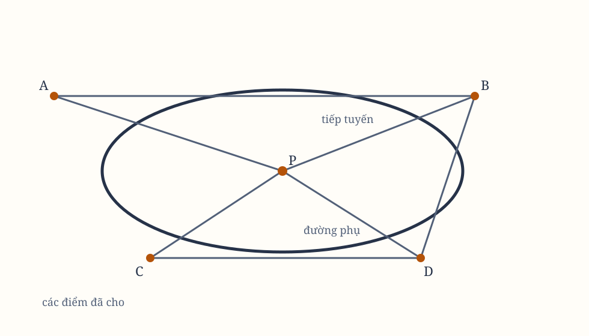

*Hình 17. Sơ đồ tổng hợp được dựng lại từ các hình bản gốc; cần đối chiếu từng ký hiệu với scan.*

## Proposition XXIII. Bài toán XV

Dựng một quỹ đạo đi qua bốn điểm đã cho và chạm một đường thẳng đã cho theo vị trí.

### Trường hợp 1

Giả sử $HB$ là tiếp tuyến đã cho, $B$ là điểm tiếp xúc, và $C$, $I$, $P$ là ba điểm đã cho còn lại. Nối $BC$, kẻ $IS$ song song với $BH$, $PQ$ song song với $BC$, hoàn thành hình bình hành $BSPQ$.

Kẻ $BD$ cắt $SP$ tại $T$, và $CD$ cắt $PQ$ tại $R$. Cuối cùng, kẻ một đường bất kỳ $tr$ song song với $TR$, cắt các đoạn $PQ$, $PS$ theo những tỷ lệ $Pr:Pr$ và $Pt:PT$ tương ứng. Kẻ $Cr$, $Bt$ cho cắt nhau tại $d$. Điểm $d$ sẽ luôn nằm trên quỹ đạo cần dựng.

### Cách dựng khác

Cho góc $CBH$ có độ lớn đã cho quay quanh cực $B$; cho bán kính thẳng $IC$, kéo dài theo cả hai phía, quanh cực $C$.

Đánh dấu $M$, $N$ là các điểm mà cạnh $BC$ của góc cắt bán kính đó khi cạnh kia của góc lần lượt gặp nó tại $P$ và $D$. Kẻ đường thẳng không xác định $MN$, rồi cho bán kính $CP$ hoặc $CD$ và cạnh $BC$ của góc tiếp tục gặp nhau trên đường ấy. Giao điểm của cạnh kia $BH$ với bán kính sẽ vẽ quỹ đạo cần dựng.

Nếu trong cách dựng của bài toán trước, $A$ trùng với $B$, các đường $CA$, $CB$ trùng nhau, và đường $AB$ ở vị trí cuối trở thành tiếp tuyến $BH$. Vì vậy, cách dựng ở đây trở thành cách dựng trước. Do đó, giao điểm của cạnh $BH$ với bán kính sẽ mô tả một hình cắt conh đi qua $C$, $D$, $P$ và chạm $BH$ tại $B$.

### Trường hợp 2

Giả sử bốn điểm $B$, $C$, $D$, $P$ đã cho nằm ngoài tiếp tuyến $HI$. Nối từng cặp điểm bằng các đường $BD$, $CP$, cắt nhau tại $G$ và cắt tiếp tuyến tại $H$, $I$.

Cắt tiếp tuyến tại $A$ sao cho
$$
HA:IA
=
\frac{\text{hình chữ nhật dưới trung bình nhân giữa }CG,GP}
{\text{hình chữ nhật dưới trung bình nhân giữa }BH,HD}
:
\frac{\text{hình chữ nhật dưới trung bình nhân giữa }GD,GB}
{\text{hình chữ nhật dưới trung bình nhân giữa }PI,IC}.
$$

Khi ấy $A$ là điểm tiếp xúc. Nếu $HX$ song song với $PI$ cắt quỹ đạo tại $X$, $Y$, thì theo các tính chất của hình cắt conh, $A$ được đặt sao cho
$$
HA^2:AP
$$
bằng tỷ số tạo thành từ
$$
XHY:BHD
\quad\text{hoặc}\quad
CGP:DGB,
$$
cộng với tỷ số
$$
BHD:PIC.
$$

Sau khi tìm được điểm tiếp xúc $A$, dựng quỹ đạo như Trường hợp 1. Điểm $A$ có thể nằm giữa $H$, $I$ hoặc nằm ngoài chúng; vì vậy có thể mô tả hai quỹ đạo.

## Proposition XXIV. Bài toán XVI

Dựng một quỹ đạo đi qua ba điểm đã cho và chạm hai đường thẳng đã cho theo vị trí.

Giả sử $HI$, $KL$ là hai tiếp tuyến đã cho, còn $B$, $C$, $D$ là các điểm đã cho. Qua hai điểm bất kỳ trong số đó, chẳng hạn $B$, $D$, kẻ đường không xác định $BD$ cắt hai tiếp tuyến tại $H$, $K$. Qua hai điểm còn lại, chẳng hạn $C$, $D$, kẻ $CD$ cắt các tiếp tuyến tại $I$, $L$.

Cắt các đường đã kẻ tại $R$, $S$ sao cho
$$
HR:KR
=
\frac{\text{trung bình nhân giữa }BH,HD}
{\text{trung bình nhân giữa }BK,KD},
$$
và
$$
IS:LS
=
\frac{\text{trung bình nhân giữa }CI,ID}
{\text{trung bình nhân giữa }CL,LD}.
$$

Có thể cắt ở giữa $K$, $H$ và $I$, $L$, hoặc ở ngoài chúng. Kẻ $RS$ cắt các tiếp tuyến tại $A$, $P$. Khi ấy $A$, $P$ là các điểm tiếp xúc.

Nếu $A$, $P$ là hai điểm tiếp xúc nằm ở bất kỳ đâu trên các tiếp tuyến, và từ một điểm $I$ trên tiếp tuyến $HI$ kẻ $IY$ song song với tiếp tuyến $KL$, cắt đường cong tại $X$, $Y$. Lấy $IZ$ bằng trung bình nhân giữa $IX$, $IY$. Theo các tính chất của hình cắt conh,
$$
IZ^2:LP^2 = CID:CLD = SI:SL^2,
$$
nên
$$
IZ:LP = SI:SL.
$$

Vì thế $S$, $P$, $Z$ thẳng hàng. Vì hai tiếp tuyến cắt nhau tại $G$, ta cũng có
$$
IZ^2:IA^2 = GP^2:GA^2,
$$
nên
$$
IZ:IA = GP:GA.
$$

Vì vậy $P$, $Z$, $A$ thẳng hàng, và do đó $S$, $P$, $A$ thẳng hàng. Cùng lập luận cho $R$, $P$, $A$. Vậy $A$, $P$ nằm trên $RS$. Sau khi tìm được chúng, dựng quỹ đạo như Trường hợp 1 của Proposition trước.

Trong Proposition này và Trường hợp 2 của Proposition trước, cách dựng không thay đổi khi $XY$ có cắt quỹ đạo tại $X$, $Y$ hay không; nó cũng không phụ thuộc vào việc $XY$ có cắt hay không.

## Lemma XXII

Biến đổi một hình thành những hình khác cùng loại.

Giả sử cần biến đổi hình $HGI$. Kẻ hai đường song song $AO$, $BL$ tùy ý, cắt một đường thứ ba $AB$ đã cho theo vị trí tại $A$, $B$. Từ một điểm $G$ bất kỳ của hình, kẻ một đường $GD$ song song với $OA$ tới khi gặp $AB$.

Từ một điểm $O$ đã cho trên $OA$, kẻ $OD$ cắt $BL$ tại $d$. Tại điểm giao ấy, dựng $dg$ chứa một góc đã cho với $BL$, và có tỷ số với $Qd$ bằng tỷ số của $DG$ với $OD$. Khi ấy $g$ là điểm trong hình mới $hgi$ tương ứng với $G$.

Các điểm khác của hình đầu cũng cho những điểm tương ứng trong hình mới. Nếu $G$ chuyển động liên tục qua mọi điểm của hình đầu, $g$ chuyển động liên tục qua mọi điểm của hình mới và mô tả cùng một loại đường.

Gọi $DG$ là ordinate đầu, $dg$ là ordinate mới, $AD$ là abscissa đầu, $ad$ là abscissa mới, $O$ là cực, $OD$ là bán kính abscissa, $OA$ là bán kính ordinate đầu, và $Oa$ là bán kính ordinate mới.

Nếu $G$ nằm trên một đường thẳng theo vị trí, $g$ cũng nằm trên một đường thẳng theo vị trí. Nếu $G$ nằm trong một hình cắt conh, $g$ cũng nằm trong một hình cắt conh. Ta hiểu đường tròn là một trong các hình cắt conh.

Nếu $G$ nằm trên một đường thuộc bậc phân tích thứ ba, $g$ cũng nằm trên một đường thuộc bậc thứ ba, và cứ tiếp tục như vậy với các đường cong bậc cao hơn. Hai đường chứa $G$, $g$ luôn cùng bậc phân tích.

Thật vậy,
$$
ad:OA = Od:OD = dg:DG = AB:AD.
$$
Do đó
$$
AD = \frac{OA \times AB}{ad},
\qquad
DG = \frac{OA \times dg}{ad}.
$$

Nếu $G$ nằm trên đường thẳng, $AD$, $DG$ trong phương trình của nó chỉ xuất hiện bậc nhất. Thay chúng bằng hai biểu thức trên sẽ tạo ra một phương trình mới, trong đó $ad$, $dg$ chỉ xuất hiện bậc nhất, nên phải biểu thị một đường thẳng. Nếu $AD$, $DG$ xuất hiện bậc hai, $ad$, $dg$ cũng xuất hiện bậc hai, và cứ tiếp tục.

Nếu một đường thẳng chạm đường cong ở hình thứ nhất, đường thẳng ấy được chuyển theo cùng cách sang hình mới cũng chạm đường cong mới, và ngược lại.

Vì vậy, để biến một hình thẳng thành hình khác, chỉ cần chuyển các giao điểm của các đường thẳng và kẻ các đường mới qua những giao điểm ấy. Nếu hình có đường cong, phải chuyển các điểm, tiếp tuyến và các đường thẳng khác xác định đường cong.

Lemma này hữu ích khi giải những bài toán khó: những hình phức tạp có thể được biến thành hình đơn giản hơn. Các đường thẳng hội tụ tại một điểm có thể biến thành các đường song song; và sau khi giải bài toán trong hình mới, ta chuyển ngược lại bằng các phép biến đổi nghịch.

> **[Chú giải]**
>
> **Có những phép biến đổi hình học giữ nguyên bậc của một đường cong**
>
> Nếu $G$ chạy trên một đường bậc ba thì $g$ cũng chạy trên một đường bậc ba; đường thẳng thì ra đường thẳng, hình cắt conic thì ra hình cắt conic.
>
> Mấu chốt nằm ở việc **cả hai toạ độ cũ và mới đều biến đổi theo cùng một tỷ lệ**, nên khi thay cả hai vào phương trình của đường cũ thì bậc của phương trình được giữ nguyên. Đường thẳng, ở đó $AD$ và $DG$ chỉ xuất hiện bậc nhất, biến thành một phương trình bậc nhất trong $ad$ và $dg$ — tức vẫn là đường thẳng; lặp lại với bậc hai rồi bậc ba thì suy ra hai đường luôn cùng bậc. Tính chạm tiếp tuyến cũng được bảo toàn, vì nó chỉ phụ thuộc điểm và đường thẳng, mà cả hai đều được chuyển theo cùng cách.
>
> **Một chiến lược giải, không chỉ là một kỹ thuật vẽ**
>
> Bài toán dựng quỹ đạo từ các điểm và tiếp tuyến rất dễ bế tắc nếu cứ giữ nguyên hình dạng. Bằng Lemma này, ông biến các đường thẳng hội tụ thành đường song song — một cấu hình dễ vẽ hơn nhiều — giải bài toán trong hình đã biến, rồi chuyển ngược lại bằng phép nghịch đảo.
>
> Người đọc hôm nay gọi đây là **chuẩn hoá phương trình bằng phép đổi biến**, và nó vẫn là cách chuẩn để giải bài toán conic ngoài mặt phẳng. Cùng ý bảo toàn bậc ấy xuất hiện trong lý thuyết đại số hình học hiện đại dưới tên phép biến đổi song ánh xạ, và nó là cơ sở để gọi hai đường cong là "chung lớp". Chi tiết đáng chú ý: Newton chứng minh bằng cách thay trực tiếp vào phương trình, tức đã làm công việc của kẻ phân tích chứ không chỉ của kẻ dựng hình — dù ông vẫn khẳng định mình đang dùng hình học thuần tuý.

Lemma cũng dùng được cho các bài toán không gian. Khi có hai hình cắt conh, một trong chúng, nếu là hypebol hoặc parabol, có thể biến thành elip, rồi elip dễ dàng biến thành đường tròn.

> **[Chú giải]**
>
> **Một hình cắt conic bất kỳ trong không gian ba chiều có thể được biến thành đường tròn**
>
> Câu ngắn này ở cuối Lemma XXII là một trong những nhận xét đáng giá nhất mà người đọc thường bỏ qua. Nghĩa là về mặt hình học, elip, parabol và hypebol chỉ khác nhau ở góc nhìn.
>
> Mặt phẳng nào chứa trục lớn của một hình cắt conic đều cắt nó theo một elip; nếu mặt phẳng ấy vuông góc với trục lớn, lát cắt là elip có hai trục bằng nhau, tức **đường tròn**. Với hypebol và parabol, chỉ cần chọn đúng mặt phẳng cắt là được vòng tròn.
>
> **Ông đang giải bài toán quỹ đạo trong không gian ba chiều**
>
> Ông muốn dùng lại toàn bộ kho vũ khí hình phẳng đã dựng. Nếu mọi quỹ đạo đều quy về được đường tròn, thì toàn bộ Phần III và IV áp dụng lại được nguyên vẹn. Việc ông nói thẳng rằng Lemma này "cũng dùng được cho các bài toán không gian" cho thấy ông biết mình đang mở rộng phạm vi công cụ, chứ không chỉ giải một bài toán hẹp.
>
> Người đọc hôm nay gặp chính ý này mỗi khi chiếu quỹ đạo lên mặt phẳng vuông góc với vectơ moment động lượng: quỹ đạo trở thành đường tròn, còn thời gian quét một góc không đổi, nên bài toán "vệ tinh quay hết một vòng quanh Trái Đất mất bao lâu" trở nên tầm thường.

## Proposition XXV. Bài toán XVII

Dựng một quỹ đạo đi qua hai điểm đã cho và chạm ba đường thẳng đã cho theo vị trí.

Qua giao điểm của hai tiếp tuyến bất kỳ, và giao điểm của tiếp tuyến thứ ba với đường thẳng đi qua hai điểm đã cho, kẻ một đường thẳng không xác định. Lấy đường này làm bán kính ordinate đầu, biến đổi hình theo Lemma XXII.

Trong hình mới, hai tiếp tuyến ấy trở thành song song, còn tiếp tuyến thứ ba song song với đường thẳng đi qua hai điểm đã cho. Gọi $hi$, $kl$ là hai tiếp tuyến song song ấy, $ik$ là tiếp tuyến thứ ba, và $hb$ là đường song song với nó, đi qua hai điểm $a$, $b$ mà hình cắt conh phải đi qua.

Hoàn thành hình bình hành $hikl$, cắt $hi$, $ik$, $kl$ tại $c$, $d$, $e$ sao cho
$$
hc:\sqrt{ahb}
=
ic:id
=
ke:kd
$$
bằng tỷ số giữa tổng $hi+kl$ và tổng của ba đoạn gồm $ik$ và hai căn bậc hai của các hình chữ nhật $ahb$, $alb$.

Theo các tính chất của hình cắt conh,
$$
hc^2:ahb
=
ic^2:id^2
=
ke^2:kd^2
=
el^2:alb
$$
đều có cùng tỷ số. Vì vậy, $c$, $d$, $e$ là các điểm tiếp xúc trong hình mới. Chuyển chúng trở lại hình đầu bằng các phép biến đổi nghịch; quỹ đạo cần tìm được mô tả.

Tùy $a$, $b$ nằm giữa $h$, $i$ hay nằm ngoài chúng, $c$, $d$, $e$ phải được lấy ở giữa hoặc ngoài $h$, $i$, $k$, $l$. Nếu một điểm nằm giữa còn một điểm nằm ngoài, bài toán không thực hiện được.

## Proposition XXVI. Bài toán XVIII

Dựng một quỹ đạo đi qua một điểm đã cho và chạm bốn đường thẳng đã cho theo vị trí.

Qua giao điểm chung của hai tiếp tuyến bất kỳ, kẻ một đường không xác định tới giao điểm chung của hai tiếp tuyến còn lại; lấy nó làm bán kính ordinate đầu và biến đổi hình theo Lemma XXII.

Trong hình mới, hai cặp tiếp tuyến sẽ trở thành song song. Gọi chúng là $hi$, $kl$ và $ik$, $hl$, hoàn thành hình bình hành $hikl$. Gọi $p$ là điểm ứng với điểm đã cho trong hình đầu. Qua tâm $O$ kẻ $pq$, với $Oq = Op$. Điểm $q$ là điểm còn lại mà hình cắt conh phải đi qua trong hình mới.

Chuyển $q$ trở lại hình đầu bằng phép biến đổi nghịch của Lemma XXII. Ta có hai điểm mà quỹ đạo cần đi qua. Dựng quỹ đạo qua hai điểm ấy bằng Proposition XXII.

## Lemma XXIII

Nếu hai đường thẳng $AC$, $BD$ đã cho theo vị trí, kết thúc tại các điểm đã cho $A$, $B$, ở trong một tỷ số đã cho, và đường $CD$ nối các điểm không xác định $C$, $D$ bị cắt tại $K$ theo một tỷ số đã cho, thì $K$ sẽ nằm trên một đường thẳng đã cho theo vị trí.

Cho $AC$, $BD$ cắt nhau tại $E$. Trên $BE$, lấy $BG:AE = BD:AC$, và cho $FD$ luôn bằng đoạn $EG$ đã cho. Khi đó, theo cách dựng,
$$
EC:GD = AC:BD,
$$
nên $EC:EF$ cũng có tỷ số đã cho. Tam giác $EFC$ có loại đã biết.

Cắt $EK$ tại $F$ sao cho $CL:CF = CK:CD$. Vì đây là tỷ số đã cho, tam giác $EFL$ có loại đã biết, và $L$ nằm trên $EL$ đã cho theo vị trí. Nối $LK$. Các tam giác $CLK$, $CFD$ đồng dạng; vì $FD$ là đoạn đã cho và $LK:FD$ là tỷ số đã cho, $LK$ cũng đã cho.

Lấy $EH = LK$. Khi ấy $ELKH$ luôn là hình bình hành, nên $K$ luôn nằm trên cạnh $HK$ đã cho theo vị trí.

## Hệ quả

Vì hình $EFLC$ có loại đã biết, ba đường thẳng $EF$, $EL$, $EC$, tức là $GD$, $HK$, $EC$, có các tỷ số đã cho với nhau.

## Lemma XXIV

Nếu ba đường thẳng, trong đó hai đường song song và đã cho theo vị trí, chạm một hình cắt conh, thì bán đường kính của hình cắt song song với hai đường ấy là trung bình nhân giữa các đoạn của chúng bị chặn giữa các điểm tiếp xúc và tiếp tuyến thứ ba.

Gọi $AF$, $GB$ là hai tiếp tuyến song song chạm hình cắt conh $ADB$ tại $A$, $B$; $EF$ là tiếp tuyến thứ ba chạm tại $I$ và cắt hai tiếp tuyến trước tại $F$, $G$; $CD$ là bán đường kính song song với chúng. Tôi nói $AF$, $CD$, $BG$ liên tục tỷ lệ.

Nếu hai đường kính liên hợp $AB$, $DM$ cắt tiếp tuyến $FG$ tại $E$, $H$ và cắt nhau tại $C$, hoàn thành hình bình hành $IKCL$. Theo tính chất hình cắt conh,
$$
EC:CA = CA:CL.
$$

Bằng cách chia tỷ số, ta có
$$
EA:AL = EC:CA.
$$

Bằng cách cộng tỷ số,
$$
EA:EL = EC:EB.
$$

Vì các tam giác $EAF$, $ELI$, $ECH$, $EBG$ đồng dạng,
$$
AF:LI = CH:BG.
$$

Cũng theo tính chất hình cắt conh,
$$
LI:CD = CD:CH.
$$

Suy ra
$$
AF:CD = CD:BG.
$$

## Hệ quả 1

Nếu hai tiếp tuyến $FG$, $PQ$ cắt hai tiếp tuyến song song $AF$, $BG$ tại $F$, $G$, $P$, $Q$, và cắt nhau tại $O$, thì
$$
AF:BQ = AP:BG.
$$

Bằng cách chia tỷ số,
$$
AF:BQ = FP:GQ = FO:OG.
$$

## Hệ quả 2

Vì thế, hai đường thẳng $PG$, $FQ$ kẻ qua các điểm $P$, $G$ và $F$, $Q$ sẽ cắt nhau trên đường $ACB$ đi qua tâm của hình và các điểm tiếp xúc $A$, $B$.

## Lemma XXV

Nếu bốn cạnh của một hình bình hành, kéo dài vô hạn, chạm một hình cắt conh, và bị một tiếp tuyến thứ năm cắt, thì lấy các đoạn của hai cạnh liên tiếp kết thúc ở các góc đối diện của hình bình hành, một đoạn sẽ tỷ lệ với cạnh từ đó nó bị cắt, theo cùng cách mà phần của cạnh liên tiếp còn lại bị chặn giữa điểm tiếp xúc và cạnh thứ ba tỷ lệ với đoạn kia.

Gọi bốn cạnh $ML$, $IK$, $KL$, $MI$ của hình bình hành $MLJK$ chạm hình cắt conh tại $A$, $B$, $C$, $D$, và tiếp tuyến thứ năm $FQ$ cắt chúng tại $F$, $Q$, $H$, $E$.

Lấy các đoạn $ME$, $KQ$ của các cạnh $MI$, $KJ$, hoặc các đoạn $KH$, $MF$ của các cạnh $KL$, $ML$. Khi ấy
$$
ME:MI = BK:KQ,
\qquad
KH:KL = AM:MF.
$$

Theo Hệ quả 1 của Lemma trước,
$$
ME:EI = BK:BQ.
$$

Bằng cách cộng tỷ số,
$$
ME:MI = BK:KQ.
$$

Tương tự,
$$
KH:HL = AM:AF.
$$

Bằng cách chia tỷ số,
$$
KH:KL = AM:MF.
$$

## Hệ quả 1

Nếu một hình bình hành $IKLM$ bao quanh một hình cắt conh đã cho, thì diện tích $KQ \times ME$, cũng như diện tích $KH \times ME$ bằng nó, sẽ đã cho. Vì các tam giác $KQH$, $MFE$ đồng dạng, hai diện tích ấy bằng nhau.

## Hệ quả 2

Nếu kẻ tiếp tuyến thứ sáu $eq$, cắt các tiếp tuyến $KI$, $MI$ tại $q$, $e$, thì
$$
KQ \times ME = Kq \times Me.
$$

Vì vậy
$$
KQ:Me = Kq:ME,
$$
và bằng cách chia tỷ số,
$$
Qq:Ee = Kq:ME.
$$

## Hệ quả 3

Nếu nối $Eq$, $eQ$ và chia đôi, rồi kẻ một đường thẳng qua các điểm chia đôi, đường thẳng ấy sẽ đi qua tâm của hình cắt conh. Vì $Qq:Ee = KQ:Me$, theo Lemma XXIII, cùng một đường ấy đi qua các trung điểm của mọi đường $Eq$, $eQ$, $MK$; trung điểm của $MK$ là tâm của hình cắt.
