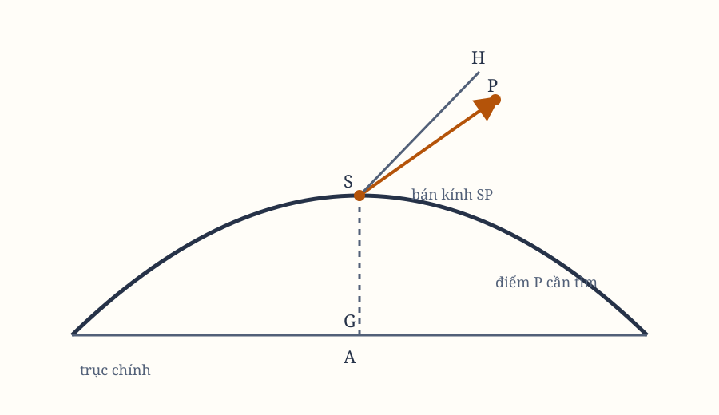

# Sách I, Phần V–VI. Lemma XXVII, Proposition XXIX–XXX

*Hình 18. Sơ đồ được dựng lại từ các hình bản gốc; cần đối chiếu ký hiệu với scan.*

## Lemma XXVII

Dựng một hình thang đã biết loại, có các góc được đặt tương xứng với bốn đường thẳng đã cho theo vị trí, sao cho các góc ấy lần lượt chạm các đường ấy.

Cho bốn đường thẳng $ABC$, $AD$, $BD$, $CE$ đã cho theo vị trí. Đường thứ nhất cắt đường thứ hai tại $A$, đường thứ ba tại $B$, và đường thứ tư tại $C$. Cần dựng hình thang $fghi$ đồng dạng với hình thang $FGHI$, trong đó góc $f$ bằng góc $F$ chạm đường $ABC$, còn các góc $g$, $h$, $i$ lần lượt chạm $AD$, $BD$, $CE$.

Nối $FH$, rồi trên $FG$, $FH$, $FI$ dựng ba hình quạt $FSG$, $FTH$, $FVI$. Hình quạt thứ nhất chứa góc bằng $\angle BAD$, thứ hai bằng $\angle CBD$, thứ ba bằng $\angle ACE$.

Các hình quạt phải được dựng về phía sao cho thứ tự quay của $FSGF$ cùng với $BADB$, $FTHF$ cùng với $CBDC$, và $FVIF$ cùng với $ACEA$. Hoàn thành chúng thành đường tròn. Gọi $P$ là tâm đường tròn $FSG$, $Q$ là tâm đường tròn $FTH$.

Kéo dài $PQ$ theo cả hai phía, lấy $QR$ theo cùng tỷ số với $PQ$ mà $BC$ có với $AB$. Lấy $QR$ về phía $Q$ sao cho thứ tự $PQR$ cùng với thứ tự $ABC$. Dựng đường tròn thứ tư tâm $R$, bán kính $RF$, cắt $FVI$ tại $c$. Nối $Fc$, cắt đường tròn thứ nhất tại $a$, đường tròn thứ hai tại $b$.

Kẻ $aG$, $bH$, $cI$, rồi hoàn thành hình $ABCfghi$ đồng dạng với $abcFGHI$. Khi ấy hình thang $fghi$ chính là hình cần dựng.

Cho hai đường tròn đầu $FSG$, $FTH$ cắt nhau tại $K$, nối $PK$, $QK$, $RK$, $aK$, $bK$, $cK$ và kéo dài $QP$ đến $L$. Các góc ở chu vi $FaK$, $FbK$, $FcK$ bằng một nửa các góc ở tâm $FPK$, $FQK$, $FRK$, nên bằng $LPK$, $LQK$, $LRK$. Do đó hình $PQRK$ đồng góc và đồng dạng với $abcK$. Suy ra
$$
ab:bc = AB:BC.
$$

Theo cách dựng, các góc $F$, $G$, $H$, $I$ bằng các góc tương ứng. Vì vậy hình $ABCfghi$ có thể hoàn thành đồng dạng với $abcFGHI$. Hình thang $fghi$ được dựng đồng dạng với $FGHI$, và các góc $f$, $g$, $h$, $i$ của nó chạm $ABC$, $AD$, $BD$, $CE$.

## Proposition XXIX. Bài toán XXI

Dựng một quỹ đạo đã biết loại, bị bốn đường thẳng đã cho theo vị trí cắt thành những phần đã biết thứ tự, loại và tỷ lệ.

Giả sử cần dựng một quỹ đạo đồng dạng với đường cong $FGHI$, có các phần đồng dạng và tỷ lệ với $FG$, $GH$, $HI$, lần lượt bị chặn giữa $AB$ và $AD$, $AD$ và $BD$, $BD$ và $CE$.

Kẻ $FG$, $GH$, $HI$, $FI$. Theo Lemma XXVII, dựng hình thang $fghi$ đồng dạng với $FGHI$, với các góc $f$, $g$, $h$, $i$ lần lượt chạm $AB$, $AD$, $BD$, $CE$. Sau đó dựng quỹ đạo quanh hình thang ấy. Quỹ đạo đó sẽ đồng dạng với $FGHI$.

## Học luận

Bài toán này cũng có thể dựng theo cách khác. Nối $FG$, $GH$, $HI$, $FI$, kéo dài $GF$ đến $Y$, nối $FH$, $IG$, và làm
$$
\angle CAK = \angle PGH,\qquad
\angle DAL = \angle VFH.
$$

Cho $AK$, $AL$ cắt $BD$ tại $K$, $L$. Từ đó kẻ $KM$, $LN$, sao cho
$$
\angle AKM = \angle GHI,\qquad KM:AK = HI:GH,
$$
và
$$
\angle ALN = \angle FHI,\qquad LN:AL = HI:FH.
$$

Các đường $AK$, $KM$, $AL$, $LN$ phải được vẽ về những phía sao cho thứ tự $DAKMC$, $ADLA$, $DALND$ được giữ giống thứ tự $FGHIF$. Kẻ $MN$ cắt $CE$ tại $L$. Làm
$$
\angle LEP = \angle IGF,\qquad PE:EI = FG:GI.
$$

Qua $P$ kẻ $PQ'$ sao cho với đường $ADE$ nó tạo thành góc $PQE = \angle FIG$, cắt $AB$ tại $f$, rồi nối $fi$. Các đường $PE$, $PQ'$ phải được vẽ về phía sao cho thứ tự $PEfP$, $PEQP$ giống $FGHIF$.

Nếu trên đường $fi$, theo cùng thứ tự chữ cái và theo hình thang $FGHI$, ta dựng hình thang $fghi$ đồng dạng, rồi bao quanh nó một quỹ đạo đã biết loại, thì bài toán được giải.

Đến đây, việc tìm các quỹ đạo đã xong. Phần còn lại là xác định chuyển động của vật thể trên những quỹ đạo ấy.

## Phần VI. Cách tìm chuyển động trong các quỹ đạo đã cho

## Proposition XXX. Bài toán XXII

Tìm vị trí của một vật thể chuyển động trong một quỹ đạo parabol đã cho, tại một thời điểm bất kỳ đã định.

Gọi $S$ là tiêu điểm, $A$ là đỉnh chính của parabol, và giả sử
$$
4AS \times M
$$
bằng diện tích parabol cần cắt $APS$. Diện tích ấy đã được bán kính $SP$ mô tả kể từ khi vật thể rời đỉnh, hoặc sẽ được bán kính ấy mô tả trước khi vật thể tới nơi.

Lượng diện tích cần cắt đã biết từ thời gian, vì thời gian tỷ lệ với nó. Chia đôi $AS$ tại $G$, dựng vuông góc $GH$ sao cho
$$
GH = 3M.
$$

Dựng đường tròn tâm $H$, bán kính $HS$. Đường tròn ấy cắt parabol tại vị trí $P$ cần tìm.

Hạ $PO$ vuông góc với trục, rồi nối $PH$. Ta có
$$
AG^2+GH^2
=
HP^2
=
(AO+AG)^2+PO^2-GH^2,
$$
nên
$$
AG^2+GH^2
=
AO^2+PO^2+2GAO+AG^2.
$$

Suy ra
$$
2GH\cdot PO
=
AO^2+PO^2-2GAO.
$$

Thay $AO^2$ bằng $AO\cdot AO$, chia các số hạng cho $2PO$, rồi nhân với $2AS$, ta được
$$
GH\cdot AS
=
\text{diện tích }APO-\text{diện tích }SPO
=
\text{diện tích }APS.
$$

Vì $GH=3M$, nên $GH\cdot AS=4AS\cdot M$. Vì thế diện tích $APS$ bằng diện tích phải cắt là $4AS\cdot M$.

## Hệ quả 1

Vì vậy, $GH:AS$ bằng thời gian vật thể mô tả cung $AP$ trong thời gian nó mô tả cung giữa đỉnh $A$ và đường vuông góc hạ từ tiêu điểm $S$ xuống trục.

## Hệ quả 2

Giả sử một đường tròn $ASP$ luôn đi qua vật thể đang chuyển động $P$. Vận tốc của điểm $H$ tỷ lệ với vận tốc vật thể tại đỉnh $A$ là $3:8$. Vì vậy, $GH$ cũng tỷ lệ với đoạn mà vật thể sẽ mô tả trong thời gian đi từ $A$ đến $P$, với vận tốc nó có tại $A$.

## Hệ quả 3

Ngược lại, có thể tìm thời gian để vật thể mô tả một cung $AP$ đã định. Nối $AP$, dựng vuông góc tại trung điểm, cắt $GH$ tại $H$.

> **[Ghi chú hiện đại]**
>
> **Khái niệm tương ứng.** Proposition XXX giải bài toán mà mọi bài toán quỹ đạo đều dẫn tới: cho một thời điểm, vật thể ở đâu trên quỹ đạo? Với quỹ đạo parabol, bài toán này có lời giải bằng công thức tường minh. Người đọc hôm nay gọi đây là **phương trình Barker**, và đây là trường hợp duy nhất trong ba loại quỹ đạo không cần hàm đặc biệt nào.
>
> **Công thức.** Với tham số $D = t\sqrt{\dfrac{2\mu}{p}}$ và bán tham số tiêu cự $p$, lời giải có dạng $r = \dfrac{p}{2}\left(1 + D^2\right)$ cùng các toạ độ theo $D$. Con số $3$ trong $GH = 3M$ của Newton không tình cờ: nó đến từ kết quả cổ đại của Archimedes rằng diện tích dưới một parabol bằng $\dfrac{2}{3}$ diện tích hình chữ nhật bao quanh nó. Vì tốc độ quét diện tích không đổi, thời gian chỉ là hàm tuyến tính của diện tích, mà diện tích ấy lại là hàm bậc ba của tham số — nên tỷ số $3:8$ ở Hệ quả 2 là hệ quả trực tiếp.
>
> **Vì sao Newton viết như vậy.** Vì ông cần biến "biết quỹ đạo" thành "biết vị trí tại mọi thời điểm", và đó là bước cuối cùng trước khi ông áp dụng vào hành tinh. Ông cũng chỉ ra ở Hệ quả 3 rằng chiều ngược cũng làm được: cho một cung $AP$ đã biết, dựng lại thời gian. Tính hai chiều ấy là điều kiện để một hình cắt conic thực sự dùng được trong thiên văn.
>
> **Hiện nay thì sao.** Việc quỹ đạo parabol cho lời giải đóng, trong khi quỹ đạo elip thì không, là một trong những bất đối xứng thú vị nhất của cơ học Kepler. Với elip, phương trình Kepler là phương trình lượng giác–giải tích không biểu thị được bằng hàm sơ cấp, và phải dùng hàm elliptic. Người đọc hôm nay dùng đúng sự phân biệt này khi lên kế hoạch động vật: quỹ đạo parabol xuất hiện khi tốc độ không đổi và lực ngược với bình phương khoảng cách — đúng bài toán ném đá mà Học luận cuối Phần II đã nêu tới.

## Lemma XXVIII

Không có hình bầu dục nào mà diện tích bị các đường thẳng tùy ý cắt ra có thể luôn được tìm bằng các phương trình với số hữu hạn các số hạng và số chiều.

Giả sử bên trong hình bầu dục có một điểm bất kỳ, quanh điểm ấy như một cực, một đường thẳng quay liên tục với chuyển động đều. Trên đường thẳng ấy, một điểm di động đi ra từ cực với vận tốc tỷ lệ với bình phương độ dài đường thẳng trong hình bầu dục. Điểm ấy sẽ mô tả một đường xoắn ốc với vô số vòng.

Nếu một phần diện tích hình bầu dục bị đường thẳng ấy cắt có thể được tìm bằng một phương trình hữu hạn, thì khoảng cách từ điểm đó tới cực, tỷ lệ với diện tích này, cũng có thể được tìm bằng cùng phương trình. Vì vậy, mọi điểm của đường xoắn ốc cũng có thể được tìm bằng một phương trình hữu hạn, và giao điểm của nó với một đường thẳng theo vị trí cũng vậy.

Nhưng một đường thẳng kéo dài vô hạn cắt đường xoắn ốc tại vô số điểm. Phương trình tìm một giao điểm bất kỳ của hai đường đồng thời biểu thị tất cả các giao điểm của chúng bằng nhiều nghiệm, nên bậc của phương trình bằng số giao điểm.

Hai đường tròn cắt nhau tại hai điểm, nên không thể tìm một điểm bằng phương trình bậc một; cả điểm kia cũng xuất hiện trong cùng phương trình. Hai hình cắt conh có thể có bốn giao điểm, nên cả bốn điểm xuất hiện trong phương trình bậc bốn.

Vì các giao điểm có cùng quy luật và cùng điều kiện, phép tính của chúng là như nhau. Vì vậy, các giao điểm của hình cắt conh với đường cong bậc ba, vì có thể lên tới sáu điểm, cùng xuất hiện bằng phương trình bậc sáu. Hai đường cong bậc ba có thể có chín giao điểm, nên chúng cùng xuất hiện bằng phương trình bậc chín.

Nếu điều ấy không xảy ra, ta có thể đưa mọi bài toán không gian về bài toán phẳng, và những bài toán cao hơn không gian về bài toán không gian. Ở đây tôi nói đến những đường cong không thể quy về bậc thấp hơn. Nếu phương trình xác định đường cong có thể quy về bậc thấp hơn, đường ấy không phải một đường cong đơn lẻ, mà gồm hai hoặc nhiều đường, có thể tìm các giao điểm riêng bằng những phép tính khác nhau.

Hai giao điểm của đường thẳng với hình cắt conh luôn xuất hiện bằng phương trình bậc hai; ba giao điểm của đường thẳng với đường cong bậc ba không quy được xuất hiện bằng phương trình bậc ba; bốn giao điểm với đường cong bậc bốn xuất hiện bằng phương trình bậc bốn, và cứ tiếp tục.

Vì vậy, vô số giao điểm của một đường thẳng với đường xoắn ốc đòi hỏi phương trình vô hạn số chiều và số nghiệm, để tất cả cùng xuất hiện. Nếu hạ vuông góc từ cực xuống đường thẳng cắt, rồi cho vuông góc ấy cùng đường cắt quay quanh cực, các giao điểm của đường xoắn ốc lần lượt chuyển thành giao điểm kế tiếp sau mỗi vòng.

Phương trình không đổi, chỉ các đại lượng xác định vị trí đường cắt thay đổi. Sau mỗi vòng, các đại lượng ấy trở về giá trị ban đầu, nên phương trình trở về dạng ban đầu. Một phương trình duy nhất vì thế biểu thị tất cả các giao điểm, và có vô số nghiệm.

Vì vậy, không thể luôn luôn tìm giao điểm của một đường thẳng với đường xoắn ốc bằng một phương trình hữu hạn. Do đó, không có hình bầu dục nào mà diện tích bị các đường thẳng tùy ý cắt ra có thể luôn luôn được biểu thị bằng một phương trình hữu hạn.

Cùng lập luận ấy, nếu khoảng cách giữa cực và điểm mô tả đường xoắn ốc tỷ lệ với phần chu vi hình bầu dục bị cắt, ta có thể chứng minh độ dài chu vi cũng không thể luôn luôn được biểu thị bằng một phương trình hữu hạn. Ở đây tôi nói đến những hình bầu dục không bị các hình liên hợp chạm vào khi kéo dài vô hạn.

> **[Ghi chú hiện đại]**
>
> **Khái niệm tương ứng.** Lemma XXVIII là một trong những bằng chứng sớm nhất và sắc nhất cho ý tưởng rằng **không phải đại lượng hình học nào cũng biểu thị được bằng một phương trình hữu hạn**. Nó nêu ra một hình bầu dục mà diện tích bị các đường thẳng tùy ý cắt ra không bao giờ tìm được bằng công thức đại số.
>
> **Công thức.** Lập luận đi qua đường xoắn ốc. Nếu phần diện tích bị cắt biểu thị được bằng phương trình hữu hạn, thì khoảng cách từ cực — vốn tỷ lệ với diện tích ấy — cũng vậy, nên mọi điểm của đường xoắn ốc đều xác định được. Nhưng một đường thẳng cắt đường xoắn ốc này ở **vô số** điểm, trong khi một phương trình bậc $n$ chỉ có $n$ nghiệm. Sự xung đột ấy buộc phải thừa nhận một phương trình vô hạn số chiều.
>
> **Vì sao Newton viết như vậy.** Vì ông đang bảo vệ tiền đề của cả Phần VI: các đại lượng ông định nghĩa bằng tích phân phải là những đại lượng thực sự tồn tại và xác định được. Với tư cách là người tạo ra phép tính, ông hiểu rõ hơn ai hết rằng "tích phân được" không phải điều hiển nhiên, và ông phải tự chứng minh nó. Câu chuyển sang bài toán không gian ở giữa Lemma cho thấy ông biết phải phân biệt cái nào giải được bằng hình học phẳng và cái nào không.
>
> **Hiện nay thì sao.** Ý tưởng này tiền đoán hai kết quả lớn của thế kỷ XIX. Thứ nhất là **định lý Abel–Ruffini**: phương trình bậc năm trở lên không giải được bằng phân biệt và căn. Thứ hai là chứng minh của Lindemann năm 1882 rằng $\pi$ là số siêu hạt, từ đó bảo đảm **không thể bình phương hình tròn** bằng thước kẻ và com pa. Nói cách khác, phép đo diện tích bằng tích phân mà Newton dùng suốt *Principia* thuộc đúng loại đối tượng mà toán học về sau phải thừa nhận là không quy về được đại số.
