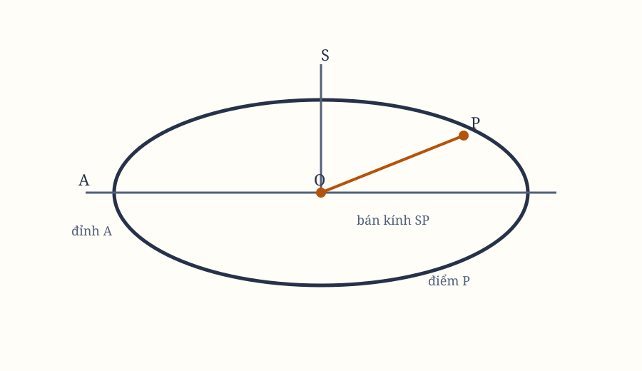

*Hình 19. Sơ đồ được dựng lại từ các hình bản gốc; cần đối chiếu ký hiệu với scan.*

## Proposition XXXI. Bài toán XXIII

Tìm vị trí của một vật thể chuyển động trong một quỹ đạo elip đã cho tại một thời điểm bất kỳ đã định.

Gọi $A$ là đỉnh chính, $S$ là tiêu điểm, $O$ là tâm của elip $APB$, và $P$ là vị trí cần tìm.

Kéo dài $OA$ đến $G$ sao cho
$$
OG:OA = OA:OS.
$$

Dựng vuông góc $GH$, rồi lấy $O$ làm tâm, bán kính $OG$, dựng đường tròn $GEF$. Trên thước $GH$, lấy $GH$ làm đáy, cho bánh xe $GEF$ tiến về phía trước, đồng thời quay quanh trục của nó. Điểm $A$ của bánh xe khi ấy mô tả cycloid $ALL$.

Lấy $GK$ trên chu vi bánh xe theo tỷ lệ giữa thời gian vật thể đi từ $A$ mô tả cung $AP$ với thời gian một vòng quay hoàn toàn trong elip. Dựng vuông góc $KL$ cắt cycloid tại $L$. Kẻ $LP$ song song với $KG$; nó cắt elip tại $P$, vị trí cần tìm.

Để chứng minh, lấy $O$ làm tâm, bán kính $OA$, dựng nửa đường tròn $AQB$. Kéo dài $LP$, nếu cần, cho nó cắt cung $AQ$ tại $Q$. Nối $SQ$, $OQ$, cho $OQ$ cắt cung $EFG$ tại $F$, và hạ vuông góc $SH$ xuống $OQ$.

Diện tích $APS$ tỷ lệ với diện tích $AQS$, tức là với hiệu giữa hình quạt $OQA$ và tam giác $OQS$, hoặc với hiệu giữa các hình chữ nhật $OQ\cdot AQ$ và $OQ\cdot SR$. Vì các tỷ số đã cho bằng nhau, diện tích này bằng hiệu giữa cung $AQ$ và đường thẳng $SH$.

Do đó, theo các tỷ số
$$
SR:\sin(\text{cung }AQ)
=
OS:OA
=
OA:OG
=
AQ:GF,
$$
ta có
$$
AQ\cdot SH:(GF\cdot\sin(\text{cung }AQ)) = GK.
$$

Đây là hiệu giữa cung $AQ$ và đường thẳng $SH$, nên diện tích $APS$ bằng $GK$ theo đúng tỷ lệ đã dựng. Vì vậy $P$ là vị trí cần tìm.

## Học luận

Vì mô tả đường cong này khó khăn, một lời giải gần đúng sẽ thích hợp hơn.

Trước hết, tìm một góc $B$ sao cho
$$
B:57{,}29578^\circ
=
SH:AB,
$$
trong đó $57{,}29578^\circ$ là góc mà một cung dài bằng bán kính chắn, $SH$ là khoảng cách hai tiêu điểm, và $AB$ là đường kính của elip.

Thứ hai, tìm một độ dài $L$ tỷ lệ nghịch với bán kính theo cùng tỷ số ấy.

Khi đã biết hai đại lượng ấy, có thể giải bài toán bằng phân tích sau. Bằng bất kỳ cách dựng nào, thậm chí bằng phỏng đoán, giả sử ta biết $P$ là vị trí gần vị trí thật. Hạ ordinate $PR$ xuống trục elip theo tỷ lệ các đường kính. Ordinate $RQ$ của đường tròn ngoại tiếp $AQB$ sẽ được biết; đây là sin của góc $AOQ$, với $AO$ là bán kính, và cũng cắt elip tại $P$.

Ta chỉ cần tìm góc ấy bằng một phép tính số gần đúng. Giả sử cũng biết góc $N$ tỷ lệ với thời gian:
$$
N:4\text{ góc vuông}
=
\text{thời gian vật thể mô tả cung }AP:
\text{thời gian một vòng trong elip}.
$$

Lấy góc $D$ theo tỷ số
$$
D:B
=
\sin(\angle AOQ):\text{ bán kính}.
$$

Lấy góc $E$ theo tỷ số
$$
E:(N-AOQ+D)
=
L:(L-\cos(\angle AOQ))
$$
nếu góc $AOQ$ nhỏ hơn góc vuông, và
$$
E:(N-AOQ+D)
=
L:(L+\cos(\angle AOQ))
$$
nếu góc ấy lớn hơn góc vuông.

Tiếp theo, lấy góc $F$ theo tỷ số
$$
F:B
=
\sin(\angle AOQ+E):\text{ bán kính},
$$
và góc $G$ theo tỷ số
$$
G:(N-AOQ-E+F)
=
L:(L-\cos(\angle AOQ+E))
$$
hoặc dùng dấu cộng trong mẫu số nếu góc ấy lớn hơn góc vuông.

Lần thứ ba, lấy góc $H$ theo tỷ số
$$
H:B
=
\sin(\angle AOQ+E+G):\text{ bán kính},
$$
và góc $I$ theo tỷ số
$$
I:(N-AOQ-E-G+H)
=
L:(L-\cos(\angle AOQ-E+G))
$$
hoặc dùng dấu cộng nếu góc ấy lớn hơn góc vuông.

Có thể tiếp tục vô hạn. Cuối cùng, lấy
$$
\angle AOp
=
\angle AOQ+E+G+I+\cdots.
$$
Từ cosin của nó, lấy ordinate $pr$ tỷ lệ với sin $qr$ như trục nhỏ của elip với trục lớn. Khi ấy ta có đúng vị trí $p$ của vật thể.

Khi góc $N-AOQ+D$ âm, dấu cộng của góc $E$ phải đổi thành dấu trừ, và dấu trừ thành dấu cộng. Cũng phải hiểu như vậy cho dấu của các góc $G$, $I$, khi các góc tương ứng âm.

Chuỗi vô hạn
$$
AOQ+E+G+I+\cdots
$$
hội tụ rất nhanh, nên hầu như không cần đi quá số hạng thứ hai $E$. Phép tính này dựa trên định lý: diện tích $APS$ bằng hiệu giữa cung $AQ$ và đường thẳng hạ vuông góc từ tiêu điểm $S$ xuống bán kính $OQ$.

Bằng một phép tính gần giống, bài toán được giải cho hypebol. Gọi $O$ là tâm, $A$ là đỉnh, $S$ là tiêu điểm và $OK$ là đường tiệm cận. Giả sử diện tích cần cắt đã biết, vì nó tỷ lệ với thời gian; gọi diện tích ấy là $A$. Giả sử ta biết gần đúng vị trí một đường thẳng $SP$ cắt diện tích gần đúng $APS$.

Nối $OP$, rồi từ $A$, $P$ kẻ $AI$, $PK$ song song với đường tiệm cận còn lại. Theo bảng logarith, diện tích $AIKP$ được biết, và bằng diện tích $OPA$. Lấy nó ra khỏi tam giác $OPS$, ta có diện tích $APS$.

Áp dụng
$$
2APS-2A
\quad\text{hoặc}\quad
2A-2APS
$$
cho đoạn $SN$ hạ từ tiêu điểm $S$ vuông góc xuống tiếp tuyến $TP$, ta có độ dài dây $PQ$. Dây ấy được nội tiếp giữa $A$, $P$ nếu diện tích $APS$ lớn hơn $A$, và nằm về phía ngược lại $P$ nếu $APS$ nhỏ hơn $A$. Điểm $Q$ sẽ là vị trí chính xác hơn. Lặp lại phép tính, độ chính xác tăng dần.

Các phép tính này cho một lời giải phân tích tổng quát. Nhưng phép tính riêng sau đây thích hợp hơn với mục đích thiên văn.

Gọi $AO$, $OB$, $OD$ là các bán trục của elip, $L$ là latus rectum, $D$ là hiệu giữa bán trục nhỏ $OD$ và nửa latus rectum. Tìm góc $Y$ sao cho
$$
\sin Y:\text{ bán kính}
=
D(AO+OD):AB^2.
$$

Tìm góc $Z$ sao cho
$$
\sin Z:\text{ bán kính}
=
2SH\cdot D:\left(3AO^2\right).
$$

Khi đã biết các góc ấy, lấy góc $T$ tỷ lệ với thời gian vật thể mô tả cung $BP$, còn gọi là chuyển động trung bình.

Lấy góc $V$, phương trình thứ nhất của chuyển động trung bình, theo tỷ số
$$
V:Y
=
\sin(2T):\text{ bán kính}.
$$

Lấy góc $X$, phương trình thứ hai, theo tỷ số
$$
X:Z
=
\sin^3(T):\text{ bán kính}^3.
$$

Khi ấy lấy góc $BHP$ bằng
$$
T+X+V
$$
nếu $T$ nhỏ hơn góc vuông, hoặc
$$
T+X-V
$$
nếu $T$ lớn hơn một góc vuông và nhỏ hơn hai góc vuông.

Nếu $HP$ cắt elip tại $P$, kẻ $SP$. Nó sẽ cắt diện tích $BSP$ gần đúng tỷ lệ với thời gian.

Cách thực hành này đủ nhanh, vì các góc $V$, $X$, tính bằng giây phút, rất nhỏ; chỉ cần tìm hai hoặc ba chữ số đầu tiên của chúng. Độ chính xác cũng đủ cho lý thuyết chuyển động hành tinh. Ngay cả trong quỹ đạo Sao Hỏa, nơi phương trình trung tâm lớn nhất lên tới mười độ, sai số cũng khó vượt quá một giây.

Khi đã biết góc chuyển động trung bình quy thành $BHP$, các phương pháp đã biết cho ta góc chuyển động thật $BSP$ và khoảng cách $SP$.

> **[Chú giải]**
>
> **Từ thời gian, tìm vị trí: bài toán khó nhất của cả cuốn sách**
>
> Đây là phương trình Kepler, và trong toàn bộ *Principia* không có kết quả nào khó hơn. Newton đưa ra hai lời giải, mỗi lời một ngôn ngữ.
>
> Lời giải hình học dựng một bánh xe lăn không trượt trên đường thẳng - điểm trên vành bánh xe mô tả đường cycloid. Chọn bán kính bánh xe sao cho $OG:OA = OA:OS$, thì độ dài cung cycloid tính từ $O$ chính là thang đo thời gian. Câu hỏi "vật thể ở góc nào ứng với thời điểm này" trở thành "đọc bao nhiêu trên cung cycloid", tức một phép đo thước. Lời giải giải tích thì khai triển góc chuyển động trung bình thành chuỗi vô hạn, các số hạng mang $\sin(2T)$ và $\sin^3 T$.
>
> Cả hai lời giải đều nhắm một mục tiêu thực dụng: dựng lịch hành tinh bằng tay. Bảng số liệu của Tycho là nguồn, độ chính xác khoảng một phút vòng cung, còn lịch thì phải tính ra bằng thước kẻ và bảng logarit. Vì vậy ông chọn chuỗi hội tụ rất nhanh, tới mức ghi rõ hầu như không cần đi quá số hạng thứ hai - rồi đo sai số ngay ở trường hợp khó nhất, quỹ đạo Sao Hỏa, nơi phương trình trung tâm lớn nhất lên tới mười độ.
>
> Đối chiếu con số ấy với dữ liệu gốc mới thấy lời hứa mạnh đến đâu: một giây thời gian ứng với mười lăm giây vòng cung, tức chuỗi của Newton chính xác hơn nhiều lần so với chính những quan sát dùng để kiểm tra nó. Ngành thiên văn về sau vẫn phân hai lời giải này: chuỗi khai triển khi chấp nhận sai số vài giây trong một vòng, hàm elliptic khi cần độ chính xác cao.

## Phần VII. Chuyển động lên và xuống theo đường thẳng của các vật thể

## Proposition XXXII. Bài toán XXIV

Giả sử lực hướng tâm tỷ lệ nghịch với bình phương khoảng cách từ các nơi đến tâm. Hãy xác định các quãng đường mà một vật thể rơi thẳng mô tả trong những thời gian đã cho.

### Trường hợp 1

Nếu vật thể không rơi vuông góc, theo Hệ quả 1 của Proposition XIII, nó sẽ mô tả một hình cắt conh có tiêu điểm $A$ đặt tại tâm lực. Giả sử hình cắt conic ấy là $ARPB$ và tiêu điểm là $S$.

Nếu hình là elip, trên trục lớn $AB$ dựng nửa đường tròn $ADB$. Cho đường thẳng $DPC$ đi qua vật thể rơi và vuông góc với trục. Kẻ $DS$, $PS$. Diện tích $ASD$ tỷ lệ với $ASP$, và do đó tỷ lệ với thời gian.

Giữ trục $AB$ không đổi, cho bề rộng của elip giảm dần. Diện tích $ASD$ vẫn tỷ lệ với thời gian. Cho bề rộng ấy giảm vô hạn. Khi đó quỹ đạo $APB$ trùng với trục $AB$, tiêu điểm $S$ trùng với điểm cuối $B$ của trục, và vật thể rơi trên đường thẳng $AC$.

Diện tích $ABD$ trở thành tỷ lệ với thời gian. Vì vậy, nếu lấy diện tích $ABD$ tỷ lệ với thời gian, ta có thể xác định quãng đường $AC$ mà vật thể mô tả trong thời gian đã cho khi rơi vuông góc từ $A$; từ $D$ hạ vuông góc $DC$ xuống $AB$.

### Trường hợp 2

Nếu hình $RPB$ là hypebol, trên cùng đường kính chính $AB$ dựng hypebol chữ nhật $BED$. Vì các diện tích $CSP$, $CBP$, $SPB$ lần lượt tỷ lệ với $CSD$, $CBED$, $SDEB$ theo các tỷ số chiều cao $CP$, $CD$ đã cho, và diện tích $SPB$ tỷ lệ với thời gian vật thể $P$ mô tả cung $PB$, diện tích $SDEB$ cũng tỷ lệ với thời gian ấy.

Cho latus rectum của hypebol $RPB$ giảm vô hạn, còn latus transversum giữ nguyên. Cung $PB$ sẽ trùng với đường thẳng $CB$, tiêu điểm $S$ trùng với đỉnh $B$, và $SD$ trùng với $BD$. Vì vậy, diện tích $BDEB$ tỷ lệ với thời gian vật thể $C$ mô tả $CB$ khi rơi vuông góc.

### Trường hợp 3

Cùng lập luận, nếu hình $RPB$ là parabol, và tại cùng đỉnh chính $B$ ta dựng một parabol khác $BED$ luôn được giữ cố định, trong khi parabol cũ, nơi vật thể $P$ chuyển động, có latus rectum giảm dần về không và trùng với đường thẳng $CB$, thì đoạn parabol $BDEB$ tỷ lệ với thời gian vật thể $P$ hoặc $C$ rơi về tâm $S$ hoặc $B$.

## Proposition XXXIII. Định lý IX

Với những kết quả trên, tôi nói rằng vận tốc của vật thể rơi tại một nơi $C$ tỷ lệ với vận tốc của một vật thể mô tả đường tròn quanh tâm $B$ tại khoảng cách $BC$, theo căn bậc hai của
$$
\frac{AC}{\frac12 AB},
$$
trong đó $A$ là đỉnh xa hơn của đường tròn hoặc hypebol chữ nhật, còn $AB$ là bán đường kính chính.

Cho $AB$, đường kính chung của hai hình $RPB$, $DEB$, chia đôi tại $O$. Kẻ $PT$ chạm $RPB$ tại $P$, và cắt $AB$, kéo dài nếu cần, tại $T$. Cho $SY$ vuông góc với $PT$, $BQ$ vuông góc với $AB$, và gọi latus rectum của $RPB$ là $L$.

Theo Hệ quả 9 của Proposition XVI, vận tốc của vật thể chuyển động trên $RPB$ quanh tâm $S$, tại $P$, tỷ lệ với vận tốc của một vật thể mô tả đường tròn quanh cùng tâm tại khoảng cách $SP$, theo căn bậc hai của
$$
\frac{\frac12 L\cdot SP}{SY^2}.
$$

Theo các tính chất của hình cắt conh,
$$
AC:CP^2 = 2AO:L.
$$

Vì vậy, các vận tốc ấy tỷ lệ với nhau theo căn bậc hai của
$$
\frac{CP^2\cdot AO\cdot SP}{AC\cdot SY^2}.
$$

Ngoài ra, theo các tính chất của hình cắt conh,
$$
CO:BO = BO:TO
$$
và, theo cách cộng hoặc chia tỷ số,
$$
CO:BO = CB:BT.
$$

Do đó,
$$
AC:AO = CP:BQ.
$$
Vì vậy, vận tốc ấy tỷ lệ theo căn bậc hai của
$$
\frac{AC\cdot SP}{AO\cdot SY^2}.
$$

Cho bề rộng $GV$ của hình $RPB$ giảm vô hạn, để $P$ trùng $C$, $S$ trùng $B$, $SP$ trùng $BC$, và $SY$ trùng $BQ$. Vận tốc của vật thể lúc rơi vuông góc trên $CB$ tỷ lệ với vận tốc của vật thể mô tả đường tròn quanh $B$ tại $BC$, theo căn bậc hai của
$$
\frac{AC}{AO}
=
\frac{AC}{\frac12 AB}.
$$

## Hệ quả 1

Khi $B$ và $S$ trùng nhau,
$$
TC:TS = AC:AO.
$$

## Hệ quả 2

Một vật thể quay trong đường tròn tại một khoảng cách đã cho từ tâm, nếu chuyển động của nó được biến thành chuyển động đi thẳng lên, sẽ lên tới khoảng cách gấp đôi khoảng cách của nó với tâm.

> **[Chú giải]**
>
> **Cho conic tiến tới đường thẳng, bài toán rơi thẳng thu được về bài toán quay tròn**
>
> Hai hình $RPB$ và $DEB$ cùng chia một đường kính $AB$. Khi bề rộng của $RPB$ co về không, tiêu điểm $S$ trượt vào đúng đỉnh $B$, cung $PB$ nằm thẳng trên $CB$ - còn mọi phép đo diện tích giữ nguyên quan hệ "diện tích quét tỷ lệ với thời gian". Nhờ đó một lập luận chứng minh duy nhất phục vụ cho cả ba: elip, hypebol và rơi thẳng vuông góc.
>
> Proposition XXXIII đi theo đúng lối ấy để liên hệ vận tốc: vận tốc của vật thể rơi tại $C$ tỷ lệ với vận tốc của vật thể quay tròn quanh $B$ tại cùng khoảng cách, theo căn bậc hai của $\dfrac{AC}{AO}$. Với quỹ đạo tròn thì $A$ nằm trên chính đường tròn, nên $AO = \frac{1}{2}AB$ và hệ số còn lại là căn bậc hai của $\dfrac{2AC}{AB}$.
>
> Hệ quả 2 là một câu hỏi năng lượng thuần tuý, trả lời bằng một dòng. Vận tốc quay tròn ở khoảng cách $R$ cho $v^2 = \dfrac{\mu}{R}$, nên động năng là $\dfrac{\mu}{2R}$; đổi hết thành thế năng $\dfrac{\mu}{r}$ thì vật thể dừng ở $r = 2R$. Vậy một vật thể đang quay tròn ở $R$, nếu chuyển toàn bộ vận tốc thành chuyển động thẳng đi lên, sẽ dừng ở $2R$.
>
> Người đọc hôm nay nhận ra ngay $2R$ là khoảng cách dừng của hành động cấp tốc chuyển hướng: đó là **vận tốc thoát**, $v_{\text{esc}} = \sqrt{2}\,v_{\text{circ}}$. Đổi chiều lại, một vật thể bay nhanh hơn $\sqrt{2}\,v_{\text{circ}}$ sẽ không bao giờ quay lại. Cùng phép tính, nếu coi nó là giới hạn của phương trình vis-viva khi $a \to \infty$, ta được quan hệ $r_a = 2r_p$ của quỹ đạo parabol. Và cùng lập luận đó giải thích vì sao một tàu đẩy nhẹ leo thang hiệu quả bằng cách hạ sâu xuống rồi đốt mới bay lên: rơi sâu hơn thì lấy được nhiều năng lượng hơn trên mỗi nhát đốt. Người đọc hôm nay gọi tên đó là **hiệu ứng Oberth**, và nó giải thích vì sao một tàu đã tăng tốc lấy được nhiều năng lượng hơn từ một nhát đốt cùng độ lớn.
