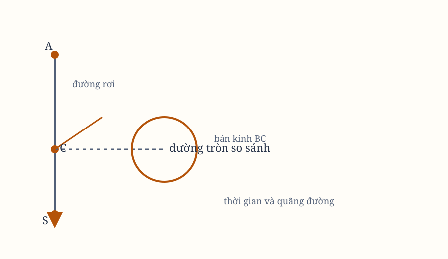

# Sách I, Phần VII–VIII. Proposition XXXVII–XXXIX

*Hình 21. Sơ đồ dùng lại để đối chiếu các đường rơi, quỹ tích và thời gian.*

## Proposition XXXVII. Bài toán XXVI

Xác định thời gian lên hoặc xuống của một vật thể được ném lên hoặc xuống từ một nơi đã cho.

Giả sử vật thể rời nơi $G$ theo phương $GS$ với một vận tốc bất kỳ. Lấy $GA$ theo bình phương tỷ lệ giữa vận tốc này và vận tốc đều của một vật thể quay trong đường tròn quanh tâm $S$ tại khoảng cách $SG$, rồi so với $AS$.

Nếu tỷ lệ ấy bằng $2:1$, điểm $A$ ở vô cùng xa. Khi đó dựng một parabol với đỉnh $S$, trục $SG$ và bất kỳ latus rectum nào, như Proposition XXXIV chỉ ra.

Nếu tỷ lệ nhỏ hơn hoặc lớn hơn $2:1$, dựng lần lượt một đường tròn hoặc một hypebol chữ nhật trên đường kính $SA$, như Proposition XXXIII chỉ ra.

Sau đó, lấy $S$ làm tâm, bán kính bằng nửa latus rectum, dựng đường tròn $HNK$. Tại nơi $G$ của vật thể đang lên hoặc xuống, và tại một nơi $C$ bất kỳ khác, dựng các vuông góc $GI$, $CD$ cắt hình cắt conh hoặc đường tròn tại $I$, $D$.

Nối $SI$, $SD$, rồi làm cho các hình quạt $HSK$, $HSD$ có diện tích bằng các đoạn $SEIS$, $SEDS$. Theo Proposition XXXV, vật thể $G$ mô tả không gian $GO$ trong cùng thời gian với vật thể $K$ mô tả cung $Kk$.

## Proposition XXXVIII. Định lý XII

Giả sử lực hướng tâm tỷ lệ với chiều cao hoặc khoảng cách của các nơi từ tâm. Tôi nói rằng thời gian và vận tốc của vật thể rơi, cùng các quãng đường nó mô tả, lần lượt tỷ lệ với các cung, cùng các hình chữ nhật của các cung.

Giả sử vật thể rơi từ một nơi $A$ bất kỳ trên đường thẳng $AS$. Quanh tâm lực $S$, với bán kính $AS$, dựng góc phần tư đường tròn $AE$. Gọi $CD$ là sin thẳng của một cung bất kỳ $AD$. Vật thể sẽ mô tả không gian $AC$ trong thời gian $AD$ khi rơi, và tại $C$ sẽ có vận tốc $CD$.

Điều này được chứng minh từ Proposition X theo cùng cách Proposition XXXII được chứng minh từ Proposition XI.

## Hệ quả 1

Vì vậy, các thời gian bằng nhau: thời gian một vật thể rơi từ $A$ đến tâm $S$, và thời gian một vật thể quay mô tả cung phần tư $ADE$.

## Hệ quả 2

Do đó, mọi thời gian để các vật thể rơi từ những nơi bất kỳ đến tâm đều bằng nhau. Mọi chu kỳ tuần hoàn của các vật thể quay đều bằng nhau, theo Hệ quả 3 của Proposition IV.

## Proposition XXXIX. Bài toán XXVII

Giả sử có một lực hướng tâm bất kỳ, và giả sử đã biết các phần tư của các hình cong. Hãy tìm vận tốc của một vật thể đang lên hoặc xuống trên đường thẳng tại những nơi khác nhau nó đi qua; đồng thời tìm thời gian nó đến một nơi bất kỳ, và ngược lại.

Giả sử vật thể $E$ rơi từ một nơi $A$ bất kỳ trên đường thẳng $ADEC$. Từ nơi $E$, hình dung một vuông góc $EG$ luôn dựng lên, tỷ lệ với lực hướng tâm tại nơi ấy hướng về tâm $C$. Gọi $BFG$ là đường cong quỹ tích của $G$.

Khi bắt đầu chuyển động, giả sử $EG$ trùng với vuông góc $AB$. Vận tốc của vật thể tại một nơi $E$ bất kỳ sẽ là một đoạn thẳng mà bình phương bằng diện tích cong $ABGE$.

Trên $EG$, lấy $EM$ tỷ lệ nghịch với một đoạn thẳng mà bình phương bằng diện tích $ABGE$, và gọi $VLM$ là đường cong quỹ tích của $M$, với đường thẳng $AB$ kéo dài làm asymptote. Thời gian vật thể rơi mô tả $AE$ sẽ tỷ lệ với diện tích cong $ABTVME$.

Để chứng minh, trên $AE$ lấy một đoạn rất nhỏ $DE$ đã cho, và gọi $DLF$ là vị trí của $EMG$ khi vật thể ở $D$. Nếu lực hướng tâm được chọn sao cho bình phương một đoạn thẳng bằng diện tích $ABGE$ thì đoạn ấy là vận tốc vật thể rơi, diện tích cũng là bình phương vận tốc.

Nếu các vận tốc tại $D$, $E$ là $V$ và $V+I$, thì
$$
ABFD \sim V^2,
\qquad
ABGE \sim (V+I)^2.
$$

Bằng cách chia,
$$
DFGE \sim 2VI+I^2.
$$

Khi lấy các tỷ số đầu tiên của những đại lượng mới xuất hiện, ta có
$$
DF \sim \frac{I}{2V}.
$$

Thời gian vật thể mô tả đoạn rất nhỏ $DE$ tỷ lệ trực tiếp với $DE$ và nghịch với vận tốc $V$. Lực tỷ lệ trực tiếp với độ tăng $I$ của vận tốc và nghịch với thời gian. Vì thế, khi lấy tỷ số đầu tiên,
$$
\frac{I}{V}
\sim DF.
$$

Do đó, một lực tỷ lệ với $DF$ hoặc $EG$ làm vật thể rơi với vận tốc là một đoạn thẳng mà bình phương bằng diện tích $ABGE$.

Ngoài ra, thời gian để mô tả một đoạn rất nhỏ $DE$ tỷ lệ nghịch với vận tốc, và do đó nghịch với một đoạn mà bình phương bằng diện tích $ABFD$. Vì $DL$ và diện tích mới $DLME$ cũng tỷ lệ nghịch với cùng đoạn ấy, thời gian tỷ lệ với diện tích $DLME$.

Tổng các thời gian sẽ tỷ lệ với tổng các diện tích. Theo Hệ quả của Lemma IV, toàn bộ thời gian mô tả $AE$ tỷ lệ với toàn bộ diện tích $ATYME$.

## Hệ quả 1

Gọi $P$ là nơi một vật thể phải rơi, để khi chịu một lực hướng tâm đều đã biết, chẳng hạn trọng lực theo cách gọi thông thường, nó có vận tốc tại $D$ bằng vận tốc mà một vật thể khác, rơi dưới bất kỳ lực nào, đã có tại $D$.

Trên vuông góc $DF$, lấy $DR$ sao cho
$$
DR:DF
=
\text{lực đều}:\text{lực khác tại }D.
$$

Hoàn thành hình chữ nhật $PDRQ$, rồi cắt diện tích $ABFD$ bằng hình chữ nhật ấy. Khi đó $A$ là nơi vật thể kia rơi.

Hoàn thành hình chữ nhật $DRSE$. Vì
$$
ABFD:DFGE = V^2:2VI = 2V:I,
$$
tức là bằng một nửa toàn vận tốc và độ tăng vận tốc của vật thể rơi dưới lực không đều. Tương tự,
$$
PQRD:DRSE
$$
bằng một nửa toàn vận tốc và độ tăng vận tốc của vật thể rơi dưới lực đều.

Các độ tăng ấy, vì thời gian mới xuất hiện bằng nhau, tỷ lệ với các lực sinh ra chúng, tức là với các ordinate $DF$, $DR$, rồi với các diện tích mới $DFGE$, $DRSE$. Suy ra
$$
ABFD:PQRD
$$
bằng tỷ số của các nửa toàn vận tốc. Vì các vận tốc bằng nhau, hai diện tích cũng bằng nhau.

## Hệ quả 2

Nếu một vật thể được ném lên hoặc xuống từ một nơi $D$ với vận tốc đã cho, và quy luật lực hướng tâm đã biết, ta tìm vận tốc tại một nơi khác $e$ bằng cách dựng ordinate $eg$ và lấy
$$
\frac{v_e}{v_D}
=
\frac{\sqrt{PQRD+DFge}}{\sqrt{PQRD}}
$$
nếu $e$ nằm dưới $D$, hoặc
$$
\frac{v_e}{v_D}
=
\frac{\sqrt{PQRD-DFge}}{\sqrt{PQRD}}
$$
nếu $e$ nằm cao hơn.

## Hệ quả 3

Thời gian cũng được biết bằng cách dựng ordinate $em$ tỷ lệ nghịch với căn bậc hai của
$$
PQRD+DFge
\quad\text{hoặc}\quad
PQRD-DFge.
$$

Lấy thời gian vật thể mô tả $De$ so với thời gian một vật thể khác rơi dưới lực đều từ $P$ đến $D$, theo tỷ lệ diện tích cong $DLme$ với hình chữ nhật $2PD\cdot DL$.

Thời gian để một vật thể rơi dưới lực đều mô tả $PD$ so với thời gian nó mô tả $PE$ bằng căn bậc hai của
$$
PD:PE.
$$

Vì $DE$ rất nhỏ, tỷ số này trở thành
$$
2PD:(2PD+DE).
$$

Bằng cách chia, nó bằng thời gian mô tả đoạn nhỏ $DE$ theo tỷ số
$$
2PD:DE,
$$
và do đó theo tỷ số hình chữ nhật $2PD\cdot DL$ với diện tích $DLME$.

Thời gian hai vật thể mô tả đoạn nhỏ $DE$ so với thời gian vật thể chuyển động không đều mô tả $De$ bằng
$$
DLME:DLme.
$$

Suy ra thời gian thứ nhất so với thời gian cuối bằng
$$
(2PD\cdot DL):DLme.
\]

## Phần VIII. Sáng tạo các quỹ đạo mà vật thể quay dưới tác dụng của một lực hướng tâm bất kỳ
