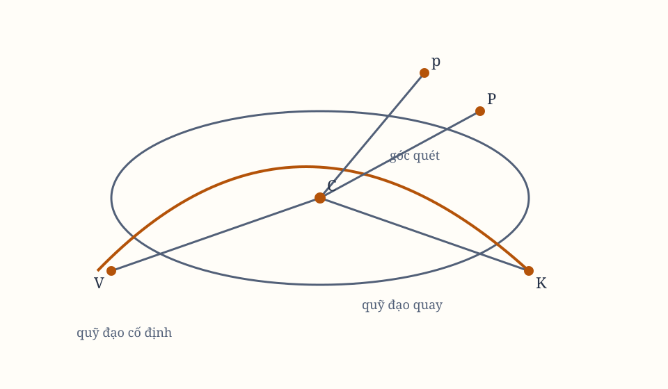

# Sách I, Phần IX. Proposition XLIII–XLV

*Hình 23. Sơ đồ được dựng lại từ các hình bản gốc; cần đối chiếu ký hiệu với scan.*

## Proposition XLIII. Bài toán XXX

Yêu cầu làm cho một vật thể chuyển động trong một quỹ đạo quay quanh tâm lực theo cùng cách mà một vật thể khác chuyển động trong cùng quỹ đạo ấy khi quỹ đạo đứng yên.

Trong quỹ đạo $VPK$ đã cho theo vị trí, cho vật thể $P$ quay từ $V$ về phía $K$. Từ tâm $C$, liên tục kẻ $Cp$ bằng $CP$, sao cho
$$
\angle VCp
$$
tỷ lệ với $\angle VCP$.

Diện tích do $Cp$ mô tả tỷ lệ với diện tích do $CP$ mô tả trong cùng thời gian, theo tỷ số vận tốc của hai đường mô tả. Vì vậy, nó tỷ lệ với $\angle VCp:\angle VCP$, tức là ở trong một tỷ số đã cho, và do đó tỷ lệ với thời gian.

Vì diện tích do $Cp$ mô tả trong một mặt phẳng bất biến tỷ lệ với thời gian, một vật thể chịu một lực hướng tâm thích hợp có thể quay cùng điểm $p$ trên đường cong mà chính điểm ấy, theo phương pháp vừa giải thích, sẽ mô tả trong một mặt phẳng bất biến.

Làm
$$
\angle VCu = \angle PCp,\qquad Cu = CV,
$$
và hình $uCp$ bằng hình $VCP$. Vật thể luôn ở điểm $p$, nên nó chuyển động trên chu vi của hình $uCp$ đang quay, và mô tả cung quay $up$ trong cùng thời gian với vật thể $P$ mô tả cung tương tự và bằng $VP$ trong hình đứng yên $VPK$.

Theo Hệ quả 5, từ đó tìm được quỹ đạo và chuyển động của vật thể.

## Proposition XLIV. Định lý XIV

Hiệu của các lực làm cho hai vật thể chuyển động tương đương, một vật thể trong quỹ đạo đứng yên, vật thể kia trong cùng quỹ đạo đang quay, tỷ lệ nghịch với lập phương các độ cao chung.

Cho các phần $VP$, $PK$ của quỹ đạo đứng yên tương tự và bằng các phần $vp$, $pk$ của quỹ đạo đang quay. Giả sử khoảng cách giữa $P$, $K\) rất nhỏ.

Hạ vuông góc $kr$ từ $k$ xuống $pC$, kéo dài đến $m$ sao cho
$$
mr:kr = \angle VCp:\angle VCP.
$$

Vì các độ cao $PC$, $pC$, $KC$, $kC$ bằng nhau, các phần tăng hoặc giảm của $PC$, $pC$ bằng nhau.

Phân rã mỗi chuyển động tại $P$, $p$ thành hai thành phần: một thành phần hướng tâm theo $PC$, $pC$, và một thành phần vuông góc với chúng. Các chuyển động hướng tâm bằng nhau, còn chuyển động vuông góc của $p$ tỷ lệ với chuyển động vuông góc của $P$ theo $\angle VCp:\angle VCP$.

Khi vật thể $P$ đến $K$, vật thể $p$ cũng di chuyển như nhau về phía $C$. Sau thời gian ấy, nó nằm trên đường $mkr$, vuông góc với $pC$, và chuyển động vuông góc tạo cho nó khoảng cách khỏi $C$ tỷ lệ với khoảng cách vật thể $P$ tạo ra khỏi $PC$.

Vì $kr$ bằng khoảng cách vật thể $P$ tạo ra khỏi $PC$, còn
$$
mr:kr = \angle VCp:\angle VCP,
$$
vật thể $p$ ở thời điểm hết thời gian sẽ ở $m$. Điều này xảy ra nếu hai vật thể chuyển động bằng nhau theo phương $pC$, $PC$, nên chịu các lực bằng nhau theo phương ấy.

Nếu lấy góc
$$
\angle pCn:\angle pCk = \angle VCp:\angle VCP
$$
và $Cn=Ck$, vật thể $p$ thật sự ở $n$. Nó chịu lực lớn hơn vật thể $P$ nếu $\angle nCp$ lớn hơn $\angle kCp$. Quỹ đạo $npk$ khi ấy chuyển động theo một tốc độ lớn hơn hai lần tốc độ của đường $CP$ trong chuyển động tương ứng; nếu nhỏ hơn, lực nhỏ hơn.

Hiệu của các lực tỷ lệ với khoảng cách $mn$ mà vật thể sẽ đi được nếu chịu lực ấy trong thời gian đã cho. Dựng đường tròn tâm $C$, bán kính $Cn$ hoặc $Ck$, cắt các đường $mr$, $mn$ kéo dài tại $s$, $u$. Hình chữ nhật $mn\cdot mu$ bằng $mk\cdot ms$, nên $mn$ tỷ lệ với $\frac{mk\cdot ms}{mt}$.

Các tam giác $pCk$, $pCn$ có độ lớn đã cho trong một khoảng thời gian. Do đó $kr$, $mr$, hiệu $mk$ và tổng $ms$ tỷ lệ nghịch với ordinate $pC$, nên
$$
mk\cdot ms \sim \frac{1}{pC^2}.
$$

Ngoài ra $mt$ tỷ lệ trực tiếp với $pC$. Đây là các tỷ số đầu tiên của các đoạn mới xuất hiện. Vì vậy, đoạn nhỏ $mn$ và hiệu của các lực tỷ lệ với nó, tỷ lệ nghịch với lập phương độ cao $pC$.

## Hệ quả 1

Vì vậy, hiệu của các lực tại $P$, $p$, hoặc $K$, $k$, tỷ lệ với lực làm cho một vật thể quay từ $R$ đến $K$ trong cùng thời gian vật thể $P$ mô tả cung $PK$, theo tỷ số giữa đoạn mới $mn$ và sin thuận của cung mới $RK$.

## Hệ quả 2

Nếu quỹ đạo $VPK$ là elip có tiêu điểm $C$ và apsis trên $Y$, giả sử elip $vpK$ tương tự và bằng nó, sao cho
$$
pC=PC
$$
và
$$
\angle YCp:\angle YCP = G:F.
$$

Gọi $PC$ hoặc $pC$ là $A$, và $2R$ là latus rectum của elip. Lực làm cho vật thể quay trong elip di động tỷ lệ với
\[
\frac{FF}{A}
+
\frac{RGG-RFF}{A^2},
\]
và ngược lại.

Lực làm cho vật thể quay trong elip bất biến được biểu thị bởi $\frac{FF}{A}$. Nhưng lực làm cho vật thể quay trong đường tròn tại khoảng cách $CY$, với cùng vận tốc với vật thể quay trong elip tại $Y$, tỷ lệ với lực tại apsis $Y$ như nửa latus rectum của elip tới bán kính $CY$ của đường tròn.

Do đó, lực này tỷ lệ với
\[
\frac{RGG-FF}{A^3}.
\]

Cùng cách, lực của elip di động tại một độ cao $A$ bằng
\[
\frac{FF}{A}
+
\frac{RGG-RFF}{A^2}
-
\frac{RGG-RFF}{A^3}
+
\cdots.
\]

Nếu quỹ đạo bất biến và elip di động cùng có tâm tại tâm lực, và $2R$ là latus rectum chính, $2T$ là latus transversum, góc $VCp$ luôn tỷ lệ với góc $TCP$ theo tỷ số $G:F$, thì các lực quay trong elip bất biến và elip di động lần lượt bằng
\[
\frac{FFA}{RGG-RFF}
\qquad\text{và}\qquad
\frac{FFA}{RGG-RFF}+A.
\]

Nói chung, nếu độ cao lớn nhất $CV$ gọi là $T$, bán kính độ cong tại $V$ gọi là $R$, và lực hướng tâm tại $V$ là $\frac{VFF}{A}$, còn tại nơi khác là $X$, thì lực hướng tâm trên quỹ đạo quay $vpK$ là tổng của các lực ấy.

## Hệ quả 3

Nếu chuyển động của một vật thể trong quỹ đạo bất biến đã biết, chuyển động góc của nó quanh tâm lực có thể tăng hoặc giảm theo một tỷ lệ đã cho. Từ đó tìm được các quỹ đạo bất biến mới, trên đó các vật thể quay với các lực hướng tâm mới.

## Hệ quả 4

Nếu dựng một đoạn $VP$ có độ dài không xác định, vuông góc với đường $CV$ đã cho, rồi kẻ $CP$ và $Cp$ bằng nhau, sao cho
$$
\angle VCp:\angle VCP
$$
có một tỷ lệ đã cho, thì lực làm cho vật thể quay trên đường cong $Vpk$ mà $p$ liên tục mô tả tỷ lệ nghịch với lập phương $Cp$.

Vật thể $P$, nếu không có lực khác ngoài quán tính, sẽ đi thẳng đều trên $VP$. Thêm một lực hướng tâm tới $C$, tỷ lệ nghịch với lập phương $CP$ hoặc $Cp$. Vật thể sẽ rời chuyển động thẳng và đi vào đường cong $Vpk$. Đây chính là đường cong $VPQ$ đã tìm trong Hệ quả 3 của Proposition XLI.

> **[Ghi chú hiện đại]**
>
> **Khái niệm tương ứng.** Proposition XLIII và XLIV là một cặp kết quả rất lạ: chúng nói rằng muốn làm cho một quỹ đạo bất biến **xoay** quanh tâm lực, ta không cần đổi lực, chỉ cần **xoay cách quét diện tích** — và phần lực phải thêm vào, thì tỷ lệ **nghịch với lập phương** khoảng cách.
>
> **Công thức.** Định lý XIV cho hiệu của hai lực tỷ lệ với $1/Cp^3$. Kiểm bằng lý thuyết: thêm một số hạng dạng $\delta F = \gamma/r^3$ vào lực nghịch đảo bậc hai làm dịch chuyển tần số góc ổn định, và làm dịch chuyển tần số góc quét diện tích theo cùng tỷ lệ — sự trùng khớp ấy chính là lý do hiệu lực lại ra tỷ lệ $1/r^3$ chứ không phải một lũy thừa khác.
>
> **Vì sao Newton viết như vậy.** Vì ông cần một **cách đặt vấn đề mới**: trước đó ông giả định quỹ đạo bất biến rồi tìm lực, ở đây ông giả sử quỹ đạo quay rồi tìm phần lực phải thêm. Đó là bước đầu tiên của tư duy **vô hướng nghịch đảo**. Hệ quả 4 còn chỉ ra rằng nếu chỉ có quán tính cộng lực tỷ lệ $1/Cp^3$ với vận tốc ban đầu đúng phương tiếp tuyến, quỹ đạo là một parabol.
>
> **Hiện nay thì sao.** Người đọc hôm nay nhận ra cấu trúc nghịch đảo lập phương này quay lại trong **thế năng hiệu dụng** của chuyển động quanh lỗ đen: nó có thêm một số hạng tỷ lệ $1/r^3$, và chính số hạng ấy làm dây chuyền của quỹ đạo. Newton đã tìm ra cấu trúc đó từ một lập luận thuần hình học vào năm 1687, gần ba trăm năm trước khi người ta hiểu vì sao nó quan trọng.

## Proposition XLV. Bài toán XXXI

Tìm chuyển động của các apsis trong các quỹ đạo rất gần đường tròn.

Bài toán này có thể giải bằng số học bằng cách đưa quỹ đạo mà vật thể quay trong elip di động mô tả trong một mặt phẳng bất biến về hình quỹ đạo cần tìm, rồi tìm các apsis của quỹ đạo ấy.

Các quỹ đạo có cùng hình dạng nếu các lực hướng tâm mô tả chúng, khi so sánh với nhau, tỷ lệ với nhau ở các độ cao bằng nhau.

Gọi $V$ là apsis trên, $T=CV$ là độ cao lớn nhất, $A$ là một độ cao khác, $X=CV-CP$ là hiệu các độ cao. Lực làm cho vật thể quay trong elip quay quanh tiêu điểm $C$ có dạng
\[
\frac{FF}{(T-X)^2}
+
\frac{RGG-RFF}{(T-X)^3}
+
\frac{RGG-RFF+TFF-FFX}{(T-X)^3}
\cdots
\]

Mọi lực hướng tâm khác cũng phải được đưa về một phân số có mẫu số $A^3$, rồi gom các số hạng đồng dạng.

### Ví dụ 1

Giả sử lực hướng tâm đều, nên nó tỷ lệ với
\[
\frac{1}{A^2}
\]
hoặc
\[
\frac{T^2-2TX+X^2}{A^2}
=
\frac{T^2-2TX+X^2}{A^2}.
\]

Khi quỹ đạo gần đường tròn, các tỷ số cuối trở thành
\[
GG:FF
=
T^2:3T^2
=
1:3.
\]

Vì thế
$$
G:F = 1:\sqrt3.
$$

Vật thể trong elip bất biến đi từ apsis trên xuống apsis dưới, mô tả góc $180^\circ$. Vật thể trong elip di động, cũng tức là trong quỹ đạo đang xét, sẽ mô tả góc
$$
\frac{180^\circ}{\sqrt3}
=
103^\circ 55' 23''.
$$

Một vật thể chịu lực hướng tâm đều trong quỹ đạo gần đường tròn luôn mô tả góc khoảng $103^\circ 55' 23''$ tại tâm: đi từ apsis trên xuống apsis dưới, rồi trở lại apsis trên, rồi lặp lại.

### Ví dụ 2

Giả sử lực hướng tâm tỷ lệ với một lũy thừa bất kỳ của độ cao $A$, chẳng hạn $A^{n-3}$ hoặc $1/A^n$.

Khi đưa tử số về một chuỗi hội tụ, ta được các số hạng tương ứng. Khi quỹ đạo gần đường tròn, tỷ số cuối trở thành
$$
G:F = 1:\sqrt n.
$$

Nếu góc từ apsis trên xuống apsis dưới trong elip bất biến là $180^\circ$, góc tương ứng trong quỹ đạo gần đường tròn là
$$
\frac{180^\circ}{\sqrt n}.
$$

Nếu lực tỷ lệ trực tiếp với $A$, tức là $1/A^4$, thì $n=4$ và góc là $90^\circ$. Vật thể đi một phần tư vòng quay để tới apsis dưới, rồi thêm một phần tư nữa để trở lại apsis trên.

Nếu lực tỷ lệ nghịch với khoảng cách, tức là trực tiếp với $1/A^2$, thì $n=2$ và góc là
$$
\frac{180^\circ}{\sqrt2}
=
127^\circ 16' 45''.
$$

Vật thể luân phiên đi từ apsis trên xuống apsis dưới rồi trở lại.

### Ví dụ 3

Cho $m$, $n$ là các chỉ số lũy thừa của độ cao, và $b$, $c$ là các hằng số đã cho. Giả sử lực hướng tâm là
\[
\frac{bA^m+cA^n}{A^3}.
\]

Sau khi đưa tử số về chuỗi hội tụ và so sánh các số hạng, khi quỹ đạo gần đường tròn ta có
$$
GG:FF
=
b+c:mb+nc.
$$

Vì vậy
$$
G:F
=
1:\sqrt{\frac{b+c}{mb+nc}}.
$$

Nếu lực là
\[
\frac{bA^m-cA^n}{A^3},
\]
dấu trừ thay cho dấu cộng trong cùng cách tính.

Sau khi loại bỏ các đại lượng thừa và lấy $T=1$, ta thu được tỷ lệ của $G$ với $F$.

## Hệ quả 1

Nếu lực hướng tâm tỷ lệ với một lũy thừa của độ cao, có thể tìm lũy thừa ấy từ chuyển động của các apsis, và ngược lại.

Nếu toàn bộ chuyển động góc để vật thể trở lại cùng một apsis tỷ lệ với chuyển động góc của một vòng quay $360^\circ$ như $m:n$, và độ cao gọi là $A$, thì lực sẽ tỷ lệ với
\[
A^{\frac{m}{n}-3}.
\]

Vì thế, lực không thể giảm theo một tỷ lệ lớn hơn bậc ba của độ cao. Nếu lực giảm nhanh hơn bậc ba, vật thể rời apsis sẽ đi xuống tâm hoặc lên vô hạn, tùy chiều khởi động.

Nếu lực giảm chậm hơn bậc ba, hoặc tăng theo bất kỳ tỷ lệ nào của độ cao, vật thể sẽ không đi xuống tâm mà tới apsis dưới.

Nếu vật thể luân phiên lên và xuống giữa hai apsis mà không bao giờ tới tâm, thì hoặc lực tăng khi rời tâm, hoặc lực giảm chậm hơn bậc ba.

Khi vật thể trở lại apsis trên sau $8$, $4$, $2$ hoặc một nửa vòng quay, các tỷ lệ lực tương ứng là
\[
A^{-13/8},\quad A^{-7/4},\quad A^{-5/2},\quad A^{-3}.
\]

Nếu vật thể đi từ apsis trên trở lại apsis trên sau một vòng quay và ba độ, tức là mỗi vòng apsis tiến ba độ, thì
$$
G:F = 363:360 = 121:120,
$$
và lực gần bằng nghịch với $A^{2.0004}$, gần bậc hai hơn bậc ba.

## Hệ quả 2

Nếu vật thể chịu lực nghịch với bình phương độ cao, quay trong elip có tiêu điểm tại tâm lực, rồi thêm hoặc bớt một lực lạ, có thể biết chuyển động apsis sinh ra bởi lực lạ ấy.

Nếu lực ban đầu là
\[
\frac{FF}{A^2}
\]
và lực lạ bị bớt đi là $\frac{c}{A^3}$, lực còn lại là
\[
\frac{FF}{A^2}-\frac{c}{A^3}.
\]

Theo Ví dụ 3, nếu $c$ nhỏ hơn một phần của lực ban đầu, góc giữa hai apsis thay đổi một ít. Mỗi vòng, apsis tiến theo một góc nhỏ; tốc độ apsis có thể được xác định từ công thức trên.

Khi các mặt phẳng quỹ đạo đi qua tâm lực, đến đây ta đã xét đủ chuyển động của các vật thể trong các mặt phẳng đó. Phần sau xét các mặt phẳng lệch tâm.

> **[Ghi chú hiện đại]**
>
> **Khái niệm tương ứng.** Proposition XLV là một cột mốc: lần đầu tiên trong lịch sử vật lí, người ta **đo** một sai lệch của quỹ đạo Trái Đất rồi suy ra sai lệch ấy đòi hỏi lực khác với lực nghịch đảo bậc hai thuần tuý, rồi tính ra sai lệch đó nhỏ đến mức nào.
>
> **Công thức.** Với lực $F = -k/r^m$, quỹ đạo gần tròn có góc giữa hai apsis liên tiếp là $\Delta\theta = \dfrac{2\pi}{\sqrt{3-m}}$. Ba trường hợp kiểm: $m = 2$ cho $\Delta\theta = 360^\circ$, tức quỹ đạo khép kín đúng như elip; lực không đổi độ lớn cho $\Delta\theta = 360^\circ/\sqrt{3} \approx 207{,}8^\circ$; lực tỷ lệ thuận với $r$ cho $\Delta\theta = 180^\circ$. Chương này dùng cách đánh số lũy thừa khác, nên khi đọc cần tự chọn một quy ước và giữ nhất quán.
>
> **Vì sao Newton viết như vậy.** Vì ông biết quy luật Kepler không khép kín tuyệt đối, mà ông không có hành tinh ngoài để đo. Ông buộc phải dùng chính quỹ đạo Trái Đất làm phép thử, và khi apsis không quay đúng $360^\circ$ thì ông gọi ra số chênh lệch. Bản dịch nói ở đây là "ba độ" mỗi vòng; con số trong bản gốc là vài **giây cung** mỗi năm, nên đây là chỗ cần đối chiếu với scan.
>
> **Hiện nay thì sao.** Sai lệch ở chữ số thứ năm của số mũ mà Newton tìm ra ấy là con đường dẫn tới cải cách lớn nhất của vật lí thế kỷ XX. Cùng cơ chế dây chuyền ấy, áp vào hành tinh gần Mặt Trời nhất, sai số quan sát vượt ra ngoài những gì lực hút Newton cùng nhiễu của các hành tinh khác giải thích được. Năm 1915 Einstein đưa ra lời giải thích bằng số hạng hiệu chỉnh cùng loại, và phần đóng góp của nó vào dây chuyền điểm gần nhất của Thủy Tinh vào khoảng 43 giây cung mỗi thế kỷ. Bài học không phải là Newton sai, mà là sai lệch nhỏ đến thế ấy đủ để chỉ ra giới hạn của lực hút Newton.
