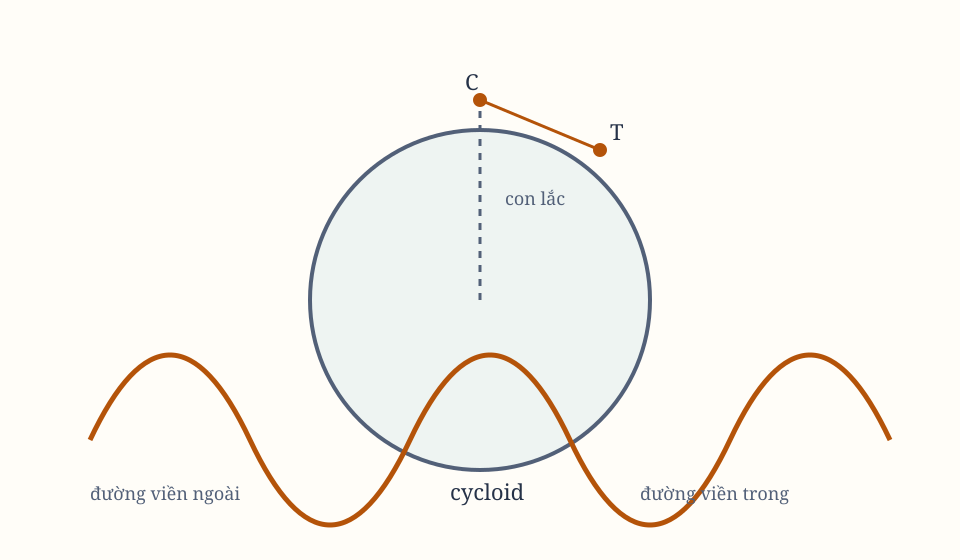

*Hình 24. Sơ đồ được dựng lại từ các hình bản gốc; cần đối chiếu ký hiệu với scan.*

## Proposition XLVI. Bài toán XXXII

Giả sử có một lực hướng tâm bất kỳ, tâm lực $S$ nằm trong một mặt phẳng bất kỳ nơi vật thể quay, và các phần tư của các hình cong đã biết. Hãy xác định chuyển động của vật thể rời khỏi một nơi đã cho với vận tốc đã cho, theo phương của một đường thẳng đã cho trong mặt phẳng ấy.

Gọi $S$ là tâm lực, $SC$ là khoảng cách nhỏ nhất từ tâm đến mặt phẳng đã cho, $P$ là vật thể rời khỏi nơi $P$ theo phương $PZ$, và $Q$ là vị trí sau đó của vật thể trên quỹ đạo $PQR$ cần tìm.

Nối $CQ$, $QS$. Trên $QS$, lấy $SV$ tỷ lệ với lực hướng tâm hướng về $S$, rồi kẻ $VT$ song song với $CQ$, cắt $SC$ tại $T$.

Lực $SV$ phân rã thành $ST$ và $TV$. Lực $ST$, vuông góc với mặt phẳng, không làm thay đổi chuyển động của vật thể trong mặt phẳng. Lực $TV$ hướng về điểm $C$ trong mặt phẳng, nên vật thể chuyển động như thể lực $SF$ bị bỏ đi và chỉ còn lực $TV$ hướng về $C$.

Vì lực $TV$ đã cho, Proposition XLII cho biết quỹ đạo, vị trí sau một thời gian và vận tốc tại vị trí ấy. Vì thế bài toán được giải.

## Proposition XLVII. Định lý XV

Nếu lực hướng tâm tỷ lệ với khoảng cách từ tâm, mọi vật thể quay trong bất kỳ mặt phẳng nào sẽ mô tả các elip và hoàn thành các vòng quay trong những thời gian bằng nhau. Những vật thể chuyển động trên đường thẳng, đi tới và lui luân phiên, cũng hoàn thành các chu kỳ tới và quay lại trong cùng thời gian.

Lực $SV$ tỷ lệ với khoảng cách từ tâm. Vì $SV$ và $SQ$ tỷ lệ, $TV$ và $CQ$ tỷ lệ, lực $TV$ tỷ lệ với khoảng cách $CQ$.

Vì vậy, các lực hướng tâm trong mặt phẳng quỹ đạo tỷ lệ với khoảng cách tới $C$ đúng như các lực hướng tâm trong không gian tới $S$. Các vật thể vì thế chuyển động trong cùng thời gian và cùng hình dạng, quanh $C$ trong bất kỳ mặt phẳng nào, như khi chúng quanh $S$ trong không gian.

Theo Hệ quả 2 của Proposition X và Hệ quả 2 của Proposition XXXVIII, chúng sẽ hoặc mô tả elip trong mặt phẳng đó quanh $C$, hoặc đi tới lui trong các đường thẳng qua $C$, với cùng chu kỳ.

## Học luận

Sự lên và xuống của các vật thể trên mặt cong có liên quan gần với các chuyển động này. Hình dung các đường cong được vẽ trên một mặt phẳng rồi quay quanh một trục đã cho đi qua tâm lực, tạo thành mặt cong. Các tâm vật thể luôn nằm trên những mặt cong ấy.

Nếu vật thể đi tới lui với một đường lên xiên và đường xuống xiên, chuyển động diễn ra trong các mặt phẳng qua trục, và do đó trong các đường cong tạo ra mặt cong đó.

## Proposition XLVIII. Định lý XVI

Nếu một bánh xe đặt bên ngoài một quả cầu vuông góc với nó, đồng thời quay quanh trục riêng và đi về phía trước trên một đường tròn lớn, độ dài đường cong mà một điểm bất kỳ trên chu vi bánh xe mô tả kể từ lúc chạm quả cầu sẽ tỷ lệ với hai lần sin thuận của nửa cung mà bánh xe đã lăn qua, theo tỷ số tổng các đường kính của quả cầu và bánh xe với bán kính của quả cầu.

## Proposition XLIX. Định lý XVII

Nếu một bánh xe đặt bên trong một quả cầu lõm vuông góc với nó, đồng thời quay quanh trục riêng và đi về phía trước trên một đường tròn lớn của quả cầu, độ dài đường cong mà một điểm bất kỳ trên chu vi bánh xe mô tả kể từ lúc chạm quả cầu sẽ tỷ lệ với hai lần sin thuận của nửa cung đã lăn qua, theo tỷ số hiệu các đường kính của quả cầu và bánh xe với bán kính của quả cầu.

Gọi $ABL$ là quả cầu, $C$ là tâm, $BPV$ là bánh xe áp vào đó, $E$ là tâm bánh xe, $B$ là điểm tiếp xúc, và $P$ là điểm đã cho trên chu vi bánh xe.

Cho bánh xe đi trên đường tròn lớn $ABL$ từ $A$ qua $B$ về $L$, đồng thời quay sao cho các cung $AB$, $PB$ luôn bằng nhau. Điểm $P$ mô tả đường cong $AP$.

Gọi $AP$ là toàn bộ đường cong đã mô tả. Độ dài $AP$ tỷ lệ với hai lần sin thuận của cung $PB$ theo tỷ số $2CE:CB$.

Kéo dài $CE$ cho cắt bánh xe tại $V$, nối $CP$, $BP$, $EP$, $VP$, kéo dài $CP$ và hạ vuông góc $VF$. Các tiếp tuyến $PH$, $VH$ cắt nhau tại $H$ và chạm đường tròn tại $P$, $V$. Đặt $PH$ cắt $VF$ tại $G$, hạ $GI$, $HK$ vuông góc với $VP$.

Dựng đường tròn tâm $C$, cắt $CP$ tại $n$, chu vi bánh xe tại $o$, và đường cong $AP$ tại $m$. Từ $V$, dựng đường tròn bán kính $Vo$, cắt $VP$ kéo dài tại $q$.

Vì bánh xe luôn quay quanh điểm tiếp xúc $B$, $BP$ vuông góc với đường cong $AP$. Vì vậy $VP$ là tiếp tuyến của đường cong tại $P$.

Cho bán kính đường tròn $nmn$ tăng hoặc giảm cho đến khi bằng $CP$. Từ sự đồng dạng của các hình mới, tỷ số giới hạn của các đoạn tức thời của $AP$, $CP$, cung $BP$, và $VP$ bằng tỷ số của $PV$, $PF$, $PG$, $PI$.

Vì $VF\perp CF$ và $VH\perp CV$, các góc $HVG$, $VCF$ bằng nhau. Vì các góc tại $V$, $P$ của tứ giác $HVEP$ vuông, góc $VHG$ bằng $\angle CEP$. Do đó các tam giác $VHG$, $CEP$ đồng dạng, suy ra
$$
HG:HP = EP:CE = KI:KP.
$$

Bằng cách cộng hoặc chia tỷ số,
$$
CB:CE = PI:PK,
$$
và
$$
CB:2CE = PI:PV = Pq:Pm.
$$

Suy ra sự giảm của $VP$, tức sự tăng của $BY-VP$ so với sự tăng của $AP$, ở trong một tỷ số đã cho. Vì vậy độ dài $BY-YP$ và $AP$ có cùng tỷ số.

Nếu $BY$ là bán kính, $YP$ là cosin của góc $BYP$, nên $BY-YP$ là sin thuận của cùng góc. Vì bán kính bánh xe là $BV$, $BY-YP$ gấp đôi sin thuận của cung $BP$. Do đó
$$
AP:(2\text{ sin thuận của cung }BP) = 2CE:CB.
$$

Ta gọi đường $AP$ trong Proposition trước là cycloid ngoài quả cầu, và đường tương ứng trong Proposition này là cycloid trong quả cầu.

## Hệ quả 1

Nếu cycloid đầy đủ $ASL$ được chia đôi tại $S$, độ dài $PS$ tỷ lệ với $PV$ theo tỷ số $2CE:CB$.

## Hệ quả 2

Nửa chu vi của cycloid $AS$ bằng một đoạn thẳng tỷ lệ với đường kính bánh xe $BY$ theo tỷ số $2CE:CB$.

## Proposition L. Bài toán XXXIII

Làm cho một vật thể treo dao động trong một cycloid đã cho.

Cho bên trong quả cầu $QYS$ tâm $C$, cycloid $QRS$ chia đôi tại $R$, có hai điểm cực $Q$, $S$ nằm trên mặt cầu. Kẻ $CR$ cắt cung $QS$ tại $O$, kéo dài đến $A$ sao cho
$$
CA:CO = CO:CR.
$$

Dựng quả cầu ngoài $DAF$ tâm $C$, bán kính $CA$. Bên trong nó, dựng hai nửa cycloid $AQ$, $AS$ bằng bánh xe đường kính $AO$, chạm mặt cầu trong tại $Q$, $S$ và gặp mặt cầu ngoài tại $A$.

Từ $A$, treo vật thể $T$ bằng sợi $APT$ dài bằng $AR$. Cho nó dao động giữa hai nửa cycloid, sao cho mỗi khi rời vuông góc $AR$, phần trên của sợi $AP$ áp vào nửa cycloid mà chuyển động hướng tới, còn phần còn lại của sợi $PT$ chưa chạm cycloid vẫn thẳng. Vật thể $T$ sẽ dao động trong cycloid $QRS$.

Để chứng minh, cho sợi $PT$ cắt cycloid tại $T$ và đường tròn $QOS$ tại $V$, kẻ $OV$, rồi dựng các vuông góc $BP$, $TW$ với các đoạn thẳng của sợi tại $P$, $T$, cắt $CV$ tại $B$, $W$.

Do các hình $AS$, $SR$ đồng dạng, $VB$, $VW$ bằng các đường kính bánh xe $OA$, $OR$. Vì vậy
$$
TP:VP = (AO+OR):AO = (CA+CO):CA = 2CE:CB.
$$

Theo Hệ quả 1 của Proposition XLIX, phần thẳng của sợi $PT$ luôn bằng cung cycloid $PS$, và toàn bộ sợi $APT$ luôn bằng nửa cycloid $APS$, tức bằng $AR$. Vì thế, nếu sợi luôn dài $AR$, điểm $T$ luôn chuyển động trong cycloid $QRS$.

## Hệ quả

Sợi $AR$ bằng nửa cycloid $AS$, nên có cùng tỷ số với $AC$, bán kính quả cầu ngoài, như nửa cycloid $SR$ với $CO$, bán kính quả cầu trong.

## Proposition LI. Định lý XVIII

Nếu lực hướng tâm hướng về tâm $C$ của một quả cầu từ mọi phía, tỷ lệ với khoảng cách từ nơi đến tâm, và vật thể $T$ chỉ chịu lực này mà dao động trên chu vi cycloid $QRS$, thì mọi dao động, dù lớn hay nhỏ, đều được thực hiện trong những thời gian bằng nhau.

Trên tiếp tuyến $TW$ kéo dài vô hạn, hạ vuông góc $CX$, nối $CT$. Phân rã lực hướng tâm $CT$ thành $CX$, $TX$.

Lực $CX$ kéo dây, nên sự kháng cự của dây tiêu tụ toàn bộ hiệu ứng của nó. Lực $TX$ gia tốc chuyển động trên cycloid. Vì vậy gia tốc tỷ lệ với $TX$, rồi với $TW$, và theo Hệ quả 1 của Proposition XLIX, với cung $TR$.

Nếu hai con lắc được kéo lệch khác nhau rồi thả cùng lúc, gia tốc của chúng luôn tỷ lệ với các cung $TR$, $tR$ còn phải mô tả. Các phần còn lại và các gia tốc tiếp theo cũng giữ tỷ lệ ấy, nên hai vật thể tới vuông góc $AR$ cùng lúc.

Khi lên từ $R$ qua các cung cycloid ấy, chuyển động bị làm chậm bởi cùng các lực đã gia tốc khi rơi. Vì vậy thời gian lên và xuống bằng nhau, và hai con lắc thực hiện toàn bộ cũng như nửa dao động trong cùng thời gian.

## Hệ quả

Lực gia tốc hoặc làm chậm vật thể $T$ tại một nơi $T$ của cycloid, tỷ lệ với trọng lượng toàn phần của vật thể tại nơi cao nhất $S$ hoặc $Q$, theo tỷ số giữa cung $TR$ và cung $SR$ hoặc $QR$.

## Proposition LII. Bài toán XXXIV

Xác định vận tốc của các con lắc tại những nơi khác nhau và thời gian của toàn bộ dao động cũng như từng phần của nó.

Lấy tâm $G$ bất kỳ, dựng nửa đường tròn $HKM$ với $GH$ bằng cung cycloid $RS$, bán kính $GK$ chia đôi nó. Giả sử lực hướng tâm tới $G$ tỷ lệ với khoảng cách, và trên chu vi $HIK$ bằng lực hướng tâm trên chu vi quả cầu $QOS$.

Khi con lắc $T$ rơi từ $S$, cho một vật thể $L$ rơi từ $H$ tới $G$. Vì các lực tác dụng bằng nhau lúc đầu và luôn tỷ lệ với các không gian $TR$, $LG$, nếu $TR=LG$, các vật thể ở $T$, $L$ cũng chịu lực bằng nhau và tiếp tục mô tả các không gian bằng nhau.

Theo Proposition XXXVIII, thời gian mô tả cung $ST$ tỷ lệ với thời gian một dao động như cung $HI$ tỷ lệ với thời gian vật thể $H$ tới $L$, và với nửa chu vi $HKM$, thời gian vật thể $H$ tới $M$.

Vận tốc con lắc tại $T$ so với vận tốc tại $R$ bằng vận tốc vật thể $H$ tại $L$ so với vận tốc tại $G$, tức bằng
$$
LI:GK.
$$

Vì các dao động không bằng nhau vẽ các cung tỷ lệ với toàn bộ cung dao động trong những thời gian bằng nhau, từ thời gian đã cho có thể tìm cả vận tốc và các cung đã mô tả.

Nếu các con lắc dao động trong các cycloid khác nhau, các lực tuyệt đối cũng khác nhau. Nếu lực tuyệt đối của quả cầu là $V$, gia tốc khi con lắc bắt đầu đi thẳng về tâm là
$$
CO\cdot V.
$$

Do đó thời gian của một dao động đầy đủ tỷ lệ trực tiếp với căn bậc hai độ dài sợi và nghịch với căn bậc hai khoảng cách giữa điểm treo và tâm quả cầu, cũng nghịch với căn bậc hai lực tuyệt đối.

## Hệ quả 1

Thời gian dao động, rơi và quay của các vật thể có thể so sánh với nhau. Nếu đường kính bánh xe bằng bán kính quả cầu, cycloid trở thành đường thẳng qua tâm, và dao động biến thành rơi rồi lên.

## Hệ quả 2

Khi bán kính quả cầu tăng vô hạn, mặt cầu trở thành mặt phẳng, và cycloid trở thành cycloid thông thường. Đó là những điều Wren và Huygens đã phát hiện.

Những Proposition ở đây phù hợp với cấu tạo thật của Trái Đất: bánh xe chạy trên các đường tròn lớn sẽ tạo cycloid ngoài quả cầu bằng các đinh tán trên chu vi; con lắc trong hầm mỏ và hang sâu sẽ dao động theo cycloid trong quả cầu, để thời gian dao động bằng nhau.

Trọng lực giảm khi đi từ bề mặt Trái Đất ra ngoài theo bình phương khoảng cách từ tâm, nhưng tăng theo khoảng cách khi đi sâu vào trong.

> **[Chú giải]**
>
> **Cycloid: một con lắc trên đường cong này thì mọi dao động đều mất đúng một thời gian**
>
> Cơ chế nằm ở chỗ gia tốc luôn tỷ lệ với cung phải đi, nên tỷ số giữa hai dao động được giữ nguyên suốt chừng. Chu kỳ là $T = 2\pi\sqrt{\dfrac{a}{g}}$, với $a$ là bán kính đường tròn sinh cycloid. Nó tỷ lệ căn bậc hai với độ dài dây, đúng như con lắc đơn, nhưng **không phụ thuộc biên độ** - và toàn bộ giá trị của nó nằm ở chỗ đó.
>
> Bán kính quả cầu là lý do bên trong: nó khiến lực hướng tâm tỷ lệ thuận với khoảng cách, đúng lực mà Proposition XLVIII vừa chứng minh là tạo ra dao động đẳng kỳ. Ông đang ở trong Phần X, nơi lực tỷ lệ với khoảng cách vừa được dựng cho họ các elip đồng tâm, nên ông nhận ra dao động đẳng kỳ trước, rồi tìm đường cong khiến nó thành hiện thực. Hệ quả 2 ghi công đúng chỗ: việc này do Wren và Huygens phát hiện, và Huygens đã dùng nó để chế tạo đồng hồ quản lắc.
>
> Nhận xét cuối chương về hầm mỏ là một quan sát địa chấn thật. Bên trong Trái Đất, trọng lực tăng tuyến tính theo độ sâu nếu mật độ đều, và nói chung là tăng theo độ sâu. Nên quả lắc trong một hầm sâu có chu kỳ khác hẳn ở mặt đất, và chính độ lệch chu kỳ ấy ở một độ sâu đã biết cho ra mật độ trung bình của Trái Đất bên trong độ sâu đó.
>
> Tính đẳng thời gian của cycloid vẫn sống trong máy gia tốc hạt, và ở đó nó được dùng đúng mục đích Newton dùng: giữ mọi vòng quét trong cùng một khoảng thời gian để không mất hạt. Nam châm phân đoạn của máy gia tốc đồng bộ được uốn cong theo đúng hình dạng ấy, và đó là nơi quy luật uốn của nó được suy ra từ chính cycloid này.

## Proposition LIII. Bài toán XXXV

Cho biết các phần tư của các hình cong, hãy tìm các lực để vật thể chuyển động trong những đường cong đã cho luôn thực hiện dao động trong những thời gian bằng nhau.

Cho vật thể $T$ dao động trên đường cong $STRQ$ có trục $AR$ đi qua tâm lực $C$. Kẻ tiếp tuyến $TX$ tại vị trí $T$, rồi lấy $TY$ bằng cung $TR$. Từ $Y$ hạ vuông góc $YZ$ xuống tiếp tuyến. Kẻ $CT$ cắt vuông góc tại $Z$. Lực hướng tâm tỷ lệ với $TZ$.

Nếu lực hướng tâm từ $T$ về $C$ được biểu thị bằng $TZ$, nó phân rã thành $TY$ và $YZ$. Lực $YZ$ không làm thay đổi chuyển động dọc theo sợi; lực $TY$ gia tốc hoặc làm chậm chuyển động trên đường cong.

Vì lực ấy tỷ lệ với không gian $TR$, các gia tốc khi mô tả hai phần tỷ lệ của hai dao động luôn tỷ lệ với các phần ấy, nên chúng hoàn thành cùng nhau.

## Hệ quả 1

Nếu vật thể $T$ treo bằng sợi thẳng $AT$ từ tâm $A$, mô tả cung tròn $STRQ$, đồng thời chịu một lực hướng xuống có các phương song song, tỷ lệ với trọng lực đều như cung $TR$ với sin $TN$, thì các dao động có thời gian bằng nhau.

## Hệ quả 2

Trong đồng hồ, nếu một máy tạo lực lên con lắc, lực đó phải được phối hợp với trọng lực sao cho lực tổng hướng xuống luôn tỷ lệ với đường cong tạo bởi hình chữ nhật giữa cung $TR$, bán kính $AR$, và sin $TN$. Khi đó mọi dao động đều đẳng thời gian.

## Proposition LIV. Bài toán XXXVI

Cho biết các phần tư của các hình cong, hãy xác định thời gian vật thể chịu một lực hướng tâm bất kỳ đi xuống hoặc đi lên trên một đường cong bất kỳ nằm trong mặt phẳng qua tâm lực.

Cho vật thể rơi từ một nơi $S$ trên đường cong $STR$ trong mặt phẳng qua $C$. Nối $CS$, chia $CS$ thành vô số phần bằng nhau, một phần là $Dd$. Từ $C$, dựng các đường tròn $DT$, $dt$ cắt đường cong tại $T$, $t$.

Vì quy luật lực và độ cao $CS$ đã cho, vận tốc tại mọi độ cao $CT$ đã biết theo Proposition XXXIX. Thời gian mô tả đoạn nhỏ $Tt$ tỷ lệ trực tiếp với đoạn ấy, tức secant của góc $TC$, và nghịch với vận tốc.

Dựng ordinate $DN$ vuông góc với $CS$ tại $D$ và tỷ lệ với thời gian này. Vì $Dd$ đã cho, hình chữ nhật $Dd\cdot DN$, tức diện tích $DNwc$, tỷ lệ với cùng thời gian.

Nếu $PN$ là đường cong có $N$ luôn nằm trên đó và asymptote là đường $SQ$ vuông góc với $CS$, thì diện tích $SQPND$ tỷ lệ với thời gian vật thể rơi mô tả $ST$. Khi biết diện tích ấy, ta biết thời gian.

## Proposition LV. Định lý XIX

Nếu vật thể chuyển động trên một mặt cong bất kỳ có trục đi qua tâm lực, và từ vật thể hạ một đường vuông góc xuống trục, rồi từ một điểm bất kỳ trên trục vẽ một đường song song và bằng nó, thì đường song song ấy mô tả diện tích tỷ lệ với thời gian.

Gọi $BKL$ là mặt cong, $T$ là vật thể quay trong đó, $STR$ là quỹ đạo, $S$ là điểm bắt đầu, $OMK$ là trục mặt cong, $TN$ là vuông góc từ vật thể xuống trục, $OP$ là đường song song và bằng nó từ điểm $O$ đã cho, và $AP$ là hình chiếu vuông góc của quỹ đạo.

Từ tâm vật thể $T$ kẻ $TO$, phân rã nó thành $TG$ tỷ lệ với lực hướng tâm và $TI$ tỷ lệ với lực áp. Kẻ $TM$ vuông góc với mặt cong, $TF$, $TH$ vuông góc với mặt phẳng, và $OF$, $IH$ vuông góc với $PHTF$.

Lực $TG$ phân rã thành $TF$, $FG$; lực $TI$ thành $TH$, $HI$. Các lực $TF$, $TH$ không làm thay đổi chuyển động của vật thể trong mặt phẳng $AOP$. Vì vậy, vật thể chuyển động như thể các lực ấy bị bỏ đi, chỉ chịu $FG$, $HI$.

Diện tích $AGP$ do $OP$ mô tả tỷ lệ với thời gian, theo Proposition I.

## Hệ quả

Nếu vật thể chịu các lực hướng tới hai hoặc nhiều tâm trên cùng một đường $CO$, và mô tả một đường cong bất kỳ $ST$ trong không gian tự do, thì diện tích $AOP$ vẫn tỷ lệ với thời gian.

## Proposition LVI. Bài toán XXXVII

Cho biết các phần tư của các hình cong, quy luật lực hướng tâm hướng tới một tâm đã cho, và mặt cong có trục đi qua tâm ấy. Hãy tìm quỹ đạo của vật thể rời khỏi một nơi đã cho với vận tốc và phương đã cho trên mặt cong.

Cho vật thể $T$ rời $S$ theo phương đã cho và đi vào quỹ đạo $STR$ cần tìm, hình chiếu vuông góc của nó trong mặt phẳng $BDO$ là $AP$.

Từ vận tốc tại $SC$, xác định vận tốc tại mọi $TC$. Trong một khoảng thời gian đã cho, cho vật thể mô tả hạt $Tt$ quỹ đạo, và $Pp$ là hình chiếu của hạt ấy trong mặt phẳng $AOP$.

Dựng đường tròn nhỏ tâm $T$, bán kính $TV$, trên mặt cong. Hình chiếu của nó trong mặt phẳng $AOP$ là elip $pq$. Vì kích thước đường tròn nhỏ và khoảng cách $TN$ hoặc $PO$ từ trục đều biết, elip $pq$ đã biết cả về loại, kích thước và vị trí.

Diện tích $POp$ tỷ lệ với thời gian, nên góc $POp$ đã biết. Vì thế giao điểm chung của elip và đường $Op$, cùng góc $OPp$, đã biết. Áp dụng Proposition XLI và Hệ quả 2, ta xác định được đường cong $APp$.

Từ các điểm $P$ của hình chiếu, dựng các vuông góc $PT$ xuống mặt cong tại $T$. Các điểm $T$ của quỹ đạo đã được xác định.

## Phần XI. Chuyển động của các vật thể hút nhau bằng lực hướng tâm

Tôi đã xét lực hướng tâm hướng về một tâm bất biến. Trong tự nhiên, lực hút luôn hướng từ vật thể này sang vật thể khác, và theo Định luật III, tác dụng và phản tác dụng luôn bằng nhau.

Nếu có hai vật thể, cả hai đều chuyển động quanh một tâm trọng lực chung. Nếu có nhiều vật thể hút nhau, tâm trọng lực chung của chúng đứng yên hoặc chuyển động đều theo một đường thẳng.

Từ đây, tôi sẽ xét chuyển động của các vật thể hút nhau. Các lực hướng tâm có thể gọi là lực hút, dù về mặt vật lý chúng có thể chính xác hơn là các xung lực.

## Proposition LVII. Định lý XX

Hai vật thể hút nhau mô tả những hình tương tự quanh tâm trọng lực chung, và cũng quanh lẫn nhau.

Khoảng cách của mỗi vật thể tới tâm trọng lực chung tỷ lệ nghịch với khối lượng của nó, nên giữ một tỷ số cố định, và tỷ lệ ấy cũng áp dụng cho toàn bộ khoảng cách giữa hai vật thể.

Các khoảng cách ấy quay quanh tâm chung bằng chuyển động góc đều, vì chúng cùng nằm trên một đường thẳng. Những đường thẳng ở trong một tỷ số cố định và quay với cùng chuyển động góc sẽ mô tả trên các mặt phẳng những hình hoàn toàn tương tự.

## Proposition LVIII. Định lý XXI

Nếu hai vật thể hút nhau bằng các lực bất kỳ, đồng thời quay quanh tâm trọng lực chung, thì có thể mô tả quanh một trong hai vật thể, bằng chính các lực ấy, một hình tương tự và bằng hình mà chúng mô tả quanh nhau.

Cho $S$, $P$ quay quanh $C$, đi từ $S$ tới $T$ và từ $P$ tới $Q$. Từ điểm cố định $s$, liên tục kẻ $sp$, $sq$ song song và bằng $SP$, $TQ$. Đường cong do $p$ mô tả quanh $s$ tương tự và bằng đường cong hai vật thể mô tả quanh nhau, nên tương tự với các đường $ST$, $PQ$ mà chúng mô tả quanh $C$.

### Trường hợp 1

Tâm trọng lực $C$ đứng yên. Đặt tại $s$, $p$ hai vật thể tương tự và bằng $S$, $P$, trong đó $s$ cố định, $p$ di động. Các tiếp tuyến tương ứng tạo các hình đồng dạng, nên các lực ở $C$, $s$ tỷ lệ với các quãng đường tương ứng.

Nếu các lực không cùng tỷ số, vật thể $p$ cần thời gian lớn hơn, theo Lemma X. Nếu vận tốc của $p$ tỷ lệ với vận tốc của $P$ theo căn bậc hai của $sp/CP$, các cung $pq$, $PQ$ được mô tả trong những thời gian tỷ lệ căn bậc hai của khoảng cách. Vì vậy $P$, $p$, chịu các lực bằng nhau, sẽ mô tả những hình tương tự quanh các tâm $C$, $s$.

### Trường hợp 2

Nếu tâm trọng lực cùng không gian chuyển động đều theo đường thẳng, mọi chuyển động trong không gian ấy vẫn giống trước, nên các vật thể mô tả quanh nhau những hình tương tự và bằng những hình trước.

## Hệ quả 1

Hai vật thể hút nhau bằng lực tỷ lệ với khoảng cách mô tả các elip đồng tâm quanh tâm trọng lực chung và quanh nhau. Ngược lại, nếu các hình ấy được mô tả, các lực tỷ lệ với khoảng cách.

## Hệ quả 2

Hai vật thể hút nhau bằng lực nghịch với bình phương khoảng cách mô tả các hình cắt conic đồng tâm quanh tâm trọng lực chung và quanh nhau. Ngược lại, nếu các hình ấy được mô tả, lực tỷ lệ nghịch với bình phương khoảng cách.

## Hệ quả 3

Hai vật thể quay quanh tâm trọng lực chung mô tả các diện tích tỷ lệ với thời gian, bằng các bán kính kẻ tới tâm ấy và tới lẫn nhau.

## Proposition LIX. Định lý XXII

Thời gian tuần hoàn của hai vật thể $S$, $P$ quanh tâm trọng lực chung $C$ tỷ lệ căn bậc hai với thời gian tuần hoàn của một vật thể quanh vật thể kia đứng yên, với hình tương tự và bằng hình mà chúng mô tả quanh nhau, theo tỷ số khối lượng $S$ với tổng $S+P$.

Theo Proposition trước, thời gian mô tả các cung tương tự tỷ lệ căn bậc hai của $CP$ với $SP$. Tổng các thời gian ấy, tức thời gian của toàn bộ hình, cũng giữ tỷ số đó.

## Proposition LX. Định lý XXIII

Nếu hai vật thể $S$, $P$ hút nhau bằng lực nghịch với bình phương khoảng cách và quay quanh tâm trọng lực chung, trục chính của elip mà một vật thể mô tả quanh vật thể kia sẽ tỷ lệ với trục chính của elip mà vật thể ấy mô tả quanh vật thể đứng yên trong cùng thời gian tuần hoàn, theo tỷ số tổng $S+P$ với trung bình nhân thứ nhất giữa tổng ấy và $S$.

Nếu các elip bằng nhau, chu kỳ của chúng tỷ lệ căn bậc hai với $S/(S+P)$. Giảm chu kỳ của elip sau theo tỷ số ấy, hai chu kỳ bằng nhau. Theo Proposition XV, trục chính giảm theo tỷ số một phần rưỡi, tức lập phương so với tỷ số ban đầu. Vì vậy trục chính của elip thứ nhất tỷ lệ với trục chính của elip thứ hai như $S+P$ với trung bình nhân thứ nhất giữa $S+P$ và $S$.

## Proposition LXI. Định lý XXIV

Nếu hai vật thể hút nhau bằng bất kỳ lực nào, không bị nhiễu hay cản trở, và chuyển động tùy ý, thì chuyển động ấy giống như khi chúng không hút nhau, nhưng cùng chịu các lực ấy từ một vật thể thứ ba đặt tại tâm trọng lực chung. Quy luật lực hút sẽ như nhau khi xét khoảng cách từ các vật thể tới tâm chung và khoảng cách giữa hai vật thể.

Các lực hút lẫn nhau cũng hướng về tâm trọng lực chung nằm giữa hai vật thể, nên tương đương với lực từ một vật thể trung gian.

Vì tỷ số giữa khoảng cách từ mỗi vật thể tới tâm chung và khoảng cách giữa hai vật thể đã cho, mọi lũy thừa và hàm của các khoảng cách ấy cũng có tỷ số tương ứng. Vì thế quy luật lực hút giống nhau khi xét cả hai loại khoảng cách.

## Proposition LXII. Bài toán XXXVIII

Xác định chuyển động của hai vật thể hút nhau bằng lực nghịch với bình phương khoảng cách, khi chúng rơi từ những nơi đã cho.

Theo Định lý trước, chúng chuyển động như thể bị một vật thể thứ ba đặt tại tâm trọng lực chung hút. Vì tâm ấy đứng yên lúc đầu, nó luôn đứng yên. Chuyển động của hai vật thể được xác định như trong Bài toán XXV, rồi suy ra chuyển động hút lẫn nhau.

## Proposition LXIII. Bài toán XXXIX

Xác định chuyển động của hai vật thể hút nhau bằng lực nghịch với bình phương khoảng cách, khi chúng rời những nơi đã cho theo phương và vận tốc đã cho.

Chuyển động ban đầu đã cho, nên chuyển động đều của tâm trọng lực chung và chuyển động của không gian chuyển động cùng nó cũng đã biết. Sau đó, theo Hệ quả 5 của các Định luật và Định lý trước, có thể xác định các chuyển động tiếp theo.

> **[Chú giải]**
>
> **Hai vật thể hút nhau: tương đương với một vật thể quanh tâm chung**
>
> Toàn bộ nội dung của định lý nằm ở một tỷ số không đổi. Với hai vật thể khối lượng $m_1$, $m_2$ quanh tâm chung $C$, ta có $CP_1:CP_2 = m_2:m_1$ không đổi theo thời gian, nên mọi lũy thừa và mọi hàm của hai khoảng cách ấy đều tỷ lệ với nhau. Với lực nghịch đảo bậc hai, lực hút tương hỗ giữa hai vật thể tỷ lệ với lực do một vật thể tưởng tượng đặt tại $C$, chỉ khác một hằng số điều chỉnh. Đó chính là phép giảm bài toán hai vật thể về **khối lượng quy hiệu dụng** $\mu = \dfrac{m_1 m_2}{m_1 + m_2}$: toạ độ tương đối chạy đúng như một vật thể duy nhất có khối lượng $\mu$ quanh tâm $C$.
>
> Ông cần cái này để chuyển giao thức từ "lực hướng về một tâm bất đổi" sang "lực hút giữa các vật thể", mà lực thứ hai không có tâm cố định. Ông không thể chỉ nói hai vật thể quay quanh nhau, vì mọi kết quả từ Phần I đến Phần X đều giả định một tâm bất đổi. Định lý này là cây cầu nối, và nó được xây bằng chính các định lý về tỷ số đã có sẵn từ trước.
>
> Hệ quả kèm theo còn đáng giữ hơn: nếu một vật thể chịu lực hút về **hai hay nhiều tâm nằm trên cùng một đường thẳng**, diện tích quét vẫn tỷ lệ với thời gian. Người đọc hôm nay biết đây chính là **bài toán ba vật thể giới hạn của Euler** - trường hợp mà mọi tâm lực đều nằm trên một đường, điều kiện đủ để bài toán vẫn còn giải được. Nó cho thấy ranh giới thật sự của lý thuyết tâm lực nằm ở chỗ các tâm lực **không** cùng nằm trên một đường, và đó cũng là lý do bài toán ba vật thể tổng quát không có lời giải giải tích.
