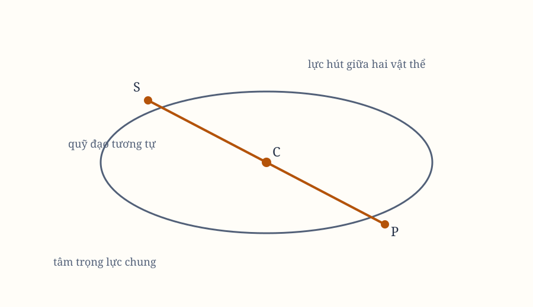

*Hình 25. Sơ đồ được dựng lại từ các hình bản gốc; cần đối chiếu ký hiệu với scan.*

## Proposition LXIII. Bài toán XXXIX

Xác định chuyển động của hai vật thể hút nhau bằng các lực nghịch với bình phương khoảng cách giữa chúng, khi chúng rời những nơi đã cho theo phương và vận tốc đã cho.

Khi chuyển động ban đầu đã biết, ta cũng biết chuyển động đều của tâm trọng lực chung và chuyển động của không gian chuyển động cùng nó theo một đường thẳng.

Theo Hệ quả 5 của các Định luật và Định lý trước, các chuyển động tiếp theo trong không gian ấy giống như khi không gian và tâm trọng lực đứng yên, và như thể các vật thể không hút nhau mà bị một vật thể thứ ba đặt tại tâm ấy hút.

Do đó, xác định chuyển động của mỗi vật thể trong không gian này bằng Bài toán IX và XXVI, rồi cộng chuyển động đều của toàn hệ thống. Khi ấy ta có chuyển động tuyệt đối trong không gian bất biến.

## Proposition LXIV. Bài toán XL

Giả sử các lực để các vật thể hút nhau tăng theo tỷ số đơn giản với khoảng cách từ các tâm. Hãy tìm chuyển động của nhiều vật thể trong tương tác.

Cho hai vật thể đầu tiên $T$, $L$ có tâm trọng lực chung tại $D$. Chúng sẽ mô tả các elip tâm tại $D$; kích thước các elip đã biết theo Bài toán V.

Cho vật thể thứ ba $S$ hút $T$, $L$ bằng các lực gia tốc $ST$, $SL$, và chúng lại hút $S$.

Lực $ST$ phân rã thành $SD$, $DT$; lực $SL$ thành $SD$, $DL$. Các lực $DT$, $DL$, tỷ lệ với tổng $TL$, cộng với lực hút giữa $T$, $L$, tạo ra các lực tỷ lệ với khoảng cách $DT$, $DL$ như trước nhưng lớn hơn.

Vì vậy, $T$, $L$ vẫn mô tả các elip quanh $D$, nhưng nhanh hơn. Lực còn lại $SD$ làm chúng cùng tiến tới đường $IK$ vuông góc với $DS$. Sự tiến cận ấy bị cân bằng bởi chuyển động quanh tâm trọng lực chung $C$.

Vật thể $S$ mô tả một elip quanh $C$, còn điểm $D$ mô tả một elip tương tự. $T$, $L$ vẫn mô tả các elip quanh tâm di động $D$.

Thêm vật thể thứ tư $V$. Cùng lập luận, $V$ và điểm $C$ mô tả các elip quanh tâm trọng lực chung $B$, trong khi chuyển động của $T$, $L$, $S$ quanh $D$, $C$ vẫn như trước nhưng nhanh hơn. Có thể thêm nhiều vật thể nữa bằng cùng phương pháp.

Nếu các lực hút giữa mọi cặp vật thể tỷ lệ với khoảng cách nhân với khối lượng vật thể hút, tất cả sẽ mô tả các elip khác nhau với cùng chu kỳ quanh tâm trọng lực chung $B$ trong một mặt phẳng bất biến.

> **[Chú giải]**
>
> **Lực tuyến tính giữa các vật thể: mọi vật thể cùng quay hết một vòng trong cùng một thời gian**
>
> Với lực hút tuyến tính $F_{ij} = -k m_i(\vec{r}_i - \vec{r}_j)$ và tổng khối lượng $M$, đặt tâm trọng lực tại gốc thì $\ddot{\vec{r}}_i = -kM\vec{r}_i$ cho mọi $i$. Kết quả: mọi vật thể cùng tần số góc $\omega = \sqrt{kM}$, cùng chu kỳ $T = 2\pi\sqrt{\dfrac{1}{kM}}$, và mọi elip đều đồng dạng quanh một tâm chung. Tổng khối lượng xuất hiện ở đúng một chỗ, nên nó là đại lượng duy nhất quyết định nhịp của cả hệ.
>
> Từng bước trong cách ông làm, mỗi lần thêm một vật thể, các vật thể cũ vẫn mô tả elip quanh tâm riêng của chúng với chu kỳ bị rút ngắn theo một tỷ lệ xác định, còn tâm ấy lại mô tả một elip tương tự quanh tâm lớn hơn. Ông cần bằng chứng rằng kết quả hai vật thể không phải một trường hợp riêng mà là thuộc tính chung của cả hệ, và cách lặp lại đó chính là cái mà ngày nay gọi là **phân rã thứ cấp** của bài toán nhiều vật thể: giải bài toán trên bằng cách đưa mọi vật thể về các hệ quy chiếu lồng nhau, mỗi hệ nhỏ hơn lại là một bài toán đã biết.
>
> Người đọc hôm nay gặp đúng cấu trúc "elip đồng dạng, cùng chu kỳ, quanh một tâm" trong lý thuyết dao động bình thường của các hệ nhiều bậc: hai con lắc gắn cứng, dãy dao động gắn, hay mạng tinh thể ở gần vị trí cân bằng nơi đạt cứng lên gần đúng tuyến tính. Cùng lý do đó, lực tuyến tính là lực duy nhất khiến mọi vật thể trong một hệ dao động cùng một tần số - đó là ý nghĩa vật lý sâu của câu "mọi chu kỳ đều bằng nhau".

## Proposition LXV. Định lý XXV

Các vật thể có lực giảm theo bình phương khoảng cách từ tâm có thể chuyển động trong các elip, và bằng các bán kính kẻ tới tiêu điểm, mô tả gần đúng các diện tích tỷ lệ với thời gian.

Trong Proposition trước, chúng ta chứng minh trường hợp chuyển động diễn ra chính xác trong elip. Nếu quy luật lực khác xa quy luật ấy, các vật thể càng làm nhiễu chuyển động của nhau. Chúng không thể chuyển động chính xác trong elip trừ khi giữ một tỷ lệ nhất định giữa các khoảng cách.

### Trường hợp 1

Hình dung nhiều vật thể nhỏ quanh một vật thể rất lớn ở những khoảng cách khác nhau, với các lực tuyệt đối hướng về mỗi vật thể tỷ lệ với nó.

Theo Hệ quả 4 của các Định luật, tâm trọng lực chung đứng yên hoặc chuyển động đều theo đường thẳng. Nếu các vật thể nhỏ đủ nhỏ, vật thể lớn không rời đáng kể khỏi tâm ấy.

Các vật thể nhỏ quanh vật thể lớn trong các elip, và bán kính kẻ tới nó mô tả diện tích tỷ lệ với thời gian. Sai số chỉ đến từ việc vật thể lớn lệch khỏi tâm trọng lực và từ lực hút giữa các vật thể nhỏ. Nếu các vật thể nhỏ đủ nhỏ, các sai số này nhỏ hơn bất kỳ đại lượng đã giao.

### Trường hợp 2

Hình dung một hệ vật thể nhỏ quanh một vật thể rất lớn, hoặc hai vật thể quanh nhau, đồng thời cả hệ chuyển động đều theo đường thẳng và chịu thêm lực ngang của một vật thể lớn hơn nhiều ở xa.

Các lực gia tốc bằng nhau theo những phương song song không làm thay đổi vị trí tương đối của các vật thể, chỉ làm toàn hệ chuyển dịch. Vì vậy, lực hút của vật thể lớn chỉ làm thay đổi chuyển động bên trong khi các lực gia tốc không bằng nhau hoặc các đường hút không song song.

Nếu các lực hút giữa các phần tử và vật thể lớn tỷ lệ nghịch với bình phương khoảng cách, và khoảng cách tới vật thể lớn đủ xa, chuyển động bên trong tiếp tục gần đúng.

Tâm trọng lực của hệ sẽ mô tả một hình cắt conic quanh vật thể lớn, và bán kính kẻ tới tâm ấy mô tả diện tích tỷ lệ với thời gian, với sai số nhỏ tùy ý.

Cùng lập luận có thể tiếp tục cho những trường hợp phức tạp hơn.

## Hệ quả 1

Trong Trường hợp 2, vật thể rất lớn càng gần hệ các vật thể đang quay, nhiễu loạn chuyển động bên trong càng lớn, vì các đường hút có độ nghiêng lớn hơn và tỷ số giữa các lực càng bất bằng.

## Hệ quả 2

Nhiễu loạn lớn nhất khi lực gia tốc của các phần tử hút về vật thể lớn không tỷ lệ nghịch với bình phương khoảng cách, nhất là khi mức bất bằng lớn hơn mức bất bằng của chính các khoảng cách.

## Hệ quả 3

Nếu các phần tử của hệ chuyển động trong elip hoặc đường tròn mà không bị nhiễu loạn đáng kể, thì lực từ các vật thể khác phải rất yếu, hoặc phải được truyền gần như bằng nhau theo các phương song song lên mọi phần tử.

## Proposition LXVI. Định lý XXVI

Nếu ba vật thể có lực giảm theo bình phương khoảng cách hút nhau, lực gia tốc của hai vật thể bất kỳ hút về vật thể thứ ba tỷ lệ nghịch với bình phương khoảng cách, và hai vật thể nhỏ quanh vật thể lớn, thì phần bên trong quỹ đạo của hai vật thể nhỏ sẽ mô tả gần hơn các diện tích tỷ lệ với thời gian và hình gần elip hơn, nếu vật thể lớn cũng bị các lực hút ấy làm chuyển động.

Điều này suy ra từ Hệ quả 2 của Proposition trước, nhưng có thể chứng minh rõ hơn.

### Trường hợp 1

Cho $P$, $S$ quanh vật thể lớn $T$ trong cùng một mặt phẳng. $P$ mô tả quỹ đạo trong $PAB$, $S$ mô tả quỹ đạo ngoài $ESE$.

Gọi $SK$ là khoảng cách trung bình, và lấy nó làm lực gia tốc của $P$ hút $S$ tại khoảng cách ấy. Lấy
$$
SL:SK = SK^2:SP^2.
$$

Nối $PT$, kẻ $LM$ song song với nó, cắt $ST$ tại $M$. Lực $SL$ phân rã thành $SM$, $LM$. Vật thể $P$ chịu ba lực.

Lực hướng tới $T$, đến từ hút giữa $T$, $P$, một mình sẽ làm $P$ mô tả elip quanh $T$ và diện tích tỷ lệ với thời gian. Lực $LM$ cộng vào lực trước, nhưng không tỷ lệ nghịch với $PT^2$, nên làm quỹ đạo lệch khỏi elip.

Lực $SM$, song song với $ST$, không còn hướng từ $P$ tới $T$, làm các diện tích không còn tỷ lệ hoàn toàn với thời gian. Quỹ đạo gần elip nhất khi lực $SM$ nhỏ nhất, tức khi lực hút của $T$ về $S$ không quá lớn hoặc quá nhỏ so với lực $SK$.

Nếu lực $SN$ bằng $SM$, nó không làm thay đổi vị trí tương đối của $T$, $P$. Nếu nhỏ hơn, phần còn lại $MN$ gây nhiễu; nếu lớn hơn, hiệu $MN$ cũng gây nhiễu. Vì vậy, diện tích và hình dạng gần hợp lý nhất khi lực $SN$ gần bằng lực trung bình $SK$.

### Trường hợp 2

Nếu $P$, $S$ quanh $T$ trong những mặt phẳng khác nhau, lực $LM$ vẫn có tác dụng cũ, còn lực $NM$ theo phương song song với $ST$ tạo thêm nhiễu theo vĩ độ, kéo $P$ ra khỏi mặt phẳng quỹ đạo.

Nhiễu ấy nhỏ nhất khi lực $MN$ nhỏ nhất, tức khi lực $SN$ gần lực $SK$.

## Hệ quả 1

Nếu nhiều vật thể nhỏ quanh một vật thể rất lớn, chuyển động của vật thể trong cùng bị nhiễu ít nhất khi vật thể lớn cũng bị các vật thể còn lại hút và chuyển động theo tỷ lệ các lực gia tốc của chúng.

## Hệ quả 2

Trong hệ ba vật thể $T$, $P$, $S$, nếu lực của hai vật thể bất kỳ hút về vật thể thứ ba tỷ lệ nghịch với bình phương khoảng cách, vật thể $P$ mô tả diện tích quanh $T$ nhanh hơn gần hội hợp $A$ và đối hợp $B$ so với gần các góc phần tư $C$, $D$.

Lực $NM$ làm gia tốc chuyển động khi đi từ $C$ tới $A$, làm chậm khi đi từ $A$ tới $D$, gia tốc khi đi từ $D$ tới $B$, rồi làm chậm khi đi từ $B$ về $C$.

## Hệ quả 3

Vì vậy, vật thể $P$ chuyển động nhanh hơn ở hội hợp và đối hợp so với góc phần tư.

## Hệ quả 4

Quỹ đạo của $P$ cong hơn ở các góc phần tư so với hội hợp và đối hợp. Vật thể chuyển động càng nhanh càng ít lệch khỏi đường thẳng, và lực $KL$ hoặc $NM$ tại hội hợp, đối hợp chống lại lực của $T$, làm lực hướng tâm giảm.

## Hệ quả 5

Vật thể $P$ ở các góc phần tư xa $T$ hơn ở hội hợp và đối hợp, nếu không xét ảnh hưởng của độ lệch tâm. Nếu quỹ đạo lệch tâm, độ lệch ấy lớn nhất khi các apsis nằm ở syzygies, nên khoảng cách ở syzygies có thể lớn hơn.

## Hệ quả 6

Lực hướng tâm của $T$ tăng ở các góc phần tư vì lực $LM$, giảm ở syzygies vì lực $KL$. Vì $KL$ lớn hơn $LM$, lực giảm nhiều hơn lực tăng. Chu kỳ vì thế tăng khi bán kính $TP$ không đổi, và thay đổi theo tỷ số phức hợp của tỷ số một phần rưỡi bán kính và căn bậc hai tỷ số lực.

Nếu lực của vật thể trung tâm giảm dần, vật thể $P$ càng ra xa $T$; nếu lực tăng, nó tiến vào gần $T$. Khi lực của vật thể $S$ xa thay đổi, bán kính $TP$ và chu kỳ cũng thay đổi.

## Hệ quả 7

Trục elip của $P$, tức đường apsis, đi tiến và lùi theo chu kỳ, nhưng tiến nhiều hơn lùi. Ở góc phần tư, lực tổng giảm chậm hơn bình phương khoảng cách, nên đường apsis lùi. Ở hội hợp và đối hợp, lực giảm nhanh hơn bình phương khoảng cách, nên đường apsis tiến. Vì lực $KL$ gần gấp đôi $LM$, chuyển động tiến chiếm ưu thế.

## Hệ quả 8

Chuyển động tiến hoặc lùi của apsis phụ thuộc vào việc lực hướng tâm giảm nhanh hay chậm hơn bình phương khoảng cách. Ở syzygies, lực bị bớt, apsis tiến nhanh; ở góc phần tư, lực được cộng, apsis lùi chậm.

## Hệ quả 9

Nếu một vật thể bị lực nghịch với bình phương khoảng cách buộc quay trong elip, rồi lực ấy liên tục tăng thêm khi đi từ apsis trên xuống apsis dưới, quỹ đạo sẽ ngày càng lệch vào trong elip. Nếu lực giảm nhanh hơn khi quay lên, độ lệch tâm tăng.

Trong hệ $T$, $P$, $S$, tỷ lệ tăng giảm lực nhỏ nhất khi apsis ở góc phần tư và lớn nhất khi ở syzygies. Vì vậy độ lệch tâm của elip tăng khi apsis đi từ góc phần tư tới syzygies, rồi giảm khi đi ngược lại.

## Hệ quả 10

Để giải thích sai số theo vĩ độ, giả sử mặt phẳng quỹ đạo $EST$ đứng yên. Lực $ML$ nằm trong mặt phẳng quỹ đạo nên không làm thay đổi vĩ độ. Lực $NM$, khi các node nằm ở syzygies, cũng nằm trong mặt phẳng ấy; khi các node ở góc phần tư, nó làm thay đổi mạnh vĩ độ.

Khi vật thể đi từ góc phần tư tới syzygy, góc nghiêng giảm, rồi tăng trở lại khi đi từ syzygy tới góc phần tư kế tiếp. Vì vậy, góc nghiêng nhỏ nhất ở syzygy.

> **[Chú giải]**
>
> **Thêm một hành tinh thứ ba: nhanh hơn ở hội hợp, cong hơn ở góc phần tư, apsis vẫn tiến**
>
> Nhiễu dọc theo phương bán kính có hai thành phần: $KL$ ở hội hợp và $LM$ ở góc phần tư, với $KL$ gần gấp đôi $LM$. Vì vậy lực hướng tâm bị giảm nhiều ở hội hợp và chỉ tăng ít ở góc phần tư: chu kỳ dài ra ở hội hợp, quỹ đạo phồng ra ở góc phần tư, và chuyển động tiến của apsis thắng chuyển động lùi. Đó là toàn bộ kết quả của các Hệ quả 2 đến 10, chỉ gói trong một câu: mọi thay đổi đều đổi dấu ở hội hợp, và vì thành phần ở hội hợp lớn hơn, phần còn lại là phần tiến.
>
> Ông cần chứng minh các quy luật Kepler vẫn xấp xỉ đúng khi có nhiều hành tinh thay vì một, và ông chỉ có một đường: phân tích lực của vật thể thứ ba theo từng thành phần phương, rồi xem thành phần nào làm sai lệch diện tích và thành phần nào làm lệch hình dạng. Đó là cách làm của **lý thuyết nhiễu** ngày nay, chỉ khác ở chỗ người ta dùng phép tính vi phân thay cho hình học thuần tuý.
>
> Cùng cấu trúc ấy, ở dạng vi phân, chính là **phương trình phẳng thứ Lagrange**: tốc độ thay đổi dài hạn của quỹ đạo được biểu diễn theo trục elip, mỗi thành phần nhiễu sẽ đẩy một trục theo một tốc độ riêng. Đó là công thức mà ngành thiên văn vẫn dùng để theo dõi quỹ đạo vệ tinh và tiểu hành tinh.
>
> Hai sự kiện lịch sử của Mặt Trăng rơi thẳng ra từ đây. Nó chạy nhanh hơn ở hội hợp và đối hợp, và mặt phẳng quỹ đạo nghiêng ít nhất ở đúng những vị trí ấy - hai bất đẳng thức thiên văn đã được ghi nhận từ lâu. Nó cũng giải thích vì sao đường apsis của Mặt Trăng tiến dần do Mặt Trời gây ra, với tốc độ biến thiên theo chu kỳ 18,6 năm của mặt phẳng quỹ đạo.
