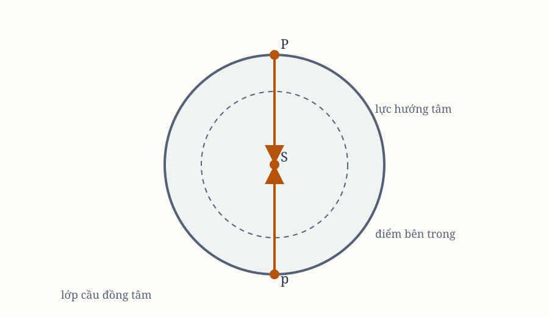

# Sách I, Phần XI–XII. Hệ quả XI–XXII; Proposition LXVII–LXXI

*Hình 26. Sơ đồ được dựng lại từ các hình bản gốc; cần đối chiếu ký hiệu với scan.*

## Các hệ quả còn lại của Proposition LXVI

### Hệ quả 11

Khi các node ở các góc phần tư, lực hút $S$ liên tục kéo $P$ ra khỏi mặt phẳng quỹ đạo. Khi đi từ node $C$ qua hội hợp $A$ tới node $D$, lực hướng về $S$; khi đi từ $D$ qua đối hợp $B$ về $C$, lực hướng ngược lại.

Vì vậy, từ node $C$, $P$ liên tục rời xa mặt phẳng cũ $CD$ cho tới node kế tiếp. Tại node ấy, $P$ ở xa mặt phẳng nhất, nên đi qua mặt phẳng $EST$ không tại $D$ mà tại một điểm gần $S$ hơn. Node vì thế lùi.

Các node lùi vô hạn khi ở góc phần tư, đứng yên ở syzygies, và ở các nơi trung gian chúng lùi chậm hơn. Trong mỗi vòng quay, chúng luôn đi lùi.

### Hệ quả 12

Các sai số lớn hơn ở hội hợp $P$, $S$ so với đối hợp, vì các lực sinh ra chúng lớn hơn.

### Hệ quả 13

Các nguyên nhân và tỷ lệ của sai số không phụ thuộc kích thước vật thể $S$. Vì vậy, mọi điều đã chứng minh vẫn đúng nếu $S$ lớn đến mức hệ $P$, $T$ quay quanh nó. Khi $S$ lớn hơn, lực hướng tâm của nó cũng lớn hơn, nên các sai số của $P$ ở cùng khoảng cách cũng lớn hơn.

### Hệ quả 14

Khi $S$ rất xa, các lực $NM$, $ML$ gần bằng lực $SK$, và tỷ lệ chúng với $PT$, $ST$ đã cho. Các hiệu ứng ấy tỷ lệ trực tiếp với lực tuyệt đối của $S$ và nghịch với lập phương khoảng cách $ST$.

Nếu kích thước $S$ tỷ lệ với lực tuyệt đối, các lực và hiệu ứng ấy tỷ lệ với lập phương đường kính biểu kiến của $S$ nhìn từ $T$.

### Hệ quả 15

Nếu các quỹ đạo giữ nguyên hình dạng, tỷ lệ và góc nghiêng, nhưng kích thước, lực và khoảng cách thay đổi, mọi sai số tuyến tính tỷ lệ với đường kính quỹ đạo, còn sai số góc và thời gian của chúng giữ tỷ lệ cũ.

### Hệ quả 16

Nếu hình dạng quỹ đạo và góc nghiêng đã cho, có thể suy ra gần đúng các sai số và thời gian của chúng trong trường hợp khác.

Các lực $NM$, $ML$, khi những thứ khác không đổi, tỷ lệ với bán kính $TP$. Các hiệu ứng tuần hoàn của chúng tỷ lệ với lực và bình phương thời gian tuần hoàn. Do đó chuyển động của apsis, node và các sai số longitude, latitude trong mỗi vòng quay gần tỷ lệ với bình phương thời gian.

### Hệ quả 17

Lực trung bình $LM$ tỷ lệ với lực trung bình $SK$ hoặc $SN$ như $PT:ST$. Khi các thời gian tuần hoàn và $PT$ đã cho, ta có $LM$, rồi gần đúng có $MN$.

### Hệ quả 18

Hãy hình dung nhiều vật thể chất lỏng quanh $T$ ở những khoảng cách bằng nhau, đủ gần để tạo thành một vành tròn đồng tâm. Các phần của vành chuyển động theo cùng quy luật như $P$, nên gần $T$ hơn và chuyển động nhanh hơn ở hội hợp, đối hợp so với góc phần tư.

Node của vành đứng yên ở syzygies và lùi ở nơi khác, nhanh nhất ở góc phần tư. Trục của vành dao động mỗi vòng rồi trở về vị trí cũ, ngoại trừ tiến động của node.

### Hệ quả 19

Nếu vật thể cầu $T$ có vật liệu rắn được mở rộng thành một vành, và có kênh nước quanh chu vi, nước sẽ chảy lên xuống như thủy triều. Nếu bỏ lực $S$, nước không có chuyển động thủy triều do quay quanh tâm cố định.

Khi $S$ tác dụng, nước gần $S$ bị hút mạnh hơn nước ở xa. Lực $LM$ kéo nước xuống ở góc phần tư, còn lực $KL$ kéo lên ở syzygies. Do đó mực nước cao nhất và thấp nhất xuất hiện ở các vị trí đã nêu trong bản gốc.

### Hệ quả 20

Nếu vành trở thành rắn và cầu nhỏ lại, chuyển động thủy triều dừng, nhưng dao động của góc nghiêng và tiến động node còn lại.

Một cầu đồng nhất, hoàn hảo không thay đổi trục khi nhận xung. Nhưng nếu thêm một đống vật chất như núi giữa cực và xích đạo, trục sẽ trôi và các cực sẽ vẽ các vòng tròn quanh chính chúng và các điểm đối diện.

Cách sửa chỉ có thể là đặt vật chất cân bằng ở cực, ở vùng xích đạo, hoặc ở phía bên kia của trục. Khi đó node đi tiến hoặc lùi tùy vị trí của vật chất.

## Proposition LXVII. Định lý XXVII

Với cùng quy luật hút, tôi nói rằng vật thể bên ngoài $S$, bằng các bán kính kẻ tới $O$ là tâm trọng lực chung của các vật thể bên trong $P$, $T$, sẽ mô tả quanh $O$ những diện tích gần tỷ lệ với thời gian hơn và quỹ đạo gần elip có tiêu điểm tại $O$ hơn so với khi nó mô tả quanh vật thể lớn nhất $T$ bằng các bán kính kẻ tới $T$.

Lực hút của $S$ với $T$ và $P$ hợp thành lực tuyệt đối hướng về $O$, tâm trọng lực chung của $T$, $P$, nhiều hơn hướng về $T$. Nó cũng gần tỷ lệ nghịch với $SO^2$ hơn với $ST^2$.

## Proposition LXVIII. Định lý XXVIII

Với cùng quy luật hút, nếu vật thể lớn nhất $T$ cũng bị các lực ấy làm chuyển động, vật thể $S$ sẽ mô tả quanh $O$ những diện tích gần tỷ lệ thời gian hơn và quỹ đạo gần elip có tiêu điểm tại $O$ hơn so với khi $T$ đứng yên hoặc bị hút mạnh, yếu, chuyển động mạnh hoặc yếu khác.

Có thể chứng minh như Proposition LXVI, nhưng lập luận dài hơn. Tâm mà $S$ bị hai lực kéo về gần tâm trọng lực chung của hai vật thể kia. Nếu các tâm ấy trùng nhau, $S$ và tâm của hai vật thể kia sẽ mô tả elip thật quanh tâm chung đứng yên.

Sai số tăng khi tâm chung chuyển động, và nhỏ nhất khi nó đứng yên, tức khi $T$ chịu lực theo cùng quy luật với các vật thể còn lại.

## Hệ quả

Nếu nhiều vật thể nhỏ quanh vật thể lớn, quỹ đạo càng gần elip và diện tích càng gần đều khi tất cả các vật thể hút và làm nhiễu nhau bằng các lực gia tốc tỷ lệ trực tiếp với lực tuyệt đối và nghịch với bình phương khoảng cách.

## Proposition LXIX. Định lý XXIX

Trong một hệ nhiều vật thể, nếu vật thể $A$ hút tất cả những vật thể còn lại bằng lực gia tốc nghịch với bình phương khoảng cách từ $A$, và vật thể $B$ cũng hút những vật thể còn lại theo cùng quy luật, thì lực tuyệt đối của $A$ và $B$ tỷ lệ với chính các vật thể $A$, $B$.

Các lực gia tốc của các vật thể hút về $A$ bằng nhau ở các khoảng cách bằng nhau, và tương tự đối với $B$. Lực tuyệt đối của $A$ so với $B$ bằng lực gia tốc tương ứng. Định luật III cho thấy tỷ số đó cũng là tỷ số khối lượng $A$ với $B$.

## Hệ quả 1

Nếu mỗi vật thể trong hệ đều hút tất cả vật thể còn lại bằng lực gia tốc nghịch với bình phương khoảng cách, lực tuyệt đối của chúng tỷ lệ với chính các vật thể.

## Hệ quả 2

Điều tương tự vẫn đúng với bất kỳ quy luật lực nào phụ thuộc vào khoảng cách.

## Hệ quả 3

Trong hệ các vật thể có lực nghịch với bình phương khoảng cách, nếu các vật thể nhỏ quay gần đúng trong elip quanh một vật thể lớn và mô tả chính xác diện tích tỷ lệ thời gian, lực tuyệt đối của chúng tỷ lệ chính xác hoặc gần đúng với khối lượng.

## Học luận

Các Proposition này dẫn tới sự tương tự giữa lực hướng tâm và vật thể trung tâm. Ta dùng “hút” cho mọi cố gắng của vật thể hướng về nhau, dù cố gắng ấy đến từ tinh thể, ether, không khí hay môi trường.

Trong toán học, ta nghiên cứu các lượng và tỷ số của lực theo các điều kiện giả thiết. Khi vào vật lý, ta so sánh những tỷ số ấy với các hiện tượng thiên nhiên.

## Phần XII. Lực hút của các vật thể cầu

## Proposition LXX. Định lý XXX

Nếu mỗi điểm trên một mặt cầu chịu các lực hướng tâm bằng nhau, giảm theo bình phương khoảng cách từ điểm ấy, thì một hạt thể đặt bên trong mặt cầu không bị các lực ấy hút theo bất kỳ hướng nào.

Gọi $HIKL$ là mặt cầu, $P$ là hạt thể bên trong. Kẻ hai đường thẳng qua $P$ cắt mặt cầu tại $H$, $K$ và $I$, $L$, chặn các cung rất nhỏ $HI$, $KL$.

Các tam giác $HPI$, $LPK$ đồng dạng, nên các cung tỷ lệ với $HP$, $LP$. Các hạt thể tại các cung ấy có lực hút tỷ lệ với bình phương khoảng cách, nên lực của chúng lên $P$ bằng nhau.

Các lực ấy theo những phương ngược nhau triệt tiêu lẫn nhau. Cùng lập luận cho toàn bộ mặt cầu, nên $P$ không chịu lực hướng tâm nào.

## Proposition LXXI. Định lý XXXI

Với cùng giả thiết, một hạt thể bên ngoài mặt cầu bị hút về tâm cầu bằng lực nghịch với bình phương khoảng cách từ tâm.

Dựng hai mặt cầu bằng nhau $AHKB$, $ahkb$ tâm $S$, $s$, đường kính $AB$, $ab$, và các hạt thể $P$, $p$ nằm ngoài trên các đường kính kéo dài.

So sánh các lực hút từ các dải mặt cầu tương ứng, ta thấy lực hút tổng hợp của mỗi hạt thể tỷ lệ với bình phương khoảng cách từ nó đến tâm. Cùng lập luận cho mọi lớp cầu đồng tâm, rồi cộng lại, ta được kết quả.

## Hệ quả 1

Nếu các hạt thể quay trong các đường tròn quanh các cầu đồng nhất, và khoảng cách từ tâm tỷ lệ với đường kính cầu, các chu kỳ sẽ bằng nhau.

## Hệ quả 2

Nếu các chu kỳ bằng nhau, các khoảng cách sẽ tỷ lệ với các đường kính.

## Hệ quả 3

Nếu hai vật thể rắn cùng hình và cùng mật độ, lực hút giữa chúng tỷ lệ với đường kính của chúng.
