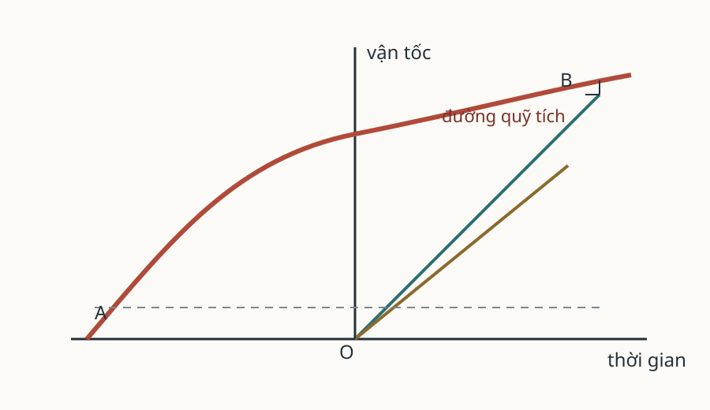

# Sách III. Proposition XIV

*Hình 47. Sơ đồ được dùng lại từ Phần I; các sơ đồ aphel, node và quỹ đạo của bản gốc cần được đối chiếu riêng.*

## Proposition XIV. Định lý XIV

Aphel và node của các quỹ đạo hành tinh là bất động.

Theo Proposition XI, Sách I, các aphel là bất động; các mặt phẳng của quỹ đạo cũng bất động, theo Proposition I của cùng Sách. Nếu các mặt phẳng ấy bất động, node cũng phải bất động.

Đúng là trong chuyển động quay của các hành tinh và sao chổi, lực tác dụng lẫn nhau có thể tạo ra một số bất đẳng thức. Nhưng những bất đẳng thức này quá nhỏ, nên ở đây có thể bỏ qua.

### Hệ quả 1

Các sao cố định là bất động, vì chúng giữ nguyên vị trí của mình đối với các aphel và node của các hành tinh.

### Hệ quả 2

Vì các sao này không chịu parallax đáng cảm nhận nào từ chuyển động quanh năm của Trái Đất, nên chúng không thể có lực đủ lớn, vì khoảng cách vô cùng xa, để tạo ra bất kỳ tác dụng đáng cảm nhận nào trong hệ thống của chúng ta. Ngoài ra, các sao cố định phân tán khắp nơi trên thiên cầu; những lực hút ngược chiều của chúng triệt tiêu các lực hút lẫn nhau, theo Proposition LXX, Sách I.

> **[Ghi chú hiện đại]**
>
> **Khái niệm tương ứng.** Hệ quả 1 và 2 dựng một lập luận ngược rất lạ. Ta quen coi các sao là bất động; ở đây Newton suy ra sự bất động ấy **từ** chuyển động của chính các hành tinh.
>
> **Công thức.** Nếu aphel và node của các hành tinh đứng yên, thì bất kỳ vật thể nào giữ nguyên vị trí tương đối với chúng cũng phải đứng yên. Các sao đó vẹn mang đúng đặc điểm ấy, nên chúng bất động. Rồi ông dựngng tiếp một lập luận về lực: vì các sao không có parallax đáng kể từ chuyển động quanh năm của Trái Đất, nên ở khoảng cách cực xa ấy chúng không thể có lực nào đủ lớn để tác động tới hệ Mặt Trời. Ông còn thêm một lý do nữa: các sao phân tán khắp thiên cầu, nên lực hút của chúng triệt tiêu nhau.
>
> **Vì sao Newton viết như vậy.** Vì ông muốn một cách kiểm chứng dựa trên những gì quan sát được ngay từ Trái Đất, chứ không cần dụng cụ nào đo trực tiếp. Ông cũng biết chỗ yếu của lập luận: nó đứng trên tiền đề là các aphel và node bất động, mà chính ông vừa thừa nhận có nhiễu. Nên ông không giấu điều đó, mà nói thẳng — bất đẳng thức có tồn tại, chỉ là quá nhỏ để tính.
>
> **Hiện nay thì sao.** Hai phần của lập luận ấy có kết cục khác nhau. Chỗ đúng là ý dùng khoảng cách cực xa để lập luận rằng lực không đáng kể: đó chính là cách giải quyết mọi nghịch lý chuyển động của Sao Mộc, hay của Trái Đất phẳng, chỉ bằng một suy luận duy nhất. Còn chỗ sai là kết luận về sự bất động. Năm 1718, chính Halley phát hiện các ngôi sao **không** đứng yên: ông so vị trí của chúng với bản Hipparchus cũ hơn nghìn năm và thấy cả đám đã dịch chuyển. Từ đó đi, kết luận còn đẹp hơn: các ngôi sao không đứng yên trước mặt ta, vì chính ta đang di chuyển. Mặt Trời bay với tốc độ khoảng $20\ \mathrm{km/s}$ về phía chòm sao Hercules, và phần lớn chuyển động mà Halley đo thấy bắt nguồn từ đó.

## Học luận

Các hành tinh ở gần Mặt Trời, tức Sao Thủy, Sao Kim, Trái Đất và Sao Hỏa, rất nhỏ, nên chúng chỉ tác dụng lên nhau với một lực nhỏ. Vì vậy, aphel và node của chúng phải bất động, ngoại trừ những nhiễu động do tác dụng của Sao Mộc, sao Thổ và những thiên thể cao hơn.

Do đó, theo thuyết trọng lực, ta có thể thấy rằng aphel của chúng dịch chuyển một chút theo chiều tiến so với các sao cố định, và tỷ lệ dịch chuyển tỷ lệ với lũy thừa \(3/2\) của các khoảng cách khác nhau từ Mặt Trời.

Nếu trong thời gian một trăm năm, aphel của Sao Hỏa dịch chuyển \(33'20''\) theo chiều tiến so với các sao cố định, thì trong một trăm năm, aphel của Trái Đất, Sao Kim và Sao Thủy sẽ dịch chuyển lần lượt

$$
17'40'',\qquad 10'53',\qquad 4'16''.
$$

Những chuyển động này nhỏ đến mức chúng ta đã bỏ qua trong Proposition này.

> **[Ghi chú hiện đại]**
>
> **Khái niệm tương ứng.** Học luận này là lần đầu tiên trong lịch sử vật lý, Newton **định lượng một hiệu ứng không quan sát trực tiếp**: aphel của các hành tinh phải trôi dần về phía tiến, và tốc độ trôi ấy tuân theo một quy luật riêng có thể kiểm tra.
>
> **Công thức.** Các hành tinh gần Mặt Trời rất nhỏ nên lực qua lại giữa chúng yếu, còn lực của Sao Mộc và sao Thổ thì đủ lớn để làm lệch aphel của chúng. Tốc độ dịch chuyển ấy tỷ lệ với **lũy thừa \(3/2\)** của các khoảng cách tới Mặt Trời. Nếu trong một trăm năm aphel của Sao Hỏa trôi \(33'20''\), thì aphel của Trái Đất, Sao Kim và Sao Thủy lần lượt trôi \(17'40''\), \(10'53''\) và \(4'16''\).
>
> **Vì sao Newton viết như vậy.** Vì ông hiểu rằng một cơ chế ta không thấy trực tiếp chỉ đáng tin khi nó sinh ra một sai số **có thể đo**. Vì thế ông dẫn ra những con số nhỏ nhưng cụ thể, rồi thừa nhận thẳng rằng chúng nhỏ đến mức không thể dùng cho Proposition trước. Đó là cách ông kiểm tra lý thuyết mà vẫn giữ được sự khiêm tốn: đưa ra con số, rồi nói rõ nó chưa đủ lớn để dùng.
>
> **Hiện nay thì sao.** Quy luật \(a^{3/2}\) ấy vẫn đúng và giờ là công thức chuẩn của tiền tiến cận điểm. Nhưng con số tuyệt đối thì không giữ nguyên: giá trị hiện nay cho phần nhiễu hành tinh vào chuyển động cận điểm là khoảng \(49''\) **mỗi năm theo chiều lùi**, lớn hơn con số của Newton khoảng hai lần rưỡi và ngược chiều hẳn; chính Newton đã phải sửa lại kết luận ấy ở các ấn bản sau. Sự kiện được Laplace giải thích khoảng một trăm hai mươi năm sau, và đó là cột mốc quan trọng: nó cho thấy một dự đoán hằng số mà không ai quan sát được vẫn có thể được kiểm chứng.

## Proposition XV. Bài toán I

Tìm các đường kính chính của quỹ đạo các hành tinh.

Các đường kính ấy phải được lấy theo tỷ lệ lũy thừa \(3/2\) của các thời gian tuần hoàn, theo Proposition XV, Sách I. Sau đó, chúng lần lượt được tăng lên theo tỷ lệ giữa tổng các lượng vật chất của Mặt Trời và từng hành tinh với số trung bình nhân thứ nhất trong hai số trung bình nhân giữa tổng ấy và lượng vật chất của Mặt Trời, theo Proposition LX, Sách I.

## Proposition XVI. Bài toán II

Tìm các độ lệch tâm và aphel của các hành tinh.

Bài toán này được giải bằng Proposition XVIII, Sách I.

*Các số liệu của Proposition XIV và Học luận đã được đối chiếu với scan trang 403–404. Hình minh họa dùng lại chưa phải hình riêng của Proposition XIV.*
