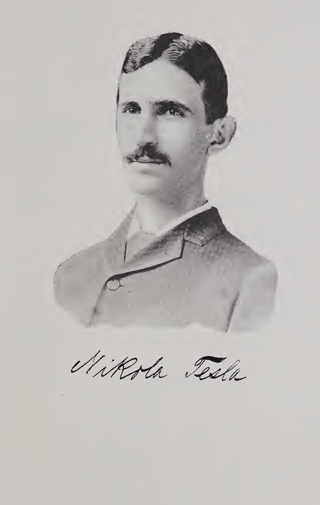

<!-- PDF 1 · trang trắng -->

<!-- PDF 2 · bìa lưu trữ -->

UNIVERSITY OF ILLINOIS LIBRARY - URL ANA-CHAMPAIGN

<!-- PDF 3 · phiếu thư viện -->

> **UNIVERSITY LIBRARY - UNIVERSITY OF ILLINOIS AT URBANA-CHAMPAIGN**
>
> Người mượn tài liệu này chịu trách nhiệm gia hạn hoặc trả trước hoặc
> trong ngày đến hạn. Khoản phí tối thiểu cho một tài liệu thất lạc là
> \$125.00, và \$300.00 với tạp chí đóng bìa.
>
> Trộm cắp, cắt xén và gạch chân sách là những lý do có thể bị xử lý kỷ
> luật, và có thể dẫn tới bị đình chỉ khỏi trường đại học. Xin lưu ý: giấy
> dán tự dính có thể làm rách trang và làm bong trôi mực.
>
> Gia hạn qua Trung tâm Điện thoại ở số 217-333-8400, 866-262-1510
> (miễn phí đường dài) hoặc circlib@illinois.edu. Gia hạn trực tuyến bằng cách
> chọn mục *My Account* tại http://www.library.illinois.edu/catalog/

<!-- PDF 4 · trang trắng -->

<!-- PDF 5 · bìa sách -->

Ảnh chụp bìa sách: vải nâu đỏ, tem mượn của thư viện.

<!-- PDF 6 · bìa sách -->

Ảnh chụp góc bìa sách.

<!-- PDF 7 · chân dung tác giả -->

*Chân dung của Nikola Tesla, kèm chữ ký.*

<!-- PDF 8 · trang Internet Archive -->

Digitized by the Internet Archive in 2019 with funding from University of
Illinois Urbana-Champaign.

<https://archive.org/details/experimentswitha00tesl_0>

<!-- PDF 9 · trang tựa -->

> **EXPERIMENTS**
>
> WITH
>
> **ALTERNATE CURRENTS**
>
> OF
>
> **HIGH POTENTIAL AND HIGH FREQUENCY.**
>
> BY
>
> **NIKOLA TESLA.**
>
> A LECTURE
>
> DELIVERED BEFORE THE
>
> **INSTITUTION OF ELECTRICAL ENGINEERS, LONDON.**
>
> *With a Portrait and Biographical Sketch of the Author.*
>
> NEW YORK:
> The W. J. Johnston Company, Ltd.,
> 167–176 Times Building.
> 1892.

<!-- PDF 10 · trang trắng -->

<!-- PDF 11 · trang in III -->

## Tiểu sử tóm tắt của Nikola Tesla

Trong khi một phần lớn của gia đình người châu Âu suốt ba hay bốn trăm năm qua
dồn từ hướng tây, lấp đầy những châu lục rộng lớn của châu Mỹ, thì một phần
khác, nhỏ hơn nhiều, vẫn làm công việc tiền tuyến ở thế giới cũ, che chở
phe sau bằng cách đẩy lùi "thổ phi vô danh" và từ từ giành lại những vùng đất
tốt đẹp còn chịu lời nguyền của chế độ Mô-ha-mét. Người Slavic - sau trận Kosovo
Polje, nơi quân Ottoman đánh bại người Serb, rút về các vùng biên của nước
Montenegro, Dalmatia, Herzegovina và Bosnia ngày nay, cùng vùng "Vùng biên" của
Áo - lâu nay hiểu rõ mình phải đối diện với điều gì, cũng như những người tiên
phong miền Tây của chúng ta: những kẻ địch không ngừng gặm gỡ bờ cương của họ.
Và các dân tộc ở những nước này, qua cuộc tranh đấu gay gắt chống lại đạo quân
của Trăng Lưỡi Liềm, đã rèn luyện nên những phẩm chất đáng chú ý về lòng dũng
cảm và tài trí, đồng thời giữ được lòng yêu nước và sự độc lập mà không dân tộc
nào khác sánh bằng.

Nikola Tesla ra đời vào năm 1857, ở vùng biên giới thú vị ấy, và giữa những
dân tộc phương Đông dũng cảm ấy. Việc ngày nay ông ở America và là một trong
những nhà điện học hàng đầu của chúng ta, là bằng chứng nổi bật về sức hút
danh dự bất ngờ, y như của việc theo đuổi điện học, lẫn của quốc gia nơi điện
được ứng dụng rộng rãi nhất.

<!-- PDF 12 · trang in IV -->

Quê hương của ông là Smiljan, thuộc vùng Lika, nơi cha ông là một mục sư tài
tài ăn nói hay của Giáo hội Hy Lạp - theo lời ông, gia đình ông cho đến nay
vẫn có tiếng rõ trong đó. Mẹ ông nổi tiếng khắp vùng quê về tài khéo tay và
sự tinh tế trong thêu phối, và chắc đã truyền tài năng ấy cho Nikola, dù tài
năng ấy tất nhiên đã đi theo một hướng khác, nam tính hơn.

Cậu bé được cho vào sách sớm, và sau khi cha chuyển đi Gospić, ông dành bốn
năm ở trường tiểu học công lập, rồi sau đó ba năm ở trường Trung cấp Thực
(*Real School*), như trường đó được gọi. Những cuộc phiêu lưu của cậu cũng
chỉ là loại mà hầu hết những đứa trẻ nhanh nhẹn đều trải qua, dù có một lần
cậu biến thành tội phạm theo cách riêng: bị nhốt trong một nhà thờ nhỏ giữa
núi, nơi hiếm khi có người đến dự lễ. Lần khác, cậu ngã đầu xuống một chiếc
nồi sữa bò sôi sục lớn vừa mới vắt từ bầu báu của cha. Câu chuyện kỳ lạ thứ
ba liên quan đến nỗ lực bay của cậu: khi dùng một chiếc dù cũ để lèo lài
trên không trung, cậu - như có thể đoán trước - ngã rất tệ, phải nằm liệt sáu
tuần.

Khoảng thời gian đó, cậu bắt đầu thích thú với số học và vật lý. Một ý tưởng
kỳ quặc của cậu là tính mọi thứ bằng ba, hay bằng lũy thừa của ba. Nay cậu
được gửi đến với một bác gái ở Cartstatt, Croatia, để hoàn tất việc học ở
trường Trung cấp Thực Bậc cao, và chính ở đó, đến từ vùng thôn quê hẻo lánh,
cậu nhìn thấy một chiếc máy hơi nước lần đầu tiên với niềm vui mà cậu vẫn
nhớ đến tận nay. Ở Cartstatt, cậu chăm chỉ đến mức nén bốn năm học vào ba
năm, và tốt nghiệp năm 1873. Về nhà trong một đợt dịch tả, ông bị...

<!-- PDF 13 · trang in V -->

...hạ gục vì dịch bệnh, chịu hậu quả nặng nề đến mức việc học của ông bị gián
đoạn trọn vẹn hai năm. Nhưng thời gian ấy không phí phạm, vì ông đã trở nên
say mê thí nghiệm một cách nồng nhiệt, và trong phạm vi tài sản cùng thời gian
rảnh cho phép, dồn hết sức lực vào việc học và nghiên cứu điện. Trong suốt
giai đoạn này, ý định của cha ông vẫn là làm cho ông trở thành một linh sĩ,
và ý nghĩ ấy treo trên đầu nhà vật lý trẻ như một thanh kiếm thủ của Đamôc
đích. Cuối cùng ông thuyết phục người cha đáng kính nhưng miễn cưỡng kia gửi
ông đến Gratz ở Áo để hoàn tất việc học tại trường Bách khoa và chuẩn bị
cho việc trở thành giáo sư toán học và vật lý.

Ở Gratz, lần đầu tiên ông nhìn thấy và vận hành một máy Gramme, và bị ấn tượng
đến mức trước những phản đối về việc dùng bộ chuyển mạch và chổi tiếp xúc, đến
mức ngay tại đó ông quyết định phải sửa cái khiếm khuyết ấy trong máy phát
điện. Trong năm thứ hai của chương trình, ông từ bỏ ý định làm giáo viên và
chuyển sang chương trình kỹ thuật. Sau ba năm vắng mặt, ông buồn bã trở về
nhà để nhìn cha mình từ trần xuống. Nhưng đã quyết định ở lại Áo, và hiểu được
giá trị của vốn hiểu biết ngôn ngữ, ông đi Prague, rồi đến Buda-Pe th, để nắm
cho chắc những thứ tiếng mà ông cho là cần.

Cho đến lúc đó ông chưa bao giờ hiểu rõ những hy sinh to lớn mà cha mẹ ông
đã phải gánh chịu để nâng dỡ việc học của mình. Nhưng nay ông bắt đầu cảm
thấy sự khó khăn, và bắt đầu quen mất với hình ảnh của Francis Joseph I.
Giữa những lá thư ông gửi về và số tiền gửi từ nhà tương ứng có khoảng cách
khá lớn; và khi cái biểu thức toán học ước lượng giá trị của khoảng cách ấy...

<!-- PDF 14 · trang in VI -->

...nhận hình dạng một con số tám nằm ngửa, ông Tesla trở thành một ví dụ rất
đẹp cho câu nói "tư tưởng cao, sống giản dị", nhưng ông đã quyết tâm với cuộc
tranh đấu, và kiến định đi tới cùng, dựa vào tài nguyên của riêng mình.

Không ham cầu vinh quang như một người *faster*[^p14n1], ông tìm kiếm một cách
sinh nhai, và với sự giúp đỡ của bạn bè, ông giành được một chỗ làm trợ giáo
trong bộ phận kỹ thuật của đường điện tín. Lương của ông là năm đô la một tuần.
Việc ấy đưa ông vào tiếp xúc trực tiếp với công việc điện và các ý tưởng thực
hành, nhưng không cần nói, hoàn cảnh tài chính của ông không cho phép thí nghiệm
nhiều. Đến khi ông đã trích xuất vài trăm nghìn căn bậc hai và bậc ba để lợi
cho công chúng, những giới hạn của vị trí ấy, về tài chính cũng như về mặt
khác, đã trở nên rõ ràng đến đau đớn, và ông kết luận rằng việc tốt nhất làm
là phải tạo ra một phát minh có giá trị. Ông lập tức bắt tay vào phát minh,
nhưng giá trị của chúng chỉ hiện rõ với con mắt của đức tin, và chúng không xay
ra được bột cho cổ máy.

Đúng vào lúc đó, chiếc điện thoại xuất hiện tại Hungary, và thành công của
phát minh vĩ đại ấy đã định mệnh sự nghiệp của ông, dù cho đến lúc bấy giờ
nghề nghiệp kỹ sư vẫn có vẻ vô vọng đối với ông. Ông lập tức gắn mình vào
công việc điện thoại, và làm ra nhiều phát minh điện thoại, trong đó có một
bộ khuếch đại lặp đang hoạt động (*operative repeater*); nhưng không bao lâu
ông nhận ra rằng, vì ở quá xa so với những nơi diễn ra hoạt động điện, ông dễ
dành thời gian cho những mục tiêu và kết quả người khác đã đạt tới, và dần
đánh mất nhịp cầu tiến. Khát vọng có những cơ hội mới, và mong muốn sự phát
triển mà ông cảm thấy mình có thể đạt, nếu một lần ông đặt được mình vào giữa
dòng chảy[^p14n2]...

<!-- PDF 15 · trang in VII -->

...thân ái và trực tiếp của dòng tư tưởng điện, ông thoát ra khỏi mọi ràng buộc và truyền thống của
quá khứ, và năm 1881 lên đường tới Pa-ri. Vừa đến thành phố ấy, chàng trai
Lika nồng nhiệt ấy xin được làm kỹ sư điện tại một trong những công ty chiếu
sáng lớn nhất. Năm sau, ông đến Strasburg để lắp đặt một nhà máy, và khi
trở lại Pa-ri thì tìm cách thực hiện một loạt ý tưởng giờ đã chín muồi thành
phát minh. Nhưng quanh thời điểm này, sự tiến bộ đáng chú ý của nước Mỹ
trong ngành điện lôi chú ý của ông, và một lần nữa, đặt cược tất cả vào một
lần quay số, ông vượt Đại Tây Dương.

Vừa đặt chân lên bờ bên này, ông Tesla đã cắm cúi làm việc, dồn hết tư tưởng
và tài năng tốt nhất của mình vào đó, và chẳng bao lâu ông đã thấy có cơ hội
cho tài năng của mình. Chẳng bao lâu sau, có người đề nghị ông lập công ty
riêng, và ông nhận lời điều kiện, lập tức hoàn thiện một hệ thống hồ quang
thực dụng, cùng một phương pháp tiềm năng để điều chỉnh máy phát, phương
pháp mà dưới dạng này ngày nay còn được gọi là "điều chỉnh bằng chổi thứ
ba". Ông còn thiết kế một động cơ nhiệt từ và những thiết bị cùng loại khác,
nhưng về những thứ đó người ta đăng rất ít, vì những rắc rối pháp lý.

Đầu năm 1887, Công ty Tesla Electric ở New York được thành lập, và không
bao lâu sau đó ông Tesla chế tạo ra những chiếc động cơ tuyệt hay đẹp đẽ
của mình cho dòng điện xoay chiều nhiều pha, trong đó, quay về với những ý
tưởng từ lâu trước đó, ông đã phát triển ra những cỗ máy không có bộ chuyển
mạch cũng không có chổi tiếp xúc. Có lẽ người ta còn nhớ rằng, vào khoảng thời
điểm ông Tesla tung ra loạt động cơ của mình và đọc bài báo cẩn trọng trước
Viện Kỹ sư Điện Mỹ, Giáo sư Ferraris ở châu Âu đã công bố phát hiện của ông
về những nguyên lý...

<!-- PDF 16 · trang in VIII -->

...tương ứng với những điều ông Tesla đã tuyên bố. Tuy nhiên không có gì
phải nghi ngờ rằng ông Tesla là người phát minh độc lập ra loại động cơ
trường quay ấy, vì dù Ferraris có ra đời trước, ông không thể nào đã biết về
công trình của Ferraris, bởi nó chưa được công bố. Giáo sư Ferraris đã tự
thừa nhận, với sự khiêm tốn đáng mở lòng, rằng ông không cho rằng Tesla có
thể biết về những thí nghiệm của chính mình (tức của Ferraris) vào thời điểm
đó, và ông bổ sung rằng ông cho rằng Tesla là người phát minh độc lập và
mới mẻ nguyên lý này. Có lẽ không còn gì phải nghi ngờ về tính độc sáng của
Tesla trong việc này, khi Ferraris đã nhận như thế.

Công trình của ông Tesla trong lĩnh vực ấy xuất sắc đúng lúc, và giá trị của
nó được nhiều nơi kịp thời đánh giá cao. Các bằng sáng chế của Tesla được
Công ty Điện Westinghouse mua lại, và công ty này nhận phát triển chiếc động
cơ ấy cùng áp dụng nó vào các loại công việc khác nhau. Công dụng của nó
trong khai thác mỏ, và việc dùng nó trong in ấn, thông gió, v.v., đã được
mô tả và minh họa trong *The Electrical World* cách đây vài năm. Lần đẩy
khổng lồ mà thông báo về công trình của ông Tesla đã tạo ra cho việc nghiên
cứu động cơ điện xoay chiều, chỉ riêng điều đó cũng đủ để đóng dấu ông là
một nhà lãnh đạo.

Ông Tesla mới chỉ 35 tuổi. Ông cao và gầy, có khuôn mặt sắc gọn, mảnh, tinh
tế, và đôi mắt gợi lại mọi câu chuyện người ta từng đọc về tầm nhìn tinh
nhị và khả năng phi thường trong việc nhìn thấu mọi thứ. Ông là một người
đọc không biết chán, và không bao giờ quên; ông có năng khiếu đặc biệt về ngôn
ngữ, năng khiếu khiến người bản xứ ít học nhất ở Đông Âu cũng nói và viết
được bằng ít nhất sáu thứ tiếng. Không thể mong muốn một người bạn đồng
hành dễ chịu hơn, cho những giờ người ta "trút hết tâm huyết trong lời nói...

<!-- PDF 17 · trang in IX -->

...chuyện", và khi cuộc trò chuyện, ban đầu bàn về những thứ gần gũi bên cạnh
ta, vươn ra và lên tới những câu hỏi lớn hơn về đời sống, nghĩa vụ và số
phận.

Năm 1890 ông chấm dứt mối liên hệ với Công ty Westinghouse, và từ đó đến
nay ông đã hoàn toàn dành thời gian cho việc nghiên cứu dòng điện xoay chiều
tần số cao và thế rất cao, đó là môn đang tiếp tục nghiên cứu hiện nay. Không
cần phải bàn tới những thành tựu thú vị của ông trong lĩnh vực ấy; bài giảng
nổi tiếng ở London đăng trong cuốn sách này, bản thân nó đã là một bằng chứng.
Bài giảng đầu tiên của ông về những nghiên cứu trong nhánh điện học mới này,
mà có thể nói chính ông đã tạo ra, được trình bày trước Viện Kỹ sư Điện Mỹ
ngày 20 tháng 5 năm 1891, và vẫn còn là một trong những bài báo thú vị nhất
được đọc trước hội đó. Bài ấy được in lại nguyên vẹn trong *The Electrical
World*, số ngày 11 tháng 7 năm 1891. Việc công bố nó đã gây nhiều hứng thú
đến mức ông nhận được rất nhiều lời đề nghị từ các kỹ sư và nhà khoa học
điện người Anh và Pháp muốn ông trình bày lại tại những nước ấy, và kết quả
của những lời đề nghị ấy chính là bài giảng thú vị đăng trong cuốn sách này.

Bài giảng hiện tại giả định người đọc đã biết bài trước, song nó vẫn có thể
được đọc và hiểu bởi bất cứ ai, kể cả khi chưa đọc bài kia. Nó là một kiểu tiếp
nối của bài trước, và chủ yếu gồm những kết quả nghiên cứu của ông kể từ thời
điểm ấy.

[^p14n1]: Bản in đọc *"Not desiring the fame of a faster"*. Đã đối chiếu trực
    tiếp trên scan PDF 14: chữ in là `faster`, không phải `poet`. Cụm này ở đây
    không có nghĩa, nhiều khả năng là lỗi của người chững. Bản dịch giữ nguyên
    chữ in và không sửa.

[^p14n2]: Bản in đọc *"within the genial and direct influences of the gulf /
    streams of electrical thought"*. Đã đối chiếu trên scan PDF 14: chữ in là
    `gulf`, không phải `full` hay `gold`. Bản dịch dịch cụm này thành "dòng
    chảy thân ái và trực tiếp của dòng tư tưởng điện" và giữ nguyên chữ in ở
    chú thích này.
