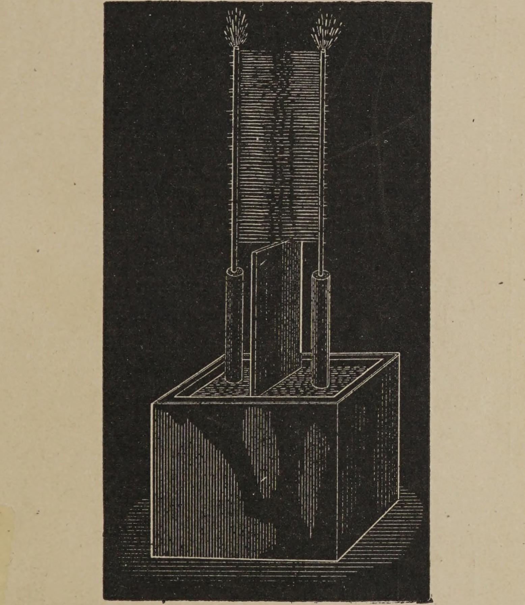
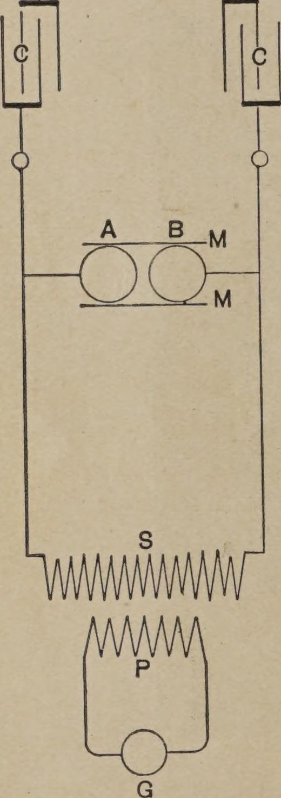

<!-- PDF 22 · trang in 4 -->

...mà trong mọi ngành công nghiệp, dòng điện xoay chiều — chuyển động sóng
điện — sẽ thống trị.

Có lẽ một lý do khiến nhánh khoa học này phát triển nhanh đến thế là nằm ở sức
hấp dẫn của việc nghiên cứu thí nghiệm về nó. Ta quấn một vòng sắt đơn giản bằng
cuộn dây; ta nối nó với máy phát, và với sự kinh ngạc lẫn thích thú, ta ghi nhận
những hiệu ứng của các lực lạ lùng mà ta đưa vào chơi, lực cho phép ta biến
đổi, truyền tải và hướng năng lượng tùy ý. Ta sắp đặt mạch điện cho đúng, và ta
thấy khối sắt cùng dây dẫn hành xử như thể được phú cho sự sống, quay một càu
cực nặng, qua những liên kết vô hình, với tốc độ và sức mạnh lớn — với năng
lượng có thể được truyền từ một khoảng cách rất xa. Ta quan sát năng lượng của một
dòng điện xoay chiều chạy trong dây biểu hiện ra thế nào — không phải nhiều
bằng trong dây, mà trong không gian quanh nó — theo cách đáng ngạc nhiên nhất, đeo
những hình thức của nhiệt, ánh sáng, năng lượng cơ, và, đáng ngạc nhiên nhất, cả
sức hút hóa. Tất cả những quan sát ấy mê hoặc chúng ta, và lấp đầy chúng ta một
khao khát cháy bỏng muốn biết thêm về bản chất của các hiện tượng ấy. Ngày nào
chúng ta cũng đi làm với hy vọng khám phá ra điều gì đó — với hy vọng rằng ai
đó, dù là ai, sẽ tìm được lời giải cho một trong những vấn đề lớn còn dang dở —
và ngày hôm sau chúng ta lại trở về công việc với lòng hăng hái mới; và ngay cả
khi không thành công, công việc của chúng ta cũng không uổng, vì trong những
cố gắng ấy, trong những nỗ lực ấy, chúng ta đã tìm được những giờ thư thái chưa
từng có, và chúng ta đã hướng năng lực của mình vào lợi ích của loài người.

Chúng ta có thể — tùy ý, nếu các ngài muốn — cầm bất kỳ thí nghiệm nào trong số
rất nhiều thí nghiệm có thể thực hiện với dòng điện xoay chiều; chỉ một vài thí
nghiệm trong số đó, và không phải những cái nổi bật nhất, là đối tượng của buổi
trình diễn tối nay; chúng đều thú vị như nhau, đều khơi gợi tư tưởng như nhau.

<!-- PDF 23 · trang in 5 -->

Đây là một ống thuỷ tinh đơn giản, trong đó không khí đã được hút đi một phần. Tôi
cầm lấy nó; tôi đưa cơ thể tôi vào tiếp xúc với một dây dẫn dòng điện xoay chiều
thế cao, và ống thuỷ tinh trong tay tôi bừng sáng. Dù tôi đặt nó ở bất kỳ tư thế
nào, dù tôi đưa nó đi bất cứ đâu trong không gian, trong tầm với của tôi, thứ ánh
sáng dịu dàng, dễ chịu ấy vẫn sáng nguyên vẽ sáng không hề giảm.

Đây là một bóng đèn đã hút chân không, treo trên một sợi dây đơn. Đứng trên một
chân đỡ cách điện, tôi nắm lấy nó, và một nút bạch kim gắn trong đó bắt đầu nóng
đỏ rực.

Đây, gắn vào một dây dẫn, là một bóng đèn khác, khi tôi chạm vào đế kim loại của
 nó, nó đầy tràn những màu phát quang tuyệt đẹp.

Đây lại một bóng nữa, khi ngón tay tôi chạm vào, nó hắt ra một bóng tối — bóng tối
Crookes, của thanh điện cực bên trong nó.

Đây, một lần nữa, khi tôi đứng trên bệ cách điện này, tôi đưa cơ thể vào tiếp xúc
với một trong hai đầu cuộn thứ cấp của cuộn cảm ứng này — với đầu một sợi dây dài
nhiều dặm — và các ngài thấy những luồng sáng bật ra từ đầu kia xa xôi, đầu đang
bị rung mạnh.

Đây, một lần nữa nữa, tôi nối hai tấm lưới dây này vào hai đầu cuộn cảm ứng, đặt
chúng cách nhau một khoảng, rồi cho cuộn cảm ứng chạy. Các ngài có thể thấy một
tia lửa nhỏ lấp ló giữa hai tấm. Tôi chèn vào giữa chúng một tấm dày bằng một
trong những chất cách điện tốt nhất, và thay vì làm cho phóng điện trở nên không
thể, như chúng ta quen chờ đợi, tôi lại giúp cho nó đi qua...

<!-- PDF 24 · trang in 6 -->

...khi tôi chèn tấm ấy vào, hiện tượng phóng điện chỉ đổi hình thức bề ngoài và
đi vào khuôn dạng những luồng sáng.

Tôi xin hỏi, liệu có thể có một môn nghiên cứu nào thú vị hơn môn nghiên cứu dòng
điện xoay chiều không?

Trong tất cả những cuộc nghiên cứu ấy, trong tất cả những thí nghiệm ấy, thú vị
quá, quá thú vị, suốt nhiều năm trở lại đây — kể từ khi nhà thí nghiệm vĩ đại nhất
từng giảng bài trong hội trường này khám phá ra nguyên lý của nó — chúng ta luôn có
một người bạn đồng hành, một thiết bị quen thuộc với tất cả mọi người, một món
đồ chơi ngày trước, giờ là một thứ mang tầm quan trọng to lớn — cuộn cảm ứng. Không
có thiết bị nào mà người làm điện học yêu quý hơn. Tôi dám nói, từ những người
giỏi nhất trong các ngài xuống tới sinh viên chưa có kinh nghiệm, tới người thầy
của các ngài, tất cả chúng ta đã trải qua nhiều giờ thú vị khi thí nghiệm với cuộn
cảm ứng. Chúng ta đã ngắm nhìn nó biểu diễn, và suy nghĩ, và suy tư trên những
hiện tượng tuyệt đẹp mà nó phơi bày trước đôi mắt mê mệ của chúng ta. Thiết bị này
đã nổi tiếng dễ dàng, những hiện tượng ấy đã quen thuộc với tất cả mọi người đến
mức lòng tôi gần như thất bại khi nghĩ rằng tôi dám đứng trước một đám đông thông
thạo như thế, dám lấy chính đề tài cũ ấy ra để giãi lịch cho các ngài. Thật ra
đây vẫn là cùng một thiết bị, và đây vẫn là cùng những hiện tượng ấy, chỉ có điều
thiết bị được vận hành hơi khác đi, và những hiện tượng được trình bày dưới một
dạng khác. Một phần những kết quả ta thu được là đúng như dự tính, một số khác
làm ta bất ngờ, nhưng tất cả đều mê hoặc sự chú ý của chúng ta, bởi trong nghiên
cứu khoa học, mỗi kết quả mới đạt được có thể là trung tâm của một hướng đi mới,
mỗi sự kiện mới học được có thể dẫn tới những phát triển quan trọng.

<!-- PDF 25 · trang in 7 -->

Thông thường, khi vận hành một cuộn cảm ứng, ta dựng lên một dao động tần số vừa
phải ở cuộn sơ cấp, hoặc bằng một bộ ngắt mạch, hoặc bằng cách dùng một máy phát
xoay chiều. Những nhà nghiên cứu người Anh trước đây, chỉ nêu tên Spottiswoode và
J. E. H. Gordon, đã dùng một bộ ngắt nhanh nối với cuộn dây. Kiến thức và kinh
nghiệm của chúng ta hôm nay cho phép ta thấy rõ vì sao trong điều kiện thử
nghiệm ấy, những cuộn dây ấy không để lộ ra điều gì đáng chú ý, và vì sao những
nhà thí nghiệm tài năng đã không nhận ra nhiều hiệu ứng kỳ lạ từ đó tới nay.

Trong những thí nghiệm như sẽ thực hiện tối nay, ta vận hành cuộn cảm ứng hoặc từ
một máy phát xoay chiều được chế tạo riêng, có khả năng tạo ra hàng nghìn lần
đảo chiều dòng điện mỗi giây, hoặc bằng cách phóng điện phá vỡ một bộ tụ điện
qua cuộn sơ cấp, ta dựng lên trong mạch thứ cấp một dao động tần số hàng trăm
nghìn hay hàng triệu mỗi giây, nếu ta muốn như vậy; và khi dùng bất kỳ phương tiện
nào trong hai phương tiện ấy, ta bước vào một miền chưa ai khai phá.

Không thể nào theo đuổi một cuộc nghiên cứu theo bất kỳ hướng mới nào mà cuối cùng
không quan sát được điều gì thú vị hay học được điều gì hữu ích. Rằng nhận định
này áp dụng được cho đề tài của bài giảng này, những hiện tượng kỳ lạ và bất ngờ
đầy ắp mà chúng ta quan sát được là bằng chứng thuyết phục. Để minh họa, hãy lấy
ví dụ những hiện tượng rõ ràng nhất, đó là hiện tượng phóng điện của cuộn cảm ứng.

Đây là một cuộn dây được vận hành bởi những dòng điện dao động cực nhanh, thu được
bằng cách phóng điện phá vỡ một bình Leyden. Chuyện người thầy giảng nói rằng cuộn
thứ cấp của cuộn dây này chỉ gồm một đoạn dây khá thô...

<!-- PDF 26 · trang in 8 -->

...chỉ một đoạn dây khá thô, sẽ không làm ngạc nhiên một sinh viên; việc người thầy
giảng nói rằng, dù vậy, cuộn dây này có thể tạo ra bất kỳ thế điện nào mà cách
cách điện tốt nhất của các vòng dây chịu được, cũng sẽ không làm ngạc nhiên ông;
nhưng dù ông đã chuẩn bị, thậm chí dù ông thờ ơ với kết quả dự tính, thì dạng
thức phóng điện của cuộn dây vẫn sẽ khiến ông kinh ngạc và thích thú. Ai cũng quen
với phóng điện của một cuộn dây thường; không cần tái tạo lại ở đây. Nhưng để
đối chiếu, đây là một dạng phóng điện của một cuộn dây, mà dòng sơ cấp của nó dao
động vài trăm nghìn lần mỗi giây. Phóng điện của một cuộn dây thường hiện ra như
một đường hay một dải sáng đơn giản. Phóng điện của cuộn dây này hiện ra dưới
hình thức những chổi lửa mạnh mẽ và những luồng sáng phát ra từ mọi điểm trên hai
sợi dây thẳng gắn vào hai đầu của cuộn thứ cấp. (Hình 1.)

Bây giờ hãy so sánh hiện tượng các ngài vừa chứng kiến này với phóng điện của máy
Holtz hay máy Wimshurst — thiết bị thú vị khác, được nhà thí nghiệm yêu quý ấy.
Giữa các hiện tượng này có sự khác biệt như thế nào! Vậy mà nếu tôi đã bố trí
đầy đủ những thứ cần thiết — điều mà lẽ ra rất dễ làm, nếu không phải vì chúng sẽ
cản trở những thí nghiệm khác — thì tôi đã có thể tạo ra bằng cuộn dây này những
tia lửa mà, nếu tôi giấu cuộn dây khỏi tầm nhìn của các ngài và chỉ để lộ hai núm
điều khiển, thì ngay cả nhà quan sát tinh tế nhất trong các ngài cũng khó, nếu
không phải là không thể, phân biệt với những tia lửa của máy cảm ứng tĩnh điện
hay máy ma sát. Điều này có thể làm theo nhiều cách — chẳng hạn, bằng cách vận
hành cuộn cảm ứng nạp tụ điện từ...

<!-- PDF 27 · trang in 9 -->

...một máy phát xoay chiều tần số rất thấp, và tốt nhất là điều chỉnh mạch phóng
điện sao cho không có dao động nào thiết lập trong đó. Khi đó, nếu hai núm điều
khiển có kích thước cần thiết và được đặt đúng chỗ, ta sẽ thu được trong mạch
thứ cấp một chuỗi tia lửa nhanh hơn hoặc chậm hơn, cực kỳ mãnh liệt và rất ít,
với cùng độ chói, và cùng tiếng kêu lách cách sắc nét, như những tia lửa lấy ra
từ máy ma sát hoặc máy cảm ứng tĩnh điện.

*Hình 1. — Phóng điện giữa hai dây, với tần số vài trăm nghìn mỗi giây.*

<!-- PDF 28 · trang in 10 -->

Một cách khác là cho dòng điện chạy qua hai mạch sơ cấp có chung một cuộn thứ cấp,
với hai dòng điện có chu kỳ hơi khác nhau, tạo ra trong mạch thứ cấp những tia lửa
xảy ra ở những khoảng cách tương đối dài. Nhưng ngay cả với những phương tiện có
sẵn trong tối nay, tôi cũng có thể thành công khi bắt chước tia lửa của máy Holtz.
Vì mục đích ấy, tôi thiết lập giữa hai đầu cuộn dây nạp tụ điện một cung lửa dài
và không ổn định, cung lửa bị gián đoạn theo chu kỳ bởi dòng không khí đi lên do
chính nó tạo ra. Để tăng dòng không khí ấy, tôi đặt ở mỗi bên của cung lửa, và ở
gần nó, một tấm mica lớn. Bộ tụ điện được nạp từ cuộn dây này phóng điện vào
mạch sơ cấp của một cuộn dây thứ hai qua một khe khí nhỏ, khe khí ấy là cần thiết
để tạo ra một dòng điện dồn dập đột ngột qua cuộn sơ cấp. Sơ đồ nối trong thí
nghiệm hiện tại được chỉ ra ở Hình 2.

*Hình 2. — Bắt chước tia lửa của máy Holtz.*

G là một máy phát xoay chiều chế tạc thông thường, cấp điện cho cuộn sơ cấp P của
một cuộn cảm ứng, cuộn thứ cấp S của cuộn dây ấy...
