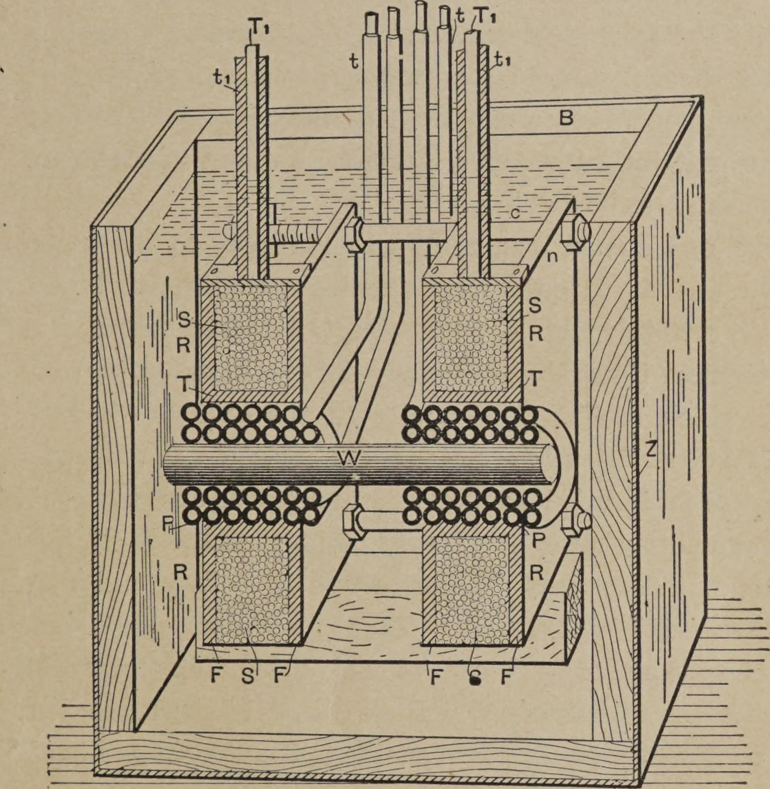

<!-- PDF 29 · trang in 11 -->

...nạp các bộ tụ điện, hay các bình C C. Hai đầu của cuộn thứ cấp được nối vào lớp
trong của các bình, còn lớp ngoài thì nối vào hai đầu của cuộn sơ cấp pp của một
cuộn cảm ứng thứ hai. Cuộn sơ cấp pp ấy có một khe khí nhỏ ab.

Cuộn thứ cấp s của cuộn dây này được trang bị những núm hay quả cầu K K đúng kích
thước, đặt cách nhau một khoảng thích hợp với thí nghiệm.

Một cung lửa dài được lập giữa hai đầu A B của cuộn cảm ứng thứ nhất. M M là các
tấm mica.

Mỗi khi cung lửa bị đứt giữa A và B, các bình tụ lập tức nạp và phóng điện qua
cuộn sơ cấp pp, tạo ra một tia lửa bật kèm tiếng lách cách giữa hai núm K K. Khi
cung lửa lập lại giữa A và B, thế điện rơi xuống, và các bình không thể nạp tới mức
thế cao đủ để phá qua khe khí ab, cho tới khi cung lửa lại bị luồng gió cắt đứt.

Bằng cách ấy, những xung đột ngột, xen kẽ với những khoảng cách dài, được tạo ra
trong cuộn sơ cấp pp, và trong cuộn thứ cấp s chúng cho ra một số xung tương ứng
cực kỳ mãnh liệt. Nếu hai núm hay quả cầu K K của cuộn thứ cấp có đúng kích thước,
những tia lửa ấy mang nét rất giống với tia lửa của máy Holtz.

<!-- PDF 30 · trang in 12 -->

Nhưng hai hiệu ứng này, trông bằng mắt rất khác nhau, chỉ là hai trong số rất
nhiều hiện tượng phóng điện. Ta chỉ cần đổi điều kiện thử nghiệm, và lại quan sát
được những hiện tượng khác đáng chú ý.

Khi thay vì vận hành cuộn cảm ứng như trong hai thí nghiệm vừa rồi, ta vận hành nó
từ một máy phát xoay chiều tần số cao, như trong thí nghiệm tiếp theo, thì việc nghiên
cứu một cách có hệ thống các hiện tượng ấy trở nên dễ dàng hơn nhiều. Trong trường
hợp ấy, bằng cách thay đổi cường độ và tần số của dòng điện qua cuộn sơ cấp, ta có
thể quan sát ra năm dạng phóng điện khác nhau, mà tôi đã mô tả trong bài báo trước
đây của tôi về cùng chủ đề này[^p30n1], đọc trước Viện Kỹ sư Điện Mỹ ngày 20 tháng
5 năm 1891.

Muốn tái hiện tất cả những dạng ấy sẽ mất quá nhiều thời gian, và sẽ đưa chúng ta
quá xa khỏi đề tài trình bày tối nay, nhưng tôi thấy còn đáng trình bày với các
ngài một dạng trong số đó. Đó là phóng điện chổi lông, thú vị ở nhiều phương diện.
Nhìn từ gần, nó rất giống một tia khí thoát ra dưới áp suất lớn. Chúng ta biết
hiện tượng này do sự cử động của các phân tử gần đầu điện cực, và chúng ta dự đoán
rằng phải có nhiệt năng sinh ra từ va chạm của các phân tử vào đầu điện cực hoặc
vào nhau. Quả thật, chúng ta thấy chổi lông ấy nóng, và chỉ cần suy nghĩ một chút
là ta đi tới kết luận rằng nếu ta đạt được tần số đủ cao, ta sẽ tạo được một chổi
lông cho ra ánh sáng và nhiệt cực mạnh, và giống hệt một ngọn lửa thường, chỉ có
thể là cả hai hiện tượng ấy không cùng do một tác nhân gây ra — có thể là sức hút
hóa không mang bản chất điện.

<!-- PDF 31 · trang in 13 -->

Vì việc sinh ra nhiệt và ánh sáng ở đây là do va chạm của các phân tử, hay nguyên tử
của không khí, hay của thứ gì đó khác nữa, và vì ta có thể chỉ cần tăng thế điện là
tăng được năng lượng, nên ngay cả khi lấy tần số từ một máy phát điện, ta cũng có
thể tăng cường tác động tới mức đưa đầu điện cực tới nhiệt độ nóng chảy. Nhưng
với những tần số thấp như vậy, ta sẽ luôn phải làm việc với thứ gì đó có tính chất
như một dòng điện. Nếu tôi đưa một vật dẫn điện lại gần chổi lông, một tia lửa
nhỏ lấp ló, nhưng ngay cả với những tần số dùng tối nay, xu hướng phóng tia lửa ấy
không mạnh lắm. Chẳng hạn, nếu tôi giữ một quả cầu kim loại ở một khoảng cách
nào đó phía trên đầu điện cực, các ngài có thể thấy toàn bộ khoảng không giữa đầu
điện cực và quả cầu được các luồng sáng soi sáng mà không có tia lửa nào lấp ló; và
với những tần số cao hơn nhiều, lấy được nhờ phóng điện phá vỡ một bộ tụ điện, nếu
không phải vì những xung đột ngột ấy, vốn tương đối ít về số lượng, thì sẽ không có
tia lửa nào lấp ló, ngay cả ở khoảng cách rất nhỏ. Tuy nhiên, với những tần số cao
hơn không gì bằng, cao đến mức ta còn có thể tìm ra cách tạo ra một cách hiệu quả,
và với điều kiện những xung điện tần số cao như thế có thể truyền được qua một vật
dẫn, thì những đặc trưng điện của phóng điện chổi lông sẽ hoàn toàn biến mất —
không có tia lửa nào lấp ló, không cảm giác điện giật nào — nhưng ta vẫn còn phải
làm việc với một hiện tượng điện, theo nghĩa rộng và hiện đại của từ ấy. Trong bài
báo đầu tiên của tôi đã nhắc đến trước đây, tôi đã chỉ ra những tính chất kỳ lạ
của chổi lông và mô tả cách tạo ra nó tốt nhất, nhưng tôi thấy đáng để cố gắng diễn
đạt rõ ràng hơn về hiện tượng này, bởi sức hấp dẫn quyện rũ của nó.

Khi một cuộn dây được vận hành bằng dòng điện tần số rất cao, những hiệu ứng chổi
lông tuyệt đẹp có thể được tạo ra, ngay cả khi cuộn dây ấy có kích thước tương đối
nhỏ. Nhà thí nghiệm...

<!-- PDF 32 · trang in 14 -->

...có thể thay đổi chúng theo nhiều cách, và chỉ riêng điều ấy đã đủ làm chúng trở
nên thú vị để nhìn. Điều làm tăng thêm sức hấp dẫn là chúng có thể được tạo ra với
chỉ một đầu điện cực cũng như với hai đầu — thật ra, thường thì một đầu còn cho ra
kết quả tốt hơn là hai đầu.

Nhưng trong tất cả các hiện tượng phóng điện đã quan sát được, những hiện tượng
thu được với một cuộn dây được vận hành bằng phóng điện phá vỡ một bộ tụ điện, là
những cái thú vị nhất với con mắt, và cũng đáng dạy nhất. Sức mạnh của những chổi
lông, sự dày đặc của những tia lửa, khi điều kiện được điều chỉnh kiên nhẫn, thường
đến mức kinh ngạc. Ngay cả với một cuộn dây rất nhỏ, nếu nó được cách điện tốt
đến mức chịu được chênh lệch thế vài nghìn vôn trên mỗi vòng, những tia lửa có thể
dày đặc đến mức toàn bộ cuộn dây có vẻ như một khối lửa hoàn chỉnh.

Điều kỳ lạ là khi hai đầu điện cực của cuộn dây được đặt cách nhau một khoảng đáng
kể, những tia lửa dường như bắn ra theo mọi hướng có thể, như thể hai đầu điện cực
hoàn toàn độc lập với nhau. Vì những tia lửa sẽ sớm phá hủy lớp cách điện, ta buộc
phải ngăn chúng. Cách tốt nhất là nhúng cuộn dây vào một chất lỏng cách điện tốt,
chẳng hạn là dầu đã nấu sôi để khử hết khí. Có thể coi việc nhúng vào chất lỏng là
gần như điều kiện tuyệt đối để cuộn dây ấy vận hành liên tục và thành công.

Dĩ nhiên, trong một bài giảng thí nghiệm, với chỉ vài phút cho mỗi thí nghiệm, thì
không thể nào trình diễn những hiện tượng phóng điện ấy một cách đáng giá, bởi để
tạo ra mỗi hiện tượng ở dạng tốt nhất cần tới sự điều chỉnh hết sức cẩn thận. Nhưng
dù được tạo ra chưa hoàn hảo, như chúng ta nhiều khả năng sẽ thấy tối nay, chúng
vẫn đủ ấn tượng để gây chú ý cho một đám đông thông minh.

<!-- PDF 33 · trang in 15 -->

Trước khi trình diễn một vài hiệu ứng kỳ lạ ấy, tôi cần, để cho đầy đủ, mô tả
ngắn gọn cuộn dây cùng các thiết bị khác đã dùng trong các thí nghiệm với hiện
tượng phóng điện phá vỡ tối nay.

*Hình 3. — Cuộn cảm ứng phóng điện phá vỡ.*

Nó đặt trong một hộp B (Hình 3) làm bằng những tấm ván dày gỗ cứng, phủ bên ngoài
bằng tấm kẽm Z, mà...

[^p30n1]: Xem *The Electrical World*, ngày 11 tháng 7 năm 1891.
