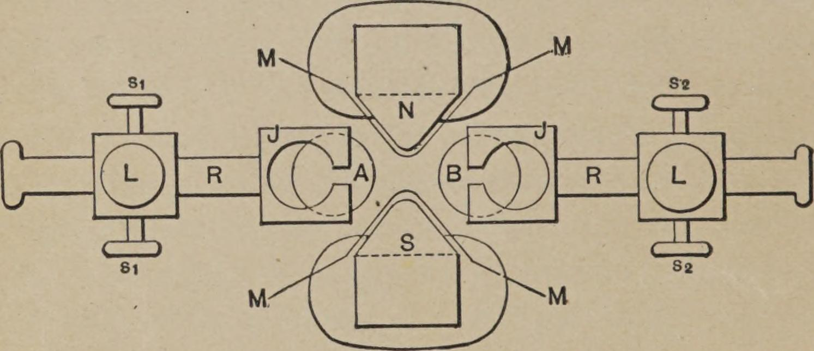
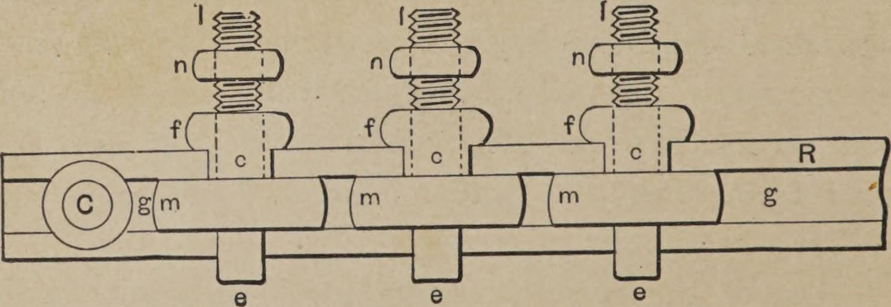
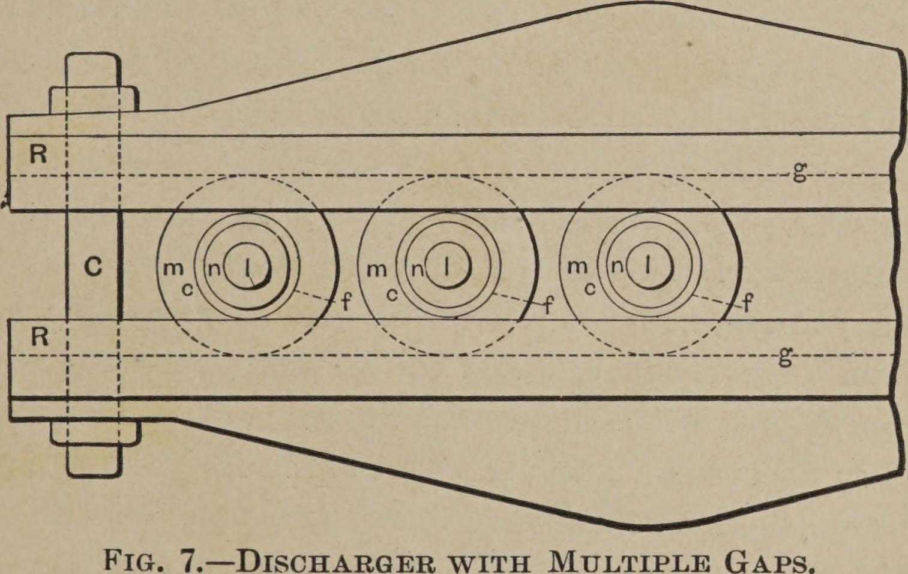

<!-- PDF 34 · trang in 16 -->

...hàn kín một cách cẩn thận xung quanh. Trong một cuộc nghiên cứu thuần túy mang
tính khoa học, khi độ chính xác là điều hết sức quan trọng, thì có lẽ nên bỏ hẳn
vỏ kim loại đi, vì nó có thể gây ra nhiều sai số, chủ yếu là do tác dụng phức tạp
của nó lên cuộn dây, với tư cách là một bộ tụ điện có dung tích rất nhỏ và với
tư cách là một tấm chắn tĩnh điện và điện từ. Khi cuộn dây được dùng cho loại
thí nghiệm như đang dự tính ở đây, dùng vỏ kim loại có một vài ưu điểm thực hành,
nhưng chúng không đủ quan trọng để bàn tới.

Cuộn dây nên được đặt đối xứng với vỏ kim loại, và khoảng không giữa hai bên, đương
nhiên, không nên quá nhỏ, chắc chắn không dưới năm xentimét, và nên rộng hơn nhiều
nếu có thể; đặc biệt là hai mặt bên của hộp kẽm, vốn vuông góc với trục của cuộn
dây, phải đủ xa cách cuộn dây, nếu không chúng có thể làm suy yếu tác dụng của nó và
trở thành nguồn tổn hao.

Cuộn dây gồm hai ống cao su cứng R R, giữ cách nhau một khoảng 10 xentimét bằng
bulông c và đai ốc n, cũng bằng cao su cứng. Mỗi ống gồm một ống T có đường kính
trong xấp xỉ 8 xentimét và dày 3 milimét, trên đó vặn hai vành FF, mỗi vành là một
hình vuông cạnh 24 xentimét, khoảng cách giữa hai vành khoảng 3 xentimét. Cuộn thứ
cấp S S, quấn bằng dây bọc gutta-percha tốt nhất, có 26 lớp, mỗi lớp 10 vòng, tính
riêng mỗi nửa thì tổng cộng 260 vòng. Hai nửa quấn ngược chiều nhau và nối tiếp
nối với nhau, và điểm nối giữa hai nửa được đặt bên trên cuộn sơ cấp. Cách sắp
đặt này, ngoài tiện lợi ra, còn có ưu điểm là khi cuộn dây cân bằng tốt...

<!-- PDF 35 · trang in 17 -->

...— tức là khi cả hai đầu T₁ T₁ của nó được nối với những vật hay thiết bị có
dung tích bằng nhau — thì rất ít khi xảy ra hiện tượng phá qua sang cuộn sơ cấp, và
lớp cách điện giữa cuộn sơ cấp với cuộn thứ cấp không cần dày. Khi dùng cuộn dây,
nên gắn vào cả hai đầu những thiết bị có dung tích gần bằng nhau, bởi nếu dung
tích của hai đầu không bằng nhau thì tia lửa dễ nhảy sang cuộn sơ cấp. Để tránh điều
đó, có thể nối điểm giữa của cuộn thứ cấp với cuộn sơ cấp, nhưng cách ấy không
phải lúc nào cũng tiện lợi.

Cuộn sơ cấp P P được quấn thành hai phần, ngược chiều nhau, trên một ống gỗ W, và
bốn đầu dây được dẫn ra khỏi dầu qua những ống cao su cứng t t. Các đầu dây của
cuộn thứ cấp T₁ T₁ cũng được dẫn ra khỏi dầu qua những ống cao su tx tx rất dày.
Các lớp của cuộn sơ cấp và cuộn thứ cấp được cách điện bằng vải bông, và độ dày
của lớp cách điện, đương nhiên, tùy thuộc vào chênh lệch thế điện giữa các vòng
của những lớp khác nhau. Mỗi nửa của cuộn sơ cấp có bốn lớp, mỗi lớp 24 vòng, tính
tổng cộng 96 vòng. Khi cả hai phần được nối tiếp nối, điều đó cho ra một tỉ lệ biến
đổi khoảng 1:2,7, và với các cuộn sơ cấp nối song song, là 1:5,4; nhưng khi vận
hành với dòng điện xoay chiều rất nhanh, tỉ lệ này không cho ra một ý tưởng gần
đúng nào về tỉ lệ của các suất điện động trong mạch sơ cấp và mạch thứ cấp. Cuộn
dây được giữ cố định trong dầu trên những chỗ tựa gỗ, và có khoảng 5 xentimét dầu
bao quanh từ mọi phía. Ở những chỗ không cần đến dầu, khoảng trống được lấp bằng
những mảnh gỗ, và chủ yếu là dùng chính chiếc hộp gỗ B bao quanh toàn bộ.

<!-- PDF 36 · trang in 18 -->

Cách cấu tạo trình bày ở đây, đương nhiên, không phải là tốt nhất theo các nguyên
tắc chung, nhưng tôi tin rằng đó là một cách tốt và tiện lợi để tạo ra những hiệu
ứng đòi hỏi một thế quá cao và một cường độ rất nhỏ.

Nối với cuộn dây, tôi dùng hoặc dạng bộ phóng điện thông thường, hoặc một dạng đã
cải tiến. Ở dạng thông thường, tôi có đưa vào hai thay đổi bảo đảm một vài ưu điểm,
và những ưu điểm ấy khá rõ ràng. Tôi nêu ra chúng chỉ với hy vọng rằng có nhà thí
nghiệm nào thấy chúng hữu ích.

Một trong hai thay đổi ấy là: các núm điều chỉnh A và B của bộ phóng điện được giữ
trong hai ngàm đồng J J, dưới áp lực lò xo, nhờ vậy có thể xoay chúng từ vị trí
này sang vị trí khác, và như thế bỏ được công đoạn mỏi mệt là đánh bóng chúng đi
đi đi xuyên suốt.

Thay đổi kia là dùng một nam châm điện từ mạnh N S, đặt với trục của nó vuông góc
với đường nối hai núm A và B, và tạo ra một từ trường mạnh giữa chúng. Cực từ của...

*Hình 4. — Cách sắp đặt của bộ phóng điện cải tiến và nam châm.*

<!-- PDF 37 · trang in 19 -->

...nam châm là những chi tiết có thể di động và được tạo hình cho phù hợp, để chúng
thò ra giữa hai núm đồng, nhằm làm cho từ trường được mãnh liệt nhất có thể; nhưng
để ngăn phóng điện nhảy sang nam châm, cực từ được bảo vệ bằng một lớp mica M M
đủ dày. x và s là hai con ốc vít dùng để kẹp dây. Ở mỗi bên, một con ốc vít dành
cho dây lớn và con kia dành cho dây nhỏ. L L là hai con ốc vít dùng để cố định
những thanh chống R R, vốn đỡ hai núm ấy.

Trong một cách sắp đặt khác có dùng nam châm, tôi lấy phóng điện ở chính giữa hai
cực từ tròn, và trong trường hợp ấy chúng được cách điện, tốt nhất là được bọc
nắp đồng đã đánh bóng.

Việc dùng một từ trường mạnh có lợi, chủ yếu là khi cuộn cảm ứng hoặc máy biến áp
nạp tụ điện được vận hành bằng dòng điện tần số rất thấp. Trong trường hợp ấy, số
những phóng điện cơ bản giữa hai núm có thể nhỏ đến mức những dòng điện sinh ra ở
cuộn thứ cấp trở nên không thích hợp cho nhiều thí nghiệm. Khi ấy từ trường mạnh
có tác dụng thổi tắt cung lửa giữa hai núm ngay khi nó hình thành, và những phóng
điện cơ bản xảy ra liên tiếp với nhịp nhanh hơn.

Thay cho nam châm, ta có thể dùng một luồng không khí, và điều ấy cũng có lợi
đôi chút. Khi ấy, cung lửa tốt nhất là lập giữa hai núm A B ở Hình 2 (còn hai núm
a b thì nhìn chung được nối lại với nhau, hoặc bỏ hẳn đi), bởi trong cách sắp đặt
đó cung lửa dài và không ổn định, nên dễ chịu ảnh hưởng của luồng không khí.

Khi dùng nam châm để ngắt cung lửa, tốt hơn là...

<!-- PDF 38 · trang in 20 -->

...chọn cách nối được chỉ ra bằng hình vẽ ở Hình 5, vì trong trường hợp ấy những dòng
điện tạo thành cung lửa mạnh hơn nhiều, và từ trường có tác dụng lớn hơn. Tuy nhiên,
dùng nam châm cho phép thay cung lửa bằng một ống chân không, nhưng tôi đã gặp rất
nhiều khó khăn khi làm việc với một ống đã hút chân không.

> **Hình 5. — Cách sắp đặt với máy phát xoay chiều tần số thấp và bộ phóng điện
> cải tiến.**
>
> *Ảnh chưa trích từ scan; xem ghi chú trong `TRANSLATION_LEDGER.md`.*

Dạng bộ phóng điện thứ hai dùng trong những thí nghiệm này và những thí nghiệm
tương tự được chỉ ra ở Hình 6 và Hình 7. Nó gồm một số mảnh đồng c c, mỗi mảnh
gồm một phần giữa hình cầu m, bên dưới có một phần chân e — phần chân này chỉ dùng
để kẹp mảnh ấy vào mỏ cưa khi đánh bóng bề mặt phóng điện — và một thân trên, gồm
một vành có ren f, bên trên là một thân có ren l mang theo đai ốc n, nhờ đó một sợi
dây...

*Hình 6. — Bộ phóng điện nhiều khe.*

<!-- PDF 39 · trang in 21 -->

...được kẹp vào thân ấy. Vành f tiện lợi cho việc giữ mảnh đồng khi kẹp dây, đồng
thời để xoay nó qua bất kỳ hướng nào khi cần đưa ra một bề mặt phóng điện mới. Hai
dải cao su cứng dày R R, có những rãnh gọt phẳng g g (Hình 7) để khớp với phần giữa của các
mảnh c c, dùng để kẹp chúng và giữ chặt tại chỗ bằng hai bulông C C (trong đó chỉ
thấy một cái) xuyên qua hai đầu của dải.

*Hình 7. — Bộ phóng điện cải tiến, cho thấy cách kẹp và các rãnh phóng điện.*

Trong khi dùng loại bộ phóng điện này, tôi đã tìm ra ba ưu điểm chính so với dạng
thông thường. **Thứ nhất**, độ bền cách điện của một tổng chiều rộng không khí xác
định là lớn hơn khi dùng rất nhiều khe khí nhỏ thay cho một khe lớn, điều này cho
phép làm việc với một khe khí ngắn hơn, và điều đó có nghĩa là tổn hao nhỏ hơn và
kim loại bị hỏng ít hơn; **thứ hai**, vì cung lửa được chia thành nhiều cung lửa
nhỏ hơn, các bề mặt đánh bóng tồn tại lâu hơn nhiều; và **thứ ba**, thiết bị này
tạo ra một vài...
