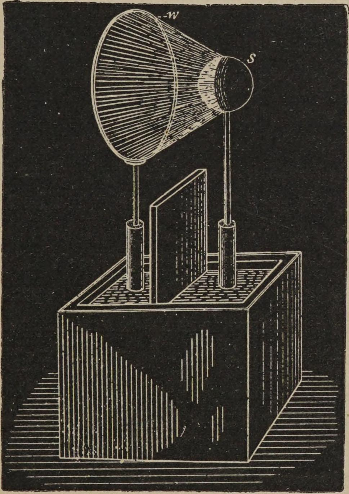
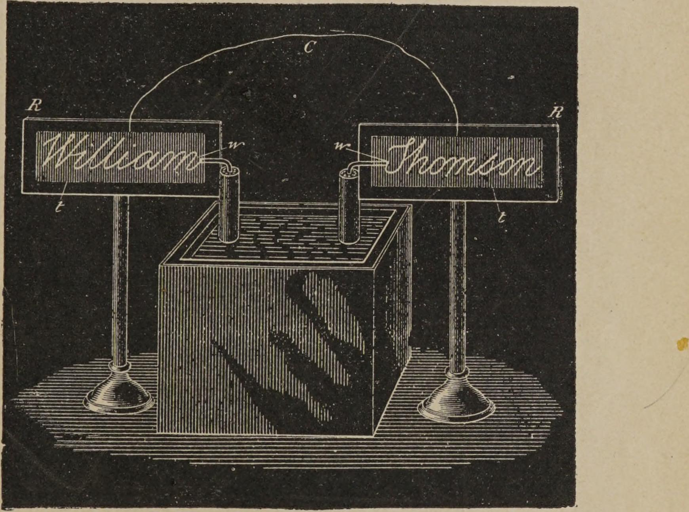

<!-- PDF 40 · trang in 22 -->

...cách đo trong các thí nghiệm ấy. Tôi thường đặt các mảnh ấy bằng cách kẹp giữa
chúng những tấm có độ dày đều nhau, ở một khoảng cách rất nhỏ đã biết, nhờ các
thí nghiệm của Sir William Thomson, là cần một suất điện động nhất định thì tia
lửa mới bắt qua được.

Điều dĩ nhiên cần nhớ rằng khoảng cách phóng điện rút ngắn đi rất nhiều khi tần
số tăng lên. Bằng cách chọn bất kỳ số khoảng cách nào, nhà thí nghiệm có một ý tưởng
đại khái về suất điện động, và thấy việc lặp lại một thí nghiệm trở nên dễ hơn, vì
ông không phải lo cứ đặt lại các núm. Với loại bộ phóng điện này, tôi đã có thể
duy trì một chuyển động dao động mà không thấy tia lửa nào bằng mắt thường giữa hai
núm, và chúng cũng không cho thấy một mức tăng nhiệt đáng kể. Dạng phóng điện này
cũng thích hợp với nhiều cách sắp đặt của bộ tụ điện và mạch điện, thường là rất
tiện lợi và tiết kiệm thời gian. Tôi đã dùng nó chủ yếu trong một cách sắp đặt
giống như Hình 2, khi những dòng điện tạo thành cung lửa nhỏ.

Tôi xin nói thêm ở đây rằng tôi cũng đã dùng những bộ phóng điện có một hay nhiều
khe khí, trong đó bề mặt phóng điện được quay với tốc độ rất lớn. Tuy nhiên cách
này không mang lại lợi ích gì đặc biệt, trừ trong những trường hợp dòng điện từ bộ
tụ điện lớn và cần giữ cho các bề mặt luôn mát, và trong những trường hợp mà bản
thân phóng điện không dao động, nên cung lửa vừa hình thành đã bị luồng không khí
ngắt, và như thế khởi động dao động theo những khoảng cách liên tiếp rất nhanh. Tôi
cũng đã dùng các bộ ngắt cơ khí theo nhiều cách. Để tránh những khó khăn với tiếp
xúc ma sát, cách được ưu tiên...

<!-- PDF 41 · trang in 23 -->

...là lập cung lửa và cho một vành mica có nhiều lỗ, gắn vào một tấm thép, quay qua
cung lửa ấy với tốc độ rất lớn. Dĩ nhiên phải hiểu rằng việc dùng nam châm, dòng
không khí, hay một bộ ngắt khác, đều tạo ra một hiệu ứng đáng chú ý, trừ khi tự
cảm, dung tích và điện trở có quan hệ với nhau sao cho mỗi lần ngắt đều thiết lập
được dao động.

Bây giờ tôi sẽ cố gắng trình diễn trước các ngài một vài hiện tượng phóng điện đáng
chú ý nhất trong số đó.

Tôi đã căng ngang qua phòng hai sợi dây thông thường bọc vải bông, mỗi sợi dài
khoảng 7 mét. Chúng được giữ trên những dây cách điện, cách nhau khoảng 30
xentimét. Bây giờ tôi nối mỗi sợi dây vào một trong hai đầu của cuộn dây và cho cuộn
dây chạy. Khi tắt đèn trong phòng đi, các ngài thấy những sợi dây được soi sáng
mạnh mẽ bởi các luồng sáng phát ra rất dày đặc từ toàn bộ bề mặt của chúng, bất chấp
lớp bọc vải bông, dù lớp bọc ấy có thể rất dày. Khi thí nghiệm được thực hiện trong
điều kiện thuận lợi, ánh sáng từ những sợi dây ấy đủ mạnh để phân biệt được các vật
trong phòng. Để đạt kết quả tốt nhất, đương nhiên cần phải điều chỉnh cẩn thận dung
tích của các bình tụ, cung lửa giữa hai núm, và chiều dài của các sợi dây. Theo
kinh nghiệm của tôi, việc tính toán chiều dài dây trong trường hợp ấy hoàn toàn
không cho kết quả gì. Cách tốt nhất để làm là nhà thí nghiệm lúc đầu hãy lấy dây
thật dài, rồi điều chỉnh bằng cách cắt bớt, trước hết những đoạn thật dài, rồi những
đoạn ngày càng nhỏ hơn, khi đã tới gần chiều dài thích hợp.

Một cách tiện lợi là dùng một bộ tụ điện dầu có dung tích rất nhỏ, gồm hai tấm
kim loại nhỏ điều chỉnh được...

<!-- PDF 42 · trang in 24 -->

...trong thí nghiệm này và những thí nghiệm tương tự. Trong trường hợp ấy, tôi lấy
dây tương đối ngắn và lúc đầu đặt hai tấm tụ điện ở khoảng cách lớn nhất. Nếu các
luồng sáng trên dây tăng lên khi đưa hai tấm lại gần, thì chiều dài dây là tương
đối thích hợp; nếu chúng giảm đi, thì dây quá dài đối với tần số và thế điện ấy.
Khi dùng một bộ tụ điện nối với những thí nghiệm dùng cuộn dây như loại này, tuyệt
đối phải là một bộ tụ dầu, vì nếu dùng bộ tụ không khí thì có thể lãng phí một lượng
năng lượng đáng kể. Những sợi dây dẫn tới các tấm bên trong dầu nên rất mỏng, được
phủ kín một lớp chất cách điện, và có một lớp vỏ dẫn điện - lớp vỏ này tốt nhất là
kéo xuống dưới mặt dầu. Lớp vỏ dẫn điện không nên quá gần hai đầu dây, bởi tia lửa
có thể nhảy từ dây sang nó. Lớp vỏ dẫn điện ấy dùng để giảm tổn hao trong không
khí, nhờ tác dụng của nó như một tấm chắn tĩnh điện. Còn kích thước bình chứa dầu
và kích thước các tấm, nhà thí nghiệm sẽ lập tức có được một ý tưởng từ một lần thử
sơ bộ. Tuy nhiên kích thước các tấm trong dầu thì tính được, vì tổn hao điện môi rất
nhỏ.

Trong thí nghiệm trước đó, điều đáng chú ý là tìm hiểu lượng ánh sáng phát ra tỉ lệ
ra sao với tần số và thế điện của những xung điện. Theo ý tôi, cả hiệu ứng nhiệt
lẫn hiệu ứng ánh sáng tạo ra, dưới những điều kiện thử nghiệm khác nhau như nhau,
phải tỉ lệ với tích của tần số và bình phương của thế điện, nhưng việc kiểm chứng
thực nghiệm quy luật ấy, dù nó là quy luật gì, sẽ khó khăn vô cùng. Một điều thì
chắc chắn...

<!-- PDF 43 · trang in 25 -->

...tức là khi tăng thế điện lẫn tần số, ta nhanh chóng làm cho các luồng sáng mạnh
lên; và, dù điều ấy có thể là một điều quá lạc quan, thì chắc chắn cũng không
đến mức tuyệt vọng khi hy vọng rằng ta có thể thành công tạo ra một nguồn sáng
thực hành theo con đường này. Khi đó ta đơn giản chỉ dùng các bếp đốt hay ngọn lửa,
trong đó không có quá trình hóa học nào, không tiêu hao vật liệu nào...

*Hình 8. - Hiệu ứng do tập trung các luồng sáng.*

...mà chỉ là một sự truyền dịch năng lượng, và rất có thể sẽ phát ra nhiều ánh sáng
hơn và ít nhiệt hơn so với ngọn lửa thông thường.

<!-- PDF 44 · trang in 26 -->

Cường độ sáng của các luồng sáng, đương nhiên, tăng lên đáng kể khi chúng được tập
trung vào một bề mặt nhỏ. Điều này có thể chứng minh bằng thí nghiệm sau đây.

Tôi nối vào một trong hai đầu của cuộn dây một sợi dây w, uốn thành một vòng tròn
đường kính khoảng 30 xentimét, và vào đầu kia tôi gắn một quả cầu đồng nhỏ s, bề mặt
của dây tốt nhất phải bằng bề mặt của quả cầu, và tâm của quả cầu phải nằm trên một
đường thẳng vuông góc với mặt phẳng của vòng dây và đi qua tâm của vòng ấy. Khi
phóng điện được lập dưới những điều kiện thích hợp, một hình nón rỗng phát sáng
hình thành, và trong bóng tối, một nửa quả cầu đồng được soi sáng mạnh mẽ, như thấy
ở hình cắt.

Bằng cách này hay cách khác, ta dễ dàng tập trung các luồng sáng lên những bề mặt
nhỏ và tạo ra những hiệu ứng ánh sáng rất mạnh. Hai sợi dây mảnh có thể trở nên
sáng rực như vậy.

Để làm các luồng sáng mạnh thêm, dây phải rất mỏng và rất ngắn; nhưng trong trường
hợp này, dung tích của chúng nói chung sẽ quá nhỏ đối với cuộn dây - ít nhất là đối
với một cuộn dây như loại hiện tại - nên cần phải tăng dung tích lên giá trị cần
thiết, đồng thời bề mặt của dây vẫn giữ rất nhỏ. Điều này có thể làm theo nhiều
cách.

Ở đây, chẳng hạn, tôi có hai tấm cao su cứng R R, trên đó tôi dán hai sợi dây rất
mảnh w w, sao cho chúng tạo thành một cái tên. Sợi dây có thể để trần hoặc bọc
cách điện tốt nhất - điều ấy không quan trọng đối với thành công của thí nghiệm.
Dây cách điện tốt, nếu có, lại càng tốt. Ở mặt sau của mỗi tấm, chỗ được tô bóng
trong hình, là một lớp phủ thiếc t...

<!-- PDF 45 · trang in 27 -->

...t t. Các tấm được đặt thẳng hàng ở một khoảng cách đủ xa để không có tia lửa
nào nhảy từ sợi dây này sang sợi dây kia. Hai lớp phủ thiếc ấy, tôi nối với nhau
bằng một vật dẫn C, và hai sợi dây thì bây giờ tôi nối vào hai đầu của cuộn dây.
Bây giờ dễ dàng, bằng cách thay đổi cường độ và tần số của dòng điện qua cuộn sơ
cấp, tìm ra một trạng thái mà dung tích của hệ thích hợp nhất với các điều kiện,
và những sợi dây trở nên sáng rực đến mức khi tắt đèn trong phòng, cái tên hình
thành từ chúng hiện ra bằng những chữ cái rực rỡ.

*Hình 9. - Dây dẫn sáng rực.*

Có lẽ thích hơn nếu thực hiện thí nghiệm này với một cuộn dây được vận hành từ một
máy phát xoay chiều tần số cao, vì...
