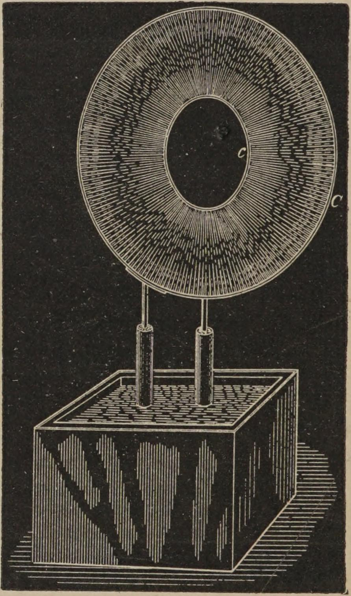
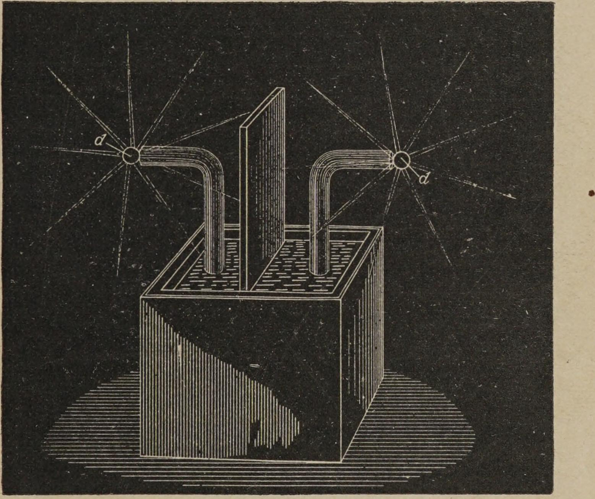

<!-- PDF 46 · trang in 28 -->

...bởi vì sự lên rút điều hòa, các luồng sáng rất đều, dù chúng ít dày đặc hơn so với
khi được tạo ra bằng một cuộn dây như loại hiện tại. Tuy nhiên, thí nghiệm này có
thể thực hiện với tần số thấp, nhưng kém thỏa mãn hơn nhiều.

*Hình 10. — Đĩa sáng.*

Khi hai sợi dây, nối vào hai đầu của cuộn dây, được đặt cách nhau một khoảng thích
hợp, các luồng sáng giữa chúng có thể mãnh liệt đến mức tạo thành một tấm sáng
liên tục. Để trình diễn hiện tượng này, tôi có ở đây hai vòng tròn C và c (Hình 10),
bằng dây khá thô, một vòng đường kính khoảng...

<!-- PDF 47 · trang in 29 -->

...80 xentimét và vòng kia cũng 80 xentimét. Tôi nối mỗi vòng vào một trong hai đầu
của cuộn dây. Những dây treo được uốn cong sao cho hai vòng có thể đặt cùng trong
một mặt phẳng, trùng khít với nhau đến mức tối đa. Khi tắt đèn trong phòng và cho
cuộn dây chạy, các ngài thấy toàn bộ khoảng không giữa hai sợi dây đều đều đặn đầy
những luồng sáng, tạo thành một đĩa sáng, có thể nhìn thấy từ một khoảng cách đáng
kể, bởi cường độ của các luồng sáng như vậy. Vòng ngoài hoàn toàn có thể lớn hơn
nhiều so với vòng hiện tại; thật ra, với cuộn dây này tôi đã dùng những vòng lớn hơn
nhiều, và đã có thể tạo ra một tấm sáng rực rỡ phủ trên một diện tích lớn hơn một
mét vuông, đó là một hiệu ứng đáng chú ý với một cuộn dây nhỏ như vậy. Để tránh mọi
mơ hồ, vòng ấy đã được lấy nhỏ hơn, và diện tích hiện nay khoảng 0,43 mét vuông.

Tần số dao động, và tốc độ nối tiếp của các tia lửa giữa hai núm, ảnh hưởng đến
mức đáng kể về dạng bên ngoài của các luồng sáng. Khi tần số rất thấp, không khí
nhường chỗ gần như theo cùng một cách, như khi có một hiệu thế không đổi, và các
luồng sáng gồm những sợi riêng biệt, thường lẫn với các tia lửa mảnh, những tia lửa
mà có lẽ tương ứng với các lần phóng điện liên tiếp xảy ra giữa hai núm. Nhưng khi
tần số cực kỳ cao, và cung lửa của hiện tượng phóng điện tạo ra một tiếng độ rất
lớn nhưng trơn tru — cho thấy cả rằng dao động đang xảy ra, lẫn rằng các tia lửa
nối tiếp nhau với tốc độ rất lớn — thì các luồng sáng hình thành hoàn toàn đều. Để
đạt được kết quả ấy, nên dùng những cuộn dây rất nhỏ và các bình tụ có dung tích
nhỏ. Tôi...

<!-- PDF 48 · trang in 30 -->

...lấy hai ống thuỷ tinh Bô-ha-mia dày, đường kính khoảng 5 xentimét và dài 20
xentimét. Trong mỗi ống, tôi luồn vào một cuộn sơ cấp bằng dây đồng rất dày. Trên
đỉnh mỗi ống, tôi quấn một cuộn thứ cấp bằng dây mảnh hơn nhiều, bọc gutta-percha.
Hai cuộn thứ cấp ấy tôi nối tiếp nối, còn hai cuộn sơ cấp thì tốt nhất nối song
song. Rồi hai ống được đặt vào một bình thuỷ tinh lớn, cách nhau từ 10 đến 15
xentimét, trên những chỗ tựa cách điện, và bình ấy được đổ đầy dầu đã nấu sôi để
khử khí, mực dầu lên cao khoảng một tấc phía trên các ống. Hai đầu tự do của cuộn
thứ cấp được nhấc ra khỏi dầu và đặt song song với nhau, cách nhau khoảng 10
xentimét. Những đầu dây đã được cạo thì nên nhúng vào dầu. Có thể dùng hai bình
tụ bốn pha nối tiếp nối để phóng điện qua cuộn sơ cấp. Khi đã điều chỉnh tất cả
những khoảng cách và chiều dài cần thiết ở phần dây nằm trên mặt dầu cũng như ở
cung lửa phóng điện, một tấm sáng được tạo ra giữa hai sợi dây, hoàn toàn trơn tru và
không có vân, giống hệt hiện tượng phóng điện thông thường qua một ống đã hút chân
không ở mức vừa phải.

Tôi đã cố ý nói dài về thí nghiệm tưởng chừng không đáng kể này. Trong những lần
thử loại này, nhà thí nghiệm đi tới một kết luận làm kinh động: để truyền những
hiện tượng phát sáng thông thường qua chất khí, không cần đến một mức hút chân khí
nào đặc biệt, mà khí có thể ở áp suất thường, thậm chí còn cao hơn. Để làm được điều
đó, một tần số rất cao là điều thiết yếu; một thế điện cao cũng cần thiết, nhưng đó
mới chỉ là một điều kiện phụ. Những thí nghiệm này dạy chúng ta rằng, khi cố gắng
tìm ra những phương pháp mới để tạo ra ánh sáng bằng cách cử động các nguyên tử,
hoặc...

<!-- PDF 49 · trang in 31 -->

...các phân tử của một chất khí, ta không cần giới hạn việc nghiên cứu của mình vào
ống chân không, mà có thể hướng tới một khả năng hoàn toàn nghiêm túc: thu được các
hiệu ứng ánh sáng mà không cần dùng bất cứ bình chứa nào, với không khí ở áp suất
thường.

Những hiện tượng phóng điện tần số rất cao như thế, làm cho không khí ở áp suất
thường phát sáng, chắc hẳn chúng ta đã từng chứng kiến nhiều lần trong thiên nhiên.
Tôi không hề nghi ngờ rằng nếu, như nhiều người tin, cực quang Bắc do những biến
động vũ trụ đột ngột sinh ra, chẳng hạn những vụ phun ở bề mặt Mặt Trời, làm cho
điện tích tĩnh điện của Trái Đất rung mạnh với tần số cực nhanh, thì thứ ánh sáng
đỏ quan sát được không chỉ giới hạn ở những tầng trên khí loãng của không khí, mà
việc phóng điện, do tần số quá cao của nó, cũng xuyên qua cả khí quyển dày dưới
hình thức một thứ ánh sáng, như ta thường tạo ra trong một ống hút chân không nhẹ.
Nếu tần số rất thấp, hoặc thấp hơn nữa, nếu điện tích hoàn toàn không rung, thì
khí dày sẽ phá vỡ như trong một hiện tượng điện giật. Dấu hiệu của sự phá vỡ ấy ở
những tầng dày bên dưới của không khí đã được quan sát thấy nhiều lần khi hiện tượng
đáng kinh ngạc này xảy ra; nhưng nếu nó có xảy ra, thì chỉ có thể do những biến
động gốc, vốn rất ít, bởi dao động chúng tạo ra sẽ quá nhanh để cho phép một sự
phá vỡ. Chính những xung ban đầu và không đều ấy mới tác động tới các dụng cụ đo;
còn những dao động chồng lên thì hẳn đã đi qua mà không ai nhận ra.

Khi một hiện tượng phóng điện tần số thấp thông thường được truyền qua không khí
hút chân không ở mức vừa phải, không khí mang một sắc tím. Nếu bằng cách này hay cách
khác, ta tăng cường độ cử động của phân tử, hay nguyên tử, thì chất khí chuyển sang...

<!-- PDF 50 · trang in 32 -->

...một màu trắng. Một sự biến đổi tương tự xảy ra ở những áp suất thường với các
xung điện tần số rất cao. Nếu các phân tử không khí quanh một sợi dây bị cử động ở
mức vừa phải, thì chổi lông hình thành có màu đỏ hoặc tím; nếu dao động đủ mãnh
liệt, các luồng sáng trở thành màu trắng. Ta có thể đạt được điều ấy bằng nhiều
cách. Trong thí nghiệm trước với hai sợi dây căng ngang phòng, tôi đã cố gắng đạt
kết quả ấy bằng cách đẩy cả tần số lẫn thế điện lên giá trị cao; trong thí nghiệm
với những sợi dây mảnh dán trên tấm cao su, tôi đã tập trung tác dộng lên một bề mặt
rất nhỏ — nói cách khác, tôi làm việc với một mật độ điện rất lớn.

Một dạng phóng điện đáng tò mò nhất được quan sát thấy với một cuộn dây như thế khi
tần số và thế điện được đẩy tới giới hạn cực đại. Để thực hiện thí nghiệm này, mọi
bộ phận của cuộn dây đều phải cách điện kỹ, và chỉ có hai quả cầu nhỏ — hoặc tốt
hơn, là hai đĩa kim loại mép sắc d d (Hình 11), đường kính không quá vài xentimét — được để
hở ra không khí. Cuộn dây dùng ở đây nhúng trong dầu, và những đầu cuộn thứ cấp thò
ra khỏi dầu được bọc trong một vỏ cao su cứng dày, kín không khí. Mọi khe nứt, nếu
có, đều phải bịt kín cẩn thận, để hiện tượng phóng điện chổi lông không thể hình
thành ở bất cứ đâu ngoài hai quả cầu hay tấm nhỏ ấy. Trong trường hợp này, vì không
có tấm lớn hay vật thể dung tích nào khác gắn vào hai đầu, cuộn dây có khả năng dao
động cực nhanh. Thế điện có thể được nâng lên bằng cách tăng, tùy nhà thí nghiệm thấy
thích hợp, tốc độ biến thiên của dòng điện sơ cấp. Với một cuộn dây không khác
loại hiện tại nhiều...

<!-- PDF 51 · trang in 33 -->

...thì tốt nhất nối hai cuộn sơ cấp song song; nhưng nếu cuộn thứ cấp có số vòng
nhiều hơn nhiều, thì hai cuộn sơ cấp tốt nhất nên dùng nối tiếp nối, nếu không dao
động có thể quá nhanh đối với cuộn thứ cấp. Trong những điều kiện này, những luồng
sáng trắng như sương bật ra từ mép các đĩa và lan ra khắp không gian như một thứ ma.

*Hình 11. — Luồng sáng ma.*

Với cuộn dây này, khi đã tạo ra tốt, chúng dài khoảng 25 đến 30 xentimét. Khi đặt
bàn tay áp vào chúng, không có cảm giác nào được tạo ra, và một tia lửa gây điện
giật chỉ nhảy ra từ đầu điện cực khi bàn tay được đưa lại gần hơn nhiều. Nếu dao
động của dòng điện sơ cấp...

<!-- PDF 52 · trang in 34 -->

...bị làm cho gián đoạn bằng cách này hay cách khác, thì các luồng sáng có sự nhịp
đập tương ứng, và bây giờ bàn tay, hay một vật dẫn điện khác, có thể đưa lại gần
đầu điện cực hơn nữa mà không gây ra tia lửa nhảy.

Trong rất nhiều hiện tượng tuyệt đẹp có thể tạo ra bằng một cuộn dây như thế, tôi ở
đây chỉ chọn những cái dường như mang vài nét mới lạ, và dẫn ta tới vài kết luận
đáng chú ý. Người ta sẽ không thấy khó chút nào khi tạo ra trong phòng thí nghiệm,
bằng phương tiện ấy, nhiều hiện tượng khác thu hút con mắt còn hơn những cái ở đây,
nhưng lại không mang nét mới lạ nào đáng kể.

Những nhà thí nghiệm đời đầu mô tả hiện tượng của các tia lửa tạo ra bởi một cuộn
cảm ứng lớn thông thường trên một tấm cách điện ngăn giữa hai đầu. Gần đây, Siemens
đã thực hiện một số thí nghiệm thu được những kết quả tinh tế, được nhiều người
quan sát với sự thích thú. Không nghi ngờ gì, những cuộn dây lớn, dù chỉ được vận
hành bằng dòng điện tần số thấp, vẫn có khả năng tạo ra những hiệu ứng đẹp. Nhưng
cuộn dây lớn nhất từng được chế tạo, dù sao, cũng không thể sánh bằng với màn trình
diễn tuyệt vời của các luồng sáng và tia lửa thu được từ một cuộn dây phóng điện phá
vỡ như thế, khi được điều chỉnh thích hợp. Để hình dung, một cuộn dây như loại hiện
tại sẽ dễ dàng phủ kín một tấm đĩa đường kính 1 mét bằng các luồng sáng. Cách tốt
nhất để thực hiện loại thí nghiệm như thế là lấy một tấm cao su rất mỏng hoặc một
tấm thuỷ tinh, dán vào một mặt của nó một vành thiếc hẹp có đường kính rất lớn, và
dán vào mặt kia một vòng đệm tròn, tâm của vòng ấy trùng với tâm của vành, và bề mặt
của cả hai tốt nhất...

<!-- PDF 53 · trang in 35 -->

...bằng nhau, để giữ cho cuộn dây cân bằng tốt. Vòng đệm và vành phải được nối với
các đầu điện cực bằng những sợi dây mảnh cách điện kỹ. Khi quan sát hiệu ứng của
dung tích, ta dễ dàng tạo ra một tấm các luồng sáng đều, hoặc một mạng lưới những
sợi bạc mảnh, hoặc một khối tia lửa sáng rực ầm ĩu, phủ kín tấm ấy.

Vì trong bài báo đọc trước Viện Kỹ sư Điện Mỹ vào đầu năm ngoái, tôi đã đề xuất ý
tưởng về việc biến đổi bằng phương tiện phóng điện phá vỡ, nên nó đã gây được sự
quan tâm đáng kể. Nó cho ta một phương tiện tạo ra bất kỳ thế điện nào nhờ những
cuộn dây rẻ tiền vận hành từ những hệ thống phân phối thông thường, và — điều có
lẽ được đánh giá cao hơn — nó cho phép ta biến đổi dòng điện của bất kỳ tần số nào
thành dòng điện của bất kỳ tần số nào khác, cao hơn hoặc thấp hơn. Nhưng giá trị
chính của nó có lẽ sẽ nằm ở sự trợ giúp mà nó mang lại cho chúng ta trong các cuộc
nghiên cứu về hiện tượng quang phát, mà một cuộn dây phóng điện phá vỡ có khả năng
kích thích trong vô số trường hợp mà những cuộn dây thông thường, dù lớn nhất,
hoàn toàn thất bại.

Xét tới những công dụng khả dĩ của nó cho nhiều mục đích thực hành, và việc nó có
thể được đưa vào phòng thí nghiệm để nghiên cứu khoa học, thì có lẽ vài nhận xét
thêm về cách cấu tạo một cuộn dây như thế sẽ không phải là thừa.

Dĩ nhiên, điều tuyệt đối cần thiết là phải dùng trong một cuộn dây như thế những
sợi dây có lớp cách điện tốt nhất.

Có thể tạo ra những cuộn dây tốt bằng cách dùng dây được bọc nhiều lớp vải bông,
nấu cuộn dây trong sáp nguyên chất một thời gian dài, rồi để nguội dưới một áp
suất vừa phải. Sự...
