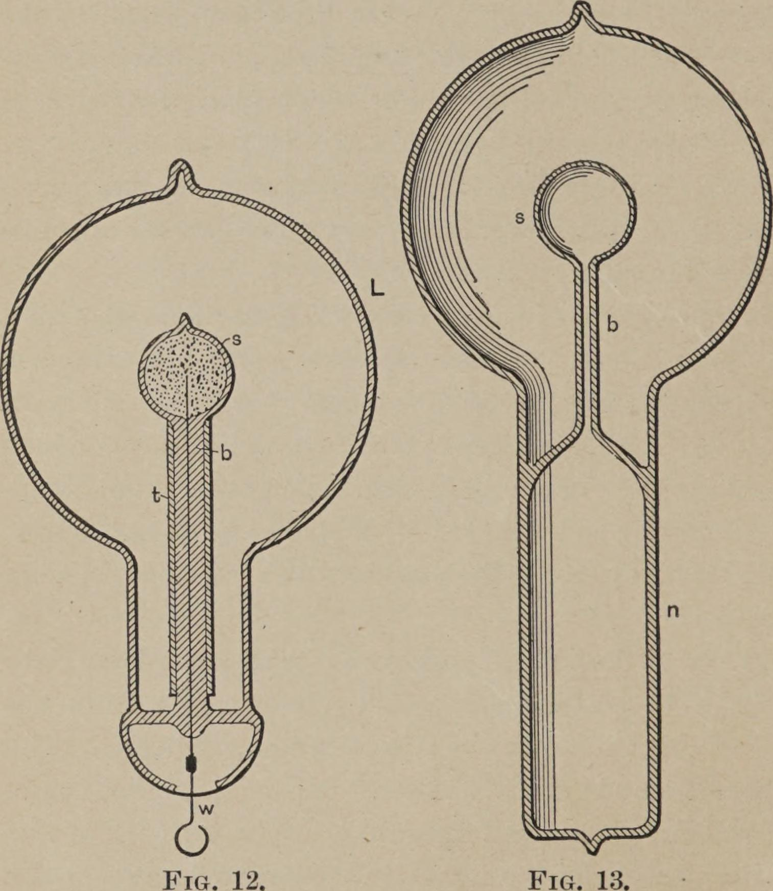
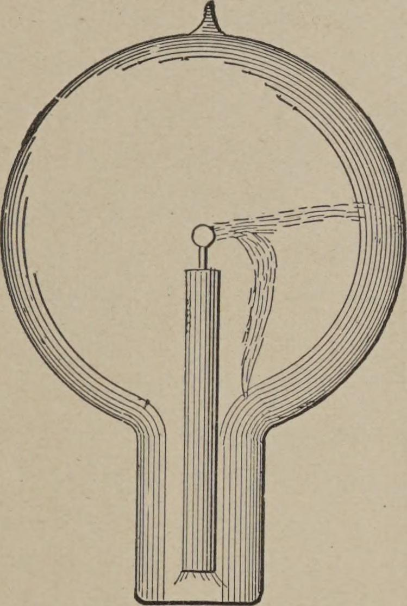
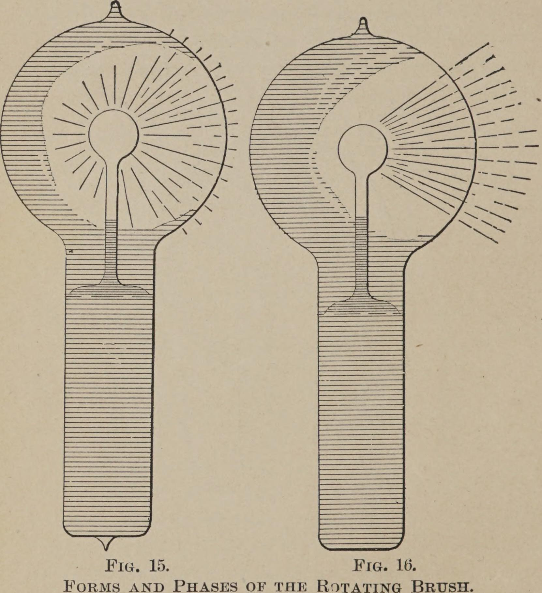

<!-- PDF 62 · trang in 44 -->

Cách cấu tạo chỉ ra ở Hình 13 được chọn để loại bỏ khỏi chổi lông mọi vật dẫn điện có
thể ảnh hưởng tới nó. Bóng đèn trong trường hợp này gồm một quả cầu đèn nung sợi đốt L,
quả cầu ấy có một cổ n, được trang bị...

*Hình 12 và Hình 13. - Bóng đèn dùng để tạo ra chổi lông quay.*

...với một dải ống, một quả cầu nhỏ s được hàn kín vào đó, sao cho tạo thành hai khoang
hoàn toàn độc lập, như hình vẽ chỉ ra. Khi bóng đèn được dùng, cổ n được phủ một lớp
thiếc, lớp này nối với máy phát và hoạt động...

<!-- PDF 63 · trang in 45 -->

...theo kiểu cảm ứng đối với khí ít khí đặc và dẫn điện rất tốt bị kín trong cổ ấy. Từ
đó dòng điện đi qua ống b vào quả cầu nhỏ s, để tác động theo kiểu cảm ứng lên khí chứa
trong quả cầu L.

Có lợi nếu làm ống t rất dày, lỗ xuyên qua nó rất nhỏ, và thổi quả cầu s rất mỏng. Điều
quan trọng nhất là quả cầu s phải được đặt ở tâm quả cầu L.

*Hình 14. - Các dạng và các giai đoạn của chổi lông quay.*

Hình 14, 15 và 16 chỉ ra những dạng khác nhau, hay các giai đoạn khác nhau, của chổi
lông. Hình 14 cho thấy chổi lông lúc nó xuất hiện đầu tiên trong một bóng đèn có sẵn
đầu dẫn dẫn điện; nhưng vì trong một bóng đèn như thế nó rất nhanh chóng biến mất -
thường chỉ sau vài phút - nên tôi sẽ chỉ giới hạn sự mô tả của mình vào hiện tượng
như quan sát được trong một bóng đèn không có điện cực dẫn điện. Hiện tượng ấy được
quan sát dưới những điều kiện sau đây:

Khi quả cầu L (Hình 12 và 13) được hút chân không đến...

<!-- PDF 64 · trang in 46 -->

...mức rất cao, nói chung bóng đèn không phát sáng khi nối dây w (Hình 12) hoặc lớp
thiếc của bóng đèn (Hình 13) vào đầu điện cực của cuộn cảm ứng. Để kích thích nó,
thường chỉ cần nắm lấy quả cầu L bằng tay. Khi đó một sự phát quang mãnh liệt trước
hết lan ra trên toàn bộ quả cầu, nhưng nhanh chóng nhường chỗ cho một ánh sáng trắng
như sương. Ít lâu sau đó, có thể thấy độ sáng phân bố không đều trong quả cầu, và sau
khi dòng điện chạy trong một thời gian...

*Hình 15 và Hình 16. - Hai giai đoạn khác nhau của chổi lông.*

<!-- PDF 65 · trang in 47 -->

...bóng đèn trông như ở Hình 15. Từ giai đoạn này, hiện tượng sẽ dần dần chuyển sang
dạng chỉ ra ở Hình 16, sau vài phút, vài giờ, vài ngày hoặc vài tuần, tuỳ theo bóng
đèn được sử dụng như thế nào. Làm ấm bóng đèn hoặc tăng thế điện sẽ làm cho sự chuyển
đổi ấy nhanh hơn.

Khi chổi lông mang dạng chỉ ra ở Hình 16, nó có thể được đưa vào một trạng thái nhạy
cảm cực đại với ảnh hưởng tĩnh điện và từ tính. Bóng đèn treo thẳng xuống từ một sợi
dây, và mọi vật thể đều ở xa nó, việc người quan sát tiến lại gần bóng đèn vài bước
sẽ làm cho chổi lông bay sang phía đối diện, và nếu người ấy đi vòng quanh bóng đèn thì
nó luôn ở phía đối diện. Nó có thể bắt đầu quanh quanh đầu điện cực từ rất lâu trước khi
đạt tới giai đoạn nhạy cảm ấy. Ngay khi nó bắt đầu quay chủ yếu, thậm chí còn trước đó,
nó đã bị ảnh hưởng bởi một nam châm, và ở một giai đoạn nào đó nó nhạy cảm với ảnh
hưởng từ tính đến mức đáng kinh ngạc. Một nam châm nhỏ, các cực cách nhau không quá
hai xentimét, sẽ ảnh hưởng tới nó một cách rõ ràng ở khoảng cách hai mét, làm chậm lại
hoặc nhanh hơn tốc độ quay tuỳ theo cách cầm nắm so với chổi lông. Tôi nghĩ rằng tôi
đã quan sát thấy rằng ở giai đoạn nó nhạy cảm nhất với từ tính, nó không nhạy cảm nhất
với ảnh hưởng tĩnh điện. Lời giải thích của tôi là: lực hút tĩnh điện giữa chổi lông
và thủy tinh của bóng đèn, làm chậm lại sự quay, lớn lên nhanh hơn nhiều so với ảnh
hưởng từ tính khi cường độ luồng sáng được tăng lên.

Khi bóng đèn treo với quả cầu L hướng xuống, sự quay luôn là theo chiều kim đồng hồ.
Ở bán cầu nam thì nó sẽ xảy ra theo chiều ngược lại, và ở xích đạo...

<!-- PDF 66 · trang in 48 -->

...chổi lông không nên quay cả. Sự quay có thể bị đảo chiều bởi một nam châm giữ ở một
khoảng cách nào đó. Chổi lông quay tốt nhất, dường như, khi nó vuông góc với các đường
sức của Trái Đất. Rất có thể khi ở tốc độ lớn nhất, nó quay đồng bộ với các nhịp
biến thiên, chẳng hạn 10.000 lần mỗi giây. Sự quay có thể bị làm chậm lại hoặc nhanh
hơn bởi việc người quan sát, hay bất kỳ vật thể dẫn điện nào, tiến lại gần hoặc lùi ra,
nhưng không thể bị đảo chiều chỉ bằng cách đặt bóng đèn vào bất kỳ tư thế nào. Khi nó ở
trạng thái nhạy cảm cao nhất và nếu thế điện hoặc tần số thay đổi thì độ nhạy cảm bị
giảm rất nhanh. Chỉ cần thay đổi một trong hai điều ấy dù chỉ một ít thì nói chung sẽ
làm cho sự quay dừng lại.

Độ nhạy cảm cũng chịu ảnh hưởng của những biến thiên nhiệt độ. Để đạt được độ nhạy cảm
lớn, cần phải có quả cầu nhỏ s ở tâm quả cầu L, nếu không tác dụng tĩnh điện của thủy
tinh quả cầu sẽ có xu hướng dừng sự quay lại. Quả cầu s nên nhỏ và có độ dày đều; bất
kỳ sự bất đối xứng nào dĩ nhiên cũng có tác dụng làm giảm độ nhạy cảm.

Việc chổi lông quay theo một hướng xác định trong một từ trường vĩnh cửu dường như cho
thấy rằng ở dòng điện xoay chiều tần số rất cao, các xung dương và âm không bằng nhau,
mà luôn có một cái nặng hơn cái kia.

Đương nhiên, sự quay theo một hướng này có thể là do tác dụng của hai phần tử cùng một
dòng điện lên nhau, hoặc do tác dụng của từ trường do một phần tử tạo ra lên phần tử
kia, như trong một động cơ nối tiếp, mà không nhất thiết một xung nào mạnh hơn xung kia.
Việc chổi lông quay, theo như tôi có thể quan sát, theo bất kỳ...
