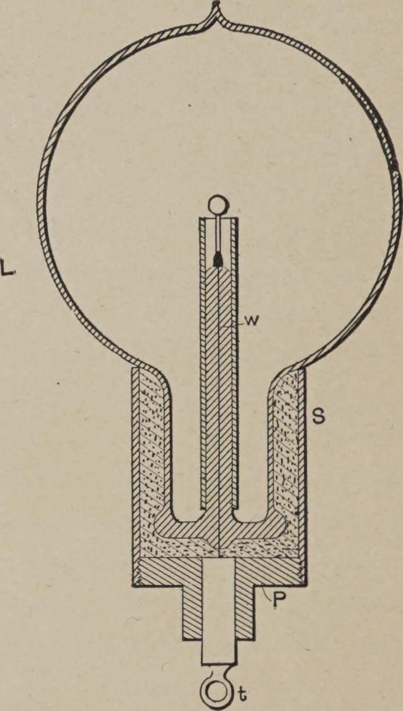
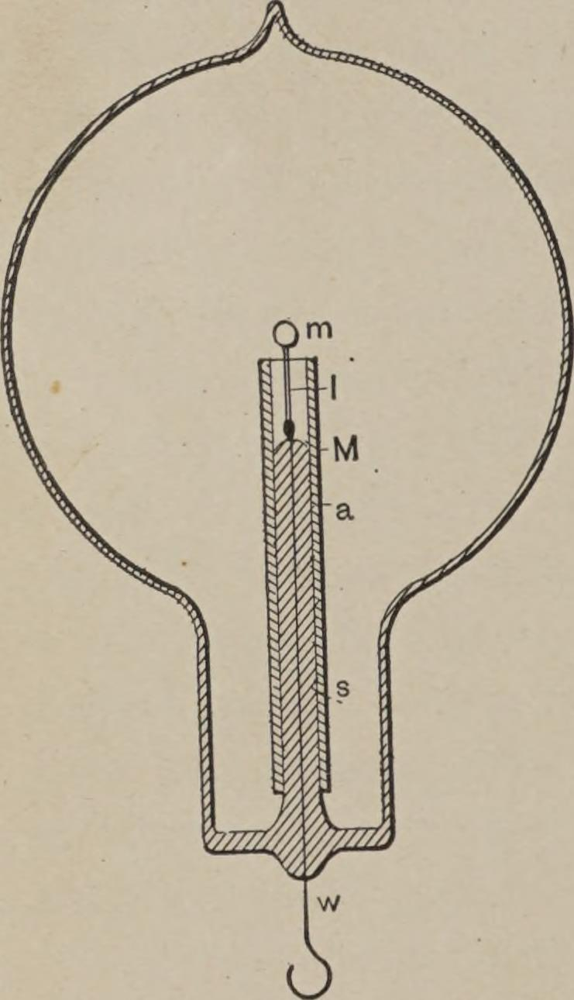

<!-- PDF 86 · trang in 68 -->

...áp suất khí quyển thường, thì quy tắc ngược lại lại đúng: càng cao tần số, hiện tượng
phóng tia lửa càng khó nhảy giữa hai đầu điện cực, nhất là khi chúng là các núm hoặc quả cầu
nào đó kích thước tương đối lớn.

Cuối cùng, ở những mức hút chân không rất thấp, khi khí dẫn điện tốt, ống kim loại không
những không có tác dụng như một tấm chắn tĩnh điện, mà còn là một trở ngại, góp phần đáng kể
vào việc phân tán năng lượng theo phương ngang từ dây dẫn vào. Điều này đương nhiên là điều
có thể dự liệu. Trong trường hợp ấy, cụ thể là ống kim loại nối điện tốt với dây dẫn vào, và
phần lớn sự phóng bội hướng vào ống. Chừng nào liên kết điện chưa tốt, ống dẫn điện luôn
có một chút lợi, bởi dù nó có thể không tiết kiệm được nhiều năng lượng, nó vẫn bảo vệ phần
tựa của nút chịu nhiệt, và là một cách để tập trung nhiều năng lượng hơn vào chính nút ấy.

Tới mức mà ống nhôm thực hiện chức năng của một tấm chắn, tính hữu ích của nó do đó bị giới
hạn ở những mức hút chân không rất cao, khi nó cách điện với điện cực - tức là khi khí nói
chung không dẫn điện, và các phân tử, hay nguyên tử, đóng vai trò những vật mang điện tích
độc lập.

Ngoài việc đóng vai trò một tấm chắn tới hơn là có hiệu quả, theo đúng nghĩa của từ, ống hoặc
lớp phủ dẫn điện còn có thể, nhờ tính dẫn điện của nó, đóng vai trò như một thứ cân bằng hay
giảm chấn sự phóng bội chống lại cuống. Để nói rõ, tôi giả thiết tác dụng ấy như sau: giả
sử rằng do tác dụng tấm chắn của nó không hoàn hảo, xảy ra một sự phóng bội nhịp nhàng chống
lại ống dẫn điện ấy.

<!-- PDF 87 · trang in 69 -->

...chắc chắn phải xảy ra là có một số phân tử, hay nguyên tử, va vào ống sớm hơn những cái
khác. Những cái tiếp xúc với nó trước tiên nhường đi điện tích thừa của chúng, và ống trở nên
mang điện, sự tích điện ấy lập tức lan ra khắp bề mặt của nó. Nhưng điều này hẳn phải làm
giảm năng lượng mất trong sự phóng bội, vì hai lý do. Thứ nhất, điện tích do các nguyên tử
nhường đi lan trên một diện tích lớn, và do đó mật độ điện tại mỗi điểm là nhỏ, và các nguyên
tử bị đẩy ra với năng lượng ít hơn so với khi chúng va vào một chất cách điện tốt. Thứ hai,
vì ống mang điện nhờ những nguyên tử tiếp xúc với nó trước tiên, sự tiến của các nguyên tử
đi sau chống lại ống bị chặn đôi chút bởi lực đẩy mà ống mang điện hẳn phải tác động lên
những nguyên tử cũng mang điện ấy. Lực đẩy này có lẽ đủ để ngăn một phần lớn các nguyên tử
không va vào ống, nhưng dù sao nó phải làm giảm năng lượng của lần va chạm của chúng. Rõ ràng
là khi mức hút chân không rất thấp, và khí loãng dẫn điện tốt, không một trong hai tác dụng nào
ở trên có thể xảy ra, và, mặt khác, các nguyên tử càng ít thì chúng càng tự do di chuyển; nói
cách khác, mức hút chân không càng cao, tới một giới hạn nào đó, cả hai tác dụng ấy càng nổi
bật.

Điều tôi vừa nói có thể giải thích hiện tượng mà Professor Crookes đã quan sát, cụ thể là
một hiện tượng phóng điện qua một bóng đèn được thiết lập dễ dàng hơn nhiều khi có một vật
cách điện hơn là khi có một vật dẫn điện trong đó. Theo ý tôi, vật dẫn điện đóng vai trò giảm
chấn chuyển động của các nguyên tử theo hai cách đã nêu; do đó, để làm một hiện tượng phóng
điện nhìn thấy được đi qua bóng đèn, cần một thế điện cao hơn nhiều nếu có một vật dẫn điện,
nhất là một vật có bề mặt lớn.

<!-- PDF 88 · trang in 70 -->

Để làm rõ một số nhận xét đã nêu trước, bây giờ tôi phải quay tới Hình 18, 19 và 20, vốn
minh hoạ những cách sắp xếp khác nhau với một loại bóng đèn được dùng phổ biến nhất.

*Hình 18. - Bóng đèn có ống mica và tấm chắn nhôm.*

*Hình 19. - Bóng đèn cải tiến có đầu cắm và tấm chắn.*

Hình 18 là một mặt cắt qua một bóng đèn cầu L, với cuống thuỷ tinh s, chứa dây dẫn vào w,
trên đó có một dây nung sợi đốt đèn nung l được gắn vào, dùng để nâng đỡ nút chịu nhiệt m ở
chính giữa. M là một tấm mỏng...
