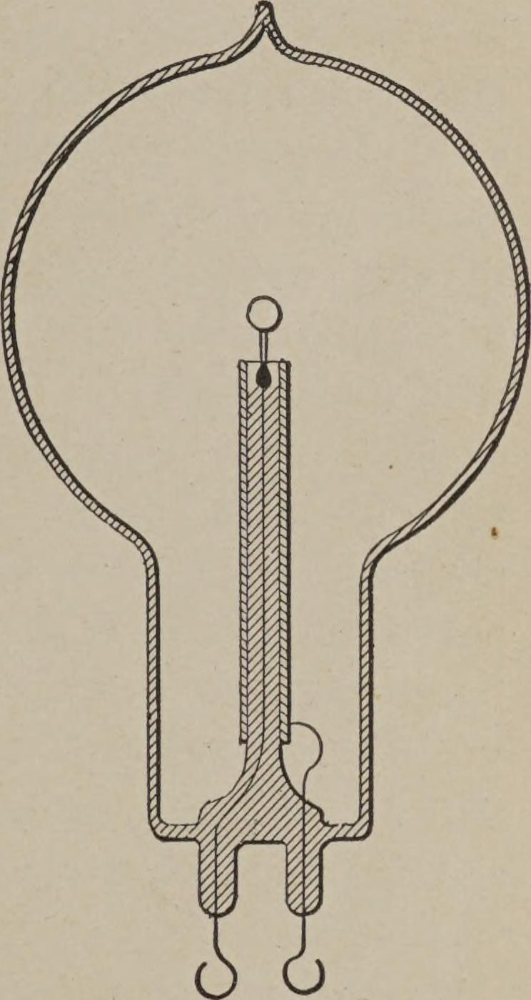
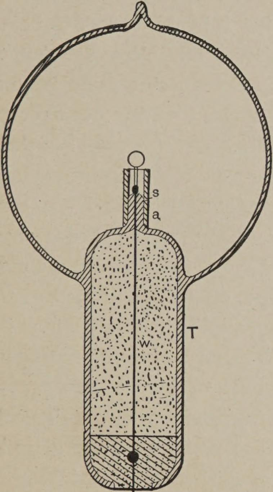
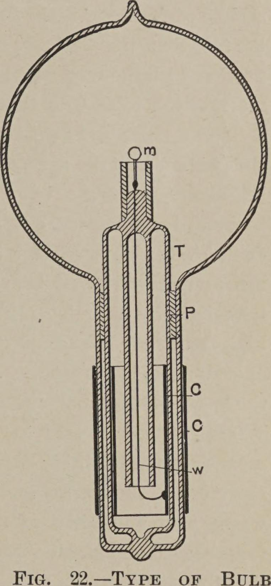

<!-- PDF 89 · trang in 71 -->

...mica quấn vài lớp quanh cuống s, và a là ống nhôm.

Hình 19 minh hoạ một bóng đèn như thế ở một giai đoạn hoàn thiện tiến thêm một chút. Một
ống kim loại S được gắn vào cổ của ống bằng một thứ chất dán. Trong ống có một nút P bằng
vật liệu cách điện được vặn vào, và ở chính giữa nút ấy được gắn một đầu điện cực kim
loại t, để nối với dây dẫn vào w. Đầu điện cực này phải cách điện tốt với ống kim loại S,
do đó, nếu chất dán dùng có dẫn điện — và thông thường nó dẫn điện khá tốt — thì khoảng
trống giữa nút P và cổ bóng đèn nên được lấp đầy bằng một vật liệu cách điện tốt, như bột
mica.

*Hình 20. — Bóng đèn dùng cho thí nghiệm với ống dẫn điện.*

Hình 20 cho thấy một bóng đèn làm cho mục đích thí nghiệm. Trong bóng đèn này, ống nhôm được
trang bị một mối nối bên ngoài, để nghiên cứu tác dụng của ống trong những điều kiện khác
nhau. Nó được nhắc tới chủ yếu để gợi ý một hướng thí nghiệm mà ta sẽ theo.

Vì sự phóng bội chống lại cuống chứa dây dẫn vào là do tác dụng cảm ứng của dây ấy lên khí
loãng, nên có lợi nếu giảm tác dụng ấy tới mức khả thi bằng cách dùng một sợi dây rất mảnh,
được bao bọc bởi một lớp cách điện rất dày bằng thủy tinh hay vật liệu khác, và bằng cách làm
cho sợi dây đi qua khí loãng càng ngắn càng tốt.

<!-- PDF 90 · trang in 72 -->

Để kết hợp những đặc điểm ấy, tôi dùng một ống lớn T (Hình 21), ống này thò vào trong
bóng đèn một đoạn nào đó, và mang trên đỉnh một cuống thuỷ tinh rất ngắn s, trong đó được
hàn kín dây dẫn vào w, và tôi bảo vệ phần trên của cuống thuỷ tinh khỏi nhiệt bằng một ống
nhôm nhỏ a và một lớp mica bên dưới, như thường lệ. Sợi dây w, đi qua ống lớn ra bên ngoài
bóng đèn, phải được cách điện tốt — chẳng hạn bằng một ống thuỷ tinh — và khoảng trống giữa
nên được lấp đầy bằng một vật liệu cách điện tuyệt vời. Trong nhiều loại bột cách điện mà
tôi đã thử, tôi thấy bột mica là tốt nhất. Nếu không đề phòng điều này, ống T thò vào trong
bóng đèn chắc chắn sẽ bị nứt do nhiệt từ những chổi lông thường hình thành ở phần trên của
ống, gần quả cầu đã hút chân không, nhất là khi chân không rất tốt, và do đó thế điện cần
thiết để vận hành đèn rất cao.

Hình 22 minh hoạ một cách sắp xếp tương tự, với một ống lớn T thò vào phần của bóng đèn chứa
nút chịu nhiệt m. Trong trường hợp này, sợi dây dẫn từ bên ngoài vào bóng đèn được bỏ qua,
năng lượng cần thiết được cung cấp qua các lớp phủ của bình tụ C C. Miếng đệm cách điện P
trong cách cấu tạo này nên khít với thủy tinh, và khá rộng, nếu không hiện tượng phóng điện
có thể tránh việc đi qua sợi dây w, vốn nối lớp phủ bình tụ bên trong với nút nung đỏ bên
trong.

<!-- PDF 91 · trang in 73 -->

*Hình 21. — Bóng đèn cải tiến có nút không dẫn điện.*

*Hình 22. — Bóng đèn cải tiến không có dây dẫn vào.*

Sự phóng bội phân tử chống lại cuống thuỷ tinh trong bóng đèn là một nguồn phiền muộn lớn.
Để minh hoạ, tôi sẽ dẫn một hiện tượng quá thường xuyên và không hẹn hò gặp. Ta có thể lấy
một bóng đèn, tốt nhất là một bóng lớn, và đặt vào đó một vật dẫn điện tốt, chẳng hạn một
mẩu than, trên một sợi dây bạch kim hàn kín trong cuống thuỷ tinh. Bóng đèn có thể được hút
chân không đến một mức khá cao, gần tới điểm mà quang phát bắt đầu xuất hiện.
