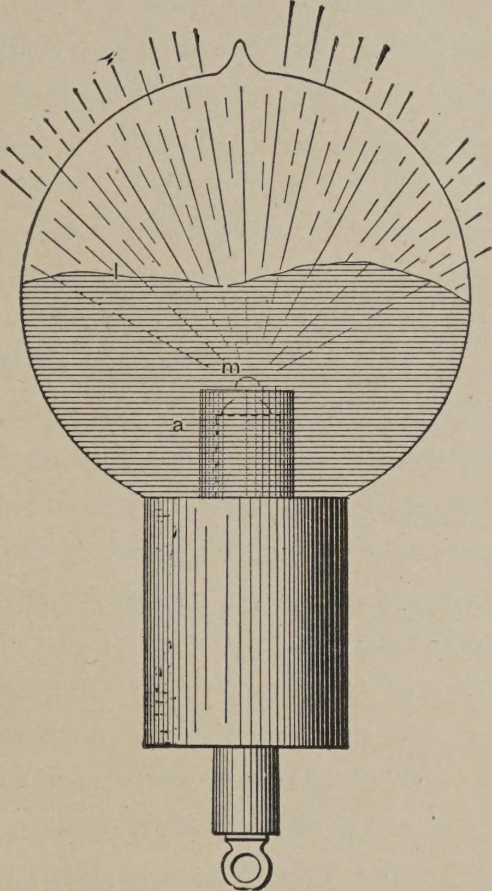

<!-- PDF 92 · trang in 74 -->

Khi bóng đèn được nối với cuộn dây, mẩu than, nếu nhỏ, có thể ban đầu được đưa tới trạng
thái nóng đỏ rực, nhưng độ sáng của nó lập tức giảm xuống, rồi hiện tượng phóng điện có thể
xuyên thủng qua thủy tinh ở đâu đó giữa chừng cuống, dưới hình thức những tia lửa sáng chói,
mặc dù sợi dây bạch kim nối điện tốt với khí loãng qua mẩu than hoặc kim loại ở phía trên.
Những tia lửa đầu tiên sáng lạ thường, gợi nhớ tới những tia kéo từ một mặt thủy nguyên
trong. Nhưng, vì chúng làm nóng thủy tinh rất nhanh, chúng đương nhiên mất độ sáng, và dừng
lại khi thủy tinh ở chỗ rách trở nên nóng đỏ, hoặc nói chung đủ nóng để dẫn điện. Khi quan
sát lần đầu, hiện tượng ấy hẳn phải trông rất kỳ lạ, và cho thấy một cách nổi bật rằng dòng
điện xoay chiều, hay xung, tần số cao cư xử khác hẳn so với dòng điện không đổi, hay dòng
điện tần số thấp. Với những dòng điện ấy - tức là loại sau - hiện tượng ấy đương nhiên sẽ
không xảy ra. Khi dùng những tần số thu được bằng phương tiện cơ học, tôi nghĩ rằng sự rách
thủy tinh phần nào là hệ quả của sự phóng bội, vốn làm nóng nó và làm suy giảm khả năng cách
điện; nhưng với những tần số thu được nhờ bình tụ, tôi không hề nghi ngờ rằng thủy tinh có thể
nứt ra mà không cần nóng trước. Dù điều này lúc đầu trông vô cùng lạ, nó thực ra đúng là
điều ta có thể dự liệu. Năng lượng cung cấp cho sợi dây dẫn vào bóng đèn được phát ra một
phần bằng tác dụng trực tiếp qua nút than, và một phần bằng tác dụng cảm ứng qua lớp thủy tinh
bao quanh sợi dây. Vì vậy trường hợp này tương tự với trường hợp một bình tụ bị đoạn mạch...

<!-- PDF 93 · trang in 75 -->

...bằng một điện trở thấp nối với một nguồn dòng điện xoay chiều. Chừng nào tần số còn
thấp, điện trở nhận phần lớn, và bình tụ hoàn toàn an toàn; nhưng khi tần số trở nên quá cao,
vai trò của điện trở có thể trở nên không đáng kể. Trong trường hợp sau, hiệu thế ở hai đầu
bình tụ có thể trở nên lớn đến mức làm nứt vật cách điện, mặc dù hai đầu ấy được nối bằng
một điện trở thấp.

*Hình 23. - Hiệu ứng do một giọt hồng ngọc.*

<!-- PDF 94 · trang in 76 -->

Đương nhiên, khi muốn tạo ra sự nóng đỏ của một vật thể nhốt trong bóng đèn bằng những dòng
điện này, không cần thiết vật thể ấy phải là một chất dẫn điện, bởi ngay cả một chất cách
điện hoàn hảo cũng có thể bị nóng dễ dàng ngang như vậy. Cho mục đích ấy, chỉ cần bao quanh
một điện cực dẫn điện bằng một vật liệu không dẫn điện, như, chẳng hạn, trong bóng đèn đã mô
tả trước ở Hình 21, trong đó một dây nung sợi đốt đèn nung mỏng được phủ một lớp chất không
dẫn điện, và nâng đỡ một nút bằng cùng vật liệu ấy ở phía trên. Lúc đầu sự phóng bội diễn
ra bằng tác dụng cảm ứng xuyên qua lớp chất không dẫn điện, cho tới khi nó được nóng đủ để
trở thành dẫn điện, khi ấy sự phóng bội tiếp tục theo cách thông thường.

Một cách sắp xếp khác, dùng trong một số bóng đèn được chế tạo, được minh hoạ ở Hình 23. Trong
trường hợp này, một vật không dẫn điện m được đặt vào một mẩu than đèn hàn quang thông thường
sao cho nó nhô lên trên mẩu than ấy một khoảng nhỏ. Mẩu than được nối với dây dẫn vào đi qua
một cuống thuỷ tinh, vốn được bọc vài lớp mica. Một ống nhôm a được dùng như thường lệ để che
chắn. Nó được sắp xếp sao cho vừa chạm tới gần bằng miệng than, và chỉ có vật không dẫn điện
m nhô lên một chút phía trên nó. Sự phóng bội lúc đầu hướng vào mặt trên của than, các phần
dưới được ống nhôm bảo vệ. Nhưng ngay khi vật không dẫn điện m bị nóng, nó trở nên dẫn điện
tốt, và khi ấy nó trở thành tâm của sự phóng bội, vì nó hở ra nhiều nhất đối với sự phóng bội ấy.

Trong các thí nghiệm này, tôi cũng đã chế tạo nhiều bóng đèn một dây như thế, có hoặc không
có điện cực bên trong,
