# Liber Primus, Phần III

<!-- Nguồn: PDF 99–123, bắt đầu tại trang in 82. Bản dịch đang được soạn; phần tiếp theo của §97 bắt đầu ở PDF 124. -->

<!-- PDF 99, trang in 82, mở đầu Section III -->

# Section III

## Quan hệ giữa nhiều điểm trên quỹ đạo

## §78

So sánh hai hoặc nhiều vị trí của một vật thể thiên thể, cả trên quỹ đạo lẫn trong không gian, cung cấp một lượng đề bài lượng giác đẹp đến mức có thể dễ dàng lấp đầy cả một cuốn sách. Mục đích của chúng ta không phải là khai thác hết một đề tài phong phú như vậy, mà là dựng một bộ phương tiện phong đầy đủ cho lời giải bài toán lớn: xác định các quỹ đạo chưa biết từ các quan sát. Vì vậy, bỏ qua những điều quá xa cách với mục đích của công trình, ta sẽ phát triển tất cả những gì có thể dẫn tới kết quả ấy.

Trước các chứng minh ấy, ta đưa vào một số mệnh đề lượng giác, vì chúng thường xuyên được dùng và sẽ được trở lại nhiều lần.

**I.** Với ba góc bất kỳ \(A,B,C\), ta có

$$
\sin A\sin(C-B)
+\sin B\sin(A-C)
+\sin C\sin(B-A)
=0,
$$

$$
\cos A\sin(C-B)
+\cos B\sin(A-C)
+\cos C\sin(B-A)
=0.
$$

**II.** Nếu hai đại lượng \(p,P\) phải được xác định từ các phương trình

$$
p\sin(A-P)=a,
\qquad
p\sin(B-P)=b,
$$

thì nói chung ta dùng hai công thức

$$
p\sin(B-A)\sin(H-P)
=
b\sin(H-A)-a\sin(H-B),
$$

$$
p\sin(B-A)\cos(H-P)
=
b\cos(H-A)-a\cos(H-B),
$$

trong đó \(H\) là một góc tùy ý. Từ đó, theo Điều 14 II, ta xác định được góc \(H-P\) và \(p\sin(B-A)\), rồi suy ra \(P,p\).

Thường có thêm điều kiện \(p\) phải dương; khi đó, sự nhập nhằng trong việc xác định góc \(H-P\) qua tangent được giải quyết. Nếu thiếu điều kiện ấy, ta có thể chọn nhánh theo ý mình. Để phép tính thuận tiện nhất, có thể đặt góc tùy ý \(H\) bằng \(A\), \(B\), hoặc \(\tfrac12(A+B)\).

Nếu \(H=A\), hai phương trình xác định \(P,p\) trở thành

$$
p\sin(A-P)=a,
$$

$$
p\cos(A-P)
=
\frac{b-a\cos(B-A)}{\sin(B-A)}.
$$

<!-- PDF 100, trang in 83, tiếp theo §78 -->

Nếu \(H=B\), các phương trình hoàn toàn tương tự. Nếu \(H=\tfrac12(A+B)\), ta có

$$
p\sin\left(\tfrac12A+\tfrac12B-P\right)
=
\frac{b+a}{2\cos\tfrac12(B-A)},
$$

$$
p\cos\left(\tfrac12A+\tfrac12B-P\right)
=
\frac{b-a}{2\sin\tfrac12(B-A)}.
$$

Nếu đưa vào góc phụ \(\zeta\) có

$$
\tan\zeta=\frac{a}{b},
$$

thì \(P\) được xác định bằng công thức

$$
\tan\left(\tfrac12A+\tfrac12B-P\right)
=
\tan(45^\circ+\zeta)\tan\tfrac12(B-A).
$$

Còn \(p\) có thể tính bằng một trong các biểu thức

$$
\tfrac12(b+a)
=
\sin(45^\circ+\zeta)\sqrt{\frac{ab}{\sin2\zeta}}
=
\frac{a\sin(45^\circ+\zeta)}{\sin\zeta\sqrt2}
=
\frac{b\sin(45^\circ+\zeta)}{\cos\zeta\sqrt2},
$$

$$
\tfrac12(b-a)
=
\cos(45^\circ+\zeta)\sqrt{\frac{ab}{\sin2\zeta}}
=
\frac{a\cos(45^\circ+\zeta)}{\sin\zeta\sqrt2}
=
\frac{b\cos(45^\circ+\zeta)}{\sin\zeta\sqrt2}.
$$

**III.** Nếu \(p,P\) phải được xác định từ

$$
p\cos(A-P)=a,
\qquad
p\cos(B-P)=b,
$$

thì mọi điều đã nêu trong II đều có thể dùng ngay, nếu ở đó thay \(A,B\) bằng \(90^\circ+A,90^\circ+B\). Để tiện hơn, ta trình bày các công thức đã rút gọn. Dạng tổng quát là

$$
p\sin(B-A)\sin(H-P)
=
-b\cos(H-A)+a\cos(H-B),
$$

$$
p\sin(B-A)\cos(H-P)
=
b\sin(H-A)-a\sin(H-B).
$$

Khi \(H=A\), ta thu được

$$
p\sin(A-P)
=
\frac{a\cos(B-A)-b}{\sin(B-A)},
$$

$$
p\cos(A-P)=a.
$$

Với \(H=B\), ta có dạng tương tự. Với \(H=\tfrac12(A+B)\),

$$
p\sin\left(\tfrac12A+\tfrac12B-P\right)
=
\frac{a-b}{2\sin\tfrac12(B-A)},
$$

$$
p\cos\left(\tfrac12A+\tfrac12B-P\right)
=
\frac{a+b}{2\cos\tfrac12(B-A)}.
$$

Khi đưa vào góc phụ \(\zeta\) có

$$
\tan\zeta=\frac{a}{b},
$$

ta có

$$
\cot\left(\tfrac12A+\tfrac12B-P\right)
=
\tan(\zeta-45^\circ)\tan\tfrac12(B-A).
$$

<!-- PDF 101, trang in 84, tiếp theo §78-§79 -->

Nếu muốn xác định trực tiếp \(p\) từ \(a,b\), không cần tính trước góc \(P\), ta dùng công thức

$$
p\sin(B-A)
=
\sqrt{aa+bb-2ab\cos(B-A)}.
$$

Công thức này dùng được trong bài toán hiện tại và trong II.

## §79

Để xác định đầy đủ một section conic trong mặt phẳng của nó, cần ba đại lượng: vị trí perihelion, độ lệch tâm và bán tham số. Nếu các đại lượng này phải được suy ra từ những đại lượng đã biết phụ thuộc vào chúng, phải có đủ dữ kiện để lập ba phương trình độc lập.

Mỗi bán kính vectơ đã biết cả độ lớn lẫn phương sẽ cung cấp một phương trình. Vì thế, để xác định quỹ đạo cần ba bán kính vectơ đã biết độ lớn và phương. Nếu chỉ có hai, hoặc một phần tử của quỹ đạo đã được cho trước, hoặc phải có ít nhất một đại lượng khác để dựng phương trình thứ ba. Từ đây xuất hiện nhiều loại bài toán mà ta sẽ trình bày tiếp.

Cho \(r,r'\) là hai bán kính vectơ, tạo với một đường thẳng tùy ý trong mặt phẳng quỹ đạo, kẻ từ Mặt Trời, các góc \(N,N'\) theo chiều chuyển động. Gọi \(\Pi\) là góc mà bán kính vectơ tại perihelion tạo với cùng đường thẳng ấy, sao cho các anomalia thật ứng với \(r,r'\) là \(N-\Pi\) và \(N'-\Pi\); cuối cùng, \(e\) là độ lệch tâm và \(p\) là bán tham số. Ta có

$$
\frac{p}{r}=1+e\cos(N-\Pi),
$$

$$
\frac{p}{r'}=1+e\cos(N'-\Pi).
$$

Nếu biết một trong ba đại lượng \(p,e,\Pi\), có thể xác định hai đại lượng còn lại.

Giả sử trước rằng bán tham số \(p\) đã biết. Khi đó, \(e,\Pi\) được xác định từ

$$
e\cos(N-\Pi)=\frac{p}{r}-1,
$$

$$
e\cos(N'-\Pi)=\frac{p}{r'}-1.
$$

<!-- PDF 102, trang in 85, tiếp theo §79-§80 -->

Các phương trình này có thể giải theo Lemma III ở Điều trước. Ta có

$$
\tan(N-\Pi)
=
\cot(N'-N)
-
\frac{r(p-r')}{r'(p-r)\sin(N'-N)},
$$

và

$$
\tan\left(\tfrac12N+\tfrac12N'-\Pi\right)
=
\frac{(r'-r)\cot\tfrac12(B-A)}
{r'+r-\dfrac{2rr'}{p}}.
$$

## §80

Nếu góc \(\Pi\) đã biết, \(p,e\) được xác định bởi

$$
p
=
\frac{rr'\bigl(\cos(N-\Pi)-\cos(N'-\Pi)\bigr)}
{r\cos(N-\Pi)-r'\cos(N'-\Pi)},
$$

$$
e
=
\frac{r'-r}
{r\cos(N-\Pi)-r'\cos(N'-\Pi)}.
$$

Mẫu số chung trong hai công thức này có thể rút gọn về dạng

$$
a\cos(A-\Pi),
$$

để \(a,A,\Pi\) trở thành ba đại lượng độc lập. Gọi \(H\) là một góc tùy ý, ta có

$$
\begin{aligned}
&r\cos(N-\Pi)-r'\cos(N'-\Pi)\\
&=
\Bigl[
\bigl(r\cos(N-H)-r'\cos(N'-H)\bigr)\cos(H-\Pi)\\
&\qquad
-\bigl(r\sin(N-H)-r'\sin(N'-H)\bigr)\sin(H-\Pi)
\Bigr].
\end{aligned}
$$

Do đó, biểu thức này bằng \(a\cos(A-\Pi)\), nếu \(a,A\) được xác định từ

$$
r\cos(N-H)-r'\cos(N'-H)=a\cos(A-H),
$$

$$
r\sin(N-H)-r'\sin(N'-H)=a\sin(A-H).
$$

Khi đó

$$
p
=
\frac{
2rr'\sin\tfrac12(N'-N)
\sin\left(\tfrac12N+\tfrac12N'-\Pi\right)
}
{a\cos(A-\Pi)},
$$

$$
e=\frac{r'-r}{a\cos(A-\Pi)}.
$$

Trước hết, các công thức này thuận tiện khi \(p,e\) phải được tính cho nhiều giá trị của \(\Pi\), trong khi \(r,r',N,N'\) giữ không đổi. Vì có thể tùy ý chọn góc phụ \(H\), thuận lợi là đặt

$$
H=\tfrac12(N+N').
$$

Khi đó, các công thức trở thành

$$
(r'-r)\cos\tfrac12(N'-N)
=
-a\cos\left(A-\tfrac12N-\tfrac12N'\right),
$$

$$
(r'+r)\sin\tfrac12(N'-N)
=
-a\sin\left(A-\tfrac12N-\tfrac12N'\right).
$$

Sau khi xác định \(A\) bằng phương trình

$$
\tan\left(A-\tfrac12N-\tfrac12N'\right)
=
\frac{r'+r}{r'-r}\tan\tfrac12(N'-N),
$$

ta có ngay

$$
e
=
-\frac{
\cos\left(A-\tfrac12N-\tfrac12N'\right)
}
{\cos\tfrac12(N'-N)\cos(A-\Pi)}.
$$

<!-- PDF 103, trang in 86, tiếp theo §80 -->

Ta có thể rút gọn phép tính logarithm của đại lượng \(\frac{r'+r}{r'-r}\) bằng thủ thuật đã được trình bày nhiều lần.

## §81

Nếu độ lệch tâm \(e\) đã biết, góc \(\Pi\) được xác định bởi phương trình

$$
\cos(A-\Pi)
=
-\frac{\cos\left(A-\tfrac12N-\tfrac12N'\right)}
{e\cos\tfrac12(N'-N)},
$$

sau khi góc phụ \(A\) đã được xác định bởi phương trình

$$
\tan\left(A-\tfrac12N-\tfrac12N'\right)
=
\frac{r'+r}{r'-r}\tan\tfrac12(N'-N).
$$

Nhập nhằng còn lại trong việc xác định góc \(A-\Pi\) qua chính cos của nó là điều cố hữu bản chất của bài toán, đến nỗi bài toán có thể thỏa mãn bởi hai lời giải khác nhau; lời giải nào nên nhận, lời giải nào nên bỏ, phải quyết định từ nơi khác, và để làm được điều đó thì ít nhất giá trị xấp xỉ của chính \(\Pi\) phải đã biết.

Sau khi \(\Pi\) đã tìm ra, \(p\) được tính hoặc theo các công thức

$$
p=r(1+e\cos(N-\Pi))=r'(1+e\cos(N'-\Pi)),
$$

hoặc theo công thức

$$
p
=
\frac{
2rr'e\sin\tfrac12(N'-N)\sin\tfrac12(N+N'-\Pi)
}
{r'-r}.
$$

## §82

Giả sử cuối cùng, ba bán kính vectơ \(r,r',r''\) đã biết, chúng tạo với một đường thẳng tùy ý kẻ từ Mặt Trời trong mặt phẳng quỹ đạo các góc \(N,N',N''\). Khi ấy ta có, nếu giữ nguyên các dấu còn lại, các phương trình (I):

$$
\frac{p}{r}=1+e\cos(N-\Pi),
$$

$$
\frac{p}{r'}=1+e\cos(N'-\Pi),
$$

$$
\frac{p}{r''}=1+e\cos(N''-\Pi),
$$

<!-- PDF 104, trang in 87, tiếp theo §82-§83 -->

từ đó \(p,\Pi,e\) có thể được suy ra theo nhiều cách khác nhau. Nếu ta muốn tính đại lượng \(p\) trước hai đại lượng còn lại, hãy nhân ba phương trình (I) lần lượt với \(\sin(N''-N')\), \(-\sin(N''-N)\), \(\sin(N'-N)\), rồi cộng các tích ấy lại; theo Lemma I, Điều 78,

$$
p
=
\frac{
\sin(N''-N')-\sin(N''-N)+\sin(N'-N)
}{
\frac1r\sin(N''-N')-\frac1{r'}\sin(N''-N)+\frac1{r''}\sin(N'-N)
}.
$$

Biểu thức này đáng được xét kỹ hơn. Tử số hiển nhiên bằng

$$
=2\sin\tfrac12(N''-N')\cos\tfrac12(N''-N')
-2\sin\tfrac12(N''-N')\cos\left(\tfrac12N''+\tfrac12N'-N\right),
$$

$$
=4\sin\tfrac12(N''-N')\sin\tfrac12(N''-N)\sin\tfrac12(N'-N).
$$

<!-- Bản in viết nguồn ý thứ ba là rr' sin(N'-N) = n, trong khi dòng kế tiếp và mẫu số dùng n''. Giữ nguyên theo bản in. -->

Đặt nữa \(r'r''\sin(N''-N')=n\), \(rr''\sin(N''-N)=n'\), \(rr'\sin(N'-N)=n\), thì thấy ngay \(\tfrac12n,\tfrac12n',\tfrac12n''\) là các diện tích tam giác giữa bán kính vectơ thứ hai và thứ ba, giữa thứ nhất và thứ ba, giữa thứ nhất và thứ hai. Từ đó dễ thấy, trong công thức mới

$$
p
=
\frac{
4\sin\tfrac12(N''-N')\sin\tfrac12(N''-N)\sin\tfrac12(N'-N)\cdot rr'r''
}{
n-n'+n''
}
$$

mẫu số là hai lần diện tích tam giác giữa các đầu mút của ba bán kính vectơ, tức là giữa ba vị trí của vật thể thiên thể trong không gian. Mỗi khi ba vị trí ấy không xa nhau, diện tích này luôn là một đại lượng cực kỳ nhỏ, và đúng là bậc ba, vì \(N'-N\) và \(N''-N'\) được xem là những đại lượng nhỏ bậc nhất. Từ đó cũng có thể kết luận rằng, nếu một hay nhiều trong các đại lượng \(r,r',r'',N,N',N''\) mắc sai số dù nhỏ, việc xác định chính \(p\) có thể sinh ra một sai số vô cùng lớn; vì thế cách xác định kích thước quỹ đạo này không bao giờ chấp nhận độ chính xác cao, trừ khi ba vị trí nhìn từ Mặt Trời cách nhau ở những khoảng đáng kể.

Tuy vậy, ngay khi bán tham số \(p\) đã tìm ra, \(e\) và \(\Pi\) sẽ được xác định từ tổ hợp của hai phương trình bất kỳ nào trong (I), theo phương pháp của Điều 79.

## §83

Nếu ta muốn bắt đầu lời giải của cùng bài toán ấy bằng việc tính góc \(\Pi\), ta sẽ dùng phương pháp sau đây. Ta lấy phương trình thứ ba trừ phương trình thứ hai, phương trình thứ ba trừ phương trình thứ nhất, phương trình thứ hai trừ phương trình thứ nhất; bằng cách ấy ta thu được ba phương trình mới sau đây (II):

$$
\frac{\frac1{r'}-\frac1{r''}}{2\sin\tfrac12(N''-N')}
=
\frac ep\sin\left(\tfrac12N'+\tfrac12N''-\Pi\right),
$$

$$
\frac{\frac1r-\frac1{r''}}{2\sin\tfrac12(N''-N)}
=
\frac ep\sin\left(\tfrac12N+\tfrac12N''-\Pi\right),
$$

$$
\frac{\frac1r-\frac1{r'}}{2\sin\tfrac12(N'-N)}
=
\frac ep\sin\left(\tfrac12N+\tfrac12N'-\Pi\right).
$$

<!-- PDF 105, trang in 88, tiếp theo §83 -->

Hai phương trình bất kỳ trong số đó, theo Lemma II, Điều 78, sẽ cho ta \(\Pi\) và \(e/p\), từ đó theo phương trình bất kỳ nào trong (I) ta còn có được \(e\) và \(p\). Nếu ta chọn lời giải thứ ba đã trình bày ở Điều 78, II, thì tổ hợp của phương trình thứ nhất với phương trình thứ ba sẽ tạo ra thuật toán sau đây. Góc phụ \(\zeta\) được xác định bởi phương trình

$$
\tan\zeta
=
\frac{\frac{r'}r-1}{1-\frac{r'}{r''}}
\cdot
\frac{\sin\tfrac12(N''-N')}{\sin\tfrac12(N'-N)},
$$

<!-- Bản in dùng chữ tang và cotang; ở đây quy ước \tan và \cot được dùng thống nhất với các phần trước. -->

và do đó

$$
\tan\left(\tfrac12N+\tfrac12N'+\tfrac12N''-\Pi\right)
=
\tan(45^\circ+\zeta)\tan\tfrac12(N''-N).
$$

Hoán đổi vị trí thứ hai với thứ nhất hoặc thứ ba, sẽ cho ra hai lời giải khác hoàn toàn tương tự. Vì khi dùng phương pháp này, các công thức để tính \(e/p\) trở nên kém thuận tiện, nên lấy \(e\) và \(p\) từ hai phương trình trong (I) theo phương pháp của Điều 80 sẽ thuận lợi hơn.

Tuy nhiên, nhập nhằng trong việc xác định chính \(\Pi\) qua tangent của góc \(\tfrac12N+\tfrac12N'+\tfrac12N''-\Pi\) phải được quyết định sao cho \(e\) trở thành một đại lượng dương: rõ ràng nếu lấy cho \(\Pi\) hai giá trị lệch nhau \(180^\circ\) thì các giá trị của \(e\) thu được sẽ trái dấu nhau. Dấu của chính \(p\) thì không phụ thuộc vào nhập nhằng ấy, và giá trị của \(p\) không thể âm, trừ khi ba điểm đã cho nằm ở phần hyperbol quay lưng về Mặt Trời; còn trường hợp trái với quy luật tự nhiên ấy, ở đây ta không xét đến.

Những gì sẽ sinh ra khi áp dụng phương pháp thứ nhất ở Điều 78, II sau những phép thế rườm rà, trong trường hợp hiện tại có thể thu được thuận tiện hơn theo cách sau. Hãy nhân phương trình thứ nhất trong (II) với \(\cos\tfrac12(N''-N')\), phương trình thứ ba với \(\cos\tfrac12(N'-N)\), rồi lấy tích sau trừ tích trước. Khi đó, áp dụng đúng đắn Lemma I, Điều 78,[^1] ta thu được phương trình

$$
\tfrac12\left(\frac1{r'}-\frac1{r''}\right)\cot\tfrac12(N''-N')
-
\tfrac12\left(\frac1r-\frac1{r'}\right)\cot\tfrac12(N'-N)
=
\frac ep\sin\tfrac12(N''-N)\cos\left(\tfrac12N+\tfrac12N''-\Pi\right)
$$

[^1]: Tức là trong công thức thứ hai, đặt \(A=\tfrac12(N''-N')\), \(B=\tfrac12N+\tfrac12N''-\Pi\), \(C=\tfrac12(N-N')\).

<!-- PDF 106, trang in 89, tiếp theo §83-§85 -->

Khi kết hợp với phương trình thứ hai trong (II), ta sẽ tìm ra \(\Pi\) và \(e/p\), và cụ thể là \(\Pi\) theo công thức

$$
\tan\left(\tfrac12N+\tfrac12N''-\Pi\right)
=
\frac{
\frac{r'}r-\frac{r'}{r''}
}{
\left(1-\frac{r'}{r''}\right)\cot\tfrac12(N''-N)
-
\left(\frac{r'}r-1\right)\cot\tfrac12(N'-N)
}.
$$

Từ đây cũng còn suy ra hai công thức khác hoàn toàn tương tự, bằng cách hoán đổi vị trí thứ hai với thứ nhất hoặc thứ ba.

## §84

<!-- Bản in viết "elementum orbitae vnquam"; theo ngữ cảnh ("một phần tử của quỹ đạo" để xác định toàn bộ quỹ đạo) đây là unum. -->

Khi từ hai bán kính vectơ đã biết về độ lớn và phương, cùng một phần tử của quỹ đạo, có thể xác định được toàn bộ quỹ đạo, thì từ các dữ kiện ấy cũng có thể xác định thời gian trong đó vật thể thiên thể chuyển từ bán kính vectơ này sang bán kính vectơ kia, vì khối lượng của vật thể hoặc bị bỏ qua, hoặc ít nhất cũng được coi như đã biết: ta sẽ bám theo giả thiết trước, còn giả thiết sau thì dễ dàng quy về giả thiết trước. Từ đó, ngược lại, ta thấy rằng hai bán kính vectơ đã biết về độ lớn và phương, cùng với thời gian trong đó vật thể thiên thể vạch không gian trung gian, có thể xác định toàn bộ quỹ đạo.

Bài toán này, thuộc về những điều trọng nhất trong lý thuyết chuyển động các vật thể thiên thể, không giải được dễ dàng, vì biểu thức của thời gian qua các phần tử vi phân thì transcend và lại đủ phức tạp. Điều đó càng khiến nó đáng được chăm chú: vì thế chúng tôi tin rằng độc giả sẽ không lấy làm khó chịu nếu, ngoài lời giải sắp trình bày ở đây, vốn không còn gì phải mong muốn thêm nữa, ta còn cất bằng lời giải mà trước đây ta thường dùng vào trước khi lời giải kia xuất hiện. Những bài toán khó hơn luôn đáng để tiếp cận bằng nhiều đường, và không nên hy vọng chọn được đường nào là tốt, ngay cả khi có đường tốt hơn. Ta bắt đầu từ việc trình bày phương pháp trước đây.

## §85

Ta giữ nguyên nghĩa của các ký hiệu \(r,r',N,N',p,e,\Pi\) như đã dùng ở trên; ta ký hiệu hiệu \(N'-N\) bằng \(\Delta\), và thời gian trong đó vật thể thiên thể chuyển từ vị trí trước sang vị trí sau bằng \(t\).

Nếu đã biết giá trị xấp xỉ của một trong các đại lượng \(p,e,\Pi\), thì cả hai đại lượng còn lại cũng có thể xác định được từ đó, rồi thời gian chuyển động từ vị trí thứ nhất sang vị trí thứ hai sẽ được tính bằng các phương pháp đã trình bày ở Section I. Nếu kết quả ấy bằng đúng thời gian \(t\) đã cho, thì giá trị giả định của \(p\), \(e\) hoặc \(\Pi\) chính là giá trị thật, và quỹ đạo đã được tìm ra. Nếu nhỏ hơn, việc lặp lại phép tính với một giá trị khác chỉ hơi khác giá trị đầu tiên sẽ cho biết một biến đổi đáng kể của thời gian ứng với một biến đổi rất nhỏ của chính \(p,e,\Pi\)-

<!-- PDF 107, trang in 90, tiếp theo §85 -->

…tương ứng với đó, và giá trị đúng sẽ thu được bằng cách nội suy đơn giản. Với điều ấy, nếu phép tính được lặp lại, thời gian thu được sẽ hoặc khớp tuyệt đối với thời gian đã cho, hoặc chỉ khác nó một ít, sao cho với những hiệu chỉnh mới nhất đã áp dụng thì có thể đạt tới sự trùng khớp chính xác đến mức mà các bảng logarithm và lượng giác cho phép.

Bài toán vì thế đã được quy về việc chỉ ra cách xác định, trong trường hợp quỹ đạo còn hoàn toàn chưa biết, ít nhất một giá trị xấp xỉ của một trong các đại lượng \(p,e,\Pi\). Ta sẽ trình bày phương pháp, theo đó giá trị của chính \(p\) được thu đến mức chính xác đến nỗi, dù với những giá trị rất nhỏ của \(\Delta\), nó không còn đòi hỏi hiệu chỉnh nào nữa, và do đó toàn bộ quỹ đạo sẽ được xác định ngay trong phép tính đầu tiên, với mức chính xác mà các bảng thông thường cho phép.

Nhưng hầu như không bao giờ cần trở lại phương pháp này, trừ khi với những giá trị trung bình của chính \(\Delta\), vì việc xác định một quỹ đạo hoàn toàn chưa biết, do tính phức tạp quá mức của bài toán, gần như không thể được tiến hành theo cách khác, ngoài trừ việc dựa trên những quan sát không quá xa nhau, hoặc đúng hơn là những quan sát mà chuyển động nhìn từ Mặt Trời không quá lớn.

## §86

Gọi \(\varphi\) là bán kính vectơ khác định hay biến thiên ứng với anomalia thật \(\nu-\Pi\), diện tích sector mà vật thể thiên thể vạch trong thời gian \(t\) sẽ bằng

$$
\tfrac12\int\varphi\rho\,d\nu,
$$

với tích phân này lấy từ \(\nu=N\) đến \(\nu=N'\); do đó, nếu lấy \(k\) theo nghĩa ở Điều 6,

$$
kt\sqrt p=\int\varphi\rho\,d\nu.
$$

Theo các công thức do Cotes khai triển, nếu \(\varphi x\) biểu thị một hàm bất kỳ của \(x\), thì giá trị càng xấp xỉ càng tốt của tích phân \(\int\varphi x\,dx\) từ \(x=u\) đến \(x=u+\Delta\) được biểu thị bằng các công thức

$$
\tfrac12\Delta\bigl(\varphi u+\varphi(u+\Delta)\bigr)
$$

$$
\tfrac12\Delta\bigl(\varphi u+4\varphi(u+\tfrac12\Delta)+\varphi(u+\Delta)\bigr)
$$

<!-- Bản in lặp lại hai lần cùng một số hạng 3φ(u+½Δ); giữ nguyên theo bản in. -->

$$
\tfrac12\Delta\bigl(\varphi u+3\varphi(u+\tfrac12\Delta)+3\varphi(u+\tfrac12\Delta)+\varphi(u+\Delta)\bigr)
$$

v.v.: đối với thiết lập của ta, chỉ hai công thức đầu là đủ.

Theo công thức thứ nhất, trong bài toán của ta ta có

$$
\int\varphi\rho\,d\nu
=
\tfrac12\Delta(rr+r'r')
=
\frac{\Delta rr'}{\cos2\omega},
$$

nếu đặt

$$
\frac{r'}r=\tan(45^\circ+\omega).
$$

Vì thế giá trị xấp xỉ thứ nhất của chính \(\sqrt p\) sẽ là

$$
\sqrt p=\frac{\Delta rr'}{kt\cos2\omega},
$$

mà ta sẽ ký hiệu bằng \(3\alpha\).

<!-- PDF 108, trang in 91, tiếp theo §86 -->

Theo công thức thứ hai, ta có chính xác hơn

$$
\int\varphi\rho\,d\nu=\tfrac12\Delta(rr+r'r+4RR),
$$

trong đó \(R\) là bán kính vectơ ứng với anomalia trung gian \(\tfrac12N+\tfrac12N'-\Pi\). Nếu ta biểu thị \(p\) qua \(r,R,r',N,N+\tfrac12\Delta,N+\Delta\) theo dạng thức của công thức đã cho ở Điều 82, ta tìm được

$$
p
=
\frac{
4\sin\tfrac12\Delta^2\sin\tfrac12\Delta
}{
\left(\frac1r+\frac1{r'}\right)\sin\tfrac12\Delta-\frac1R\sin\Delta
},
$$

<!-- Bản in viết "sin ½Δ²"; giữ nguyên thứ tự này. Cùng cách viết ấy xuất hiện ở các công thức III và IV. -->

từ đó

$$
\frac{\cos\tfrac12\Delta}{R}
=
\tfrac12\left(\frac1r+\frac1{r'}\right)-\frac{2\sin\tfrac12\Delta^2}{p}
=
\frac{\cos\omega}{\sqrt{rr'\cos2\omega}}-\frac{2\sin\tfrac12\Delta^2}{p}.
$$

Đặt

$$
\frac{2\sin\tfrac12\Delta^2\sqrt{rr'\cos2\omega}}{\cos\omega}=\delta,
$$

ta có

$$
R
=
\frac{\cos\tfrac12\Delta\sqrt{rr'\cos2\omega}}
{\cos\omega\left(1-\frac\delta p\right)},
$$

từ đó thu được giá trị xấp xỉ thứ hai của chính \(\sqrt p\):

$$
\sqrt p
=
\alpha+\frac{2\alpha\cos\tfrac12\Delta^2\cos2\omega^2}
{\cos\omega^2\left(1-\frac\delta p\right)^2}
=
\alpha+\frac{e}{\left(1-\frac\delta p\right)^2},
$$

nếu đặt

$$
2\alpha\left(\frac{\cos\tfrac12\Delta\cos2\omega}{\cos\omega}\right)^2=\varepsilon.
$$

<!-- Bản in dùng cả hình ε và hình e để chỉ độ lệch tâm; giữ nguyên từng hình. -->

<!-- PDF 109, trang in 92, tiếp theo §86-§87 -->

Vì thế, nếu ta dùng \(\pi\) để chỉ \(\sqrt p\), thì \(\pi\) sẽ được xác định bởi phương trình

$$
(\pi-\alpha)\left(1-\frac\delta{\pi\pi}\right)^2=\varepsilon,
$$

khi giải đúng thì độc lập bậc năm. Đặt \(\pi=q+\mu\), sao cho \(q\) là giá trị xấp xỉ của chính \(\pi\), còn \(\mu\) là một đại lượng vô cùng nhỏ, mà bậc hai và các bậc cao hơn của nó thì có thể bỏ qua. Phép thế ấy cho

$$
(q-\alpha)\left(1-\frac\delta{qq}\right)^2
+
\mu\left\{
\left(1-\frac\delta{qq}\right)^2
+\frac{4\delta(q-\alpha)}{q^2}\left(1-\frac\delta{qq}\right)
\right\}
=
\varepsilon,
$$

hay

$$
\mu
=
\frac{
\varepsilon q^2-(qq-\alpha q)(qq-\delta)^2
}{
(qq-\delta)(q^2+3\delta q-4\alpha\delta)
},
$$

<!-- Bản in viết qq cho q². -->

và do đó

$$
\pi
=
\frac{
\varepsilon q^2+(qq-\delta)(\alpha qq+4\delta q-5\alpha\delta)q
}{
(qq-\delta)(q^2+3\delta q-4\alpha\delta)
}.
$$

Trong bài toán của ta, ta có giá trị xấp xỉ của chính \(\pi\), giả sử bằng \(3\alpha\); thay \(q\) bằng lượng ấy trong công thức trên, ta thu được giá trị đúng

$$
\pi
=
\frac{
243\alpha^4\varepsilon+3\alpha(9\alpha\alpha-\delta)(9\alpha\alpha+7\delta)
}{
(9\alpha\alpha-\delta)(27\alpha\alpha+5\delta)
}.
$$

<!-- Bản in dùng một chữ viết khác ở vế trái của công thức này; theo lập luận đó đó là π. -->

Đặt

$$
\frac{\delta}{27\alpha\alpha}=\beta,
\qquad
\frac{e}{(1-3\beta)\alpha}=\gamma,
$$

công thức ấy có được dạng

$$
\pi=\frac{\alpha(1+\gamma+21\beta)}{1+5\beta},
$$

và mọi phép tính cần thiết cho lời giải bài toán đều nằm gọn trong năm công thức sau đây:

$$
\begin{array}{rll}
\mathrm{I.} & \dfrac{r'}r=\tan(45^\circ+\omega) & \\[6pt]
\mathrm{II.} & \dfrac{\Delta rr'}{3kt\cos2\omega}=\alpha & \\[6pt]
\mathrm{III.} & \dfrac{2\sin\tfrac12\Delta^2\sqrt{rr'\cos2\omega}}{27\alpha\alpha\cos\omega}=\beta & \\[6pt]
\mathrm{IV.} & \dfrac{2\cos\tfrac12\Delta^2\cos2\omega^2}{(1-3\beta)\cos\omega^2}=\gamma & \\[6pt]
\mathrm{V.} & \dfrac{\alpha(1+\gamma+21\beta)}{1+5\beta}=\sqrt p &
\end{array}
$$

Nếu ta chấp nhận giảm bớt độ chính xác của năm công thức này, thì còn có thể khai triển thành những biểu thức còn đơn giản hơn. Cụ thể là, đặt \(\cos\omega\) và \(\cos2\omega\) bằng \(1\), rồi khai triển giá trị của chính \(\sqrt p\) thành chuỗi tiến dần theo các lũy thừa của \(\Delta\), ta được, sau khi bỏ các lũy thừa bậc bốn và cao hơn,

$$
\sqrt p
=
\alpha\left(3-\tfrac12\Delta\Delta+\frac{\Delta\Delta\sqrt{rr'}}{18\alpha\alpha}\right),
$$

trong đó \(\Delta\) phải được biểu thị theo đơn vị bán kính. Vì thế, đặt

$$
\frac{\Delta rr'}{kt}=\sqrt{p'},
$$

ta có

$$
\mathrm{VI.}\qquad
p=p'\left(1-\tfrac14\Delta\Delta+\frac{\Delta\Delta\sqrt{rr'}}{5p'}\right).
$$

Tương tự, nếu khai triển \(\sqrt p\) thành chuỗi tiến dần theo các lũy thừa của \(\sin\Delta\), ta thu được, với

$$
\frac{rr'\sin\Delta}{kt}=\sqrt{p''},
$$

$$\mathrm{VII.}\qquad
\sqrt p=\left(1+\frac{\sin\Delta^2\sqrt{rr'}}{6p''}\right)\sqrt{p''},
$$

hay

$$
\mathrm{VIII.}\qquad
p=p''+\tfrac12\sin\Delta^2\sqrt{rr'}.
$$

Công thức VII và VIII trùng với những công thức mà Euler đã đưa ra trong *Theoria motus planetarum et cometarum*; còn công thức VI thì trùng với công thức đã được dùng trong *Recherches et calculs sur la vraie orbite elliptique de la comete de 1769*, trang 80.

## §87

Những ví dụ sau đây sẽ minh họa việc sử dụng các phép tính vừa nêu, đồng thời cũng cho phép ước lượng mức độ chính xác của chúng.

<!-- PDF 110, trang in 93, tiếp theo §87 -->

**I.** Giả sử

$$
\log r=0{,}5307640,
\qquad
\log r'=0{,}3222239,
$$

$$
\Delta=7^\circ34'53''{.}73=27293''{,}73,
\qquad
t=21{,}95591\ \text{ngày}.
$$

Khi ấy ta tìm được \(\omega=-55'47''90\), và phép tính tiếp theo diễn ra như sau.

<!-- Bản in đặt hai cột cạnh nhau; ở đây trình bày theo thứ tự cột. -->

$$
\begin{array}{lr}
\log\Delta & 4{,}4360629\\
\log rr' & 0{,}6529879\\
\mathrm{C.}\log 3k & 5{,}9728722\\
\mathrm{C.}\log t & 8{,}6588340\\
\mathrm{C.}\log\cos 2\omega & 0{,}0000840\\
\hline
\log\alpha & 9{,}7208910
\end{array}
$$

$$
\begin{array}{lr}
\frac12\log rr'\cos 2\omega & 0{,}5264519\\
2\log\sin\tfrac14\Delta & 7{,}0589972\\
\log[\text{OCR không rõ}]^{2} & 8{,}8696662\\
\mathrm{C.}\log\alpha\alpha & 0{,}5582180\\
\mathrm{C.}\log\cos\omega & 0{,}0000210\\
\hline
\log\beta & 6{,}7955545\\
\beta & 0{,}0006215757
\end{array}
$$

<!-- Nhãn của hệ thức thứ ba trong bảng trên là một phân số xếp chồng kèm chữ ²; bản in không cho đọc chắc chữ tử số và mẫu số. -->

$$
\gamma=1{,}9945982,
\qquad
21\beta=0{,}0130489
$$

<!-- Bản in tự mâu thuẫn ở đây: log p phải bằng hai lần log √p, nhưng 2 · 0,1977418 = 0,3954836, khác với 0,5954836 in ra. Giữ nguyên theo bản in. -->

Ở đây giá trị của chính \(\log p\) chỉ khác giá trị thật chưa tới một đơn vị trong hình thứ bảy: công thức VI cho trong ví dụ này \(\log p=0{,}5954807\); công thức VII cho \(0{,}5954780\); còn công thức VIII cho \(0{,}5954754\).

<!-- Ghi chú sửa: trước đây chỗ này ghi "Hình thứ bảy được dẫn chiếu ở §87". Đối chiếu lại toàn bộ văn bản cho thấy "figura septima" trong §87 và §93 không phải hình vẽ, mà là chữ số thập phân thứ bảy (cùng ngữ cảnh "ad septem figuras decimales"). Vì vậy §87 không cần hình nào.

Ghi chú về các hình: sách có dẫn chiếu Fig. 1 (trang in 46–47), Fig. 2 (trang in ~51), fig. 3 (dẫn ở §75) và Fig. 4 (Section IV). Riêng §75 còn mô tả rõ hình fig. 3: ba điểm T (quang tâm Trái Đất), G (địa tâm thiên thể) và H (quang tâm thiên thể) cùng nằm trên một đường tròn lớn duy nhất; N là nút lên điểm, N', N'' là các phần của mặt hoàng đạo và của quỹ đạo, còn CP là đường vuông góc hạ từ G xuống mặt hoàng đạo. Chưa tìm thấy trang hình nào trong bản scan này, nên §75 chưa có hình đi kèm. -->

**II.** Giả sử

$$
\log r=0{,}4282792,
\qquad
\log r'=0{,}4062033,
$$

$$
\Delta=62^\circ55'16''{,}64,
\qquad
t=259{,}88477\ \text{ngày}.
$$

Từ đó ta thu được

$$
\omega=-1^\circ27'20''{,}14,
\qquad
\log\alpha=9{,}7482348,
$$

$$
\beta=0{,}04535216,
\qquad
\gamma=1{,}681127,
$$

$$
\log\sqrt p=0{,}2198027,
\qquad
\log p=0{,}4596054,
$$

giá trị này nhỏ hơn giá trị thật trong hình thứ bảy đúng \(187\) đơn vị. Giá trị thật trong ví dụ này là \(0{,}4596237\); theo công thức VI ta tìm được \(0{,}4368750\); theo công thức VII ta thu được \(0{,}4159824\); còn theo công thức VIII ta tìm được \(0{,}4051105\): hai giá trị sau cùng ấy lệch khỏi giá trị thật đến mức không thể dùng ngay cả với tư cách một phép xấp xỉ.

## §88

Phần trình bày phương pháp thứ hai sẽ cơ hội để bày tỏ nhiều quan hệ mới và đẹp hơn nữa; vì chúng, trong các loại section conic khác nhau, sinh ra những dạng thức khác nhau, nên từng cái cần phải xét riêng: ta sẽ bắt đầu từ ELIP.

<!-- PDF 111, trang in 94, tiếp theo §88 -->

Cho hai vị trí có anomalia thật \(\nu,\nu'\) (trong đó \(\nu\) ứng với thời điểm trước), anomalia tâm sai \(E,E'\), và các bán kính vectơ \(r,r'\); ngoài ra, để \(p\) là bán tham số, \(e=\sin\varphi\) là độ lệch tâm, \(a\) là bán trục lớn, \(t\) là thời gian trong đó chuyển động từ vị trí thứ nhất sang vị trí thứ hai được hoàn thành; cuối cùng, đặt

$$
\nu'-\nu=2f,
\qquad
\nu'+\nu=2F,
\qquad
E'-E=2g,
\qquad
E'+E=2G,
$$

$$
a\cos\varphi=\frac{p}{\cos\varphi}=b.
$$

Với những điều ấy đã đặt, từ tổ hợp các công thức V, VI ở Điều 8, ta dễ dàng suy ra các phương trình sau:

$$
\text{[1]}\quad b\sin g=\sin f\cdot\sqrt{rr'}
$$

$$
\text{[2]}\quad b\sin G=\sin F\cdot\sqrt{rr'}
$$

$$
R\cos g
=
\Bigl(
\cos\tfrac12\nu\cos\tfrac12\nu'(1+e)
+\sin\tfrac12\nu\sin\tfrac12\nu'(1-e)
\Bigr)\sqrt{rr'},
$$

hay

$$
\text{[3]}\quad p\cos g=(\cos f+e\cos F)\sqrt{rr'},
$$

và đồng thời

$$
\text{[4]}\quad p\cos G=(\cos F+e\cos f)\sqrt{rr'}.
$$

Từ tổ hợp các phương trình 3, 4, ta thu được

$$
\text{[5]}\quad \cos f\cdot\sqrt{rr'}=(\cos g-e\cos G)a
$$

$$
\text{[6]}\quad \cos F\cdot\sqrt{rr'}=(\cos G-e\cos g)a
$$

Còn từ công thức III ở Điều 8, ta tìm được

$$
\begin{aligned}
\text{[7]}\quad &r'-r=2ae\sin g\sin G\\
&r'+r=2a-2ae\cos g\cos G=2a\sin g^2+2\cos f\cos g\sqrt{rr'}
\end{aligned}
$$

nên

$$
\text{[8]}\quad
a=\frac{r+r'-2\cos f\cos g\sqrt{rr'}}{2\sin g^2}.
$$

Đặt

$$
\text{[9]}\quad
\frac{\sqrt{\frac{r'}r}+\sqrt{\frac r{r'}}}{2\cos f}=1+2l,
$$

ta sẽ có

$$
\text{[10]}\quad
a=\frac{2\bigl(l+\sin\tfrac12 g^2\bigr)\cos f\sqrt{rr'}}{\sin g^2},
$$

và không những thế, còn có

$$
\sqrt a=\pm\frac{\sqrt{\bigl(a\bigl(l+\sin\tfrac12 g^2\bigr)\cos f\sqrt{rr'}\bigr)}}{\sin g},
$$

trong đó phải lấy dấu trên hay dấu dưới tuỳ theo \(\sin g\) dương hay âm. Công thức XII ở Điều 8 cho ta phương trình

$$
\frac{kt}{a^{3/2}}
=
E'-e\sin E'-E+e\sin E
=
2g-2e\sin g\cos G
=
2g-\sin2g+2\cos f\sin g\frac{\sqrt{rr'}}a.
$$

Nếu nay trong phương trình này ta thay \(a\) bằng giá trị của nó ở công thức 10, và để tiện, đặt

$$
\text{[11]}\quad
\frac{kt}{2^{3/2}\cos f^{3/2}(rr')^{3/2}}=m,
$$

thì sau khi rút gọn đúng đắn, ta thu được

$$
\text{[12]}\quad
\pm m
=
\bigl(l+\sin\tfrac12 g^2\bigr)^{1/2}
+
\bigl(l+\sin\tfrac12 g^2\bigr)^{1/2}
\left(\frac{2g-\sin2g}{\sin g^3}\right),
$$

<!-- PDF 112, trang in 95, tiếp theo §88-§89 -->

trong đó cũng phải gắn dấu trên hay dấu dưới cho \(m\), tuỳ theo \(\sin g\) dương hay âm.

Mỗi khi chuyển động nhìn từ Mặt Trời nằm giữa \(180^\circ\) và \(360^\circ\), hay nói chung mỗi khi \(\cos f\) âm, thì đại lượng \(m\) xác định bởi công thức 11 sẽ trở thành ảo, và \(l\) cũng âm; để tránh điều ấy, trong trường hợp này ta dùng cho các phương trình 9, 11:

$$
\text{[9*]}\quad
\frac{\sqrt{\frac{r'}r}+\sqrt{\frac r{r'}}}{2\cos f}=1-2L
$$

$$
\text{[11*]}\quad
\frac{kt}{2^{3/2}(-\cos f)^{3/2}(rr')^{3/2}}=M.
$$

Từ đó, thay cho 10 và 12, ta có

$$
\text{[10*]}\quad
a=-\frac{2\bigl(L-\sin\tfrac12 g^2\bigr)\cos f\sqrt{rr'}}{\sin g^2}
$$

<!-- Bản in viết lần thứ hai "negatius" thay cho "negativus". -->

$$
\text{[12*]}\quad
\pm M
=
-\bigl(L-\sin\tfrac12 g^2\bigr)^{3/2}
+
\bigl(L-\sin\tfrac12 g^2\bigr)^{1/2}
\left(\frac{2g-\sin2g}{\sin g^3}\right),
$$

<!-- Bản in dùng lũy thừa 3/2 cho số hạng thứ nhất và 1/2 cho số hạng thứ hai, trong khi ở công thức 12 cả hai đều là 1/2. Giữ nguyên theo bản in. -->

trong đó dấu nhập nhằng cũng được xác định theo cách như trên.

## §89

Ta nay phải làm hai việc: thứ nhất, vì phương trình transcendente 12 không nhận lời giải trực tiếp, phải tìm ra cách thuận tiện nhất để suy ra ẩn số \(g\); thứ hai, từ góc \(g\) đã tìm ra, phải suy ra chính các đại lượng cần tìm. Trước khi đi vào việc ấy, ta sẽ đạt tới một phép biến đổi nào đó, nhờ đó việc tính đại lượng phụ \(l\) hay \(L\) sẽ nhanh hơn, hơn nữa nhiều công thức sẽ được khai triển thành một dạng đẹp hơn.

Cụ thể là, đưa vào góc phụ \(\omega\), xác định bởi công thức

$$
\sqrt[4]{\frac{r'}r}=\tan(45^\circ+\omega),
$$

ta được

$$
\sqrt{\frac{r'}r}+\sqrt{\frac r{r'}}=
$$

<!-- PDF 113, trang in 96, tiếp theo §89 -->

$$
2+\Bigl(\tan(45^\circ+\omega)-\cot(45^\circ+\omega)\Bigr)^2
=
2+4\tan 2\omega^2;
$$

từ đó ta có

$$
l
=
\frac{\sin\tfrac12 f^2}{\cos f}
+
\frac{\tan 2\omega^2}{\cos f},
\qquad
L
=
-\frac{\sin\tfrac12 f^2}{\cos f}
-
\frac{\tan 2\omega^2}{\cos f}.
$$

## §90

Xét trước trường hợp mà khi giải phương trình 12, giá trị của chính \(g\) thu được không quá lớn, sao cho \(\frac{2g-\sin2g}{\sin g^3}\) có thể khai triển thành chuỗi tiến dần theo các lũy thừa của \(\sin\tfrac12 g\). Tử số của biểu thức này, ta ký hiệu bằng \(X\), bằng

$$
=\frac{3}{7^2}\sin\tfrac12 g^3
-\frac{1\cdot6}{7}\sin\tfrac12 g^5
-\frac47\sin\tfrac12 g^7
-\text{v.v.}
$$

<!-- Bản in dùng dấu gạch nối ở trước các số hạng kế tiếp và trước "etc."; giữ nguyên. -->

Còn mẫu số thì bằng

$$
=8\sin\tfrac12 g^3-12\sin\tfrac12 g^5+5\sin\tfrac12 g^7+\text{v.v.}
$$

Từ đó \(X\) có dạng

$$
\frac47+\frac67\sin\tfrac12 g^2+\frac{6\cdot4}{3\cdot7}\sin\tfrac12 g^4+\text{v.v.}
$$

<!-- Chuỗi tóm tắt ở trên không khớp với chuỗi tính từ \(\alpha,\beta,\gamma,\delta\) ở dưới; giữ nguyên theo bản in. -->

Muốn tìm quy luật của các hệ số, ta vi phân phương trình

$$
X\sin g^3=2g-\sin2g,
$$

từ đó thu được

$$
3X\cos g\sin g^2+\sin g^3\frac{dX}{dg}
=
2-2\cos2g
=
4\sin g^2.
$$

Đặt \(\sin\tfrac12 g^2=x\), ta có \(\frac{dx}{dg}=\tfrac12\sin g\), và do đó kết luận được

$$
\frac{dX}{dx}
=
\frac{8-6X\cos g}{\sin g^2}
=
\frac{4-3X(1-2x)}{2x(1-x)},
$$

rồi

$$
(2x-2xx)\frac{dX}{dx}=4-(3-6x)X.
$$

Nếu vậy, đặt

$$
X=\frac47\Bigl(1+\alpha x+\beta xx+\gamma x^3+\delta x^4+\text{v.v.}\Bigr)
$$

thì ta thu được phương trình

$$
\frac47\Bigl(
\alpha x+(2\beta-\alpha)xx+(3\gamma-2\beta)x^3+(4\delta-3\gamma)x^4+\text{v.v.}
\Bigr)
=
(3-4\alpha)x+(8\alpha-4\beta)xx
+(8\beta-4\gamma)x^3+(8\gamma-4\delta)x^4+\text{v.v.},
$$

vốn phải là đẳng nhức. Từ đó ta suy ra

$$
\alpha=\frac67,
\qquad
\beta=\frac37\alpha,
\qquad
\gamma=\frac{1\cdot0}{7}\beta,
\qquad
\delta=\frac{1\cdot7}{7}\gamma
\quad\text{v.v.},
$$

vì quy luật tiến triển ở đây là hiển nhiên. Ta có vậy

$$
X
=
\frac47
+\frac{4\cdot6}{3\cdot5\cdot7}x
+\frac{4\cdot6\cdot8}{5\cdot5\cdot7}xx
+\frac{4\cdot6\cdot8\cdot10}{5\cdot5\cdot7\cdot9}x^3
+\frac{4\cdot6\cdot8\cdot10\cdot12}{5\cdot5\cdot7\cdot9\cdot11}x^4
+\text{v.v.}
$$

<!-- Bản in viết "1·0" và "1·7" ở hai hệ số trên; giữ nguyên. Lưu ý thêm rằng chuỗi thu được ở đây không tái tạo lại đúng các giá trị \(\alpha,\beta,\gamma,\delta\) nêu trên. -->

<!-- PDF 114, trang in 97, tiếp theo §90 -->

Chuỗi này có thể biến thành phân số liên tục sau:

$$
X=
\frac{
\frac47
}{
1-\frac{
\frac67 x
}{
1+\frac{
\frac{2}{5\cdot7}x
}{
1-\frac{
\frac{5\cdot8}{7\cdot9}x
}{
1-\frac{
\frac{1\cdot4}{9\cdot11}x
}{
1-\frac{
\frac{7\cdot10}{11\cdot13}x
}{
1-\frac{
\frac{3\cdot6}{13\cdot15}x
}{
1-\frac{
\frac{9\cdot12}{15\cdot17}x
}{
1-\text{etc.}
}
}
}
}
}
}
}
}
$$

Quy luật theo đó các hệ số \(\frac65\), \(-\frac{2}{5\cdot7}\), \(\frac{5\cdot8}{7\cdot9}\), \(\frac{1\cdot4}{9\cdot11}\) v.v. tiến triển là điều hiển nhiên; cụ thể, số hạng thứ \(n'''\) của chuỗi này, với \(n\) chẵn, bằng \(\frac{n-3\cdot n}{2n+1\cdot2n+3}\), còn với \(n\) lẻ thì bằng \(\frac{n+2\cdot n+5}{2n+1\cdot2n+3}\): việc khai triển thêm đối số của lập luận này sẽ quá xa cách với cách lập của chúng ta.

<!-- Danh sách hệ số trong văn xuôi bắt đầu bằng 6/5, trong khi bậc đầu tiên của phân số liên tục ở trên là 6/7. -->

Nếu nay đặt

$$
\frac{
x
}{
1+\frac{
\frac{2}{5\cdot7}x
}{
1-\frac{
\frac{5\cdot8}{7\cdot9}x
}{
1-\frac{
\frac{1\cdot4}{9\cdot11}x
}{
1-\text{etc.}
}
}
}
}
=
x-\xi,
$$

ta được

$$
X=\frac{1}{\frac27-\frac{2}{1\cdot5}(x-\xi)},
\qquad
\xi=x-\frac25+\frac{10}{9X},
$$

hay

$$
\xi
=
\frac{
\sin g^3-\frac27(2g-\sin2g)\Bigl(1-\frac67\sin g^2\Bigr)
}{
\frac27(2g-\sin2g)
}.
$$

Tử số của biểu thức này là một đại lượng bậc bảy, mẫu số là đại lượng bậc ba, và do đó \(\xi\) là đại lượng bậc tư, vì \(g\) được xem là đại lượng bậc nhất, còn \(x\) thì được xem là đại lượng bậc hai. Từ đó ta kết luận rằng công thức này không thích hợp cho việc tính bằng số chính xác đại lượng \(\xi\), mỗi khi \(g\) biểu thị một góc không đáng kể lắm: khi ấy, để đạt mục đích ấy, ta dùng thuận tiện các công thức tiếp theo; chúng khác nhau theo thứ tự hoán đổi tử số trong các phân số hệ số, và công thức trước hết dễ dàng suy ra từ giá trị giả định của \(x-\xi\):[^2]

[^2]: Lập luận về sau giả định rằng còn phải trình bày vài phép biến đổi ít hiển nhiên hơn cùng một vài điều được giải thích khi có dịp.

<!-- PDF 115, trang in 98, tiếp theo §90 -->

$$\text{[13]}\quad
\xi=
\frac{
\frac{2}{3\cdot5}xx
}{
1+\frac{2}{3\cdot5}x
-\frac{
\frac{4\cdot6}{6\cdot3}x
}{
1-\frac{
\frac{4}{9\cdot9}x
}{
1-\frac{
\frac{7\cdot0}{7\cdot3}x
}{
1-\frac{
\frac{1\cdot8}{7\cdot3}x
}{
1-\frac{
\frac{1\cdot0\cdot8}{2\cdot3\cdot3}x
}{
1-\text{etc.}
}
}
}
}
}
}
$$

hay

$$
\xi=
\frac{
\frac{2}{3\cdot5}xx
}{
1-\frac{1\cdot8}{3\cdot5}x
-\frac{
\frac{4}{6\cdot3}x
}{
1-\frac{
\frac{4\cdot0}{9\cdot9}x
}{
1-\frac{
\frac{1\cdot8}{7\cdot3}x
}{
1-\frac{
\frac{7\cdot0}{9\cdot3}x
}{
1-\frac{
\frac{4\cdot0}{2\cdot3\cdot3}x
}{
1-\text{etc.}
}
}
}
}
}
}
$$

<!-- Hai dạng của công thức [13] trong bản in khác nhau ở nhiều hệ số, và không dạng nào khớp với quy luật số hạng đã nêu ở PDF 114; giữ nguyên theo bản in. -->

Trong bảng thứ ba kèm theo công trình này, các giá trị ứng với của chính \(\xi\) được tính cho mọi giá trị của \(x\) từ \(0\) đến \(0{,}3\), theo từng phần nghìn một, với bảy chữ số thập phân. Bảng này ngay nhìn đã cho thấy \(\xi\) nhỏ đến mức nào với các giá trị vừa phải của \(g\); chẳng hạn, với \(E'-E=10^\circ\), tức \(g=5^\circ\), ở đó \(x=0{,}00195\) và \(\xi=0{,}0000002\). Việc kéo dài bảng thêm nữa là thừa, bởi mức cuối cùng \(x=0{,}3\) ứng với \(g=66^\circ25'\), tức \(E'-E=132^\circ50'\).

<!-- Bảng thứ ba được dẫn chiếu ở đây và ở §91; cần tìm và trích xuất hoặc dựng lại. -->

Còn cột thứ ba của bảng, chứa các giá trị của \(\xi\) ứng với những giá trị âm của \(x\), sẽ được giải thích ở dưới đúng chỗ của nó.

## §91

Phương trình 12, trong đó, đối với trường hợp đang xét, rõ ràng phải chọn dấu trên, nhận được dạng

$$
m
=
\sqrt{l+x}
+
\frac{(l+x)^{3/2}}{\frac27-\frac{2}{1\cdot5}(x-\xi)}
$$

khi đặt \(\sqrt{l+x}=\frac{m}{y}\), ta có

$$
\text{[14]}\quad \frac{mm}{\frac27+l+\xi}=h,
$$

và sau khi rút gọn đúng đắn, ta thu được

$$
\text{[15]}\quad h=\frac{(y-1)yy}{y+\frac27}.
$$

Nếu vậy, có thể coi \(h\) là một đại lượng đã biết, thì \(y\) sẽ được xác định từ đó bằng một phương trình bậc ba, rồi-

<!-- PDF 116, trang in 99, tiếp theo §91 -->

$$
\text{[16]}\quad x=\frac{mm}{yy}-l.
$$

Dù \(h\) ở đây còn chứa đại lượng \(\xi\) chưa biết, thì trong lần xấp xỉ thứ nhất ta có thể bỏ qua nó và lấy \(\frac{mm}{\frac27+l}\) làm \(h\), vì trong trường hợp đang xét \(\xi\) luôn là một đại lượng rất nhỏ. Từ đó, theo các phương trình 15, 16, ta suy ra \(y\) và \(x\); từ \(x\), nhờ bảng III, ta có \(\xi\), và nhờ đó, theo công thức 14, sẽ thu được giá trị đúng của \(h\); lặp lại phép tính ấy sẽ cho các giá trị đúng của \(y\) và \(x\). Thường thì chúng chỉ khác các giá trị trước đó một ít, đến nỗi \(\xi\) lấy lại từ bảng III cũng không khác xa giá trị đầu tiên: nếu không thì ta đã phải lặp lại phép tính, cho tới khi nó không còn chịu thêm sự biến đổi nào nữa. Ngay khi tìm ra \(x\), ta có \(g\) theo công thức \(\sin\tfrac12 g^2=x\).

**Bảng III** (`TABVLA III`, xem artt. 90 và 100) cho \(\xi\) và \(\zeta\) theo \(x\), từ \(0,000\) tới \(0,5\), mỗi bước một phần nghìn. Bảng nằm ở cuối sách, trên bốn trang in mang số 17–20 (PDF 264–267).

<!-- Ảnh bảng chụp từ scan, cần đối chiếu với bản in và chú thích lại trước khi coi là hoàn tất. -->

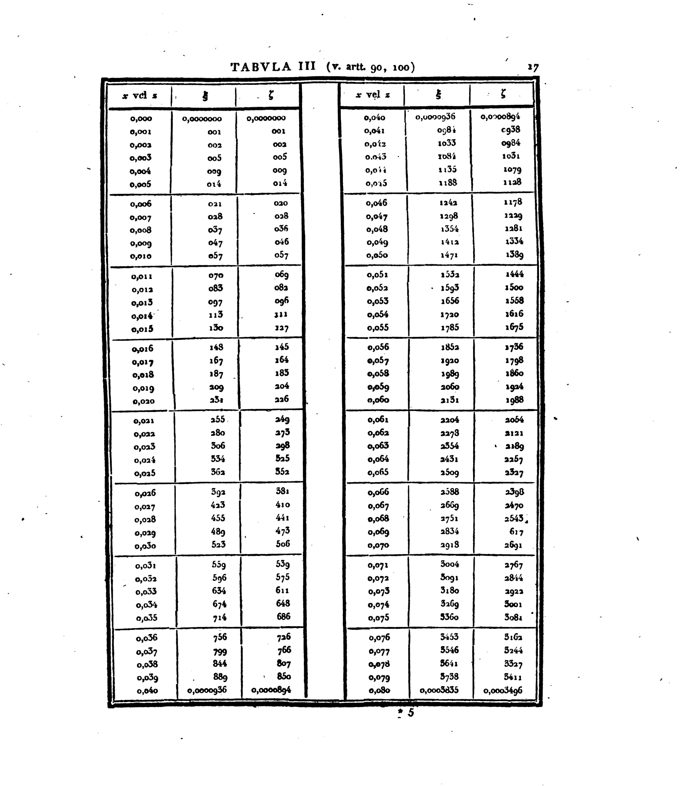

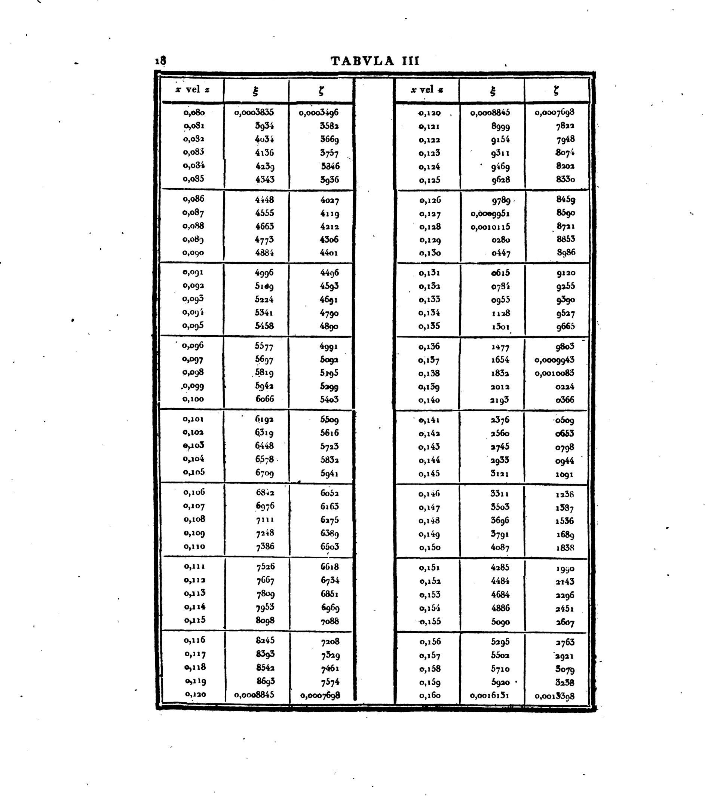

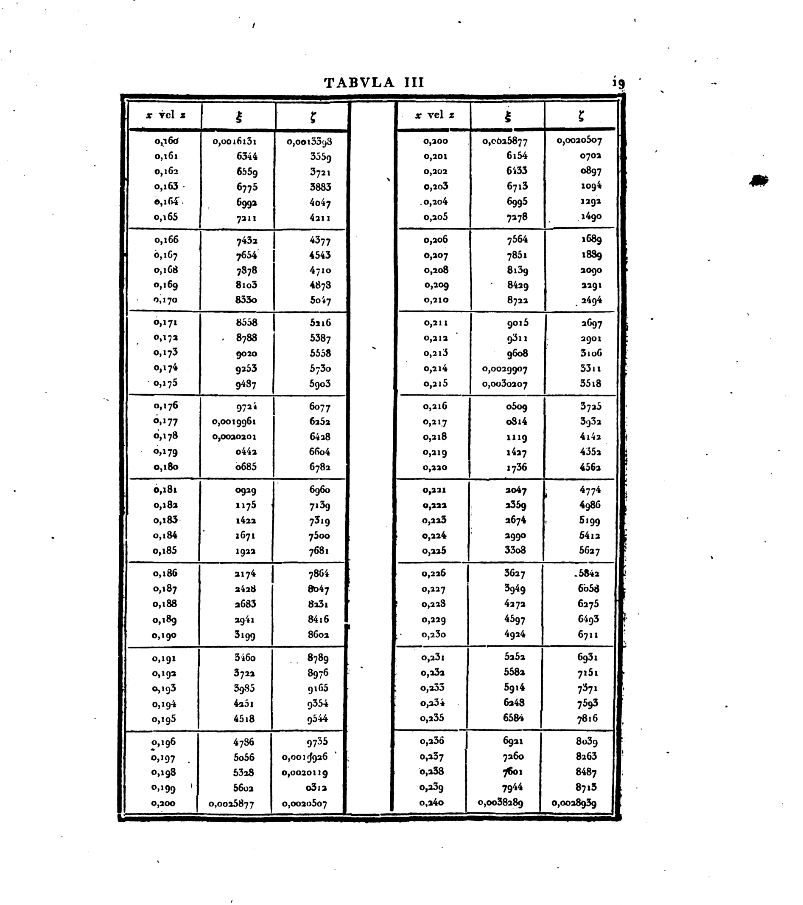

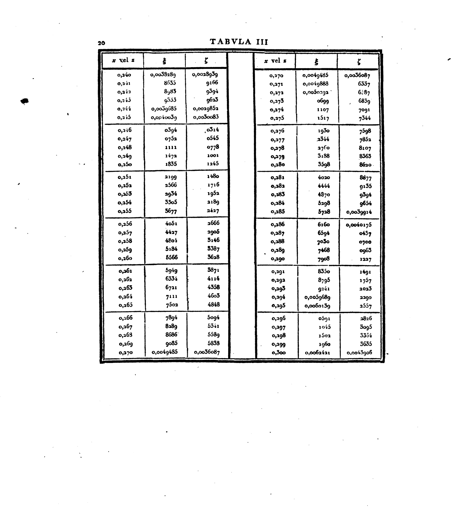

Những chỉ dẫn này áp dụng cho trường hợp thứ nhất, khi \(\cos f\) dương; còn trong trường hợp thứ hai, khi nó âm, ta đặt \(\sqrt{L-x}=\frac{M}{Y}\), và

$$
\text{[14*]}\quad \frac{MM}{L-\frac27-\xi}=H,
$$

từ đó phương trình 12*, rút gọn đúng đắn, trở thành

$$
\text{[15*]}\quad H=\frac{(Y+1)YY}{Y-\frac27}.
$$

Bởi vậy, từ \(H\) có thể xác định \(Y\) bằng phương trình bậc ba ấy, rồi \(x\) lại được suy ra theo phương trình

$$
\text{[16*]}\quad x=L-\frac{MM}{YY}.
$$

Trong lần xấp xỉ thứ nhất, ta lấy \(\frac{MM}{L-\frac27}\) làm giá trị của \(H\); từ giá trị của \(x\) suy ra ở đó, theo các phương trình 15*, 16*, ta lấy \(\xi\) từ bảng III; rồi nhờ vậy, theo công thức 14*, ta thu được giá trị đúng của \(H\), và phép tính cũng được lặp lại theo cùng cách ấy. Cuối cùng, từ \(x\), góc \(g\) cũng được xác định theo cùng cách như trong trường hợp thứ nhất.

## §92

Dù các phương trình 15, 15* trong một số trường hợp có thể có ba nghiệm thực, nhưng sự nhập nhằng ấy sẽ không bao giờ xảy ra, vì trong bài toán của ta, ta phải chọn lời giải. Vì \(h\) rõ ràng là một đại lượng dương, từ lý thuyết các phương trình dễ dàng kết luận rằng phương trình 15 có duy nhất một nghiệm dương, hoặc kèm hai nghiệm ảo, hoặc kèm hai nghiệm âm: vì khi \(y=\frac{m}{\sqrt{l+x}}\) thì cần phải là một đại lượng dương, và ở đây không còn gì phải ngần ngại nữa.

Còn với phương trình 15*, trước hết ta nhận xét \(L\) tất yếu phải lớn hơn 1. Điều này dễ thấy, nếu ta đặt phương trình đã dẫn ở art. 89 dưới dạng

$$
L = 1 + \frac{\cos\tfrac12 f^2}{-\cos f} + \frac{\operatorname{tang}\,2\omega^2}{-\cos f}.
$$

Thế \(M\) trong phương trình 12* bằng \(Y\sqrt{L-x}\), ta được \(Y+1=(L-x)X\), nên

$$
Y+1 > (1-x)X > \frac47 + \frac{4}{3\cdot5}x + \frac{4\cdot6}{5\cdot5\cdot7}xx + \frac{4\cdot6\cdot8}{5\cdot5\cdot7\cdot9}x^3 + \text{etc.} > \frac47,
$$

và thế \(Y > \frac37\). Đặt \(Y=\frac47+Y'\), ta chắc chắn \(Y'\) là một đại lượng dương, còn phương trình 15* thì sang dạng

$$
Y'^3 + 2Y'Y' + (1-H)Y' + \frac47 - \frac23 H = 0.
$$

Theo lý thuyết các phương trình, dễ dàng chứng minh phương trình bậc ba này không thể có nhiều nghiệm dương. Từ đó, phương trình 15* có duy nhất một nghiệm lớn hơn \(\frac47\) [^3], và nghiệm ấy, bỏ qua các nghiệm còn lại, chính là nghiệm ta nên dùng trong bài toán của mình.

[^3]: Vì ta giả thiết rằng bài toán quả thực giải được.

## §93

Để lời giải của phương trình 15 thuận tiện trong những trường hợp hay gặp nhất khi thực hành, ta thêm vào cuối sách này một bảng riêng, bảng II. Với các giá trị của chính \(h\) từ 0 cho tới \(0,6\), bảng cho các logarithm ứng với \(yy\), tính đến bảy chữ số thập phân, được lập ra hết sức cẩn thận. Biến số \(h\) từ 0 cho tới \(0,04\) tiến mỗi bước một phần mười nghìn, nhờ đó các sai khác bậc hai của chính \(\log yy\) trở nên không đáng kể, nên ở phần bảng này thì nội suy đơn giản là đủ.

<!-- Bản in ở PDF 117 đọc: "Quoniam vero tabula, si vbiis eadem extensione gauderet"; "vbiis" không có nghĩa, nhiều khả năng là lỗi in thay cho "amplior". -->

Nhưng nếu bảng ấy cũng trải dài tới tận cuối với bước như vậy, nó sẽ rất cổm kênh; vì thế từ \(h=0,04\) trở đi, mỗi bước chỉ tiến một phần nghìn, và ở phần sau ấy phải tính đến các sai khác bậc hai, bởi ta muốn tránh sai số tới vài đơn vị ở chữ số thứ bảy. Dù vậy, trong thực hành thì các giá trị nhỏ hơn của chính \(h\) được dùng thường xuyên hơn nhiều.

**Bảng II** cho \(\log yy\) theo \(h\) từ \(0\) tới \(0,6\). Bảng nằm ở cuối sách, trên tám trang in mang số 9–16 (PDF 256–263), mỗi trang ba khối cột \(h \mid \log yy\).

<!-- Ảnh bảng chụp từ scan, cần đối chiếu với bản in và chú thích lại trước khi coi là hoàn tất. -->

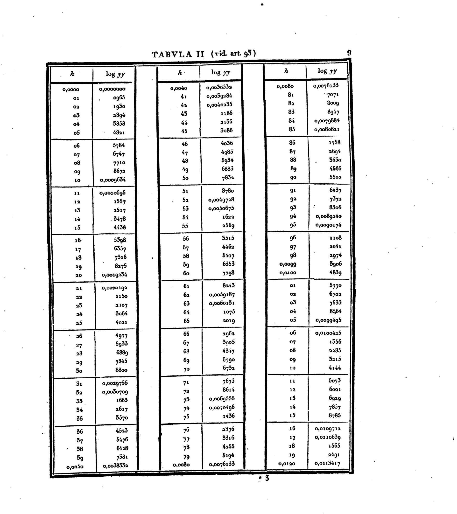

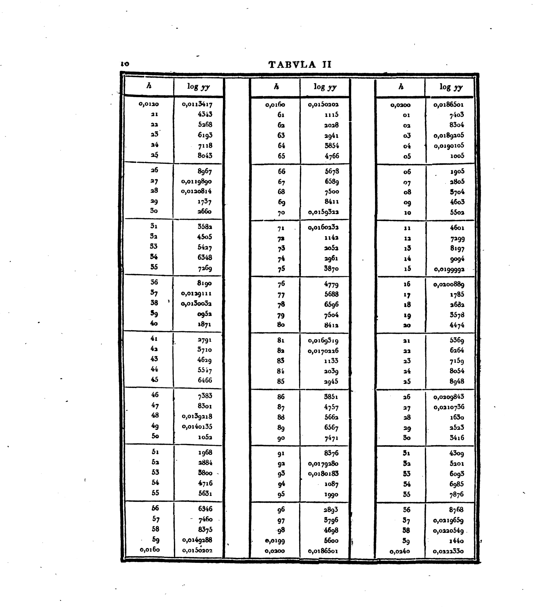

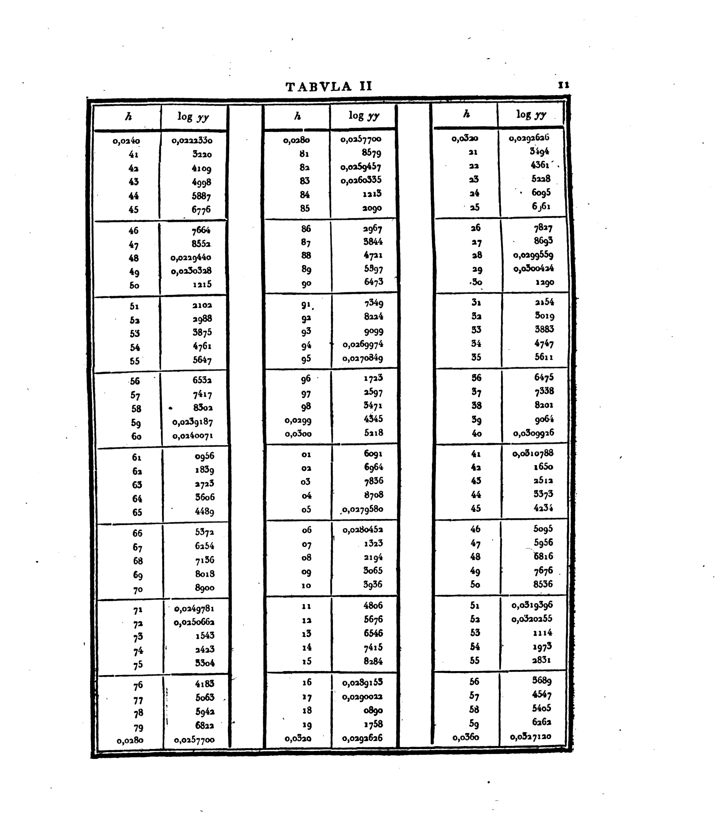

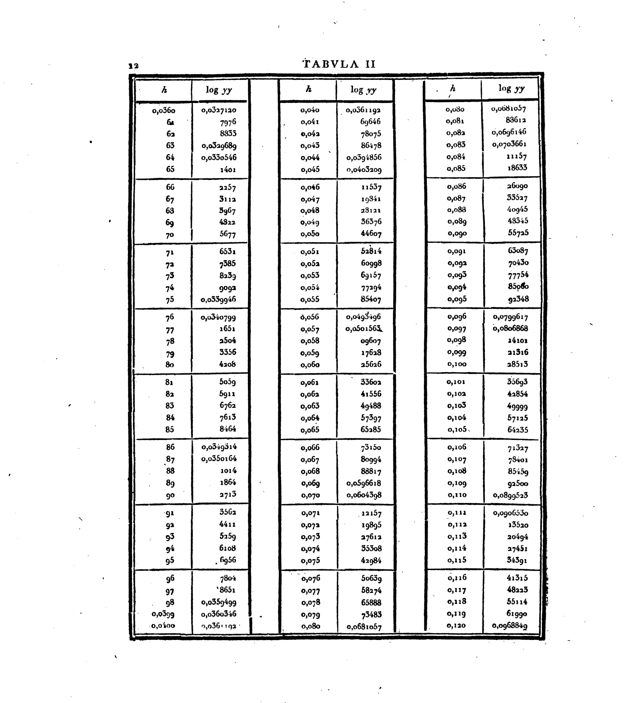

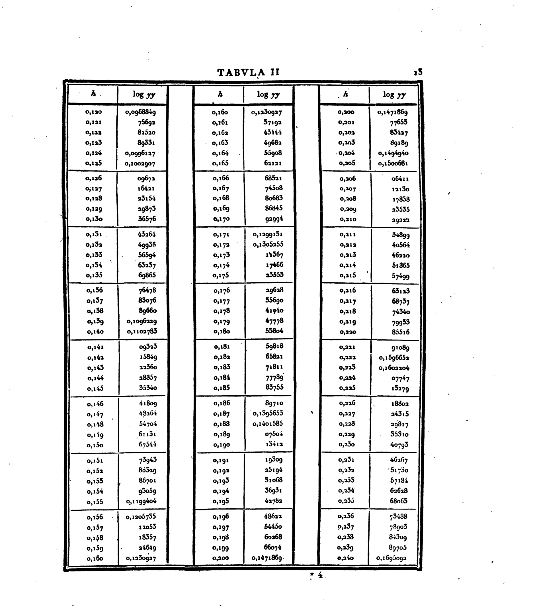

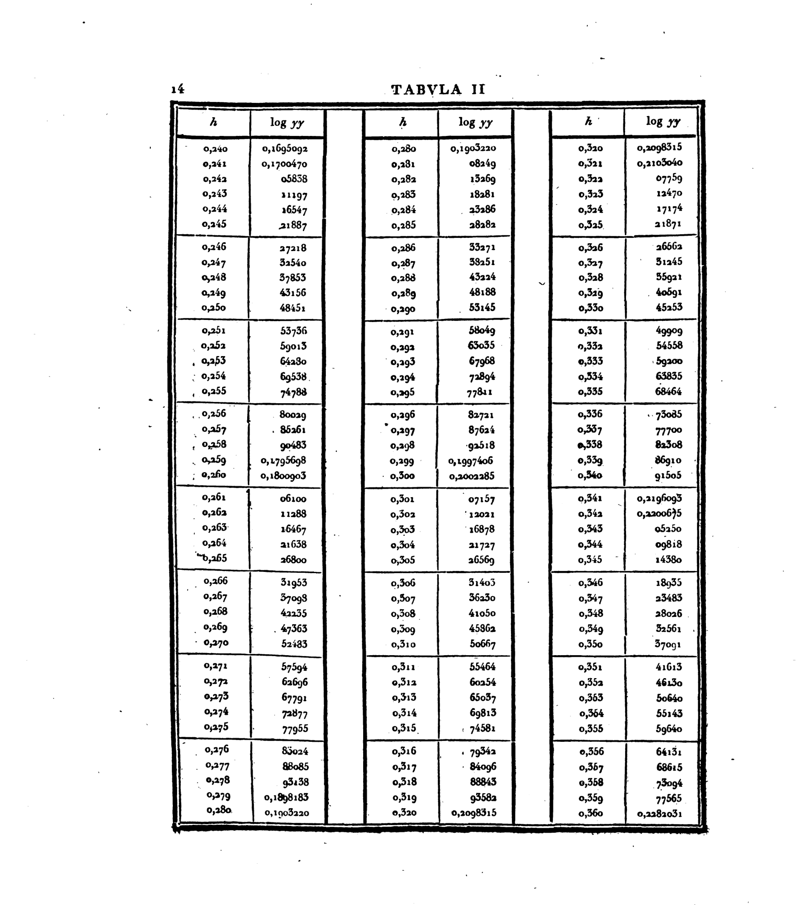

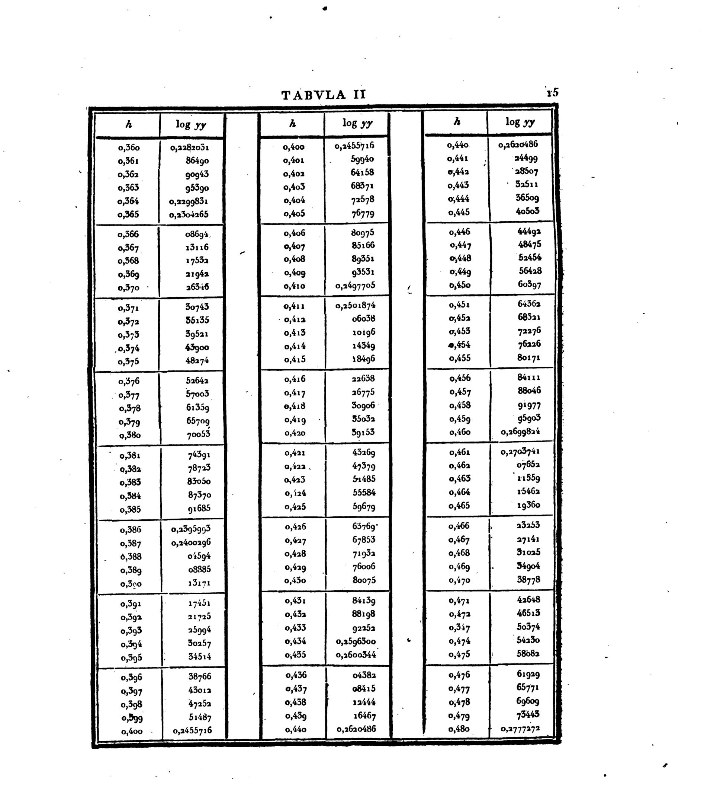

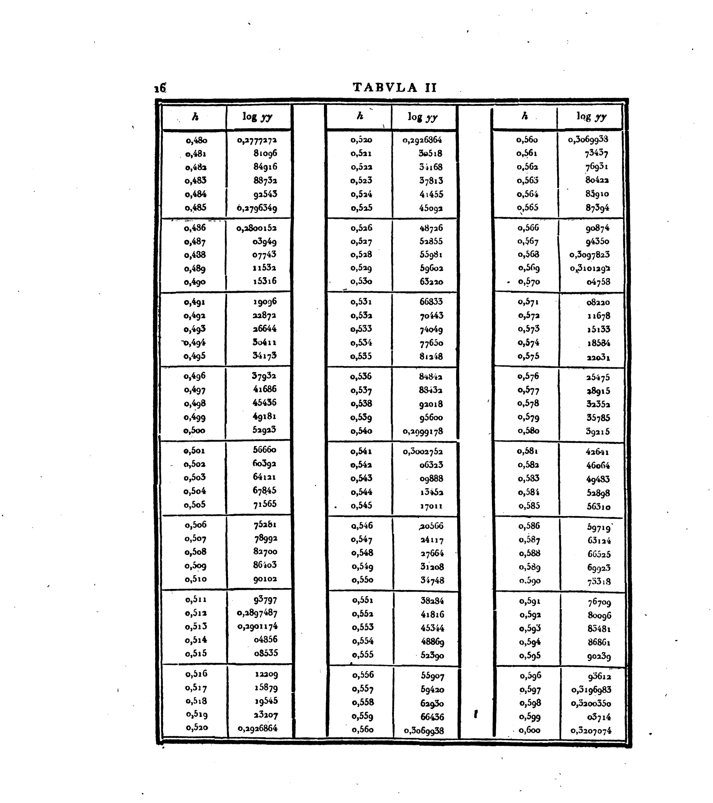

Lời giải của phương trình 15, mỗi khi \(h\) vượt ra ngoài giới hạn của bảng, cũng như lời giải của phương trình 15*, đều có thể hoàn thành dễ dàng bằng phương pháp gián tiếp, hay bằng những phương pháp khác đã biết khá rõ. Cũng không vô ích gì khi nhắc rằng một giá trị nhỏ của chính \(g\) không thể đi cùng với giá trị âm của chính \(\cos f\), trừ khi quỹ đạo rất lệch tâm; điều này sẽ tự hiện ra từ phương trình 20 ở dưới, trong art. 95, như đã dẫn [^4].

[^4]: Phương trình này chỉ ra rằng nếu \(\cos f\) âm thì \(\varphi\) chắc chắn phải lớn hơn \(90^\circ - g\).

<!-- Bản in ở PDF 118 viết "aequationis 15" (không sao) ở câu trước, rồi "aequationis 15*" (có sao) ở câu kế. Giữ nguyên cả hai. -->

## §94

Cách trình bày phương trình 12, 12* trong art. 91, 92, 93 dựa trên giả thiết rằng góc \(g\) không quá lớn, dưới đúng giới hạn \(66^\circ 25'\); vượt quá giới hạn ấy, ta không mở rộng bảng III. Mỗi khi giả thiết này không còn đúng, các phương trình ấy cũng chẳng cần đến thủ thuật tinh vi: chúng vẫn được giải an toàn, và giải thuận tiện, bằng phép thử.

Quả thể an toàn, bởi vì giá trị của biểu thức \(\frac{2g-\sin 2g}{\sin g^3}\), trong đó \(2g\) dễ thấy là phải hiểu theo phần của bán kính, với các giá trị lớn hơn của chính \(g\) thì tính được với mọi độ chính xác nhờ bảng lượng trình; chức khi \(g\) là một góc nhỏ thì điều ấy chắc chắn không thành. Các điểm quang tâm cách nhau một khoảng lớn như vậy hầu như không bao giờ dùng đến cho việc xác định một quỹ đạo mà vẫn còn hoàn toàn chưa biết, và từ hiểu biết quỹ đạo dù chỉ ở mức nào, một giá trị xấp xỉ của chính \(g\) cũng gần như không mất công nào mà suy ra được theo phương trình 1 hay 3 ở art. 89. Từ giá trị xấp xỉ ấy, giá trị đúng của \(g\), thỏa mãn phương trình 12 hay 12* với mọi độ chính xác cần thiết, sẽ rút ra sau chỉ ít lần thử.

Dù vậy, mỗi khi có hai điểm quang tâm ứng với một lần giải đầy đủ, cần nhớ rằng từ dị thác sẽ có cũng bấy nhiêu lần giải đầy đủ và tuyệt đối. Do đó các góc \(E'-E\), \(\nu'-\nu\) hoặc cả hai cùng nằm giữa \(0\) và \(360^\circ\), hoặc cả hai cùng nằm giữa những phần gần bằng nhau của toàn bộ chu vi; và thế \(f\) cùng \(g\) hoặc cùng lúc nằm giữa \(0\) và \(180^\circ\), hoặc cùng nằm giữa những phần gần bằng nhau của nửa chu vi. Nếu quỹ đạo hoàn toàn chưa biết, ta cũng không biết thiên thể, khi đi từ vectơ bán kính thứ nhất sang vectơ thứ hai, đã mô tả chỉ một phần của lần giải, hay ngoài ra còn thêm một hay nhiều lần giải đầy đủ nữa; bài toán của ta khi ấy đôi khi sẽ chấp nhận nhiều lời giải khác nhau. Ta không dừng lại ở trường hợp ấy, vì trong thực hành nó hầu như không bao giờ xảy ra.

## §95

Sang việc thứ hai, tức là xác định các thành phần từ góc \(g\) đã biết. Bán trục lớn có ngay ở đây theo các công thức 10, 10*, và cũng có thể dùng hai công thức sau:

$$
\text{[17]}\quad a = \frac{2mm\cos f\sqrt{rr'}}{yy\sin g^2} = \frac{kk\,tt}{4yy\,rr'\cos f^2\sin g^2}
$$

$$
\text{[17*]}\quad a = \frac{-2MM\cos f\sqrt{rr'}}{YY\sin g^2} = \frac{kk\,tt}{4YY\,rr'\cos f^2\sin g^2}
$$

<!-- Bản in viết "kk tt" ngang hàng nhau, không có chỉ số trên. Chưa rõ đó là k²t² hay ký hiệu riêng; giữ đúng như in và cần đối chiếu lại. -->

Bán trục nhỏ \(b=\sqrt{ap}\) có được theo phương trình 1, khi kết hợp với những phương trình trước thì ra

$$
\text{[18]}\quad p = \left(\frac{yrr'\sin 2f}{kt}\right)^{2}
$$

$$
\text{[18*]}\quad p = \left(\frac{Yrr'\sin 2f}{kt}\right)^{3}
$$

Hình quạt elliptic giữa hai vectơ bán kính và cung elliptic thì có diện tích bằng \(\frac12 kt\sqrt{p}\), còn tam giác giữa chính hai vectơ bán kính ấy và dây cung thì bằng \(\frac12 rr'\sin 2f\); do đó tỷ số diện tích hình quạt trên tam giác là \(y:1\) hoặc \(Y:1\).

Đây là nhận xét quan trọng nhất, và nó minh họa các phương trình 12, 12* một cách rất đẹp: từ đây thấy rõ rằng trong phương trình 12, các thành phần \(m\), \((l+x)^{\frac12}\), \(X(l+x)^{\frac32}\), còn trong phương trình 12* thì các thành phần \(M\), \((L-x)^{\frac12}\), \(X(L-x)^{\frac32}\), lần lượt tỷ lệ với diện tích hình quạt giữa hai vectơ bán kính và cung elliptic, với diện tích tam giác (giữa hai vectơ bán kính và dây cung), và với diện tích đoạn cung (giữa cung và dây cung). Lý do là rõ ràng: diện tích thứ nhất bằng hoặc tổng hoặc hiệu của hai diện tích còn lại, tuỳ \(\nu'-\nu\) nằm giữa \(0\) và \(180^\circ\) hay giữa \(180^\circ\) và \(360^\circ\). Trong trường hợp \(\nu'-\nu\) lớn hơn \(360^\circ\), diện tích hình quạt cũng như diện tích đoạn cung phải được hiểu là cộng thêm diện tích nguyên ellipse, số lần bằng số vòng quay tròn mà chuyển động ấy chứa.

Vì \(b=a\cos\varphi\), nên từ việc kết hợp các phương trình 1, 10, 10* ta có tiếp

$$
\text{[19]}\quad \cos\varphi = \frac{\sin g\,\operatorname{tang} f}{2\left(l+\sin\tfrac12 g^{2}\right)}
$$

$$
\text{[19*]}\quad \cos\varphi = \frac{-\sin g\,\operatorname{tang} f}{2\left(L-\sin\tfrac12 g^{2}\right)}
$$

từ đó, thay \(l\), \(L\) bằng các giá trị của chúng ở art. 89, ta được

$$
\text{[20]}\quad \cos\varphi = \frac{\sin f\sin g}{1-\cos f\cos g + 2\operatorname{tang}\tfrac12\omega^{2}}
$$

Công thức này không thích hợp để tính độ lệch tâm một cách chính xác khi độ lệch tâm ấy còn nhỏ; nhưng từ đó dễ dàng suy ra một công thức thích hợp hơn

$$
\text{[21]}\quad \operatorname{tang}\tfrac12\varphi^{2} = \frac{\sin\tfrac12(f-g)^{2}+\operatorname{tang}\,2\omega^{2}}{\sin\tfrac12(f+g)^{2}+\operatorname{tang}\,2\omega^{2}}
$$

mà cũng có thể cho nó dạng sau (nhân tử số và mẫu số với \(\cos\omega^{2}\))

$$
\text{[22]}\quad \operatorname{tang}\tfrac12\varphi^{2} = \frac{\sin\tfrac12(f-g)^{2}+\cos\tfrac12(f-g)^{2}\sin 2\omega^{2}}{\sin\tfrac12(f+g)^{2}+\cos\tfrac12(f-g)^{2}\sin 2\omega^{2}}
$$

<!-- Ghi chú về [22]: số hạng thứ hai ở mẫu số được in là cos ½(f−g)², giống hệt số hạng thứ hai ở tử số, trong khi số hạng thứ nhất ở mẫu số lại là sin ½(f+g)². Thêm nữa, phép nhân mà văn bản nêu (với cos ω²) không cho ra [22] như in. Giữ nguyên theo bản in và cần đối chiếu lại.

Ghi chú về chỗ số mũ: trong [19]–[22] bản in viết "tang ½ φ²" và "tang ½ ω²"; cách đặt số mũ ½ và ² không rõ là \(\operatorname{tang}\tfrac12\varphi^{2}\) hay \((\operatorname{tang}\tfrac12\varphi)^{2}\). Đã giữ đúng cách viết của bản in. -->

Qua cả hai công thức trên (nếu thích, dùng các góc phụ mà tangents của chúng là \(\frac{\operatorname{tang}2\omega}{\sin\tfrac12(f-g)}\), \(\frac{\operatorname{tang}2\omega}{\sin\tfrac12(f+g)}\) cho trường hợp trước, hoặc \(\frac{\sin 2\omega}{\operatorname{tang}\tfrac12(f-g)}\), \(\frac{\sin 2\omega}{\operatorname{tang}\tfrac12(f+g)}\) cho trường hợp sau) thì góc \(\varphi\) luôn có thể được xác định với mọi độ chính xác.

Để xác định góc \(G\), có thể dùng công thức sau, vốn dĩ nhiên bộc lộ ra từ việc kết hợp các phương trình 5, 7 và phương trình kế tiếp không đánh số:

$$
\text{[23]}\quad \operatorname{tang}G = \frac{(r'-r)\sin g}{(r'+r)\cos g - 2\cos f\sqrt{rr'}}
$$

từ đó, đưa \(\omega\) vào, ta dễ dàng suy ra

$$
\text{[24]}\quad \operatorname{tang}G = \frac{\sin g\sin 2\omega}{\cos 2\omega^{2}\sin\tfrac12(f-g)\sin\tfrac12(f+g) + \sin 2\omega^{2}\cos g}
$$

Sự nhập nhằng còn lại ở đây dễ dàng được gỡ bỏ nhờ phương trình 7, vì nó dạy rằng \(G\) phải lấy giữa \(0\) và \(180^\circ\), hay giữa \(180^\circ\) và \(360^\circ\), tuỳ tử số trong hai công thức này là dương hay âm.

Kết hợp phương trình 3 với các phương trình vừa rồi, vốn dĩ nhiên suy ra ngay từ phương trình II ở art. 8:

$$
\frac{1}{r} - \frac{1}{r'} = \frac{2e}{p}\sin f\sin F
$$

$$
\frac{1}{r} + \frac{1}{r'} = \frac{2}{p} + \frac{2e}{p}\cos f\cos F
$$

mà không tốn công gì, ta suy ra

$$
\text{[25]}\quad \operatorname{tang}F = \frac{(r'-r)\sin f}{2\cos g\sqrt{rr'} - (r'+r)\cos f}
$$

từ đó, đưa góc \(\omega\) vào, ta được

$$
\text{[26]}\quad \operatorname{tang}F = \frac{\sin f\sin 2\omega}{\cos 2\omega^{2}\sin\tfrac12(f-g)\sin\tfrac12(f+g) - \sin 2\omega^{2}\cos f}
$$

Sự nhập nhằng ở đây cũng được gỡ bỏ y như trên. Khi các góc \(F\) và \(G\) đã tìm ra, ta có \(\nu = F - f\), \(\nu' = F + f\), và nhờ đó vị trí điểm gần nhất sẽ biết; cũng không khác gì, \(E = G - g\), \(E' = G + g\). Cuối cùng, chuyển động trung bình trong khoảng thời gian \(t\) sẽ là

$$
= \frac{kt}{a^{\frac32}} = 2g - 2e\cos G\sin g,
$$

trong đó sự nhất trí giữa hai biểu thức ấy sẽ được kiểm tra bằng phép tính. Còn thời điểm ứng với dị thác trung bình, tức là giữa hai thời điểm đã chọn, sẽ là

$$
G - e\sin G\cos g,
$$

và theo ý muốn thì có thể chuyển nó sang bất kỳ thời điểm nào khác. Còn thuận tiện hơn nữa là, dị thác trung bình ứng với hai thời điểm

<!-- Ghi chú: trong [24] và [26] bản in viết "cos 2 ω²" và "sin 2 ω²"; cách đặt số mũ 2 ở đây cũng không rõ là \(\sin(2\omega^2)\) hay \(\sin 2\omega\) rồi bình phương. Đã giữ đúng như in. Lưu ý thêm mẫu số của [24] kết thúc bằng \(+\sin 2\omega^{2}\cos g\), còn của [26] là \(-\sin 2\omega^{2}\cos f\): dấu và hàm lượng giác khác nhau, giữ nguyên theo bản in. -->

và theo ý muốn thì có thể chuyển nó sang bất kỳ thời điểm nào khác. Còn thuận tiện hơn nữa là, tính dị thác trung bình ứng với hai thời điểm đã cho bằng các công thức \(E-e\sin E\), \(E'-e\sin E'\), rồi so hiệu của chúng với \(\frac{kt}{a^{\frac32}}\) để kiểm chứng phép tính.

## §96

Các phương trình dẫn ở bài trước quả thật có sự chặt chẽ đến mức không còn gì đáng mong muốn thêm. Tuy vậy, vẫn có thể rút ra một vài công thức khác, nhờ đó các thành phần quỹ đạo được xác định càng khéo léo và thuận tiện hơn nữa; chỉ có điều là sự triển khai những công thức ấy hơi khuất hơn một chút.

Ta chép lại từ art. 8 các phương trình sau, đánh số lại cho tiện:

$$
\text{I.}\quad \sin\tfrac12\nu\sqrt{\frac{r}{a}} = \sin\tfrac12 E\sqrt{1+e}
$$

$$
\text{II.}\quad \cos\tfrac12\nu\sqrt{\frac{r}{a}} = \cos\tfrac12 E\sqrt{1-e}
$$

$$
\text{III.}\quad \sin\tfrac12\nu'\sqrt{\frac{r'}{a}} = \sin\tfrac12 E'\sqrt{1+e}
$$

$$
\text{IV.}\quad \cos\tfrac12\nu'\sqrt{\frac{r'}{a}} = \cos\tfrac12 E'\sqrt{1-e}
$$

Nhân I với \(\sin\tfrac12(F+g)\), II với \(\cos\tfrac12(F+g)\), rồi cộng các tích ấy lại, ta được

$$
\cos\tfrac12(f+g)\sqrt{\frac{r}{a}} = \sin\tfrac12 E\sin\tfrac12(F+g)\sqrt{1+e} + \cos\tfrac12 E\cos\tfrac12(F+g)\sqrt{1-e}
$$

hay, vì \(\sqrt{1+e} = \cos\tfrac12\varphi + \sin\tfrac12\varphi\), \(\sqrt{1-e} = \cos\tfrac12\varphi - \sin\tfrac12\varphi\),

$$
\cos\tfrac12(f+g)\sqrt{\frac{r}{a}} = \cos\tfrac12\varphi\cos\left(\tfrac12 F - \tfrac12 G + g\right) - \sin\tfrac12\varphi\cos\tfrac12(F+G)
$$

Tương tự hệt, nhân III với \(\sin\tfrac12(F-g)\), IV với \(\cos\tfrac12(F-g)\), rồi cộng các tích ấy lại, ta được

$$
\cos\tfrac12(f+g)\sqrt{\frac{r'}{a}} = \cos\tfrac12\varphi\cos\left(\tfrac12 F - \tfrac12 G - g\right) - \sin\tfrac12\varphi\cos\tfrac12(F+G)
$$

Trừ phương trình trước khỏi phương trình này, ta được

$$
\cos\tfrac12(f+g)\left(\sqrt{\frac{r'}{a}} - \sqrt{\frac{r}{a}}\right) = 2\cos\tfrac12\varphi\sin g\sin\tfrac12(F-G)
$$

hay, đưa góc phụ \(\omega\) vào,

$$
\text{[27]}\quad \cos\tfrac12(f+g)\operatorname{tang}2\omega = \sin\tfrac12(F-G)\cos\tfrac12\varphi\sin g\sqrt[4]{\frac{aa}{rr'}}
$$

<!-- Ghi chú: trong hai phương trình sau lần nhân với sin½(F−g) và cos½(F−g), vế trái được in là cos ½(f+g), trong khi lẽ ra phải là cos ½(f−g) cho khớp với hệ số nhân. Giữ nguyên theo bản in và cần đối chiếu lại.

Ghi chú: [27] dùng căn bậc bốn \(\sqrt[4]{aa/rr'}\), khớp với cách đặt góc phụ ở §89. -->

Qua những phép biến đổi hệt như thế, mà việc triển khai ta phó cho người đọc thành thạo, ta tìm ra

$$
\text{[28]}\quad \frac{\sin\tfrac12(f+g)}{\cos 2\omega} = \cos\tfrac12(F-G)\cos\tfrac12\varphi\sin g\sqrt[4]{\frac{aa}{rr'}}
$$

$$
\text{[29]}\quad \cos\tfrac12(f-g)\operatorname{tang}2\omega = \sin\tfrac12(F+G)\sin\tfrac12\varphi\sin g\sqrt[4]{\frac{aa}{rr'}}
$$

$$
\text{[30]}\quad \frac{\sin\tfrac12(f-g)}{\cos 2\omega} = \cos\tfrac12(F+G)\sin\tfrac12\varphi\sin g\sqrt[4]{\frac{aa}{rr'}}
$$

Vì các thành phần đầu trong bốn phương trình này là những đại lượng đã biết, nên từ 27 và 28 ta xác định được \(\tfrac12(F-G)\) và \(\cos\tfrac12\varphi\sin g\sqrt[4]{\frac{aa}{rr'}} = P\); cũng từ 29 và 30, theo cùng cách, ta xác định được \(\tfrac12(F+G)\) và \(\sin\tfrac12\varphi\sin g\sqrt[4]{\frac{aa}{rr'}} = Q\). Sự nhập nhằng trong việc xác định các góc \(\tfrac12(F-G)\), \(\tfrac12(F+G)\) phải được gỡ bỏ như sau: chọn \(P\) và \(Q\) sao cho chúng mang cùng dấu với \(\sin g\). Rồi từ \(P\) và \(Q\) ta suy ra \(\tfrac12\varphi\) và \(\sin g\sqrt[4]{\frac{aa}{rr'}} = R\). Từ \(R\) có thể suy ra

$$
a = \frac{RR\sqrt{rr'}}{\sin g^{2}},
$$

và cũng

$$
p = \frac{\sin f^{2}\sqrt{rr'}}{RR},
$$

trừ khi dùng đại lượng phải lấy là

$$
= \pm\sqrt{2\left(l+\sin\tfrac12 g^{2}\right)\cos f} = \pm\sqrt{-2\left(L-\sin\tfrac12 g^{2}\right)\cos f},
$$

mà ta vẫn muốn dùng để kiểm chứng phép tính. Trong trường hợp ấy, \(a\) và \(p\) được xác định thuận tiện nhất bằng các công thức

$$
b = \frac{\sin f\sqrt{rr'}}{\sin g},\qquad a = \frac{b}{\cos\varphi},\qquad p = b\cos\varphi
$$

<!-- Bản in viết "vnice" (chỉ một lần/duy nhất) ở chỗ "vnice ad calculi confirmationem vti malimus"; nghĩa là chỉ dùng để kiểm chứng. Giữ nguyên nghĩa. -->

Theo ý muốn, ta cũng có thể dùng nhiều phương trình ở art. 89 và art. 95 để kiểm chứng; và còn thêm những phương trình sau:

$$
\frac{2\operatorname{tang}2\omega}{\cos 2\omega}\sqrt{\frac{rr'}{aa}} = e\sin G\sin g
$$

$$
\frac{2\operatorname{tang}2\omega}{\cos 2\omega}\sqrt{\frac{pp'}{rr'}} = e\sin F\sin f
$$

$$
\frac{2\operatorname{tang}2\omega}{\cos 2\omega} = \operatorname{tang}\varphi\sin G\sin f = \operatorname{tang}\varphi\sin F\sin g
$$

Cuối cùng, chuyển động trung bình và thời điểm của dị thác trung bình cũng được tìm ra y như ở bài trước.

## §97

Để minh họa phương pháp đã trình bày từ art. 88, ta chép lại hai ví dụ ở art. 87: ý nghĩa của góc phụ \(\omega\) mà cho tới giờ ta đã quan sát thấy,<!-- PDF 123 -->

<!-- Ghi chú: dòng "½(F+G) = ..." trong bản in không có dấu độ, phút, giây, và các chữ số đọc được là 5, 19, 21, 58, 05. Giá trị này không khớp với F = 314°42′56.51″ và ½(F−G) = −4°58′41.54″ đã in ngay cạnh, vì hai số ấy cần ½(F+G) = 319°41′38.05″. Đã giữ nguyên theo bản in và cần đối chiếu lại.

Ghi chú: chữ "n" đi sau một số trong bảng là dấu của việc lấy giá trị ấy từ bảng logarithm. -->

chưa phải là đủ để phân biệt với trường hợp mà ở đó cùng một dấu đã được thừa nhận ở art. 87, 88, thì hầu như không cần phải nói thêm.

**I.** Trong ví dụ thứ nhất ta có \(f = 3^\circ47'26''865\), rồi \(\log\frac{r'}{r} = 9{,}9914599\), \(\log\operatorname{tang}(45^\circ + \omega) = 9{,}997864975\), \(\omega = -8'27''006\). Nhờ đó, theo art. 89,

$$
\begin{array}{lrllr}
\log\sin\tfrac12 f^{2} & 7{,}0389972 & & \log\operatorname{tang}2\omega^{2} & 5{,}3832428 \\
\log\cos f & 9{,}9990488 & & \log\cos f & 9{,}9990488 \\
& 7{,}0399484 & & & 5{,}3841940
\end{array}
$$

$$
7{,}0399484 = \log 0{,}0010963480,
\qquad
5{,}3841940 = \log 0{,}0000242211
$$

nên \(l = 0{,}0011205691\), và \(\frac{2}{7} + l = 0{,}8344539\). Ta lại có \(\log kt = 9{,}5766974\), và

$$
\begin{array}{lr}
2\log kt & 9{,}1533948 \\
\text{C.}\tfrac12\log rr' & 9{,}0205181 \\
\text{C.}\log 8\cos f^{3} & 9{,}0997636 \\
\log mm & 7{,}2756765 \\
\log\tfrac{2}{7} + l & 9{,}9214023 \\
& 7{,}5522742
\end{array}
$$

Vậy giá trị xấp xỉ của \(h\) là \(0{,}00225047\), ứng với nó trong bảng II của ta có \(\log yy = 0{,}00216533\). Do đó

$$
\log\frac{mm}{yy} = 7{,}2715132,
\qquad\text{hay}\qquad
\frac{mm}{yy} = 0{,}001868387,
$$

từ đó, theo phương trình 16, ta được \(x = 0{,}0007480179\). Vì \(\xi\) lấy từ bảng III hoàn toàn không đáng kể, nên các giá trị tìm được cho \(h\), \(y\), \(x\) không cần sửa. Còn việc xác định các thành phần thì diễn ra như sau:

$$
\log x \ldots\ldots 6{,}8739120
$$

$$
\log\sin\tfrac12 g \ldots 8{,}4369560,
\qquad
\tfrac12 g = 1^\circ34'2''0286,
\qquad
\tfrac12(f+g) = 3^\circ27'45''4611,
\qquad
\tfrac12(f-g) = 19'41''4039
$$

Theo đúng thể lệ của các phương trình 27, 28, 29, 30, ta có

$$
\begin{array}{lrllr}
\log\operatorname{tang}2\omega & 7{,}6916214\,n & & \text{C.}\log\cos 2\omega & 0{,}0000052 \\
\log\cos\tfrac12(f+g) & 9{,}9992065 & & \log\sin\tfrac12(f+g) & 8{,}7810188 \\
\log\cos\tfrac12(f-g) & 9{,}9999929 & & \log\sin\tfrac12(f-g) & 7{,}7579709 \\
\log P\sin\tfrac12(F-G) & 7{,}6908279\,n & & \log Q\sin\tfrac12(F+G) & 7{,}6916143\,n \\
\log P\cos\tfrac12(F-G) & 8{,}7810240 & & \log Q\cos\tfrac12(F+G) & 7{,}7579761 \\
\end{array}
$$

$$
\begin{array}{lrllr}
\tfrac12(F-G) = -4^\circ58'41''54 & & & \log P = \log R\cos\tfrac12\varphi \ldots\ldots & 8{,}7884527 \\
\tfrac12(F+G) = 5\ 19\ 21\ 58\ 05 & & & \log Q = \log R\sin\tfrac12\varphi \ldots\ldots & 7{,}8778355 \\
F = 314\ 42\ 56{,}51 & & & \text{suy ra } \tfrac12\varphi = 7^\circ6'0''955 \\
\nu = 310\ 55\ 29{,}64 & & & \varphi = 14\ 12\ 1{,}87 \\
\nu' = 318\ 30\ 23{,}37 & & & \log R \ldots\ldots\ldots\ldots & 8{,}7857960
\end{array}
$$

<!-- Phần tiếp theo của §97 bắt đầu từ PDF 124. -->
