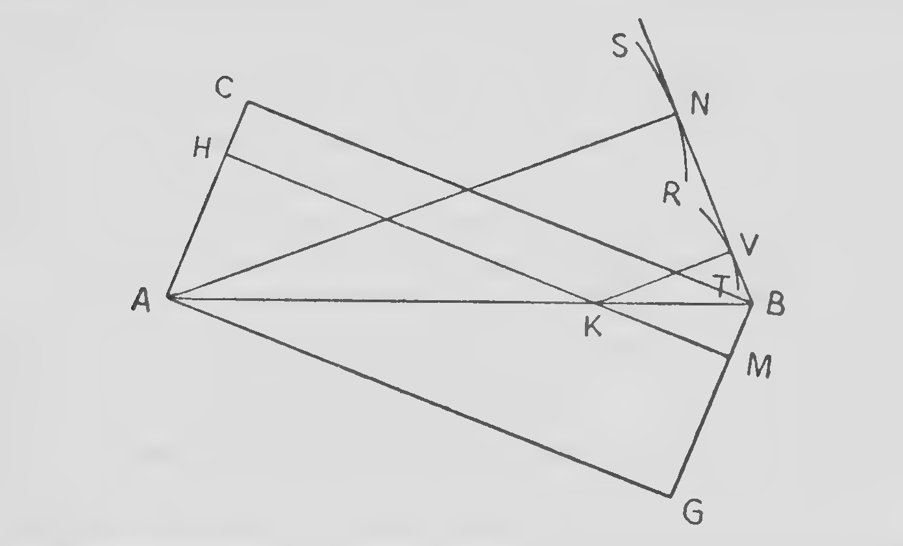
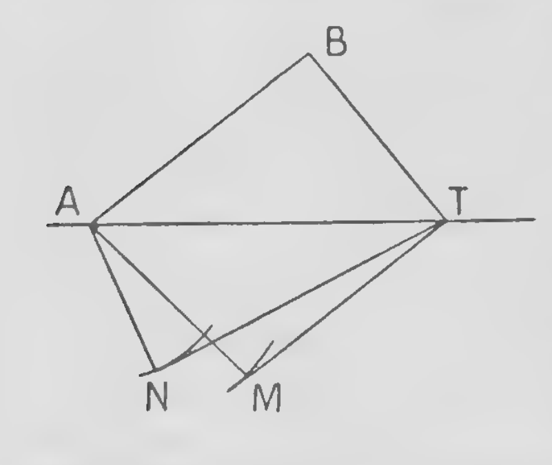

<!-- PDF 17 · trang in 1 -->

Khoa học sớm nhất, khoa học của người Hy Lạp cổ đại, đã bắt nguồn từ những suy tư của các triết gia về bản chất của cái là và cái trở thành. Khoa học hiện đại cũng thoạt đầu gắn bó chặt chẽ với triết học, và một lịch sử về những khởi đầu của nó phải mở đầu bằng vài nét về tình hình triết học vào cuối thời Trung Cổ.

Như Aristotle đã chỉ ra,[^p17n1] về căn bản có hai loại triết học, tuỳ theo việc tiếp cận các vấn đề triết học được thực hiện theo lối lập luận (λογικῶς) hay theo lối "tự nhiên" (φυσικῶς). Loại thứ nhất thuộc về tất cả những triết gia đã suy tư theo lối hoành tráng, từ Plato tới Hegel; loại thứ hai thuộc về Democritus, chính Aristotle, và phần lớn các nhà khoa học hiện đại đã viết về các môn khoa triết.

Những triết gia thuộc loại thứ nhất đã sản sinh ra các hệ thống, dù độc lập với kinh nghiệm ở mức độ nào, và các hệ thống ấy đòi hỏi bao trùm toàn bộ cái là trong khung của chúng; những người thuộc loại thứ hai thì tiến hành thận trọng hơn — các khái niệm nền tảng của họ là do hệ thống hoá kinh nghiệm của họ về thế giới bên ngoài mà có. Nói cách khác, họ tiến tới triết học chung của mình bằng cách mở rộng phân tích khái niệm của khoa học tự nhiên (điều này đúng với Aristotle thì rõ ràng khi so *Metaphysica* của ông với *Physica* của ông). Dĩ nhiên phương pháp như vậy hàm ý nguyên lý rằng chân lý triết học chỉ đạt được dần dần, và rằng không hệ thống bao trùm nào thuộc loại thứ nhất có khả năng là đúng.

Kế hoạch dựng nên một triết học của Aristotle, do đó, là kế hoạch mà một nhà khoa học hiện đại sẽ hoàn toàn tán thành. Nhưng tiếc thay, những khái niệm vũ trụ luận và vật lí mà ông khởi đầu đều hoàn toàn sai. Ông tin rằng có một khác biệt về bản chất, mang tính tuyệt đối, giữa các thiên thể một mặt và các vật thể trần gian mặt khác: những thiên thể bất biến, không pha trộn, và vĩnh cửu, chuyển động trên những đường tròn, còn những vật thể trần gian thì có thể hư hoại, là tổng hợp, nhất thời, và về bản chất chúng chuyển động theo những đường thẳng. Trái Đất đứng yên, còn các ngôi sao bị mang tròn trên những quả cầu thiên thể, mà chuyển động của chúng do các trí tuệ phi vật chất

<!-- PDF 18 · trang in 2 -->

chỉ huy. Từ ông dùng cho "vật chất" (ὕλη) không hàm ý vật chất theo nghĩa của chúng ta, mà chỉ một thứ mà từ đó có thể tạo ra một thứ khác bằng cách áp đặt lên nó một điều kiện hay nguyên lý cấu trúc thêm, gọi là một *hình thức* (*form*). Các vật thể thông thường, ông cho là gồm bốn nguyên tố, lửa, không khí, nước, đất; nhưng ông tin rằng chúng có thể biến đổi lẫn nhau, và vì thế chỉ là những "hình thức" khác nhau gắn với một "vật chất nguyên thủy" mà bản thân nó không thể tiếp cận được bằng kinh nghiệm. Lời giải thích của ông về chuyển động của các vật thể là: "hình thức thực chất" hay "bản chất" của mỗi vật thể thúc nó tới một nơi nào đó; như vậy lửa chuyển động lên trên, còn các vật thể khác thì có xu hướng chuyển động về phía tâm Trái Đất. Thật ra, mọi sự vật đều hướng tới một "đích", hay theo thuật ngữ của Aristotle, một *nguyên nhân cuối cùng*; và "nguyên nhân cuối cùng" của một sự chuyển động trong không gian là một vị trí xác định nào đó. Có thể thêm rằng Aristotle không nghiên cứu gì theo lượng; công bằng mà nói với ông rằng ông đã khẳng định sự cần thiết của quan sát và kinh nghiệm, nhưng mệnh lệnh ấy đã bị nhiều người trong số những người theo sau ông thời về sau bỏ qua.

Một ví dụ điển hình cho triết học tự nhiên của Aristotle là cách ông diễn giải ánh sáng bằng các khái niệm siêu hình về *khả năng* (δύναμις) và *hiện thực* (ἐνέργεια hay ἐντελέχεια). Một vật thể trong suốt có "khả năng" truyền ánh sáng, nhưng nó không trở nên trong suốt thực sự cho tới khi ánh sáng đi qua nó và nhờ đó đưa sự trong suốt ấy vào hiện thực. Vì thế ánh sáng được Aristotle định nghĩa là "hành động của một vật thể trong suốt, do nó là trong suốt".

Dưới ảnh hưởng chủ yếu của Thánh Thomas Aquinas, chủ nghĩa Aristotle được nhận rộng rãi khắp châu Âu phương Tây trong thế kỷ mười ba. Như Aristotle, Thánh Thomas tuyên bố triết học của mình thuộc loại thứ hai mà chúng ta đã gọi tên. "Nguồn gốc tri thức của chúng ta," ông nói,[^p18n1] "nằm ở các giác quan, ngay cả đối với những thứ vượt quá giác quan;" và "siêu hình học đã nhận được cái tên của nó, tức là ở bên kia vật lí học, bởi vì đối với chúng ta, những người vốn dĩ nhiên đi tới tri thức về các sự vật phi vật chất bằng con đường của những sự vật có thể cảm nhận được, nó hiện ra một cách tất nhiên là đối tượng nghiên cứu sau vật lí học."[^p18n2] Siêu hình học là "phần cuối cùng của triết học phải học," bởi vì "cần phải có trước kiến thức về nhiều sự vật."[^p18n3]

Tất cả những điều ấy rất đúng đắn, nhưng không thể rút ra một siêu hình học chân thật từ vật lí học sai lệch của Aristotle. Món tai họa ấy lại càng nặng thêm vì các nhà trường đại học thời Trung Cổ, vốn xem chủ nghĩa Aristotle là một kho tàng tri thức bách khoa, không cần được bổ sung

<!-- PDF 19 · trang in 3 -->

bằng những thí nghiệm tiếp theo. Họ đã bỏ rơi quan điểm của Thánh Thomas về quan hệ giữa vật lí học và siêu hình học. "Việc suy lý trên chính những sự kiện và các luật của mình, hay là tiến hành dựng lại vũ trụ luận hay siêu hình học," họ nói, "không thuộc địa hạn của vật lí học,"[^p19n1] và "nếu một thuyết vật lí mâu thuẫn với giáo lý siêu hình đã được thừa nhận thì không thể chấp nhận được, bởi siêu hình học chứ không phải vật lí học mới là khoa học tự nhiên tối cao."[^p19n2] Họ chỉ diễn giải thế giới bên ngoài bằng cách vận dụng logic hình thức để rút ra các kết luận từ những nguyên lý mơ hồ và vô sinh, vốn thực chất chỉ là sự hóa đá của vật lí sai lệch của Aristotle: một thủ tục chỉ sinh ra chẳng ngoài ra những sophistry dài dòng.[^p19n3] Như Erasmus đã nói: "Có vô số những tinh tế điệu về các khái niệm, các quan hệ, các thời khắc, các hình thức, các quiddities và các haecceities, mà không ai có thể dòm vào, trừ khi họ có đôi mắt xuyên qua lớp tối dày nhất, và ở đó thấy được những thứ hoàn toàn không tồn tại."[^p19n4] Cho tới khi truyền thống ấy bị lật đổ, không thể có bất kỳ cách hiểu nào đúng đắn về thiên nhiên.

Vậy nên, để khoa học hiện đại ra đời, một điều kiện cần thiết là sự giải phóng khỏi triết học Tomist. Điều ấy đã xảy ra chủ yếu là kết quả của công trình của William xứ Ockham, một tu sĩ dòng Phanxit người Anh, sống trong nửa đầu thế kỷ mười bốn. Trong siêu hình học, Ockham đưa vào những nguyên lý không cần phải để ý ở đây, nhưng chúng đã làm sụp đổ chủ nghĩa Aristotle và cuối cùng dẫn tới sự bác bỏ triệt để triết học thời Trung Cổ mà người ta gắn với thời Phục hưng; và chính ông là người mở đầu động lực học lý tính, vốn sau khi ông qua đời được những người tranh thủ phát triển tiếp, và mọi tiến bộ về sau đều dựa trên đó. Những bước tiến quyết định nhất là cách hiểu mới về quan hệ giữa Trái Đất và Mặt Trời mà Copernicus đề xuất năm 1543, và thành công của Kepler, trong những năm đầu của thế kỷ kế tiếp, trong việc bác bỏ nguyên lý của Aristotle rằng các thiên thể khác về bản chất với các vật thể trần gian. Nhưng thời đại suy tàn của chủ nghĩa trung dung kéo dài rất lâu, và gần ba thế kỷ sau Ockham, những người theo Aristotle vẫn còn đủ ảnh hưởng để khiến Galileo bị kết án.[^p19n5]

Chính một người đương thời trẻ hơn của Galileo, René Descartes, là người

<!-- PDF 20 · trang in 4 -->

đã lần đầu tiên thử dựng lại một cách tổng quát các ý tưởng về vũ trụ vật chất, và lịch sử, nói đúng ra, bắt đầu từ tường thuật về công trình của ông.

Descartes sinh năm 1596, là con trai Joachim Descartes, ủy viên của Quốc hội Brittany. Còn trẻ, ông theo nghề quân sự và đã phục vụ trong các chiến dịch của Maurice xứ Nassau và của Hoàng đế; nhưng năm thứ hai mươi tư tuổi của ông mang đến một cơn khủng hoảng tinh thần sâu sắc, dường như không khác gì những cơn khủng hoảng đã được ghi nhận ở nhiều nhà lãnh đạo tôn giáo, và ông quyết từ đây trở đi dành trọn đời mình cho việc nghiên cứu triết học.

Thời đại đã đi trước khi Descartes ra đời, cùng thời đại mà ông sống trong đó, được đánh dấu bởi những sự kiện đã làm thay đổi sâu sắc các quan niệm thông thường về thế giới. Việc phát hiện châu Mỹ, việc các bạn đồng hành của Magellan vòng quanh trái đất, việc phát minh ra kính viễn, việc lật đổ hệ thống thiên văn Ptolemaic, và sự bất mãn chung với chủ nghĩa trung dung — tất cả đều góp phần làm lỏng các nền móng cũ và làm rõ nhu cầu về một cấu trúc mới. Chính điều ấy mà Descartes tự đặt ra cho mình để dựng lên. Mục đích của ông không gì nhỏ hơn việc từ đầu tạo ra một thuyết về vũ trụ, được triển khai tới mức tối đa có thể trong từng chi tiết.

Nền tảng của một hệ thống như vậy tất nhiên phải là siêu hình; và cũng chính phần công trình ấy của Descartes là phần khiến ông được biết đến rộng rãi nhất. Ở đây chúng ta chỉ nhắc tới những nguyên lý triết học nào của ông đã quyết định cách ông biểu diễn thế giới bên ngoài.[^p20n1]

Bước đầu tiên là gạt bỏ những phương pháp vô ích của thời Trung Cổ, tức những cố gắng giải thích Thiên nhiên bằng hiện thực và khả năng, vật chất và hình thức, bản thể và tính chất phụ, mười phạm trù, và những thứ tương tự. Việc này đã được nhiều triết gia đề xuất, và những cách mới đã được chỉ báo, đặc biệt bởi Francis Bacon (1561–1626) và Galileo Galilei[^p20n2] (1564–1642). Họ bác bỏ hoàn toàn thói quen của Aristotle là quy mọi thứ trong vật lí học về *Nguyên nhân cuối cùng*,[^p20n3] và họ hỏi *Bằng cách nào?* chứ không phải *Vì sao?* Họ dừng lại ở mức nhấn mạnh sự cần thiết phải quan sát thế giới bên ngoài, hơn nữa còn khẳng định rằng, bên cạnh việc nghiên cứu những sự kiện được đưa ra một cách tự nhiên trước mắt chúng ta,

<!-- PDF 21 · trang in 5 -->

còn phải có sự thẩm vấn Thiên nhiên bằng cách những thí nghiệm được thiết kế cẩn thận. (Lời khuyên ấy không phải là thừa, vì tới lúc ấy việc thực nghiệm vẫn chủ yếu gắn với giả kim và không có danh tiếng tốt.) Giáo lý của Bacon có khiếm khuyết ở một phương diện quan trọng, vì ông không nhận ra tầm quan trọng của mặt định lượng, trái với mặt định tính của các hiện tượng; không thể buộc lỗi ấy cho Galileo, nhưng ông là một nhà vật lí thực nghiệm chứ không phải toán học, và chính một người đương thời thứ ba, Johannes Kepler (1571–1630), đã nhấn mạnh tầm quan trọng tối cao của toán học trong việc nghiên cứu Thiên nhiên.

Giáo lý của Kepler là nguồn cảm hứng chính cho Descartes, và những nghiên cứu của ông bị chi phối bởi một niềm tin rằng các định lý toán học có tính chính xác, tính không thể chống cự và sự thừa nhận phổ quát, vốn không tìm thấy ở những lĩnh vực nghiên cứu khác. Vì thế ông gắn tầm quan trọng cao nhất cho những đặc tính ấy, và phát biểu như một tiên đề rằng sự rõ ràng và sự chắc chắn là dấu hiệu của mọi tri thức chân thật. Nhưng một trong những vấn đề của triết học tự nhiên lúc ấy là giải thích các tác dụng được truyền giữa những vật thể không tiếp xúc với nhau, chẳng hạn những tác dụng mà hành vi của nam châm chỉ ra, hay mối liên hệ giữa vị trí của Mặt Trăng một mặt và việc thủy triều lên xuống mặt khác. Chấp nhận những cái ấy là những ảnh hưởng "huyền diệu" sẽ trái với các nguyên lý của ông; và ông kết luận rằng chúng phải được thực hiện bởi trung gian của những loại tác dụng duy nhất giữa các vật thể mà hoàn toàn dễ hiểu, tức là áp lực và va chạm. Điều này hàm ý rằng các vật thể chỉ có thể tác dụng lên nhau khi chúng tiếp giáp; nói cách khác, ông phủ nhận tác dụng từ xa;[^p21n1] và điều ấy còn kéo theo một hệ quả nữa: khoảng không gian giữa Mặt Trăng và Trái Đất, và quả thực là toàn bộ không gian, không thể là rỗng. Nó được lấp đầy một phần bởi những sự vật vật chất thông thường — không khí và các vật thể sờ được; nhưng những kẽ hở giữa các hạt của chúng, cùng toàn bộ phần không gian còn lại, phải được lấp đầy bằng những hạt thuộc một loại tinh tế hơn nhiều, ở khắp mọi nơi chúng ép lên nhau, hay va vào nhau: chúng chính là cái cơ cấu được đưa vào để giải thích mọi sự vật vật lí. Không gian, do đó, theo cách nhìn của Descartes, là một *plenum*, bị chiếm bởi một môi trường mà, dù không nhận thức được qua các giác quan, vẫn có khả năng truyền lực, và gây tác dụng lên các vật thể vật chất ngâm mình trong đó — cái mà người ta gọi là ether. Từ ấy[^p21n2] vốn có nghĩa là bầu trời xanh hay không khí

<!-- PDF 22 · trang in 6 -->

trên (khác với không khí thấp ở tầm mặt đất), và từ tiếng Hy Lạp, các nhà viết Latin đã mượn từ ấy,[^p22n1] từ họ nó truyền sang tiếng Pháp và tiếng Anh trong thời Trung Cổ. Trong vũ trụ luận cổ đại, đôi khi nó được dùng với nghĩa là thứ chiếm giữ các vùng trời; và khi khái niệm một môi trường lấp đầy khoảng trống giữa các hành tinh được đưa ra, ether là từ hiển nhiên phải dùng cho nó. Trước Descartes, nó mới chỉ hàm ý sự chiếm giữ của một phần nào đó trong không gian: ông là người đầu tiên đưa ether vào khoa học, bằng cách phải đoán rằng nó có những thuộc tính cơ học. Theo cách nhìn của ông, nó phải được xem là người thuê duy nhất của vũ trụ, trừ ra cái phần vi mô vô cùng nhỏ của không gian mà vật chất thông thường chiếm giữ.

Descartes giả định rằng các hạt ether luôn luôn chuyển động. Nhưng vì không có khoảng trống nào để các hạt đang chuyển động chuyển động vào, ông suy ra rằng chúng chuyển động bằng cách chiếm lấy những chỗ mà các hạt ether khác, vốn cũng đang chuyển động, đã bỏ trống. Như vậy chuyển động của một hạt ether đơn lẻ kéo theo chuyển động của cả một dây chuyền hạt khép kín; và chuyển động của những dây chuyền khép kín ấy tạo thành các xoáy (*vortices*), vốn đóng vai trò quan trọng trong bức tranh vũ trụ của ông.

Vậy, cho rằng những hiệu quả sinh ra nhờ tiếp xúc và va chạm là những hiện tượng đơn giản và dễ hiểu nhất trong thế giới bên ngoài, Descartes không chấp nhận trung gian nào khác. Ông không đòi hỏi cấu trúc của mình phải khớp với thực nghiệm một cách chính xác về mặt định lượng, theo tinh thần của một giáo trình khoa học hiện đại. Ông tin vào sự rõ ràng và dữ dằng của một cách suy đoán hơn là vào sự nhất quán của nó với sự thật đã quan sát:[^p22n2] công trình của ông nên được xem là một cố gắng khiến dĩ của trí tuệ tưởng tượng — một thần thoại, theo cùng nghĩa mà *Timaeus* của Plato là một thần thoại — với ý định chứng tỏ rằng toàn bộ nội dung và diễn biến của vũ trụ đều có thể được trình bày như những bộ phận của một cấu trúc cơ học được phối hợp hợp lý, chỉ phụ thuộc vào những loại tác dụng vật lí cơ bản nhất, và mang (một khi đã chấp nhận các tiền đề) sự chắc chắn tuyệt đối của lập luận suy ra mà trước đó chỉ gắn với toán học. Descartes là người khởi xướng *Triết học Cơ học* (*Mechanical Philosophy*), tức học thuyết cho rằng thế giới bên ngoài vô sinh có thể, vì mục đích khoa học, được xem là một cơ cấu máy tự động, và rằng việc tưởng tượng ra một mô hình cơ học cho mỗi hiện tượng vật lí là vừa khả thi vừa đáng làm.

Một quan niệm như vậy khó có thể xuất phát từ trước thời Phục hưng, bởi người xưa và người thời Trung Cổ

<!-- PDF 23 · trang in 7 -->

chưa có hoặc rất ít kinh nghiệm về những cơ cấu tự thân, có thể vận hành độc lập với sự hướng dẫn của con người; họ chỉ quen với công cụ, mà để đạt được những mục đích xác định thì công cụ ấy cần tới sự chỉ dẫn của trí tuệ. Bất kỳ sự biểu hiện nào của quy luật trong hoạt động, theo những người tiền bố của chúng ta, đều chỉ ra một hoạt động của tinh thần làm nguyên nhân điều khiển; thật vậy, chính trật tự và hài hoà quan sát được trong chuyển động của các thiên thể đã khiến các nhà tư tưởng Hy Lạp xem chúng là có linh hồn.[^p23n1]

Những chuyển động như sự rơi của một vật thể vật chất xuống đất, như chúng ta đã thấy, được giải thích bằng cách giả định rằng vật chất nặng có xu hướng tìm về nơi tự nhiên của nó, tức tâm vũ trụ. Lời giải thích ấy trở nên không còn thỏa đáng khi thuyết Copernicus về hệ Mặt Trời được chấp nhận, bởi khi ấy Trái Đất đang chuyển động trong không gian vô tận, và không thể chỉ ra điểm nào là tâm của vũ trụ. Chính vào thời khắc ấy Descartes đưa ra đề xuất mang tính cách mạng của mình: vũ trụ có thể được nghĩ tới như một cỗ máy khổng lồ. Điều ấy kéo theo nguyên lý chung rằng mọi diễn biến trong thế giới vật chất đều có thể được tiên đoán bằng tính toán toán học, và nguyên lý này đã tỏ ra là yếu tố có giá trị lớn nhất trong triết học tự nhiên của Descartes.

Bản thân Descartes dường như còn đi xa hơn, và có lẽ đã giữ học thuyết của *chủ nghĩa lý tính về nhận thức*, tức khẳng định rằng vật lí học có thể, giống hình học Euclid, được suy ra hoàn toàn từ những nguyên lý *a priori*, không hề phụ thuộc vào quan sát và thực nghiệm. Dù sao, thói quen chung của ông là trình bày các hiện tượng như những hệ quả của các khuynh hướng và nguyên nhân đã được dự trước. Ở điểm này ông rời khỏi những học thuyết đúng đắn mà Francis Bacon và Galileo đã rao giảng chỉ một thế hệ trước đó, và ông tự khiến mình phải chịu sự phê phán của Huygens:[^p23n2] "Descartes," Huygens viết, "đối với tôi dường như ghen tị với danh tiếng của Galileo, đã có tham vọng được coi là tác giả của một triết học mới, sẽ được giảng dạy trong các viện học thay cho chủ nghĩa Aristotle. Ông đưa ra các phỏng đoán của mình như những chân lý, gần như thể chúng có thể được chứng minh bằng việc ông thề thốt xác nhận chúng. Ông lẽ ra phải trình bày hệ thống vật lí của mình như một cố gắng chỉ ra điều gì có thể được dự đoán là xác suất

<!-- PDF 24 · trang in 8 -->

trong môn khoa ấy, khi không có nguyên lý nào ngoài những nguyên lý của cơ học được thừa nhận: điều ấy quả thật đáng khen; nhưng ông còn đi xa hơn nữa, và tuyên bố đã phơi bày chân lý chính xác, do đó gây trở ngại lớn cho việc khám phá ra tri thức chân thật."

Khi đưa ra một thuyết bao trùm toàn bộ vũ trụ trước khi đã nghiên cứu kỹ bất kỳ quá trình nào của nó, Descartes thực ra chỉ đang tiếp nối truyền thống của người Hy Lạp cổ đại, chứ không bước vào những con đường mới mà Tycho, Kepler và Galileo đã khai phá: ông chưa bao giờ thực sự nắm được nguyên lý rằng tri thức chân thật chỉ có thể đạt được từng chút một, bằng cách kiểm tra bền bỉ thiên nhiên. Một điểm yếu nữa trong hệ thống của ông là việc ông giả định rằng lực không thể được truyền đi ngoài tới bằng áp lực hoặc va chạm thực sự, một nguyên lý buộc ông phải dựng ra một cơ chế tường minh cho từng lực lực đã biết của thiên nhiên. Công việc ấy rõ ràng khó khăn hơn nhiều so với công việc đặt trước những người sẵn lòng thừa nhận tác dụng từ xa như một thuộc tính tối hậu của vật chất.

Rất nhiều khuyết điểm của phương pháp Descartes đã khiến gần như toàn bộ các thuyết của ông bị bác bỏ trong vòng chưa đầy một thế kỷ. Tuy vậy, phải nói rằng sự hoành tráng của kế hoạch ấy, và sự táo bạo trong cách thực hiện, đã kích thích tư tưởng khoa học đến một mức độ chưa từng có. "Hãy đưa cho tôi vật chất và chuyển động," ông kêu lên, "và tôi sẽ dựng nên vũ trụ." Vật chất, trong triết học Descartes, không được đặc trưng bởi tính không thể xuyên thủng, hay bất kỳ phẩm chất nào nhận biết được qua các giác quan, mà đơn thuần là bởi sự trải rộng; sự trải rộng tạo nên vật chất, và vật chất tạo nên không gian. Nền tảng của mọi sự vật là một loại vật chất nguyên thủy, sơ cấp, duy nhất, vô hạn về mặt rộng lớn và chia hữu hạn vô tận. Trong quá trình tiến hoá của vũ trụ, ba dạng riêng biệt của loại vật chất ấy đã sinh ra, tương ứng với vật chất phát sáng của Mặt Trời, vật chất trong suốt của không gian giữa các hành tinh, và vật chất đặc mờ đục của Trái Đất. "Loại thứ nhất gồm những gì bị cào ra từ các hạt vật chất khác khi chúng được gọt tròn; nó chuyển động với vận tốc lớn đến mức khi gặp các vật thể khác thì lực của sự khuấy động ấy làm cho nó bị phá vỡ và chia nhỏ bởi chúng thành một đống những hạt nhỏ có hình dạng vừa đúng lấp đầy mọi lỗ hổng và kẽ hở nhỏ chúng tìm được quanh các vật thể ấy. Loại thứ hai gồm phần lớn phần còn lại của vật chất: các hạt của nó có dạng cầu, và rất nhỏ so với các vật thể ta thấy trên Trái Đất; nhưng dù sao chúng vẫn có kích thước hữu hạn, nên có thể chia được thành những hạt khác nhỏ hơn nữa. Ngoài ra còn tồn tại một loại thứ ba, được minh họa bởi một số loại vật chất — tức là những loại, xét về kích thước và hình dạng, không thể chuyển động dễ dàng bằng loại đứng trước. Tôi sẽ cố gắng

<!-- PDF 25 · trang in 9 -->

chứng tỏ rằng mọi vật thể của thế giới nhìn thấy được đều gồm cả ba dạng vật chất ấy, như gồm ba nguyên tố riêng biệt; nói cụ thể, Mặt Trời và các ngôi sao cố định được hình thành từ nguyên tố thứ nhất trong ba nguyên tố ấy, các khoảng không gian giữa các hành tinh từ nguyên tố thứ hai, và Trái Đất cùng các hành tinh và sao chổi từ nguyên tố thứ ba. Bởi vì, thấy rằng Mặt Trời và các ngôi sao cố định phát ra ánh sáng, bầu trời truyền nó, còn Trái Đất, các hành tinh và sao chổi phản chiếu nó, thì đối với tôi có cơ sở để dùng ba phẩm chất ấy — phát quang, trong suốt và mờ đục — nhằm phân biệt ba nguyên tố của thế giới nhìn thấy được'.[^p25n1]

Theo thuyết của Descartes, Mặt Trời là tâm của một cơ cấu xoáy khổng lồ hình thành từ loại vật chất thứ nhất, tức loại tinh tế nhất.[^p25n2] Phương tiện mang ánh sáng trong không gian giữa các hành tinh là vật chất thuộc loại thứ hai, tức nguyên tố thứ hai, gồm một tập hợp các cầu nhỏ chen chúc sát nhau, kích thước nằm giữa kích thước vật chất của cơ cấu xoáy và vật chất có trọng lượng. Các cầu ấy của nguyên tố thứ hai, cùng toàn bộ vật chất của nguyên tố thứ nhất, không ngừng ép ra xa khỏi các tâm mà chúng quanh quẩn, nhờ lực ly tâm của các cơ cấu xoáy;[^p25n3] sao cho các cầu bị ép tiếp xúc với nhau và có xu hướng chuyển động ra ngoài, dù chúng thực sự không chuyển động như vậy.[^p25n4] Chính sự truyền dẫn của áp lực ấy tạo thành ánh sáng; do đó tác dụng của ánh sáng lan ra mọi phía quanh Mặt Trời và các ngôi sao cố định, và truyền tức thời tới bất kỳ khoảng cách nào.[^p25n5] Trong *Dioptrique*,[^p25n6] thị giác được so với việc một người mù cảm nhận sự hiện diện của các vật thể bằng cách dùng gậy của mình; sự truyền dẫn áp lực dọc theo gậy từ vật thể tới bàn tay tương tự với sự truyền dẫn áp lực từ một vật thể phát sáng tới con mắt bởi loại vật chất thứ hai.

Descartes cho rằng "những khác biệt về màu sắc và ánh sáng" là do những cách khác nhau mà vật chất chuyển động.[^p25n7] Trong *Météores*,[^p25n8] các màu khác nhau được liên hệ với những vận tốc quay khác nhau của các cầu: những hạt quay nhanh nhất tạo ra cảm giác đỏ, những hạt chậm hơn tạo ra cảm giác vàng, và chậm nhất tạo ra cảm giác xanh lá lẫn xanh dương — thứ tự màu sắc lấy từ cầu vồng. Khẳng định rằng màu sắc phụ thuộc vào thời gian tuần hoàn là một dấu hiệu báo trước đáng ngạc nhiên của một phát hiện lớn, phát hiện mà mãi sau đó mới được xác lập trọn vẹn.

<!-- PDF 26 · trang in 10 -->

Lời giải thích chung về ánh sáng trên những nguyên lý ấy được mở rộng bởi một cuộc thảo luận riêng tư hơn về phản xạ và khúc xạ. Định luật phản xạ — rằng góc tới và góc phản xạ bằng nhau — đã được người Hy Lạp biết đến. Kepler trong *Dioptrics* (1611) đã bàn về khúc xạ qua các thấu kính; ông đã tìm ra bằng thực nghiệm rằng với kính, khi tia tới gần như vuông góc, góc tới và góc khúc xạ gần như đúng tỉ số 3 phần 2; và khi lấy giá trị ấy, ông đã tìm ra kết quả đúng rằng tiêu điểm của một thấu kính hai mặt lõi, có hai mặt cùng độ cong, chính là tâm độ cong của phía gần vật thể. Tuy nhiên ông không thành công trong việc khám phá ra định luật chung của khúc xạ — rằng sin của góc tới và sin của góc khúc xạ tỉ lệ với nhau theo một tỉ số phụ thuộc vào các môi trường — và định luật ấy nay được công bố lần đầu tiên.[^p26n1] Descartes đưa ra nó như của riêng mình: nhưng dường như ông mang nợ lớn với Willebrord Snell (1591–1676), Giáo sư Toán học ở Leyden, người đã khám phá ra nó bằng thực nghiệm (dù không phải ở dạng mà Descartes đã đưa ra) vào khoảng năm 1621. Snell không công bố kết quả của mình, mà truyền miệng trong bản thảo cho một vài người, và Huygens khẳng định[^p26n2] rằng bản thảo ấy đã được Descartes nhìn thấy.

Descartes trình bày định luật như một kết quả suy ra từ lý thuyết. Tuy nhiên ông chỉ có thể làm được điều ấy nhờ sự trực giác bằng: khi các tia gặp những vật thể có trọng lượng, "chúng dễ bị làm lệch hoặc bị dừng lại theo cùng cách như chuyển động của một quả bóng hay một hòn đá va vào một vật thể": bởi "dễ tin rằng cái tác dụng hay xu hướng chuyển động mà tôi đã nói phải lấy làm ánh sáng, thì ở đây cũng phải tuân theo cùng những định luật như chuyển động." Như vậy ông thay ánh sáng, mà ông tin vận tốc lan truyền của nó luôn vô hạn, bằng một vật thể bay, vận tốc của nó thay đổi từ môi trường này sang môi trường khác.[^p26n3] Định luật khúc xạ sau đó được chứng minh, đại khái, như sau:[^p26n4] Giả sử một tia ánh sáng bị khúc xạ qua một mặt phẳng từ môi trường này sang môi trường khác. Cho một hạt ánh sáng, có vận tốc trong môi trường thứ nhất là $v_i$, tới trên mặt phẳng ấy, tạo thành góc $i$ với đường pháp tuyến của mặt phẳng, và cho nó bị khúc xạ với góc $r$ vào môi trường thứ hai, nơi vận tốc của nó là $v_r$. Descartes giả định rằng tỉ số của các vận tốc $v_i$ và $v_r$ chỉ phụ thuộc vào bản chất của các môi trường: $(v_r/v_i) = \mu$, giả sử là. Ông giả định

<!-- PDF 27 · trang in 11 -->

rằng thành phần của vận tốc song song với mặt phẳng không bị khúc xạ làm thay đổi, vì thế ta có

$$
v_i \sin i = v_r \sin r
$$

Kết hợp các phương trình này, ta được

$$
\sin i = \mu \sin r
$$

chính là định luật khúc xạ.

Các phương trình này hàm ý rằng nếu $i > r$ (chẳng hạn nếu ánh sáng khúc xạ từ không khí vào kính) thì vận tốc lớn hơn ở môi trường thứ hai, tức môi trường đặc hơn. Như chúng ta sẽ thấy, hệ quả này của thuyết hạt ở dạng nguyên thủy của nó là mâu thuẫn với sự thật thực nghiệm.[^p27n1]

Dù hệ thống Descartes còn thô kệch ở nhiều điểm, không thể nghi ngờ rằng bằng cách đưa ra những hình tưởng cơ học cụ thể về hoạt động vật lí, rồi áp dụng chúng cho một phạm vi hiện tượng rộng như vậy, nó đã kích thích tinh thần truy tìm và ở mức độ nào đó mở đường cho những thuyết chính xác hơn đi sau. Vào thời đại của nó, nó được tiếp nhận rộng rãi;[^p27n2] sự hỗn loạn do phá bỏ trật tự cũ gây ra, nay dường như đã kết thúc bằng một sự dựng lại tri thức trong một hệ thống vừa đáng tin vừa hoàn chỉnh. Và, như chúng ta sẽ thấy về sau, ảnh hưởng của nó cũng không mất đi nhanh chóng.

Xét tới thuyết ánh sáng, những cách hiểu của Descartes nhanh chóng đã thay thế những cách hiểu đang thịnh hành thời Trung Cổ. Tuy nhiên tính đúng đắn của lời giải thích của ông về khúc xạ bị người đồng bào là Pierre de Fermat (1601–65) chất vấn,[^p27n3] và một cuộc tranh luận nổ ra, được duy trì

<!-- PDF 28 · trang in 12 -->

bởi những người theo Descartes trong một thời gian dài sau khi thầy của họ qua đời. Cuối cùng Fermat đưa ra một định luật nền tảng mới, từ đó ông đề xuất suy ra các đường đi của tia ánh sáng. Đó là *Nguyên lý Thời gian Nhỏ nhất* nổi tiếng, được phát biểu[^p28n1] dưới dạng: "Tự nhiên luôn hành động theo con đường ngắn nhất." Từ đó có thể dễ dàng suy ra định luật phản xạ, vì đường đi mà ánh sáng vạch ra giữa một điểm trên tia tới và một điểm trên tia phản xạ là đường ngắn nhất có thể, nhất quán với điều kiện phải gặp các mặt phản xạ.[^p28n2] Để thu được định luật khúc xạ, Fermat giả định rằng "sức cản của các môi trường là khác nhau," và áp dụng "phương pháp cực đại và cực tiểu" của mình để tìm đường đi mà ánh sáng sẽ vạch ra trong thời gian ít nhất từ một điểm của môi trường này tới một điểm của môi trường kia. Năm 1661 ông đã tới được lời giải.[^p28n3] "Kết quả công trình của tôi," ông viết, "là kết quả phi thường nhất, không lường trước nhất, và hạnh phúc nhất, từng có; bởi vì, sau khi đã thực hiện tất cả các phương trình, các phép nhân, các phép phản chứng, và các phép tính khác của phương pháp tôi, và sau khi cuối cùng đã giải xong bài toán, tôi thấy rằng nguyên lý của tôi cho ra đúng và chính xác cùng một tỉ số với tỉ số mà ông Descartes đã xác lập cho các hiện tượng khúc xạ." Ông càng ngạc nhiên hơn nữa, vì ông đã tưởng ánh sáng chuyển động chậm hơn trong môi trường đặc hơn trong môi trường loãng, trong khi Descartes thì, như chúng ta đã thấy, buộc phải phải đoán ngược lại.

Tuy kết quả của Fermat là đúng, và thật vậy còn có tầm quan trọng lâu dài, các nguyên lý mà nó được suy ra lại mang tính siêu hình chứ không phải tính vật lí, và hệ quả là chúng ít có giá ích cho việc dựng nên một lời giải thích cơ học về ánh sáng. Vì thế ảnh hưởng của thuyết Descartes hầu như không giảm chút nào vì công trình của Fermat. Nhưng một cuộc tấn công mới lại mở ra từ một phía khác: không gì khác hơn là sự lên ngòi của một trường triết học mới, chống đối với cả chủ nghĩa Aristotle lẫn chủ nghĩa Descartes. Tác giả của nó là Pierre Gassendi (1592–1655), Giáo sư tại Collège de France ở Paris, một người theo

<!-- PDF 29 · trang in 13 -->

của Copernicus và Galileo, những người đã đưa lại giáo lý của các nhà nguyên tử luận cổ đại, tức là vũ trụ gồm các nguyên tử vật chất, vĩnh cửu và bất biến, chuyển động trong một không gian trống rỗng ngoài chúng. Phản đối mạnh nhất chống lại giáo lý mới ấy là ở thế giới Hy Lạp–La Tinh, nó đã bị gắn với những quan niệm luân lý và thần học của Epicurus và Lucretius. Gassendi, bản thân ông là một linh mục, đã cố gắng chứng tỏ rằng nó không có mối liên hệ tất yếu nào với sai lầm tôn giáo, và rằng những người Kitô giáo có thể chấp nhận nó làm nền tảng cho vật lí học. Sau cuộc tranh luận gay gắt với Descartes trong những năm 1641–6, ông đã thành công đến mức, như chúng ta sẽ thấy, giáo lý của ông không lâu sau đó đã được Newton chấp nhận, và thực sự trở thành điểm xuất phát cho mọi triết học tự nhiên về sau.

Một ưu điểm lớn của nó là: vì không gian không còn là một *plenum*, nên không cần các hạt chuyển động phải tạo thành những dây chuyền khép kín, và các cơ cấu xoáy của Descartes có thể bị loại bỏ. Thực tế, phần lớn những phát triển về sau của thuyết này đều giả thiết một ether (đôi khi là hơn một), và do đó, theo một nghĩa nào đó, đã quay lại với ý tưởng không gian là một *plenum*; nhưng những ether ấy được hình dung như một thứ không tạo ra sức cản nào với chuyển động của vật chất thông thường xuyên qua chúng, sao cho các hạt vật chất có thể được coi như đang nằm trong chân không.

Sự kiện quan trọng tiếp theo trong thuyết ánh sáng là việc xuất bản năm 1667[^p29n1] *Micrographia* của Robert Hooke (1635–1703).[^p29n2] Hooke, người đã bắt đầu sự nghiệp khoa học của mình với chức trợ lý cho Robert Boyle, và người sau cùng làm thư ký của Royal Society, đã thực hiện hai khám phá thực nghiệm liên quan tới chủ đề chúng ta đang bàn; nhưng cả hai, như thấy rõ, đều đã có người đi trước. Khám phá thứ nhất[^p29n3] là quan sát thấy những màu óng ánh xuất hiện khi ánh sáng rơi vào một lớp không khí mỏng giữa hai tấm kính hay hai thấu kính, hoặc vào một màng mỏng của bất kỳ chất trong suốt nào. Chúng thường được gọi là "màu của những tấm mỏng", hay "những vòng tròn Newton"; chúng đã được Boyle quan sát trước đó.[^p29n4] Khám phá thực nghiệm thứ hai của Hooke,[^p29n5] thực hiện sau thời điểm *Micrographia*, là: ánh sáng trong không khí không lan truyền chính xác theo những đường thẳng, mà có một chút ánh sáng nào đó bên trong cái bóng hình học của một vật thể đục. Quan sát này đã được công bố năm 1665 trong một tác phẩm xuất bản sau khi tác giả qua đời[^p29n6] của Fr. Francesco Maria Grimaldi

<!-- PDF 30 · trang in 14 -->

(1613–63), một tu sĩ dòng Tên, người đã đặt cho hiện tượng ấy cái tên *diffraction*.

Những nghiên cứu lý thuyết của Hooke về ánh sáng có tầm quan trọng lớn, bởi chúng đại diện cho sự chuyển tiếp từ hệ thống Cartesian sang thuyết sóng đã phát triển hoàn chỉnh. Ông bắt đầu bằng cách công kích mệnh đề của Descartes rằng ánh sáng là một xu hướng chuyển động chứ không phải một chuyển động thực sự. "Không có," ông nhận xét,[^p30n2] "vật thể phát sáng nào mà các bộ phận của nó không chuyển động nhiều ít"; và chuyển động ấy "cực kỳ nhanh". Hơn nữa, vì một số vật thể (chẳng hạn viên kim cương, khi được cọ xát hoặc nung nóng trong bóng tối) phát sáng trong một thời gian đáng kể mà không hao mòn đi, nên suy ra rằng thứ đang chuyển động không bị mất vĩnh viễn vào vật thể, và do đó chuyển động ấy phải mang tính chất đi đi lại hay rung động. Biên độ của các rung động ấy phải cực kỳ nhỏ, vì một số vật thể phát sáng (lại nữa là viên kim cương) rất cứng, nên không thể nhường hay uốn theo bất kỳ mức độ nào đáng kể.

Suy ra rằng điều kiện đi kèm với sự phát ra ánh sáng của một vật thể phát sáng là một chuyển động rung nhanh với biên độ rất nhỏ, Hooke tiếp theo hỏi rằng ánh sáng truyền qua không gian như thế nào. "Điều kế tiếp chúng ta phải xét xét," ông nói, "là cách thức hay kiểu cách mà chuyển động này được *truyền dẫn* xuyên qua vật thể trong suốt nằm ở giữa để tới mắt: Và ở đây sẽ dễ dàng thừa nhận rằng:

"Thứ nhất, nó phải là một vật thể *tiếp nhận* được và *truyền* được chuyển động này thì mới xứng đáng mang tên là Trong suốt; và kế tiếp, các bộ phận của một vật thể như vậy phải *đồng nhất*, hay cùng một loại.

"Thứ ba, cấu trúc và chuyển động của các bộ phận phải sao cho cú xung của vật thể phát sáng có thể được truyền đạt hoặc lan truyền xuyên qua nó tới khoảng cách xa nhất có thể tưởng tượng trong khoảng thời gian ngắn nhất có thể tưởng tượng, dù tôi không thấy lý do gì để khẳng định rằng nó phải là tức thời.

"Thứ tư, chuyển động được lan truyền theo mọi hướng xuyên qua một *môi trường đồng nhất* theo những đường *trực tiếp* hay *thẳng*, kéo dài ra mọi phía như các tia xuất phát từ tâm một hình cầu.

"Thứ năm, trong một *môi trường đồng nhất*, chuyển động này được lan truyền theo mọi hướng với *vận tốc bằng nhau*, do đó tất nhiên mỗi *xung* hay *dao động* của vật thể phát sáng sẽ sinh ra một hình cầu, hình cầu ấy sẽ không ngừng tăng lên, và lớn dần, đúng theo cách (dù vô hạn nhanh hơn) như sóng hay những vòng sóng trên mặt nước phồng lên thành những vòng tròn lớn dần quanh một điểm nào đó của nó, nơi mà chuyển động đã được bắt đầu bằng việc một hòn đá chìm xuống, do đó

<!-- PDF 31 · trang in 15 -->

thì tất nhiên suy ra rằng mọi bộ phận của những hình cầu ấy, khi sóng hoa trong một môi trường đồng nhất, đều cắt các tia ở góc vuông."

Ở đây ta có một hình tưởng cơ học khá cụ thể. Nó giống hình tưởng của Descartes ở chỗ cả hai đều giả thiết một môi trường làm phương tiện mang ánh sáng; nhưng theo giả thiết Cartesian, nhiễu loạn là một áp lực tĩnh trong môi trường ấy, còn trong thuyết của Hooke nó là một chuyển động rung nhanh với biên độ nhỏ. Trong đoạn trích trên, Hooke còn đưa vào ý tưởng về front sóng, hay quỹ tích tại một thời điểm bất kỳ của một nhiễu loạn vốn ban đầu sinh ra tại một điểm, và khẳng định rằng nó là một hình cầu, tâm của hình cầu ấy là điểm ấy, và bán kính của nó là các tia ánh sáng phát ra từ điểm ấy.

Cố gắng tiếp theo của Hooke là dựng ra một thuyết cơ học về khúc xạ, để thay thế thuyết do Descartes đưa ra. "Bởi vì," ông nói, "không phải mọi môi trường trong suốt đều đồng nhất với nhau, nên chúng ta hãy xét tiếp xem xung hay chuyển động này sẽ được lan truyền ra sao qua những môi trường trong suốt khác nhau. Và ở đây, theo nhà triết gia sắc bén và xuất sắc nhất là Descartes, tôi giả thiết sin của góc nghiêng trong môi trường thứ nhất so với sin của góc khúc xạ trong môi trường thứ hai, đúng bằng tỉ số mật độ của môi trường thứ nhất với mật độ của môi trường thứ hai. Còn mật độ, tôi muốn nói không phải mật độ xét về trọng lực (mà khúc xạ hay tính trong suốt của các môi trường không tỉ lệ với nó), mà chỉ xét riêng về sự *truyền dẫn* của các tia ánh sáng, và theo phương diện ấy chúng chỉ khác nhau ở chỗ: cái này truyền xung dễ dàng và yếu hơn, cái kia chậm hơn, nhưng mạnh hơn. Còn bản thân các xung ấy thì, do khúc xạ, sẽ thu được một thuộc tính khác, mà giờ chúng ta sẽ cố gắng giải thích.

"Vì thế, chúng ta hãy giả sử, trong hình thứ nhất, ACFD là một tia vật lý, hay ABC và DEF là hai tia toán học,

<!-- PDF 32 · trang in 16 -->

được *truyền dẫn* từ một điểm rất xa của một vật thể phát sáng xuyên qua một môi trường trong suốt *đồng nhất* LL, và DA, EB, FC là những phần nhỏ của các xung hình tròn, vốn do đó phải cắt các tia ở góc vuông; các tia này gặp mặt phẳng NO của một *môi trường* tạo ra một sự *truyền qua* dễ dàng hơn cho sự lan truyền của ánh sáng, và rơi *xiên* lên đó, chúng sẽ, trong môi trường MM, bị khúc xạ về phía đường vuông góc của mặt phẳng. Và vì môi trường này được *truyền dẫn* dễ dàng hơn môi trường trước tới một phần ba, nên điểm C của xung hình tròn FC sẽ dịch chuyển tới H bốn khoảng cách trong cùng khoảng thời gian mà F, đầu kia của nó, dịch chuyển ba khoảng cách; do đó toàn bộ xung khúc xạ tới H sẽ *xiên* so với các tia khúc xạ CHK và GI.'"

Dù ở nhiều mặt chưa thành công, nó vẫn là một bước tiến rõ rệt so với cách xử lý cùng vấn đề của Descartes, vốn dựa trên một sự ví von thuần tuý. Hooke cố xác định điều gì xảy ra với front sóng khi nó gặp mặt giữa của hai môi trường; và để làm điều ấy, ông đưa vào nguyên lý đúng đắn rằng phía của front sóng gặp mặt phẳng trước sẽ tiến vào môi trường thứ hai với vận tốc riêng của môi trường ấy, trong khi phía kia của front sóng, vốn vẫn còn ở môi trường thứ nhất, vẫn đang chuyển động với vận tốc cũ; do đó front sóng sẽ bị lệch đi trong khi chuyển từ môi trường này sang môi trường kia.

Sự lệch của front sóng này, theo Hooke, là nguồn gốc của các màu lăng kính. Ông xem ánh sáng tự nhiên hay trắng là kiểu nhiễu loạn đơn giản nhất, vì nó gồm một xung đơn giản và đồng nhất ở góc vuông với phương truyền, và suy ra rằng màu sắc được sinh ra bởi sự méo mó mà nhiễu loạn ấy chịu đựng trong quá trình khúc xạ. "Tia," ông nói,[^p32n1] "bị khuếch tán, bị tách ra, và bị mở rộng bởi sự Khúc xạ của nó tại Bề mặt của một môi trường thứ hai, và từ một đường thẳng được mở ra thành một Bề mặt phân kỳ, và do đó bị nghiêng, nhờ đó mà các hiện tượng của Màu sắc được sinh ra." "Màu," ông nói ở một nơi khác,[^p32n2] "không gì khác hơn là sự nhiễu loạn của ánh sáng do sự truyền đạt của xung tới những môi trường trong suốt khác, tức là do sự khúc xạ của nó." Giả thuyết cụ thể của ông về các màu khác nhau là[^p32n3] "rằng Xanh là một ấn tượng trên Võng mạc của một xung ánh sáng xiên và rối loạn, phần yếu nhất đi trước, và phần mạnh nhất đi sau. Và rằng Đỏ là một ấn tượng trên Võng mạc của

<!-- PDF 33 · trang in 17 -->

một xung ánh sáng xiên và rối loạn, phần mạnh nhất đi trước, và phần yếu nhất đi sau.'"

Thuyết màu sắc của Hooke bị lật đổ hoàn toàn, chỉ vài năm sau khi nó được công bố, bởi một trong những khám phá sớm nhất của Isaac Newton (1642–1727). Newton, thời ấy là một học bổng của Trinity College, Cambridge, vào đầu năm 1666 đã có được một lăng kính tam giác, "để dùng nó thử với những Hiện tượng Màu sắc nổi tiếng ấy." Vì mục đích ấy, "sau khi đã làm tối căn phòng của tôi, và khoét một lỗ nhỏ trong cánh cửa sổ của tôi, để lọt vào một lượng ánh sáng Mặt Trời vừa phải, tôi đặt Lăng kính của tôi ngay tại lối vào ấy, để nó có thể nhờ đó bị khúc xạ tới bức tường đối diện. Ban đầu đó là một cuộc giải trí rất thú vị, được nhìn thấy những màu sắc sống động và rực rỡ sinh ra ở đó; nhưng sau một lúc, khi tôi bắt tâm nghiên cứu chúng một cách thận trọng hơn, tôi trở nên kinh ngạc khi thấy chúng ở dạng bầu dục, trong khi theo các định luật Khúc xạ đã được thừa nhận, tôi đã mong chúng phải có dạng tròn." Chiều dài của dải quang phổ ấy thực tế gấp khoảng năm lần chiều rộng của nó.

Sự kiện khó hiểu ấy ông tự đặt ra để nghiên cứu; và sau nhiều thí nghiệm hơn, lời giải thích chân thật đã được phát hiện — tức là ánh sáng trắng thông thường thực sự là một hỗn hợp[^p33n1] của các tia thuộc mọi thứ màu, và sự kéo dài của dải quang phổ là do sự khác biệt trong khả năng khúc xạ của kính đối với những tia khác nhau ấy.

"Giữa những suy nghĩ ấy," ông kể lại,[^p33n2] "tôi bị buộc phải rời Cambridge vì cơn Dịch hạch xảy ra giữa chừng"; điều ấy xảy ra vào năm 1666, và bản thảo của ông về chủ đề này không được trình bày trước Royal Society cho tới năm năm sau. Trong đó ông đề xuất một thuyết màu sắc đối đầu trực tiếp với thuyết của Hooke. "Các màu," ông nói, "không phải là những Đặc tính của ánh sáng rút ra từ các sự Khúc xạ hay Phản xạ từ những vật thể tự nhiên (như người ta thường tin), mà là những thuộc tính Nguyên thuỷ và cùng gốc, vốn khác nhau ở những tia khác nhau. Có những tia thiên về việc thể hiện màu đỏ mà không có màu nào khác: có những tia màu vàng mà không có màu nào khác, có những tia màu xanh lá mà không có màu nào khác, và cứ thế cho những màu còn lại. Cũng không chỉ có những tia thuộc riêng và riêng biệt cho những màu nổi bật hơn, mà còn có cho tất cả những sắc thái trung gian của chúng."

"Một mức độ Khúc xạ nhất định, luôn đi kèm với

<!-- PDF 34 · trang in 18 -->

một màu duy nhất, và một màu nhất định, luôn đi kèm với cùng một mức độ Khúc xạ.

"Loài màu, cùng mức độ Khúc xạ thích hợp với bất kỳ loại tia nào, không thay đổi được bởi sự Khúc xạ, cũng không bởi sự Phản xạ từ những vật thể tự nhiên, cũng không bởi bất kỳ nguyên nhân nào khác mà tôi cho tới nay còn quan sát được. Khi một loại tia nào đó đã được tách ra rõ ràng khỏi những loại khác, thì sau đó nó vẫn bướn bỉ giữ màu sắc của mình, bất chấp mọi cố gắng tận dục của tôi để đổi nó.'"

Việc công bố thuyết mới đã gây ra một cuộc tranh luận gay gắt.[^p34n1] Như có thể đoán trước, Hooke đứng đầu trong phe phản đối, và dẫn đầu đòn tấn công với một chút cay gắt. Khi nhớ rằng thời ấy Newton còn ở khởi đầu sự nghiệp, còn Hooke là một người lớn tuổi hơn, đã có tiếng kém, thì sự cay nghiệt ấy trông đặc biệt không phải cách đối xử; và nhiều khả năng là những hậu quả khó chịu đã theo sau lời công bố khám phá lớn đầu tiên của ông đã góp phần không nhỏ vào sự miễn cưỡng mà từ đó Newton luôn luôn thể hiện khi công bố kết quả của mình với thế giới.

Trong quá trình thảo luận ấy, Newton có dịp giải thích đầy đủ hơn những quan điểm mà ông nuôi dưỡng về bản chất của ánh sáng. Hooke buộc lỗi ông là giữ học thuyết rằng ánh sáng là một chất vật chất. Nhưng Newton, thực tế, rất ghét loại giả thuyết nào tưởng tượng hơn; ông hoàn toàn từ bỏ cố gắng dựng nên vũ trụ từ nền tảng của nó theo kiểu của Descartes, và chỉ mong có được một sự phát biểu các định luật chi phối trực tiếp những hiện tượng thực sự. Điều ông mong muốn trong quang học là trình bày một thuyết không vướng vào phỏng đoán nào về cơ chế ẩn giấu của ánh sáng. Do đó, để đáp lại sự phê phán của Hooke, ông phản đối[^p34n2] rằng quan điểm của ông về màu sắc không dính dáng gì tới một cách hiểu nào cả định danh về bản chất tối hậu của các quá trình quang học.

Tuy nhiên Newton không thể thực hiện kế hoạch của mình là nối kết các hiện tượng ánh sáng thành một tổng thể mạch lạc và có lý lẽ mà không phải nhờ giả thuyết. Giả thuyết của Hooke rằng ánh sáng gồm rung động của một ether, ông bác bỏ vì những lý do mà thời ấy hoàn toàn có sức thuyết phục, và quả thật đã không được bác bỏ thành công trong hơn một thế kỷ. Một trong số đó là sự bất lực của thuyết sóng trong việc giải thích sự lan truyền thẳng của ánh sáng, và một lý do khác là sự bất lực của nó trong việc bao hàm các sự thật —

<!-- PDF 35 · trang in 19 -->

khám phá ra, như chúng ta sẽ thấy ngay dưới đây, bởi Huygens, và được chính Newton giải thích lần đầu một cách đúng đắn — của sự phân cực. Nhìn chung, ông dường như đã ưu ái một cấu trúc mà có thể tóm tắt như sau:[^p35n1]

Toàn bộ không gian thấm nhiễu một môi trường đàn hồi, hay ether, có khả năng truyền dẫn các dao động theo cùng cách mà không khí truyền dẫn các dao động của âm thanh, nhưng với vận tốc lớn hơn nhiều. Ether này thấm vào các lỗ xố của mọi vật thể vật chất, và là nguyên nhân của sự dính kết của chúng; mật độ của nó thay đổi từ vật thể này sang vật thể khác, lớn nhất ở những khoảng không gian giữa các hành tinh tự do. Nó không nhất thiết là một chất duy nhất đồng nhất: nhưng cũng như không khí có chứa hơi nước, ether có thể chứa các *linh hồn ether* khác nhau, thích ứng để tạo ra các hiện tượng của điện, từ và hấp dẫn.

Các dao động của ether, vì những lý do đã nêu, không thể bị coi là bản thân chúng tạo thành ánh sáng. Vì thế ánh sáng được lấy là "một thứ thuộc loại khác, được truyền ra từ những vật thể sáng. Ai muốn thì có thể giả thiết nó là tổng hợp của các phẩm chất đi lang thang. Kẻ khác có thể giả thiết nó là vô số hạt nhỏ đến mức không tưởng tượng nổi và nhanh, nhiều kích cỡ khác nhau, phát ra từ những vật thể sáng ở những khoảng cách lớn, liên tiếp từ cái này sang cái khác; song không có khoảng thời gian nào đủ nhận biết, và liên tục bị thúc đẩy về phía trước bởi một nguyên lý chuyển động, vốn lúc đầu làm chúng tăng tốc, cho tới khi sức cản của môi trường ether bằng lực của nguyên lý ấy, gần giống như cách các vật thể cho rơi xuống nước bị tăng tốc cho tới khi sức cản của nước bằng lực hấp dẫn. Nhưng ai không thích cách ấy thì có thể giả thiết ánh sáng là bất kỳ một sự phát tán vật chất nào khác, hay bất kỳ một cú đẩy hoặc chuyển động nào khác của một môi trường hay linh hồn ether nào khác khuếch tán trong thân chính của ether, hay bất cứ điều gì khác mà họ có thể tưởng tượng là thích hợp cho mục đích này. Để tránh tranh cãi và làm cho giả thuyết này có tính tổng quát, ai cứ tùy ý mình ở đây; chỉ có điều, dù ánh sáng là gì, tôi giả thiết rằng nó gồm những tia khác nhau ở những hoàn cảnh tình cờ, như kích thước, hình dạng hay cường độ."[^p35n2]

Dù trong bất kỳ trường hợp nào, ánh sáng và ether đều có khả năng tác dụng lẫn nhau; ether thực ra là trung gian giữa ánh sáng và vật chất có trọng lượng. Khi một tia ánh sáng gặp một lớp ether đặc hơn hoặc

<!-- PDF 36 · trang in 20 -->

loãng hơn lớp mà nó vừa truyền qua, thì nói chung nó bị lệch khỏi đường thẳng của nó; và sự khác biệt mật độ của ether giữa môi trường vật chất này và môi trường kia, theo những nguyên lý này, giải thích sự phản xạ và khúc xạ của ánh sáng. Sự ngưng tụ hay loãng ra của ether do một vật thể vật chất gây ra kéo dài tới một khoảng cách nào đó nhỏ từ bề mặt của vật thể, sao cho sự uốn cong do nó gây ra thực sự liên tục chứ không đột ngột; và điều này lại giải thích nhiễu ở cửa khe, mà Newton cho rằng chỉ "là một loại khúc xạ mới, có lẽ do ether bên ngoài bắt đầu trở nên loãng hơn một chút trước khi nó tới vật thể đục, so với việc nó loãng ra trong những khoảng không gian tự do."[^p36n1]

Dù các dao động đều đặn của ether theo Newton không được coi là tạo thành ánh sáng, sự hỗn độn bất đều của nó dường như đã khá sát với cách ông hiểu về nhiệt. Ông giả thiết rằng khi ánh sáng bị một vật thể vật chất hấp thụ, các dao động được kích hoạt trong ether, và chúng được nhận ra là nhiệt, nhiệt mà luôn được sinh ra trong những trường hợp ấy. Sự truyền nhiệt từ các vật thể nóng sang những vật thể lạnh tiếp giáp, ông hình dung là do các dao động của ether truyền dẫn giữa chúng gây ra; và ông giả thiết rằng chính sự khuấy động dữ dội của những chuyển động ether khiến các vật chất nóng chói phát ra ánh sáng.

Cùng với Newton, nếu giả thiết rằng ánh sáng không thực sự do các dao động của một ether tạo thành, dù những dao động ấy có thể tồn tại trong mối liên hệ rất gần với nó, thì giả thuyết rõ ràng và dễ hình dung nhất là các tia ánh sáng là những luồng hạt được phát ra từ các vật thể phát sáng. Dù đây không phải là giả thuyết của chính Descartes, nó gần gũi với cấu trúc chung của ông đến mức các nhà khoa học cùng thế hệ với Newton, phần lớn thấm sâu triết học Cartesian, đã bản năng chọn nó trong sự lựa chọn rộng rãi mà Newton đã dành cho họ; và các tác giả về sau thường gắn nó với tên Newton. Một lập luận thú vị ủng hộ nó được rút ra từ một hiện tượng khi ấy đã được biết gần nửa thế kỷ: Vincenzo Cascariolo, một thợ giày ở Bologna, vào khoảng năm 1630 đã phát hiện rằng một chất, sau này được gọi là đá Bologna hay phát quang Bologna, có đặc tính sáng lên trong bóng tối sau khi đã phơi nắng một thời gian; và việc tích trữ ánh sáng dường như liên quan ở đây thì dễ giải thích hơn dưới thuyết hạt so với bất kỳ thuyết nào khác. Tuy nhiên bằng chứng ở mảng ấy lại chỉ về hướng ngược lại khi người ta phát hiện rằng

<!-- PDF 37 · trang in 21 -->

các chất phát quang không nhất thiết phát ra cùng loại ánh sáng như loại đã dùng để kích thích chúng.

Theo khám phá sớm nhất của mình, Newton xem màu sắc là một đặc tính nội tại của ánh sáng, và suy ra rằng nó phải gắn với một phẩm chất xác định nào đó của các hạt hoặc của các dao động ether. Những hạt tương ứng với các màu khác nhau sẽ, ông nhận xét, giống như các vật thể phát âm khác cao độ, kích thích trong ether những dao động thuộc các kiểu khác nhau; và "nếu bằng cách nào đó, những [dao động ether] có kích thước không bằng nhau ấy bị tách ra khỏi nhau, thì cái lớn nhất sinh ra cảm giác màu Đỏ, cái nhỏ nhất hay ngắn nhất sinh ra màu Tím thẫm, và những cái ở giữa thì sinh ra những màu ở giữa; rất giống cách mà các vật thể, tuỳ theo kích thước, hình dạng và chuyển động khác nhau của chúng, kích thích trong Không khí những dao động có kích thước khác nhau, vốn, tuỳ theo những kích thước ấy, tạo ra nhiều Cao độ trong Âm thanh."[^p37n1]

Câu này là lần phát biểu đầu tiên nguyên lý lớn rằng ánh sáng đơn sắc về bản chất là *tuần hoàn*, và rằng những khác biệt về chu kỳ tương ứng với những khác biệt về màu sắc. Sự tương tự hiển nhiên với âm thanh đã được Huygens nêu tường minh trong *Traité de la lumière* ấy, về cuốn sách sẽ còn nói tới[^p37n2]: và có thể nhận xét đi lỡng tiếp rằng thuyết về các dao động tuần hoàn trong một môi trường đàn hồi của Newton, mà ông đã phát triển[^p37n3] trong khi giải thích âm thanh, chỉ riêng điều ấy đã đủ để ông có một chỗ trong số những người đã gây ảnh hưởng lớn nhất tới thuyết ánh sáng, dù ông có đóng góp trực tiếp nào cho chủ đề sau hay không.

Newton đã dành đáng kể sự chú ý cho màu sắc của những tấm mỏng, và xác định các định luật thực nghiệm của hiện tượng ấy với độ chính xác rất cao. Để giải thích chúng, ông giả thiết rằng "mỗi tia ánh sáng, trong lúc đi qua bất kỳ mặt khúc xạ nào, bị đưa vào một cấu trúc hay một trạng thái nhất thời, cấu trúc hay trạng thái ấy, trong tiến trình của tia, trở lại sau những khoảng thời gian bằng nhau, và làm cho tia, mỗi khi trở lại, dễ dàng được truyền qua mặt khúc xạ kế tiếp, và, giữa hai lần trở lại, dễ dàng bị phản xạ bởi nó."[^p37n4] Khoảng thời gian giữa hai lần sẵn sàng liên tiếp để truyền dễ dàng, hay "chiều dài của khoảng vừa khớp" (*length of fit*), thay đổi, như ông đã tìm ra, theo màu sắc, lớn nhất với ánh sáng đỏ và nhỏ nhất với ánh sáng tím. Vậy nên nếu một tia ánh sáng đơn sắc rơi vào một tấm mỏng, số phận của nó về phần truyền và phản xạ tại hai mặt ấy sẽ tuỳ thuộc vào quan hệ mà chiều dài của

<!-- PDF 38 · trang in 22 -->

khoảng vừa khớp ấy có với bề dày của tấm; và trên cơ sở đó ông đã dựng nên một thuyết về màu sắc của những tấm mỏng. Rõ ràng là "chiều dài của khoảng vừa khớp" của Newton tương ứng ở mức độ nào đó với đại lượng mà trong thuyết sóng gọi là bước sóng của ánh sáng; nhưng thuyết về các khoảng vừa khớp dễ truyền và dễ phản xạ, dù đã thành công giải thích những hiện tượng chỉ được biết tới sau thời Newton, đã bị bỏ rơi sau thắng lợi của thuyết sóng trong thế kỷ mười chín.[^p38n1]

Thuyết ánh sáng của Newton đã dẫn tới một sự trao đổi với Fr. Ignace-Gaston Pardies, S.J. (1636–73),[^p38n2] Giáo sư Toán học ở Collège de Clermont (sau này gọi là Collège Louis-le-Grand) ở Paris. Kết quả là, Pardies, vốn là một người theo Cartesian, dường như đã bị thuyết phục về sự chân lý của giáo lý Newton. Tuy nhiên ông hết sức nghiêng về giả thuyết sóng (vốn không mâu thuẫn với giáo lý ấy), và trước cái chết sớm của mình ông đã viết một luận văn về chuyển động sóng dường như đã ảnh hưởng tới Huygens, người đã xem nó ở Paris. Pardies đã phác hoạ ý niệm về sự lệch, ý niệm mà mãi hơn nửa thế kỷ sau mới được khám phá ra, và ông bác bỏ giả thiết của Descartes về vận tốc vô hạn của ánh sáng.

Vào thời điểm *Micrographia* của Hooke và thuyết màu sắc của Newton được xuất bản, người ta chưa biết ánh sáng có được truyền tức thời hay không. Nhiều năm trước đó Galileo đã thử giải quyết câu hỏi ấy bằng thực nghiệm,[^p38n3] ông bố trí hai người cầm đèn lồng ở hai điểm cách nhau một khoảng khá xa; một người được dặn phải quan sát xem khi nào người kia hạ đèn che của mình, và hạ đèn của chính mình ngay khoảnh khắc ông ta nhận thấy. Nhưng khoảng thời gian mà ánh sáng cần để đi hết đường quá ngắn, không thể nhận thấy theo cách ấy; và cuối cùng phát hiện ấy do một nhà thiên văn thực hiện. Năm 1675, Olaf Roemer[^p38n4] (1644–1710), một người Đan Mạch khi ấy đang cư trú ở Paris với chức giáo sư toán học của Thái tử Pháp, quan sát thấy các nhật thực của vệ tinh thứ nhất của sao Mộc tinh dường như bị ảnh hưởng bởi một nguyên nhân nhiễu loạn vô hiệu; thời điểm xảy ra hiện tượng bị chậm lại khi Trái Đất và sao Mộc, trong dòng chuyển động quỹ đạo của chúng, tình cờ ở xa nhau nhất

<!-- PDF 39 · trang in 23 -->

xa nhau, và bị tăng tốc trong trường hợp ngược lại. Roemer giải thích điều này bằng cách giả thiết rằng ánh sáng cần một thời gian hữu hạn để truyền từ vệ tinh tới Trái Đất; và bằng các quan sát về nhật thực, ông tính ra khoảng thời gian mà ánh sáng cần để đi từ Mặt Trời tới Trái Đất (gọi là *phương trình ánh sáng*) là 11 phút.[^p39n1]

Chỉ ít lâu sau khám phá của Roemer, thuyết sóng về ánh sáng được Christiaan Huygens (1629–95) cải thiện và mở rộng rất nhiều. Huygens, khi ấy đang sống ở Paris, đã trình bày kết quả của mình năm 1678 cho Cassini, Roemer, De la Hire và những nhà vật lí khác của Viện Hàn lâm Pháp, và soạn một bản thảo dài đáng kể về chủ đề này. Ông định dịch bản thảo ấy sang tiếng La Tinh, và xuất bản bằng ngôn ngữ ấy cùng với một chuyên khảo về quang học kính viễn; nhưng việc dịch không tiến được nhiều, nên sau một thời gian chậm trễ mười hai năm ông quyết định in tác phẩm về thuyết sóng theo nguyên bản. Năm 1690 nó xuất bản tại Leyden,[^p39n2] dưới nhan đề *Traité de la lumière où sont expliquées les causes de ce qui luy arrive dans la réflexion et dans la réfraction. Et particulièrement dans l'étrange réfraction du cristal d'Islande. Par C.H.D.Z.*[^p39n3]

Sự chân lý của giả thuyết của Hooke, rằng ánh sáng về bản chất là một hình thức chuyển động, dường như được chứng minh trước mắt Huygens bởi những hiệu ứng quan sát được với các thấu kính đốt; bởi trong sự cháy được gây ra ở tiêu điểm của kính, các phân tử của vật thể bị phân rã; điều mà ông nhận xét, phải được coi là một dấu hiệu chắc chắn của chuyển động, nếu, theo đúng triết học Cartesian, ta tìm nguyên nhân của mọi hiện tượng tự nhiên trong những tác dụng thuần tuý cơ học.[^p39n4]

Câu hỏi ấy bèn ra: liệu chuyển động ấy có phải là chuyển động của một môi trường, như thuyết của Hooke giả thiết, hay có thể so với chuyển động của một đợt tên bay, như trong thuyết hạt. Huygens kết luận rằng chỉ phương án thứ nhất mới đứng được vững

<!-- PDF 40 · trang in 24 -->

, bởi những chùm ánh sáng truyền theo các phương chếch nhau không giao thao với nhau dưới bất kỳ hình thức nào.

Hơn nữa, trước đó Torricelli đã chứng minh rằng ánh sáng được truyền dễ dàng qua chân không y hệt qua không khí; và từ đó Huygens suy ra rằng môi trường hay ether, nơi sự lan truyền diễn ra, phải thấm vào mọi vật chất, và hiện diện ngay cả trong mọi thứ gọi là chân không. Vậy nên, ánh sáng gồm những nhiễu loạn được truyền với vận tốc rất lớn trong một môi trường cực kỳ đàn hồi cấu tạo bởi vật chất cực kỳ tinh vi.

Quá trình lan truyền sóng, ông đã bàn bằng sự trợ giúp của một nguyên lý mà nay[^p40n1] được đưa ra lần đầu tiên, và từ đó về sau được gọi chung với tên ông. Có thể phát biểu như sau: hãy xét một front sóng,[^p40n2] hay quỹ tích của sự nhiễu loạn, như nó tồn tại tại một thời điểm xác định $t_0$; khi đó mỗi phần tử bề mặt của front sóng có thể được xem là nguồn của một sóng thứ cấp, mà trong một môi trường đồng nhất đẳng hướng sẽ lan truyền ra ngoài từ phần tử bề mặt ấy dưới dạng một hình cầu mà bán kính tại mọi thời điểm sau $t$ tỉ lệ với $(t - t_0)$; và front sóng biểu diễn toàn bộ sự nhiễu loạn tại thời điểm $t$ đơn giản là bao hình của các sóng thứ cấp phát sinh từ những phần tử bề mặt khác nhau của front sóng gốc. Việc đưa nguyên lý này vào đã cho phép Huygens thành công ở nơi Hooke và Pardies đã thất bại, trong việc giải thích khúc xạ và phản xạ. Phương pháp của ông là kết hợp nguyên lý của riêng mình với thủ pháp của Hooke là theo dõi riêng biệt số phận của phía bên phải và phía bên trái của một front sóng khi nó tới mặt giữa của hai môi trường. Lời giải thích thực sự cho trường hợp phản xạ như sau:

Cho AB là mặt giữa nơi phản xạ xảy ra, AHC là front sóng tới tại một thời điểm $t_0$, GMB là vị trí mà front sóng sẽ chiếm tại một thời điểm $t$ muộn hơn nếu sự lan truyền không bị phản xạ cắt ngang. Khi đó, theo nguyên lý của Huygens, sóng thứ cấp phát ra từ A tại thời điểm $t$ là một hình cầu RNS có bán kính bằng AG; còn sự nhiễu loạn từ H, sau khi gặp mặt giữa tại K, sẽ sinh ra một sóng thứ cấp TV có bán kính bằng KM, và tương tự, sóng thứ cấp ứng với bất kỳ phần tử nào khác của front sóng gốc đều có thể tìm ra. Rõ ràng rằng bao hình của những sóng thứ cấp ấy, vốn tạo thành front sóng cuối cùng, sẽ là một mặt phẳng BN, mặt phẳng ấy sẽ

<!-- PDF 41 · trang in 25 -->

nghiêng với AB ở cùng góc với AC. Điều này cho ta định luật phản xạ.

Định luật khúc xạ được xác lập bằng lập luận tương tự, hoặc bằng giả thiết rằng vận tốc của ánh sáng phụ thuộc vào môi trường mà nó truyền trong đó. Vì một tia đi từ không khí vào kính bị lệch vào phía trong, về phía đường pháp tuyến, nên có thể suy ra rằng ánh sáng truyền chậm hơn trong kính so với trong không khí.

Huygens đưa ra một lời giải thích vật lí cho sự biến thiên của vận tốc ánh sáng từ môi trường này sang môi trường khác, bằng cách giả thiết rằng các vật thể trong suốt gồm những hạt cứng tương tác với vật chất ether, làm thay đổi độ đàn hồi của nó. Sự mờ đục của kim loại ông giải thích bằng cách mở rộng cùng ý ấy, giả thiết rằng một phần các hạt của kim loại là cứng (chúng giải thích sự phản xạ) và phần còn lại là mềm; những hạt mềm ấy phá hủy chuyển động phát sáng bằng cách làm tắt dần nó.

Nửa sau của *Traité de la lumière* bàn về một hiện tượng mà vài năm trước đó đã được một triết gia Đan Mạch là Erasmus Bartholin (1625–98) khám phá ra. Một thủy thủ đã mang từ Iceland về Copenhagen một số tinh thể đẹp mà anh ta sưu tầm ở vịnh Röerford. Bartholin, người mà chúng lọt vào tay, nhận thấy[^p41n1] rằng bất kỳ vật thể nhỏ nào nhìn qua một trong những tinh thể ấy đều có vẻ như thành hai, và tìm ra nguyên nhân trực tiếp của điều ấy ở chỗ một tia ánh sáng đi vào tinh thể nói chung sinh ra *hai* tia khúc xạ. Một trong hai tia này tuân theo định luật khúc xạ thông thường, còn tia kia, được gọi là tia *bất thường*, tuân theo một định luật khác, mà Bartholin không thành công trong việc xác định.

<!-- PDF 42 · trang in 26 -->

Vấn đề đã được đưa tới mức ấy khi nó được Huygens tiếp quản. Vì trong cách hiểu của ông, mỗi tia ánh sáng tương ứng với sự lan truyền của một front sóng, nên hai tia trong lăng kính Iceland chắc chắn phải tương ứng với hai front sóng khác nhau được lan truyền đồng thời. Trong ý tưởng ấy ông không thấy khó khăn gì; như ông nói: "Chắc chắn rằng một không gian bị chiếm bởi nhiều hơn một loại vật chất có thể cho phép sự lan truyền của nhiều loại sóng khác nhau, khác nhau về vận tốc; bởi điều này thực sự xảy ra trong không khí trộn lẫn với vật chất aetherial, nơi sóng âm và sóng ánh sáng được lan truyền cùng nhau."

Theo đó ông giả thiết rằng một sự nhiễu loạn ánh sáng phát sinh tại bất kỳ điểm nào bên trong một tinh thể lăng kính Iceland sẽ lan ra dưới dạng một mặt sóng, gồm một hình cầu và một hình ellipsoid có tâm là gốc của sự nhiễu loạn. Front sóng hình cầu tương ứng với tia thường, còn hình ellipsoid tương ứng với tia bất thường; và phương mà tia bất thường bị khúc xạ có thể được xác định bằng một dựng tượng hình học, trong đó hình ellipsoid đóng vai trò mà trong dựng tượng thông thường do hình cầu đảm nhiệm.

Như vậy, hãy để mặt phẳng của hình vuông góc với đường giao của front sóng với bề mặt của tinh thể; hãy cho AB là vết của front sóng tới; và giả thiết rằng trong một đơn vị thời gian, sự nhiễu loạn từ B tới được mặt giữa tại T. Trong khoảng thời gian đơn vị ấy, sự nhiễu loạn từ A sẽ đã lan ra bên trong tinh thể thành một hình cầu và một hình ellipsoid; do đó front sóng tương ứng với tia thường sẽ là mặt phẳng tiếp xúc với hình cầu, đi qua đường thẳng có vết là T, còn front sóng tương ứng với tia bất thường sẽ là mặt phẳng tiếp xúc với hình ellipsoid đi qua cùng đường thẳng ấy. Các điểm tiếp xúc N và M sẽ xác định các phương AN và AM của hai tia khúc xạ[^p42n1] bên trong tinh thể.

Huygens đã không thử giải thích một cách chi tiết về mặt vật lí của sóng ellipsoid trong *Théorie de la lumière*, nhưng sau đó truyền đạt một lời giải thích trong thư gửi Papin,[^p42n2] viết tháng Mười hai năm 1690. "Về những loại vật chất có trong tinh thể Iceland," ông nói, "tôi giả thiết một loại gồm những ellipsoid nhỏ, và một loại khác chiếm"

<!-- PDF 43 · trang in 27 -->

khoảng trống giữa những ellipsoid ấy, và vốn có tác dụng ràng buộc chúng lại với nhau. Ngoài ra còn có vật chất ether thấm vào toàn bộ tinh thể, cả ở giữa lẫn bên trong các bó của hai loại vật chất vừa nói; bởi tôi giả thiết rằng cả những ellipsoid nhỏ ấy, lẫn vật chất chiếm các khoảng trống quanh chúng, đều gồm những hạt cố định nhỏ, trong đó các hạt tinh vi hơn nữa của ether được khuếch tán trong chuyển động vĩnh cửu. Bây giờ không còn lý do gì để tia thường trong tinh thể lại không do những sóng lan truyền trong vật chất ether ấy gây ra. Để giải thích sự khúc xạ bất thường, tôi hình dung một loại sóng khác, vốn lấy cả vật chất ether lẫn hai loại vật chất kia cấu thành tinh thể làm phương tiện truyền dẫn. Trong số những loại sau này, tôi giả thiết rằng vật chất của các ellipsoid nhỏ truyền sóng nhanh hơn vật chất ether một chút, còn vật chất quanh các ellipsoid thì truyền những sóng ấy chậm hơn cùng vật chất ether ấy. . . . Những sóng ấy, khi truyền theo phương bề ngang của các ellipsoid, sẽ gặp nhiều vật chất của ellipsoid hơn, hoặc ít nhất đi qua với ít trở ngại hơn, và do đó được lan truyền theo phương ấy nhanh hơn một chút so với phương kia; thế là sự nhiễu loạn ánh sáng được lan truyền như một mặt ellipsoid.'

Huygens đã thực hiện một khám phá khác[^p43n1] có tầm quan trọng lớn lao khi thí nghiệm với tinh thể Iceland. Ông quan sát thấy rằng hai tia thu được bằng khúc xạ kép của một tia đơn lẻ, về sau, có hành xử khác với ánh sáng thông thường chưa từng trải qua khúc xạ kép; và cụ thể là, nếu một trong hai tia ấy tới trên một tinh thể lăng kính Iceland thứ hai, nó sinh ra trong một số trường hợp hai tia khúc xạ, còn trong những trường hợp khác chỉ một. Hành xử của tia tại lần khúc xạ thứ hai ấy có thể thay đổi chỉ bằng cách xoay tinh thể thứ hai quanh phương của tia làm trục; tia trải qua sự khúc xạ thường hay bất thường tuỳ theo mặt cắt chính của tinh thể nằm theo một phương nào đó hay theo phương vuông góc với phương ấy.

Giai đoạn đầu tiên trong lời giải thích quan sát của Huygens do Newton đạt tới, khi năm 1717 ông chứng minh[^p43n2] rằng một tia thu được bằng khúc xạ kép khác với một tia ánh sáng thông thường đúng như một thanh dài có tiết diện hình chữ nhật khác với một thanh dài có tiết diện hình tròn; nói cách khác, các tính chất của một tia ánh sáng thông thường là như nhau đối với mọi phương vuông góc với phương truyền của nó, còn một tia thu được bằng khúc xạ kép thì phải giả thiết là có *mặt bên*, hay có các tính chất

<!-- PDF 44 · trang in 28 -->

liên quan tới những phương đặc biệt vuông góc với phương của chính nó. Sự khúc xạ của một tia như vậy tại bề mặt của một tinh thể phụ thuộc vào quan hệ giữa các mặt bên của nó với mặt phẳng chính của tinh thể.

Việc một tia ánh sáng lại sở hữu những tính chất như vậy, dường như với Newton[^p44n1] là một phản đối không thể vượt qua đối với giả thuyết xem sóng ánh sáng là tương tự sóng âm thanh. Ở điểm này ông đã đúng; những phản đối của ông hoàn toàn có giá trị đối với thuyết sóng theo cách nó được hiểu bởi những người đương thời,[^p44n2] nhưng không có giá trị đối với thuyết[^p44n3] mà Young và Fresnel đưa ra nửa thế kỷ sau.

Dù những nghiên cứu chủ yếu của Huygens về quang học đến sau những khám phá năm 1666–72 của Newton, Huygens thực ra lớn tuổi hơn Newton mười ba tuổi, và xét về các cách hiểu vật lí thì ông nhìn chung là một người theo Cartesian. Ether của ông, giống như của Descartes, gồm những hạt tinh vi; và ông đã cố diễn giải hấp dẫn theo các thuật ngữ ấy, giả thiết rằng nó quay nhanh trong vùng không gian bao quanh Trái Đất — tạo thành, nói đúng ra, một cơ cấu xoáy kiểu Cartesian — và, do tác dụng của lực ly tâm của nó, đẩy các vật thể trần gian về phía tâm Trái Đất. Tuy nhiên, như chúng ta đã thấy (trang 7), ông rất ý thức được những lỗi nguyên lý liên quan tới phương pháp tiếp cận Thiên nhiên của Descartes.

Định luật hấp dẫn đúng đắn, định luật có giá trị cho toàn vũ trụ và đã làm cho việc tính toán chuyển động của mọi thiên thể trở nên khả thi, được công bố năm 1687 trong *Principia* của Newton: tức là, bất kỳ hai hạt nào cũng hút nhau với một lực mà độ lớn của nó tỉ lệ với tích của các khối lượng của chúng và nghịch đảo bình phương khoảng cách giữa chúng. Newton không đòi hỏi gì hơn cho khám phá của mình ngoài việc nó cung cấp công cụ cần thiết cho dự đoán toán học, và ông chỉ ra rằng nó không đụng tới câu hỏi về cơ chế của hấp dẫn. Về điều ấy, ông phỏng đoán rằng mật độ của ether có thể thay đổi từ chỗ này sang chỗ khác, và rằng các vật thể có thể có xu hướng chuyển động từ những phần đặc hơn của môi trường về phần loãng hơn; nhưng dù đó có phải là lời giải thích chân thật hay không, dù sao ông cũng nói rằng giả thiết "một vật thể có thể tác dụng lên một vật thể khác ở khoảng cách xa qua một chân không, không có gì trung gian, . . . đối với tôi là điều phi lý đến mức, tôi tin rằng không ai, kẻ nào trong các việc triết học có năng lực tư duy đủ thẩm quyền, có thể rơi vào."

<!-- PDF 45 · trang in 29 -->

Công trình của Newton rực rỡ đến mức không gì sánh bằng, nên người ta kinh ngạc khi biết nó đã thay thế thuyết xoáy của Descartes chậm rãi đến thế. Nhiều lâu sau khi *Principia* ra đời, giáo trình triết học tự nhiên dùng ở Cambridge vẫn còn là một bản dịch (từ tiếng Pháp sang tiếng La Tinh) của *Physics* của Rohault, một tác phẩm hoàn toàn mang tính Cartesian. Whiston đã ghi lại rằng, sau khi trở về Cambridge vào năm 1693 sau khi được thụ phong, ông tiếp tục học tại đó, "đặc biệt là Toán học và Triết học Cartesian, thứ duy nhất thịnh hành với chúng ta thời ấy. Nhưng chẳng bao lâu sau đó, tôi, với những cố gắng khổng lồ, nhưng không có sự trợ giúp nào, đã tự đặt mình với lòng nhiệt hết mức vào việc nghiên cứu những Khám phá tuyệt diệu của Ngài Isaac Newton."[^p45n1] Việc thay đổi tính chất của giáo dạy chính thức được tạo ra theo một cách rất kỳ lạ. Dr Samuel Clarke, một tín đồ Newton nhiệt tình, vào khoảng năm 1718 đã xuất bản một bản dịch mới của Rohault, kèm theo một lời chú giải chạy theo dạng ghi chú mà, trong khi tránh cả ngôn ngữ lẫn diện mạo của tranh cãi, thực ra tạo thành một sự bác bỏ hoàn toàn văn bản ấy. Ấn bản này thay thế ấn bản cũ đang được dùng, và thế hệ trẻ hơn bình thản tiếp nhận tri thức mới.

Đại học Anh đầu tiên đưa chủ nghĩa Newton vào giáo trình chính thức dường như là Edinburgh, nơi David Gregory, một người bạn của Newton, làm giáo sư từ 1683–90. Để dẫn lại Whiston, "ông khiến một vài học trò của ông tổ chức những cuộc tranh luận, như chúng ta gọi, về nhiều mảng khác nhau của Triết học Newton; trong khi chúng ta ở Cambridge, những kẻ khổn khổ, lại đang học một cách nhục nhã những Giả thuyết hư cấu của nhà Cartesian."[^p45n2]

Trên lục địa, việc chuyển đổi ấy diễn ra còn chậm hơn nữa. "Một người Pháp đến London," Voltaire viết năm 1730, "sẽ thấy Triết học, giống mọi thứ khác, đã thay đổi rất nhiều. Ông rời khỏi thế giới với một *plenum*, và giờ ông thấy nó là một *vacuum*."[^p45n3] Vì điều này ông đưa ra một lời giải thích đáng ngạc nhiên nhất. "Chính ngôn ngữ được dùng, chứ không phải bản thân sự vật," ông nói,[^p45n4] "mới làm khó chịu tâm trí con người. Nếu Newton đã không dùng chữ *attraction* trong triết học tuyệt hay của ông, thì tất cả mọi người trong Viện học của chúng ta đều đã mở mắt ra dưới ánh sáng; nhưng, thật không may, ở London ông đã dùng một chữ mà ở Paris người ta gắn cho nó một ý nghĩa đáng cười; và chỉ riêng điều ấy ông đã bị đánh giá bất lợi, với sự hấp táp mà ngày nào đó sẽ bị coi là làm rất ít danh dự cho những người phản đối ông."[^p45n5]

<!-- PDF 46 · trang in 30 -->

Ở nước Đức, Leibnitz đã gọi công thức Newton là sự quay lại với khái niệm trung dung đã mất uy tín về *phẩm chất huyền diệu*;[^p46n1] và mãi tới giữa thế kỷ mười tám, Euler và hai người trong họ Bernoulli vẫn còn dựa lời giải thích từ học vào giả thuyết xoáy.[^p46n2]

Việc những người theo Cartesian Pháp bác bỏ định luật hấp dẫn nghịch đảo bình phương đã khiến những môn đồ trẻ hơn của Newton căng thẳng đến mức họ cứng lại trong thái độ chống đối không chỉ với các cơ cấu xoáy mà với toàn bộ khối các khái niệm Cartesian, kể cả ether. Trong ấn bản thứ hai (1713) của *Principia*, có một lời tựa do Roger Cotes (1682–1716) viết, trong đó định luật Newton về tác dụng từ xa được bảo vệ như là cách diễn đạt duy nhất của các sự kiện kinh nghiệm mà không đưa vào bất kỳ giả thiết nào không thể kiểm chứng và vô ích. Nguyên lý mà Cotes lúc ấy khẳng định là: mục đích của vật lí học lý thuyết đơn thuần là tiên đoán những sự kiện tương lai, và mọi thứ không thật sự cần thiết cho mục đích ấy, cũng không suy ra trực tiếp từ các sự thật đã quan sát, nên bị cắt bỏ đi. Trong khẳng định này rõ ràng có một câu hỏi được liên đới, vốn mang tính nền tảng trong triết học về thiên nhiên, và cũng đáng để ta xem xét kỹ hơn.

Những cuộc nghiên cứu của nhà vật lí lý thuyết liên quan một phần tới những sự kiện thực sự quan sát được — những sự kiện ấy sẽ được gọi là *hiện tượng* — và một phần nữa tới những sự kiện bản thân chúng không thể phát hiện, nhưng được giả thiết là tồn tại để lập nên sự liên tục giữa các sự kiện rời rạc mà thực tế có quan sát được; sự liên tục được cảm thấy là cần thiết nếu bức tranh về thế giới phải mạch lạc về mặt luận lý. Những sự kiện giả định ấy được các tác giả hiện đại gọi là[^p46n3] *hiện tượng liên*. Ta có thể lấy một ví dụ từ quang học: ánh sáng không thể bị nhận thấy trừ khi nó đập vào vật chất: những cú đập ấy là *hiện tượng*; nhưng vì vận tốc ánh sáng hữu hạn, giữa những lần gặp vật chất liên tiếp có những khoảng thời gian; và nếu ta chấp nhận niềm tin rằng sự nhiễu loạn phát sáng vẫn tồn tại dưới dạng nào đó trong khoảng đi từ điểm này tới điểm khác, thì trong trạng thái trung gian ấy nó được xếp vào loại hiện tượng liên. Hấp dẫn cho một ví dụ khác: giả thiết (điều mà nay đã được xác lập) rằng tốc độ lan truyền của nó là hữu hạn, thì câu hỏi xem trong lúc nó đang truyền thì điều gì xảy ra thuộc về lãnh thổ của hiện tượng liên.

<!-- PDF 47 · trang in 31 -->

Nguyên lý của Cotes khuyến nghị rằng hiện tượng liên nên bị bỏ qua, với lập luận rằng chúng không quan sát được và rằng các công thức tiên đoán có thể được thiết lập mà không cần dùng tới chúng; rằng chúng thuộc về siêu hình học chứ không thuộc về vật lí học. Mặt khác, trường phái mà Descartes và Huygens là những thành viên xuất sắc đầu tiên, và gần như toàn bộ các nhà vật lí của hai thế kỷ kế tiếp đều thuộc về trường ấy, coi việc hiểu các hiện tượng liên là một trong những mục đích chính của triết học tự nhiên; như việc mang các ý tưởng vượt qua các hiện tượng vào những vùng sâu hơn, vốn vẫn còn giá trị bản thể.

Vào thời Cotes, người ta giả thiết sự lan truyền của hấp dẫn là tức thời, và do đó không có khoảng thời gian nào phải được nối bằng hiện tượng liên. Khi các nhà triết học tự nhiên thế kỷ mười tám phát hiện bằng kinh nghiệm rằng định luật Newton có sức mạnh kinh ngạc, cho ra các công thức bằng đó mọi chuyển động quan sát được trong hệ Mặt Trời đều có thể được tiên đoán, trong khi mặt khác, cuộc tìm kiếm một lời giải thích cho hiện tượng liên lại không dẫn tới kết quả thực tiễn nào, dư luận ngả về thái độ của Cotes, và thái độ ấy lan rộng và thịnh hành; và giữa thế kỷ, R. G. Boscovich (1711–87), một tu sĩ Croatia, người đầu tiên tuyên truyền các ý tưởng Newton tại Ý, đã cố giải thích mọi tác dụng vật lí đã biết bằng các thuật ngữ tác dụng từ xa giữa các hạt điểm.[^p47n1] Ether quang sáng bị bỏ rơi, bất chấp sự phát triển rực rỡ của giả thuyết sóng mà Huygens đã thực hiện, và một thuyết hạt về ánh sáng được chấp nhận gần như khắp nơi.

Tuy nhiên, ngay cả trong thời đại ấy, hy vọng hiểu các hiện tượng liên chưa bao giờ bị từ bỏ hẳn. Một nỗ lực kỳ lạ nhằm "Cartesian hoá" chủ nghĩa Newton do một người Pháp–Thụy Sĩ, George Louis Le Sage, thực hiện;[^p47n2] ông đề xuất giải thích hấp dẫn bằng một ether thuộc loại nguyên thuỷ của Descartes, tức là một đám những hạt cực kỳ nhỏ, mà ông gọi là *hạt siêu thế giới* (*ultra-mundane corpuscles*). Những hạt này, giống như neutrino của nhà vật lí nguyên tử hiện đại, ông giả thiết tồn tại với số lượng lớn ở mọi nơi trong không gian, và chuyển động với tốc độ lớn theo mọi phương; đường kính của chúng còn được giả thiết là nhỏ đến mức, so với khoảng cách giữa chúng, rằng những va chạm giữa chúng hiếm hoi vô cùng. Khi ấy hai hạt vật chất thông thường sẽ ở mức độ nào đó che chắn lẫn nhau khỏi sự pháo phãi của các hạt ấy, mỗi hạt nhận được ít

<!-- PDF 48 · trang in 32 -->

cú đập hơn ở phía đối diện với hạt kia so với ở phía kia; và Le Sage chứng minh rằng tác dụng ấy sẽ tương đương với một lực hút giữa chúng, thay đổi theo chiều nghịch đảo bình phương khoảng cách giữa chúng; và ông đồng nhất lực ấy với lực mà Newton đã khám phá ra.

<!-- Hết Chương I. -->

[^p17n1]: *De generatione et corruptione*, i, 2, 316a

[^p18n1]: *Summa contra gentiles*, i, ch. 12

[^p18n2]: *Opusc. lx* (ed. 1571), in *Boet. de Trinit.*, qu. 5, art. 1

[^p18n3]: *Summa contra gentiles*, i, ch. 4

[^p19n1]: T. Harper, *The Metaphysic of the School* (London, 1879–84), i, p. 41

[^p19n2]: *ibid.* ii, p. 249

[^p19n3]: Điều này không đúng với Robert Greathead và Roger Bacon, nhưng họ lớn tuổi hơn Thánh Thomas và có thể nói là thuộc về thời tiền Aristotle; và nó cũng không đúng với những người theo William xứ Ockham, nhưng họ không phải là người Tomist.

[^p19n4]: Erasmus, *Moriae Encomium* (1509)

[^p19n5]: Nghị quyết kết án có ghi: *Che la terra non sia centro del mondo, né immobile, ma che si move etiandio di moto diurno, è propositione assurde, e falsa in filosofia.*

[^p20n1]: Trong số những tác phẩm có liên quan tới chủ đề của chúng ta, *Dioptrique* xuất bản (vô danh) năm 1637, *Météores* năm 1638, và *Principia Philosophiae* tại Amsterdam năm 1644, sáu năm trước ngày mất của tác giả. *Discours de la méthode*, xuất bản năm 1637, là một bài tựa dẫn cho *Dioptrique* và *Météores*.

[^p20n2]: Phần đóng vai trò chủ yếu của Galileo trong việc phá hủy quan niệm thế giới theo kiểu Aristotle–Thomas được Giáo sư A. C. Crombie trình bày rất rõ trong một chuyên khảo, “Galileo's ‘Dialogues concerning the two principal systems of the world,’” *Dominican Studies*, 1950, 34 trang.

[^p20n3]: *Causarum finalium inquisitio sterilis est*, Bacon, *De Augment* (1623), iii, 5. Những tác phẩm triết học chính của Bacon được viết khoảng mười tám năm trước những tác phẩm của Descartes.

[^p21n1]: Học thuyết cho rằng lực không thể được truyền đi ngoài tới bằng áp lực hoặc va chạm đã được các nhà nguyên tử luận Hy Lạp cổ đại cũng như Aristotle và Thánh Thomas nêu, nhưng đã bị Duns Scotus và những người theo ông bác bỏ.

[^p21n2]: αἰθήρ

[^p22n1]: *e.g. innubilis aether* (bầu trời không mây), Lucr. 3, 21

[^p22n2]: Điều ấy giải thích vì sao ông ưu tiên tường thuật của chính mình về sự tuần hoàn của máu hơn là của Harvey.

[^p23n1]: Có thể nhận xét rằng máy móc hiện đại có thể mô phỏng trí tuệ một cách kỳ diệu. Chẳng hạn, phép chia dài, như dạy cho học sinh, đòi hỏi một hành động lựa chọn có trí tuệ để thu được từng chữ số mới trong thương; nhưng ngày nay đã có những máy thực hiện phép chia dài mà không cần bất kỳ sự hướng dẫn nào của con người trong suốt tiến trình: khi máy được cài đặt, tức là được cung cấp bài toán cần giải, thì chỉ cần bấm một nút bật dòng điện, và lát sau thương số cần tìm hiện ra trên một cái đồng hồ.

[^p23n2]: Nó được đưa ra trong các chú thích của ông trên *Life of Descartes* của Baillet (một cuốn sách xuất bản năm 1691), vốn được in trong *Fragments philosophiques* của V. Cousin, tập ii, trang 155.

[^p25n1]: *Principia*, pt. iii, § 52

[^p25n2]: It is curious to speculate on the impression which would have been produced had the spiralality of nebulae been discovered before the overthrow of the Cartesian theory of vortices.

[^p25n3]: *ibid.* §§ 55–9

[^p25n4]: *ibid.* § 63

[^p25n5]: *ibid.* § 64

[^p25n6]: *Discours premier*

[^p25n7]: *Principia*, pt. iv, § 195

[^p25n8]: *Discours huitiéme*

[^p26n1]: *Dioptrique, Discours second*

[^p26n2]: cf. Cousin's *Fragments philosophiques*, tome ii, p. 162

[^p26n3]: *Dioptrique, Discours premier*

[^p26n4]: *ibid. Discours second*

[^p27n1]: Descartes' idea can however be modified so as to avoid erroneous consequences in the following way. Instead of considering the *velocities* of the light-corpuscle in the two media, consider its *momenta*, say $p_i$ and $p_r$ (for a light-corpuscle, as will be seen later, the momentum is not measured by the product of the mass and the velocity). Let us assume that the ratio of $p_r$ to $p_i$ depends only on the nature of the media, and that the component of momentum parallel to the interface is unaffected by the transition from one medium to the other, then as in Descartes' proof we have

    $$
    (p_r/p_i) = \mu
    $$
    $$
    p_i \sin i = p_r \sin r
    $$

    and therefore

    $$
    \sin i = \mu \sin r
    $$

    These equations are correct; the momentum is actually greater in the optically denser medium.

[^p27n2]: Though it appears from the *Optica promota* of James Gregory, which was published in 1663, and which contains an account of the reflecting telescope known by his name, that Gregory had not heard of the discovery of the law of refraction, which had been given in Descartes' *Dioptrique* twenty-five years earlier.

[^p27n3]: *Renati Descartes Epistolae, Pars tertia* (Amsterdam, 1683). The Fermat correspondence is comprised in letters xxix to xlvi.

[^p28n1]: *Epist.* xlii, written at Toulouse in August 1657 to Monsieur de la Chambre; reprinted in *Œuvres de Fermat* (ed. 1891), ii, p. 354.

[^p28n2]: That reflected light follows the shortest path was no new result, for it had been affirmed in a Commentary on Aristotle's *Meteor*, iii, by Olympiodorus, who lived at Alexandria in the middle of the sixth century A.D.: and also in the *κεφάλαια τῶν ὀπτικῶν* of Damianus, a pupil of Heliodorus of Larissa, a work of which several editions were published in the seventeenth century. Damianus gives in his first book the optical work of Hero of Alexandria, to whom he attributes the theorem regarding the path of reflected light.

[^p28n3]: *Epist.* xliii, written at Toulouse on 1 Jan. 1662; reprinted in *Œuvres de Fermat*, ii, p. 457; i, pp. 170, 173

[^p29n1]: The *imprimatur* of Viscount Brouncker, P.R.S., is dated 23 Nov. 1664.

[^p29n2]: On Hooke, cf. the excellent Wilkins Lecture by E. N. da C. Andrade, printed in *Proc. R.S.*, cci (1950), p. 439

[^p29n3]: *Micrographia*, p. 47

[^p29n4]: *Boyle's Works* (ed. 1772), i, p. 742

[^p29n5]: *Hooke's Posthumous Works*, p. 186

[^p29n6]: *Physico-Mathesis de lumine, coloribus, et iride* (Bologna, 1665), i, prop. i. Chú thích này được in ở đầu khối chú thích của PDF 30, vì dấu nhắc nằm ở cuối PDF 29.

[^p30n2]: *Micrographia*, p. 55

[^p32n1]: Hooke's *Posthumous Works*, p. 82

[^p32n2]: 'To the Royal Society, 15 February 1671–72

[^p32n3]: *Micrographia*, p. 64

[^p33n1]: The word *mixture* must not be taken to imply that the rays of different colours, when compounded together, preserve their separate existence and identity unaltered within the compound, like the constituents of a mechanical mixture. On the contrary, as was shown by Gouy in 1886 (*Journal de Physique*, (2) v, p. 354), natural white light is to be pictured, in the undulatory representation, as a succession of short *pulses*, out of which any spectroscopic apparatus such as a prism *manufactures* the different monochromatic rays, by a process which is physically equivalent to the mathematical resolution of an arbitrary function into periodic terms by Fourier's integral theorem.

[^p33n2]: *Phil. Trans.* vi (19 February 1671–2), p. 3075

[^p34n1]: The astronomer John Flamsteed explained his objections to it in a letter to Collins of date 17 April 1672, printed in Rigaud's *Correspondence of scientific men of the XVIIth century* ii, p. 134.

[^p34n2]: *Phil. Trans.* vii (1672), p. 5086

[^p35n1]: cf. Newton's memoir in *Phil. Trans.* vii (1672); his memoir presented to the Royal Society in December 1675, which is printed in T. Birch's *History of the Royal Society of London* (4 vols., 1756–7), iii, p. 247; his *Opticks*, especially queries 18, 19, 20, 21, 23, 29; the Scholium at the end of the *Principia*; and a letter to Boyle, written in February 1678–9, which is printed in Horsley's *Newtoni Opera*, p. 385, and in Rigaud's *Correspondence*, ii, p. 407. In the *Principia*, bk. i, § xiv, the analogy between rays of light and streams of corpuscles is indicated; but Newton does not commit himself to any theory of light based on this.

[^p35n2]: Royal Society, 9 Dec. 1675 (Purch iii p. 255)

[^p36n1]: Newton's proof of the law of refraction, in *Opticks*, i, prop. 6, does not differ greatly in principle from Descartes' proof.

[^p37n1]: *Phil. Trans.* vii (1672), p. 5088

[^p37n2]: The hypotheses that the colour of monochromatic light depends on the period of vibration, and that the brightness increases with the amplitude of the vibration, seem to have been first clearly enunciated in 1699 by N. de Malebranche (1638–1715).

[^p37n3]: Newton's *Principia*, ii, props. xliii–l

[^p37n4]: *Opticks*, ii, prop. 12

[^p38n1]: It was however a remarkable anticipation of the twentieth-century quantum-theory explanation: the "fits of easy transmission and easy reflection" correspond to the transition *probabilities* of the quantum theory.

[^p38n2]: Two letters from Pardies are printed in *Phil. Trans.* vii (1672), pp. 4087, 5012, followed by Newton's comments.

[^p38n3]: *Discorsi e dimostrazioni matematiche*, p. 43 of the Elzevir edition of 1638

[^p38n4]: *Mém. de l'Acad.* x (1666–99), p. 575. Roemer, who was afterwards appointed Director of the Copenhagen Observatory, was the inventor of many astronomical instruments, notably the equatorial and the transit instrument.

[^p39n1]: It was soon recognised that Roemer's value was too large; and the astronomers of the succeeding half-century reduced it to 7 minutes. Delambre, by an investigation whose details appear to have been completely destroyed, published in 1817 the value 493·2 s, from a discussion of eclipses of Jupiter's satellites during the previous 150 years. Glasenapp, in an inaugural dissertation published in 1875, discussed the eclipses of the first satellite between 1848 and 1870, and derived, by different assumptions, values between 496 s and 501 s, the most probable value being 500·8 s. Sampson, in 1909, derived 498·64 s from his own readings of the Harvard Observations, and 498·79 s from the Harvard readings with probable errors of about ± 0·02 s. The inequalities of Jupiter's surface give rise to some difficulty in exact determinations.

[^p39n2]: Huygens had by this time returned to Holland.

[^p39n3]: i.e. Christiaan Huygens de Zuylichem. The custom of indicating names by initials was not unusual in that age. English translation by S. P. Thompson, London, 1912.

[^p39n4]: It would seem from Berkeley's *First Dialogue between Hylas and Philonous* that this opinion was favoured in England in 1713. 'Hylas: I tell you, Philonous, external light is nothing but a thin fluid substance, whose minute particles, being agitated with a brisk motion, communicate different motions to the optic nerves.'

[^p40n1]: *Traité de la lum.*, p. 17

[^p40n2]: It may be remarked that Huygens' 'waves' are really what modern writers, following Hooke, call *pulses*; Huygens never considered true wave-trains having the property of periodicity.

[^p41n1]: *Experimenta crystalli Islandici disdiaclastici*, 1669

[^p42n1]: The word *ray* in the wave-theory is always applied to the line which goes from the centre of a wave (i.e. the origin of the disturbance) to a point on its surface, whatever may be the inclination of this line to the surface-element on which it abuts; for this line has the optical properties of the 'rays' of the emission theory.

[^p42n2]: Huygens' *Œuvres* (ed. 1905), x, p. 177

[^p43n1]: *Théorie de la lumière*, p. 89

[^p43n2]: The second edition of Newton's *Opticks*, query 26

[^p44n1]: *Opticks*, query 28

[^p44n2]: In which the oscillations are performed in the direction in which the wave advances.

[^p44n3]: In which the oscillations are performed in a direction at right angles to that in which the wave advances.

[^p45n1]: W. Whiston's *Memoirs* (1749), i, p. 36

[^p45n2]: *ibid.* p. 36

[^p45n3]: Voltaire, *Lettres philosophiques, quatorzième lettre*

[^p45n4]: In a letter to M. de la Condamine, of date 22 June 1734, printed in *Œuvres complètes de M. de Voltaire* (Deux-Ponts, 1791–2), tome 79, p. 219

[^p45n5]: Presumably the Cartesian word *impulsion* would have satisfied them.

[^p46n1]: S. Clarke, *Papers which passed between Mr Leibnitz and Dr Clarke* (1717), p. 265

[^p46n2]: Their memoirs shared a prize of the French Academy in 1743, and were printed in 1752 in the *Recueil des pièces qui ont remporté les prix de l'Acad.*, tome v.

[^p46n3]: e.g. H. Reichenbach

[^p47n1]: Boscovich, *Theoria Philosophiae Naturalis*, Venice, 1763

[^p47n2]: *Mém. de Berlin* for 1782 (Berlin, 1784), p. 404
