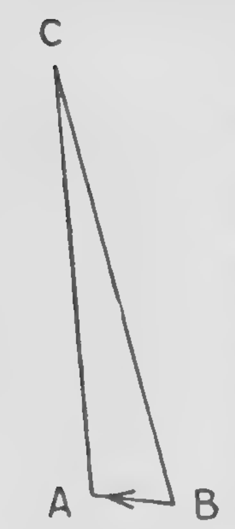

<!-- PDF 110 · trang in 94 -->

Dù Newton, như ta đã thấy, đã tránh đi tới bất kỳ học thuyết nào về bản chất tối hậu của ánh sáng, những người viết thế hệ kế tiếp lại hiểu sự phê phán của ông đối với thuyết sóng tương đương với việc chấp nhận giả thuyết phân tử. Tình cờ thế, phát hiện quang học quan trọng nhất của thời kỳ ấy lại nghiêng về phía củng cố học thuyết sau, và chính học thuyết ấy giải thích nó một cách trước tiên và dễ dàng nhất.

Năm 1728 James Bradley (1692–1762), khi ấy là Giáo sư Thiên văn Savilian tại Oxford, đã gửi cho Nhà Thiên văn Hoàng gia (Halley) một bài viết mang tên "Một tài liệu về chuyển động mới phát hiện của các sao cố định".[^p110n1] Khi quan sát ngôi sao \(\gamma\) ở đầu con rồng, với mục đích tìm ra thị sai của nó, ông đã phát hiện rằng trong suốt mùa đông năm 1725–6, lần đi qua đường chân trời liên tục dịch về phía nam hơn, còn trong mùa hè ngay sau đó, vị trí ban đầu của nó được khôi phục bởi một chuyển động hướng bắc. Không thể giải thích một hiệu ứng như thế là hệ quả của thị sai; và cuối cùng Bradley đoán rằng nó do sự lan truyền dần dần của ánh sáng.[^p110n2]

Vậy, hãy gọi \(CA\) là một tia sáng, rơi trên đường thẳng \(BA\); và giả sử con mắt của người quan sát đang chạy dọc theo \(BA\), với một vận tốc mà tỉ lệ với vận tốc của ánh sáng như \(BA\) tỉ lệ với \(CA\). Khi đó, phân tử sáng nhờ đó vật thể hiện ra với con mắt tại \(A\), sẽ đã ở \(C\) vào lúc con mắt còn ở \(B\). Do đó, ống của kính viễn thọ phải chĩa theo phương \(BC\), để nhận được các tia sáng từ một vật thể mà ánh sáng của nó thực sự lan truyền theo phương \(CA\). Góc \(BCA\) đo sai khác giữa vị trí thật và vị trí biểu kiến của vật thể; và theo hình thì rõ ràng sin của góc này tỉ lệ với sin của góc nghiêng biểu kiến của vật thể so với đường mà con mắt đang chạy, cũng như vận tốc của con mắt tỉ lệ với vận tốc của ánh sáng. Do đó, những quan sát như quan sát của Bradley sẽ cho ta suy ra

<!-- PDF 111 · trang in 95 -->

tỉ lệ giữa vận tốc quỹ đạo trung bình của Trái Đất và vận tốc của ánh sáng, hay, như người ta gọi, *hằng số lệch*; từ giá trị của nó Bradley tính ra rằng ánh sáng lan truyền từ Mặt Trời tới Trái Đất trong 8 phút 12 giây, điều mà, như ông nhận xét, "gần như là một Trung bình giữa những gì đã từng được xác định vào các thời điểm khác nhau từ các hiện tượng nhật thực của vệ tinh Mặt Trời."[^p111n1]

Trừ ra phát hiện của Bradley - vốn mang tính thiên văn nhiều hơn là quang học - thế kỷ mười tám hết sức cằn trối, xét cả về khía cạnh thực nghiệm lẫn khía cạnh lý luận trong nghiên cứu ánh sáng; điều này tương phản một cách kỳ lạ với sự rực rỡ của thành tích của thế kỷ ấy về các nghiên cứu điện. Nhưng cũng phải dành chút chú ý cho một nghiên cứu gợi mở[^p111n2] về ether, mà nghiên cứu ấy đã khiến John Bernoulli trẻ (1710–90) vào năm 1736 nhận được giải thưởng của Viện Hàn lâm Pháp. Những ý tưởng của ông dường như ban đầu được gợi ý bởi một cố gắng[^p111n3] mà người cha, John Bernoulli lớn tuổi (1667–1748), đã thực hiện vào năm 1701 nhằm nối định luật khúc xạ với nguyên lý cơ học của phép hợp thành lực. Nếu hai lực đối nhau có tỉ lệ \(\mu\) giữ cân bằng một hạt chỉ tự do chuyển động trong một mặt phẳng xác định, thì từ tam giác lực suy ra rằng các phương của lực phải tuân theo quan hệ

$$
\sin i = \mu \sin r,
$$

trong đó \(i\) và \(r\) là các góc mà các phương ấy tạo với các đường pháp tuyến của mặt phẳng. Đây chính là phương trình biểu diễn định luật khúc xạ, và Bernoulli lớn tuổi phỏng đoán rằng một thuyết về ánh sáng có thể dựa trên cơ sở ấy; nhưng ông không đưa ra lý do vật lý nào thỏa đáng cho sự tồn tại của các lực dọc theo tia tới và tia khúc xạ. Khuyết điểm ấy, người con ông bắt đầu xử lý.

Theo Bernoulli trẻ, toàn bộ không gian thấm nhuốm một ether lỏng, chứa một số lượng khổng lồ những xoáy nhỏ xíu. Sự đàn hồi mà ether dường như có, và nhờ đó nó có thể truyền dao động, thực ra là do sự hiện diện của những xoáy ấy; bởi, do lực ly tâm,

<!-- PDF 112 · trang in 96 -->

mỗi xoáy liên tục cố nới ra, và do đó ép vào những xoáy lân cận. Sẽ thấy rằng Bernoulli là một người Cartesian triệt để về tinh thần; ông không chỉ phủ nhận tác dụng từ xa, mà còn khẳng định rằng ngay cả sự đàn hồi của ether của ông cũng phải giải thích được bằng vật chất và chuyển động.

Tập hợp những xoáy nhỏ ấy, hay như một thế kỷ rưỡi sau được gọi là *chuyển động rối hạt mịn*,[^p112n1] rải rác với những phân tử rắn, mà kích thước của chúng nhỏ so với khoảng cách giữa chúng. Chúng bị các xoáy đẩy đi đây đó mỗi khi ether bị xáo trộn, nhưng không bao giờ đi xa khỏi những vị trí ban đầu của mình.

Một nguồn sáng truyền cho môi trường xung quanh nó một nhiễu loạn, nhiễu loạn ấy làm co lại những xoáy gần nhất; chúng, do co lại, đẩy lệch những phân tử liền kề khỏi vị trí cân bằng của chúng; và những phân tử ấy lại tạo ra các vùng co lại trong những xoáy kế bên ngoài chúng, sao cho dao động được lan truyền về mọi hướng từ điểm sáng. Điều đáng lạ là Bernoulli gọi những dao động ấy là *dọc*, và thật sự đối lập chúng với dao động của một sợi dây căng, sợi dây mà, "khi nó bị lệch khỏi dạng thẳng một chút, rồi buông ra, thực hiện những dao động *ngang* theo một phương vuông góc với phương của sợi dây." Khi nhớ rằng phản đối đối với dao động dọc, trên cơ sở tính phân cực, đã được Newton nêu rõ, và rằng ether của Bernoulli gần giống cái mà Maxwell đã sáng chế vào năm 1861–2 với đúng mục đích bảo đảm tính ngang của dao động, ta có cảm giác rằng có lẽ chưa ai từng bỏ lỡ một phát hiện lớn một cách hẹp hòi đến thế.

Bernoulli giải thích hiện tượng khúc xạ bằng cách kết hợp những ý tưởng ấy với những ý tưởng của người cha ông. Trong các lỗ rỗng của những vật thể có trọng lượng, các xoáy bị nén, nên lực ly tâm phải thay đổi cường độ từ môi trường này sang môi trường khác. Như vậy, một phân tử nằm ở mặt phân cách giữa hai môi trường chịu tác dụng của một lực đàn hồi lớn hơn từ môi trường này so với từ môi trường kia; và bằng cách áp dụng tam giác lực để tìm điều kiện cân bằng của nó, ta có thể thu được định luật của Snell và Descartes.

Không lâu sau đó, những tiếng vọng của cuộc tranh cãi cũ giữa Descartes và Fermat về định luật khúc xạ được Pierre-Louis-Moreau de Maupertuis (1698–1759) đánh thức.[^p112n2] Cần nhớ rằng theo Descartes, vận tốc ánh sáng là lớn nhất trong những môi trường chặt, còn theo Fermat thì

<!-- PDF 113 · trang in 97 -->

truyền là nhanh nhất trong ether tự do. Những lập luận của học thuyết phân tử thuyết phục Maupertuis rằng ở điểm cụ thể này Descartes là đúng; nhưng dù vậy ông vẫn muốn giữ lại cho khoa học phương pháp tuyệt đẹp mà Fermat đã dùng để thu được kết quả của mình. Nay ông đề nghị làm điều ấy bằng cách sửa đổi nguyên lý của Fermat cho nó thống nhất với học thuyết phân tử; thay vì giả định rằng ánh sáng đi theo con đường *nhanh nhất*, ông phỏng đoán rằng "con đường đã mô tả là con đường mà theo đó đại lượng hành động là nhỏ nhất"; và ông định nghĩa *hành động* ấy tỉ lệ với tổng của các quãng đường đã mô tả, mỗi quãng nhân với vận tốc mà nó được đi qua. Vậy, thay cho biểu thức của Fermat

$$
\int dt \qquad \text{hoặc} \qquad \int \frac{ds}{v}
$$

(trong đó \(t\) là thời gian, \(v\) là vận tốc và \(ds\) là một phần tử của đường đi) Maupertuis đưa vào

$$
\int v\, ds
$$

như đại lượng mà giá trị nhỏ nhất của nó phải xảy ra khi đường tích phân chính là đường đi thực sự của ánh sáng. Vì \(v\) của Maupertuis, ký hiệu vận tốc theo học thuyết phân tử, tỉ lệ với nghịch đảo của \(v\) của Fermat, ký hiệu vận tốc theo thuyết sóng, nên hai biểu thức ấy thực sự tương đương, và dẫn tới cùng một định luật khúc xạ. Tuy nhiên, bài bản của Maupertuis rất đáng chú ý từ góc nhìn của động lực học; bởi đề xuất của ông sau đó đã được chính ông cùng Euler và Lagrange phát triển thành một nguyên lý chung bao trùm toàn bộ phạm vi của Thiên nhiên, chừng nào Thiên nhiên là một hệ động lực.

Phần lớn các nhà tự nhiên luận của thế kỷ mười tám, giống Maupertuis, chấp nhận giả thuyết phân tử; nhưng thuyết sóng không thiếu những người bảo vệ. Franklin tuyên bố[^p113n1] ủng hộ nó; và nhà toán học nổi tiếng Leonhard Euler (1707–83) cũng đứng về phe ấy, bị thuyết phục bởi ý tưởng rằng sự phát xạ của các hạt sẽ làm giảm trong khối lượng. của vật thể phát sáng, điều mà không quan sát thấy, trong khi sự phát xạ của sóng thì không kéo theo hậu quả như vậy. Trong một tác phẩm mang tên *Nova Theoria Lucis et Colorum*, xuất bản[^p113n2] khi ông đang sống dưới sự bảo trợ của Frederic Đại đế tại Berlin, ông khẳng định mạnh mẽ rằng có sự tương đồng giữa ánh sáng và âm thanh; toàn bộ không gian mà các thiên thể chuyển động trong đó được lấp đầy một vật thể mỏng manh

<!-- PDF 114 · trang in 98 -->

vật thể mỏng manh, tức ether, và ánh sáng bao gồm những dao động của ether ấy; "ánh sáng trong ether là cùng một thứ với âm thanh trong không khí." Chấp nhận học thuyết của Newton rằng màu phụ thuộc vào bước sóng, trong bài bản này ông phỏng đoán tần số lớn nhất đối với ánh sáng đỏ, và nhỏ nhất đối với ánh sáng tím; nhưng vài năm sau[^p114n1] ông đã chấp nhận quan điểm ngược lại.

Điểm mới chủ yếu trong các tác phẩm của Euler về ánh sáng là cách ông giải thích cơ chế mà theo đó các vật thể vật chất trông có màu khi được nhìn bằng ánh sáng trắng; và đặc biệt là cách các màu của những tấm mỏng được tạo ra. Ông phủ nhận rằng những màu ấy là do sự phản xạ dồi dập hơn của ánh sáng có những chu kỳ xác định nào đó, và phỏng đoán rằng chúng biểu diễn những dao động được sinh ra bên trong chính vật thể dưới tác động của ánh sáng tới. Theo giả thuyết này, một bề mặt có màu chứa một lượng lớn phân tử đàn hồi, khi bị kích động, sẽ phát ra ánh sáng với chu kỳ chỉ phụ thuộc vào cấu trúc riêng của chúng. Euler giải thích các màu của những tấm mỏng theo cùng cách ấy; ông cho rằng đáp ứng đàn hồi và chu kỳ tự do của tấm ở bất kỳ chỗ nào sẽ phụ thuộc vào độ dày của nó tại chỗ ấy; và bằng cách ấy, sự phụ thuộc của màu sắc vào độ dày được giải thích, các hiện tượng nói chung tương tự với những tác dụng quen thuộc quan sát được trong các thí nghiệm về âm thanh.

Euler, người đã ở lại Berlin từ năm 1741 tới 1766, đã có trong số học trò của mình một cháu gái của Frederic, là Bà chúa xứ Anhalt-Dessau, và trong những năm 1760–1 ông đã viết cho bà một loạt thư để trình bày các quan điểm của mình về triết học tự nhiên. Ông đi trước Maxwell khi khẳng định rằng nguồn gốc của mọi hiện tượng điện chính là ether truyền sáng: điện không gì khác ngoài sự mất trật tự của trạng thái cân bằng của ether. "Một vật thể phải trở nên có điện," ông nói, "bất cứ khi nào ether chứa trong các lỗ rỗng của nó trở nên đàn hồi hơn hoặc kém hơn ether nằm trong các vật thể lân cận. Điều này xảy ra khi một lượng ether lớn hơn được đưa vào các lỗ rỗng của một vật thể, hoặc khi một phần ether mà nó chứa bị ép ra ngoài. Trong trường hợp trước, ether trở nên nén hơn, và do đó đàn hồi hơn; trong trường hợp sau, nó trở nên loãng hơn, và mất đi tính đàn hồi. Trong cả hai trường hợp, nó không còn ở trạng thái cân bằng với phần bên ngoài; và những nỗ lực mà nó thực hiện để phục hồi trạng thái cân bằng ấy, tạo ra mọi hiện tượng của điện."[^p114n2]

Không chỉ các hiện tượng điện, mà cả các hiện tượng hấp dẫn nữa, cũng được giải thích bằng thuật ngữ của ether.[^p114n3] Cách giải thích ấy phụ thuộc vào

<!-- PDF 115 · trang in 99 -->

giả sử rằng áp suất của ether tăng lên theo khoảng cách từ tâm Trái Đất, chẳng hạn theo \(\text{Constant} - 1/r\), sao cho lực ép một vật thể về phía Trái Đất mạnh hơn lực hướng ra xa khỏi nó, và sự cân bằng của các lực ấy chính là trọng lượng của vật thể. Theo giả thuyết này, lực tác dụng lên mỗi nguyên tử sẽ tỉ lệ với thể tích của nguyên tử, và do đó trọng lượng của một nguyên tử phải tỉ lệ với thể tích của nó, tức là, mật độ của mọi nguyên tử đều bằng nhau; việc mật độ của các vật thể khác nhau được giải thích bằng cách giả thiết rằng các nguyên tử không tiếp xúc với nhau.

Một cố gắng nhằm cải thiện học thuyết phân tử theo một hướng khác được Marquis de Courtivron thực hiện vào năm 1752,[^p115n1] và độc lập, vào năm sau, bởi T. Melvill.[^p115n2] Những tác giả này gợi ý, như một lời giải thích cho sự khác nhau về độ khúc xạ của các màu khác nhau, rằng "các tia mang màu khác nhau được phóng ra từ vật thể sáng với những vận tốc khác nhau: tia đỏ với vận tốc lớn nhất, tia tím với vận tốc nhỏ nhất, và các màu trung gian với những mức vận tốc trung gian." Theo giả thiết này, như các tác giả của nó chỉ ra, lượng lệch sẽ khác nhau với từng màu khác nhau; và các vệ tinh của Mặt Trời sẽ đổi màu, từ trắng qua lục tới tím, trong khoảng thời gian hơn nửa phút trước khi chúng đi vào bóng tối của hành tinh; còn khi ra khỏi bóng tối thì dãy màu ngược lại sẽ được quan sát thấy, bắt đầu bằng màu đỏ và kết thúc bằng màu trắng. Các nhà thiên văn thực nghiệm mau chóng làm chứng rằng không quan sát thấy những hiện tượng như vậy; và giả thuyết ấy bị từ bỏ theo đó.

Dù Euler khẳng định rằng một ether duy nhất nên phục vụ cho mọi mục đích, vào cuối thế kỷ mười tám vẫn có xu hướng ở một số nơi tăng thêm số lượng ether bằng cách giả thiết một loại mà chức năng là truyền nhiệt bức xạ, chẳng hạn từ một ngọn lửa qua không khí tới các vật thể xung quanh. Tuy nhiên, vào năm 1800, Sir William Herschel (1738–1822) đã chứng minh[^p115n3] rằng các tia của ánh sáng thường truyền một lượng nhiệt nào đó, rằng hiệu ứng ấy rõ hơn đối với ánh sáng ở đầu đỏ của quang phổ so với ánh sáng ở đầu tím, và rằng bên ngoài đầu đỏ còn có các tia truyền nhiệt nhưng không tác động tới giác quan thị giác của con người: các tia này có thể được phản xạ và khúc xạ giống như ánh sáng thường. Một hệ quả hiển nhiên (mà Herschel ban đầu chấp nhận, nhưng sau đó đã bác bỏ vì những lý do không cần bàn ở đây) là nhiệt bức xạ về bản chất cùng loại với ánh sáng, và do đó không

<!-- PDF 116 · trang in 100 -->

cần một riêng ether. Sự đồng nhất ấy lâu được coi là đáng ngờ, nhưng trong nửa thế kỷ kế tiếp nó đã được thực nghiệm chứng minh[^p116n1] rằng nhiệt bức xạ có mọi tính chất đặc trưng của ánh sáng (tính phân cực, khúc xạ kép, giao thoa), và quan điểm ban đầu được gợi ý bởi công trình của Herschel dần được chấp nhận một cách phổ quát. Vào năm sau, J. W. Ritter đã chứng minh[^p116n2] rằng cũng tồn tại các tia vô hình bên ngoài đầu tím của quang phổ, có khả năng gây ra những tác dụng hóa học như làm đen clorua bạc: và Young đã chứng minh[^p116n3] (bằng cách chiếu các vòng Newton lên giấy phủ clorua bạc) rằng những tia vô hình ấy có tính chất giao thoa (xem bên dưới).

Vận đàn của thuyết sóng bắt đầu sáng lên vào cuối thế kỷ, khi một người tướng mới xuất hiện. Thomas Young, sinh ra ở Milverton thuộc Somersetshire năm 1773, và được huấn luyện trong nghề y, bắt đầu viết về thuyết quang học vào năm 1799. Trong bài bản đầu tiên của mình[^p116n4] ông nhận xét rằng, theo học thuyết phân tử, vận tốc phát xạ của một phân tử phải là như nhau trong mọi trường hợp, dù lực phóng ra là lực của tia lửa yếu ớt do ma sát giữa hai viên sỏi tạo ra, hay là hơi nóng dữ dội của chính Mặt Trời - một điều gần như không thể tin. Khó khăn ấy không tồn tại trong thuyết sóng, bởi mọi nhiễu loạn đều được biết là được truyền qua một chất lỏng đàn hồi với cùng một vận tốc. Sự e dè mà một số triết gia cảm thấy về việc lấp đầy toàn bộ không gian bằng một chất lỏng đàn hồi, ông gặp phải một lập luận kỳ lạ báo hiệu trước thuyết điện về ánh sáng: "Rằng một môi trường, giống cái đã được gọi là ether ở nhiều tính chất, thực sự tồn tại, đã được chứng minh không thể chống cãi bởi các hiện tượng của điện. Sự truyền tải nhanh chóng của cú sốc điện cho thấy môi trường điện có sự đàn hồi lớn đúng như điều cần giả thiết để cho sự lan truyền của ánh sáng. Liệu ether điện có được coi là giống với ether quang hay không, nếu có một chất lỏng như thế, có lẽ vào một ngày nào đó trong tương lai thí nghiệm sẽ phát hiện ra: cho tới nay tôi chưa thể quan sát thấy rằng khả năng khúc xạ của một chất lỏng có thay đổi gì dưới tác dụng của điện."

Young sau đó tiếp tục chứng minh sức mạnh vượt trội của thuyết

<!-- PDF 117 · trang in 101 -->

lý thuyết để giải thích hiện tượng phản xạ và khúc xạ. Trong học thuyết phân tử, khó thấy vì sao một phần ánh sáng lại phải phản xạ còn một phần khác của cùng chùm ấy lại khúc xạ; nhưng trong thuyết sóng thì không có khó khăn gì, như đã thấy qua việc so sánh với sự phản xạ một phần của âm thanh từ một đám mây hay một lớp không khí chặt hơn: "Chẳng cần gì hơn là giả thiết rằng mọi môi trường khúc xạ đều giữ lại, nhờ sức hút của chúng, một lượng ether quang lớn hơn hoặc nhỏ hơn, sao cho mật độ của nó lớn hơn mật độ mà nó có trong chân không, mà không làm tăng tính đàn hồi của nó." Chính đây là giả thuyết mà sau đó Fresnel và Green đã chấp nhận.

Năm 1801, Young đã thực hiện một phát hiện tầm cỡ lớn nhất[^p117n1] khi cố giải thích các vòng Newton theo các nguyên lý của thuyết sóng. Bác bỏ giả thuyết dao động cảm ứng của Euler, ông giả thiết rằng các màu quan sát được đều đã tồn tại trong ánh sáng tới, và chứng minh rằng chúng có thể được suy ra từ ánh sáng ấy bằng một quá trình mà giờ đây lần đầu tiên được khoa học quang học nhận ra.

Ý tưởng về quá trình ấy không hẳn là mới, bởi nó đã được Newton dùng trong thuyết thủy triều của ông. "Điều có thể xảy ra là," ông viết,[^p117n2] "thủy triều có thể lan truyền từ đại dương qua những kênh khác nhau về cùng một cảng, và có thể đi qua một số kênh nhanh hơn những kênh khác, trong trường hợp ấy cùng một thủy triều sinh ra, do bị chia thành hai hay nhiều thủy triều nối tiếp nhau, có thể tạo ra bằng cách hợp thành những kiểu thủy triều mới." Newton đã áp dụng nguyên lý này để giải thích những con thủy triều bất thường ở Batsha thuộc Đông Dương, những con sóng ấy trước đây đã được Halley mô tả.[^p117n3]

Hình ảnh mà chính Young dùng để minh họa nguyên lý ấy rõ ràng được gợi ý bởi Newton. "Giả sử," ông nói,[^p117n4] "một số đợt sóng nước bằng nhau di chuyển trên mặt một hồ đứng yên, với một vận tốc hằng số nào đó, và đi vào một kênh hẹp dẫn ra khỏi hồ; giả sử rồi một nguyên nhân tương tự khác đã kích thích ra một dãy đợt sóng bằng nhau khác, vốn đến cùng kênh ấy, với cùng vận tốc, và cùng lúc với dãy thứ nhất. Không dãy sóng nào sẽ hủy dãy kia, nhưng các tác dụng của chúng sẽ kết hợp lại; nếu chúng đi vào kênh sao cho những đỉnh sóng của dãy này trùng khớp với những đỉnh sóng của dãy kia, thì chúng phải cùng tạo ra một dãy những đỉnh sóng cao hơn; nhưng nếu những đỉnh sóng của một dãi được đặt sao cho tương ứng với những lõm của dãi kia, thì chúng phải lấp đầy chính xác những lõm ấy, và mặt nước phải vẫn phẳng. Bây giờ tôi khẳng định rằng những hiện tượng tương tự

<!-- PDF 118 · trang in 102 -->

hiện tượng tương tự xảy ra mỗi khi hai phần ánh sáng được trộn lẫn như thế; và tôi gọi đây là định luật chung của sự giao thoa ánh sáng.'"

Như vậy, "bất cứ khi nào hai phần của cùng một ánh sáng đến với con mắt theo những đường đi khác nhau, dù chính xác hay gần như chính xác cùng một phương, thì ánh sáng trở nên mạnh nhất khi hiệu của các đường đi là một bội số của một độ dài nào đó, và yếu nhất ở trạng thái trung gian của các phần đang giao thoa; và độ dài ấy khác nhau với ánh sáng màu khác nhau."

Vậy, lời giải thích của Young về các màu của những tấm mỏng quan sát được qua phản xạ là: ánh sáng tới sinh ra hai chùm tia đi tới con mắt: một trong hai chùm ấy đã phản xạ tại mặt thứ nhất của tấm, còn chùm kia phản xạ tại mặt thứ hai; và hai chùm ấy tạo ra các màu nhờ sự giao thoa của chúng.

Một khó khăn gặp phải khi muốn dung hòa thuyết này với quan sát thực nghiệm bắt nguồn từ việc vết giữa trong các vòng Newton (nơi bề dày của màng không khí mỏng bằng không) là đen chứ không phải trắng, như nó sẽ là nếu hai chùm giao thoa giống hệt nhau về mọi mặt. Để giải thích điều đó, Young đã chứng minh, bằng cách so sánh với sự va chạm của các vật thể đàn hồi, rằng khi ánh sáng phản xạ tại bề mặt của một môi trường chặt hơn, pha của nó bị trễ đi nửa chu kỳ: sao cho hai chùm giao thoa ở tâm các vòng Newton hủy lẫn nhau. Ông đã kiểm chứng tính đúng đắn của giả thiết này bằng cách thay thế không khí trong khoảng giữa hai thấu kính bằng tinh chất sassafras (có chiết suất nằm giữa chiết suất của kính crown và kính flint); như ông đã dự đoán, tâm của hệ vòng giờ đã thành màu trắng.

Newton từ lâu đã quan sát thấy rằng các vòng ấy nhỏ hơn khi môi trường tạo ra chúng có mật độ quang học lớn hơn. Được lý giải bằng thuyết của Young, điều đó chắc chắn chứng minh rằng bước sóng của ánh sáng ngắn hơn trong những môi trường chặt, và do đó vận tốc của nó nhỏ hơn.

Việc các bài bản của Young được công bố đã châm ngòi cho một cuộn tấn công dữ dội nhắm vào ông trên *Edinburgh Review*, nước bút của Henry Brougham, sau này là Tể tướng của Anh. Young đã trả lời bằng một tập sách mỏng, và người ta nói[^p118n1] rằng chỉ có duy nhất một bản được bán ra; và không thể nghi ngờ rằng vào lúc ấy Brougham đã đạt được mục đích làm mất uy tín của thuyết sóng.[^p118n2] Việc nó không gây được nhiều ấn tượng trong những năm ngay sau khi xuất bản được chứng tỏ một cách nổi bật vào giai đoạn 1807–10, khi Sir William Herschel

<!-- PDF 119 · trang in 103 -->

công bố ba bài bản[^p119n1] về các vòng Newton. Herschel hoàn toàn bỏ qua thuyết của Young, và, thay cho các *fit* dễ phản xạ và dễ truyền của Newton, ông đề xuất một lời giải thích dựa trên "nguyên lý của sự phân tách tới hạn của các màu, xảy ra ở những góc tới xác định, trong đó một số tia được phản xạ ở chính góc tới mà ở đó những tia khác lại được truyền."

Bây giờ Young chuyển sự chú ý sang các vân tối của bóng. Trong lời giải thích theo thuyết phân tử cho những vân ấy, người ta giả thiết rằng các lực hút có tác dụng trong hiện tượng khúc xạ còn lan tỏa ảnh hưởng của chúng tới một khoảng cách nào đó kể từ bề mặt các vật thể, và làm uốn cong những tia đi sát bên cạnh. Nếu đúng như vậy, lượng uốn cong ấy rõ ràng phải phụ thuộc vào cường độ của các lực hút, và do đó phụ thuộc vào các chiết suất của vật thể - một mệnh đề đã bị các thí nghiệm của 'sGravesande bác bỏ. Như vậy, nguyên nhân của các hiện tượng nhiễu xạ hoàn toàn chưa được biết, cho tới khi Young, trong bài giảng Bakerian năm 1803,[^p119n2] chứng minh rằng nguyên lý giao thoa có liên quan tới sự hình thành của chúng; bởi khi một sợi tóc được đặt trong hình nón các tia phân kỳ từ một điểm sáng, các vân bên trong (tức là những vân nằm trong bóng hình học) sẽ biến mất khi ánh sáng đi qua một phía của sợi tóc bị chặn lại. Dự đoán của ông về nguồn gốc của những tia gây giao thoa thì kém may mắn hơn; ông quy các vân bên ngoài bóng hình học cho sự giao thoa giữa các tia trực tiếp và các tia phản xạ tại mép nhiễu xạ; và cho rằng các vân bên trong của bóng một vật thể hẹp là do giao thoa của những tia bị uốn bởi hai mép của vật thể ấy.

Thành công của nhiều phát triển của thuyết sóng ấy khiến Young đi sâu hơn vào việc xem xét khả năng giải quyết vấn đề chính còn bỏ ngỏ của quang học - vấn đề về hành vi của ánh sáng trong tinh thể. Cái dựng khéo léo dành cho tia bất thường do Huygens đưa ra đã bị bỏ quên suốt một thế kỷ; và mức độ chính xác mà nó biểu diễn các quan sát thì chưa ai biết. Theo đề nghị của Young, Wollaston[^p119n3] đã khảo sát vấn đề bằng thực nghiệm, và chứng minh rằng sự trùng khớp giữa các phép đo của ông và quy tắc của Huygens gần như đáng kinh ngạc. "Tôi cho rằng," ông viết, "kết quả này phải được thừa nhận là rất thuận lợi cho thuyết Huygens; và, mặc dù sự tồn tại của hai tia khúc xạ cùng một lúc, trong cùng một vật liệu, chưa được giải thích cho ra, và sự trao đổi của chúng với nhau càng ít hơn, khi một tia ánh sáng

<!-- Chưa dịch: trang in 104–127 (PDF 120–143). -->

[^p119n1]: *Phil. Trans.* xcvii (1807), p. 180; xcix (1809), p. 259; c (1810), p. 149

[^p119n2]: *Phil. Trans.* xciv (1804), p. 1; Young's *Works*, i, p. 179

[^p119n3]: *Phil. Trans.* xcii (1802), p. 381

[^p118n1]: Peacock's *Life of Young*

[^p118n2]: 'Strange fellow,' wrote Macaulay, when half a century afterwards he found himself sitting beside Brougham in the House of Lords, 'his powers gone: his spite immortal.'

[^p117n1]: *Phil. Trans.* xcii (1802), pp. 12, 387

[^p117n2]: *Principia*, bk. iii, prop. 24

[^p117n3]: *Phil. Trans.* xiv (1684), p. 681

[^p117n4]: Young's *Works*, i, p. 202

[^p116n1]: J. E. Bérard, *Ann. chim.* lxxxv (1813), p. 309; A. M. Ampère, *Bibl. univ.* xlviii (1832), p. 225; *Ann. d. phys.* xxvi (1832), p. 161; *Ann. chim.* lviii (1835), p. 432

[^p116n2]: J. D. Forbes, *Phil. Mag.* v, p. 209; vii (1835), p. 349; M. Melloni, *Ann. chim.* lxv (1837), p. 5, and many other papers in the same journal

[^p116n3]: H. L. Fizeau and L. Foucault, *Comptes Rendus* xxv (1847), p. 447; F. de la Provostaye and P. Desains, *Ann. chim.* xxxii (1849), p. 109

[^p116n4]: *Ann. d. Phys.* vii (1801), p. 527; *Phil. Trans.* xciv (1804), p. 1; *Phil. Trans.* xc (1800), p. 106

[^p115n1]: Courtivron's *Traité d'optique* (1752)

[^p115n2]: *Phil. Trans.* xlviii (1753), p. 262

[^p115n3]: *Phil. Trans.* xc (1800), pp. 255, 284, 293, 437

[^p114n1]: *Mém. de l'Acad. de Berlin* (1752), p. 262

[^p114n2]: Letter of 4 July 1761

[^p114n3]: *Leonhardi Euleri Opera Omnia*, series tertia i, pp. 4, 149

[^p110n1]: *Phil. Trans.* xxxv (1728), p. 637

[^p110n2]: Roemer, in a letter to Huygens of date 30 Dec. 1677, mentions a suspected displacement of the apparent position of a star, due to the motion of the earth at right angles to the line of sight. cf. *Correspondance de Huygens*, viii, p. 53.

[^p111n1]: Struve in 1845 found for the constant of aberration the value 20″·445, which he afterwards corrected to 20″·463. This was superseded in 1883 by the value 20″·492, determined by M. Nyrén. The observations of both Struve and Nyrén were made with the transit in the prime vertical. The method now generally used depends on the measurement of differences of meridian zenith distances. In the present century values have been found which range from 20″·523 down to 20″·445. The value.calculated from the solar parallax and the velocity of light is 20″·511, if for the parallax we take the value 8″·790 found by H. Spencer Jones in 1941, and for the velocity of light take the value 2.99776 × 1010 cm/sec.

[^p111n2]: Printed in 1752, in the *Recueil des pièces qui ont remportés les prix de l'Acad.*, tome iii

[^p111n3]: *Acta eruditorum* (1701), p. 19

[^p112n1]: cf. Lord Kelvin's vortex-sponge aether, described later in this work

[^p112n2]: *Mém. de l'Acad.* (1744), p. 417

[^p113n1]: Letter xxiii, written in 1752

[^p113n2]: L. Euleri, *Opuscula varii argumenti* (Berlin, 1746), p. 169
